# Техническая лента скриншотов Kenshi

- **Сформировано**: `2026-11-03T06:53:17Z`
- **Окно выборки**: последние 7 суток (с `2026-10-27T06:53:17Z` по `2026-11-03T06:53:17Z`)
- **Всего скриншотов в окне**: 343
- **Сгруппировано серий/кадров**: 316

Техническая лента сгруппированных по сходству кадров с извлеченным текстом интерфейса (OCR). Интерпретация происходящего в игре полностью принадлежит LLM-компаньону по оригинальным изображениям.

---

### Серия 1 (1 кадр)

- **Файловое время**: с `2026-10-27T07:52:48Z` по `2026-10-27T07:52:48Z`
- **Игровое время (OCR)**: `Не зафиксировано в UI`
- **Локация (OCR)**: Не зафиксирована в UI
- **Персонажи в UI (OCR)**: Не зафиксированы в UI

**Кадры серии:**
- [screenshot_83.jpg](screenshot_83.jpg) ([GitHub](https://github.com/asaf1n/kenshi-campaign-tech/blob/main/published/screenshots/screenshot_83.jpg) | [Raw](https://raw.githubusercontent.com/asaf1n/kenshi-campaign-tech/main/published/screenshots/screenshot_83.jpg))

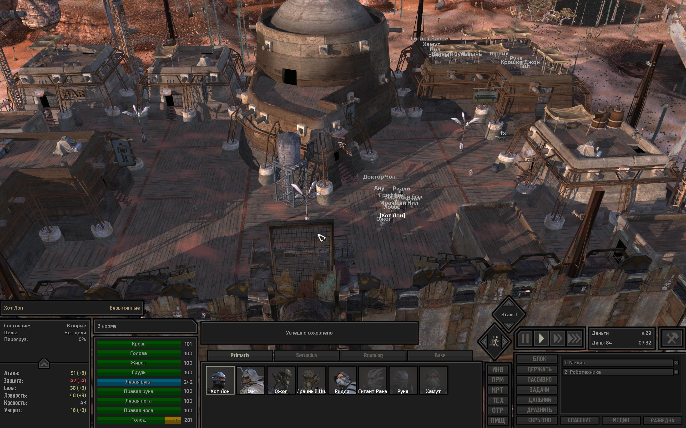

---

### Серия 2 (1 кадр)

- **Файловое время**: с `2026-10-27T14:39:28Z` по `2026-10-27T14:39:28Z`
- **Игровое время (OCR)**: `Не зафиксировано в UI`
- **Локация (OCR)**: Не зафиксирована в UI
- **Персонажи в UI (OCR)**: Не зафиксированы в UI

**Кадры серии:**
- [screenshot_84.jpg](screenshot_84.jpg) ([GitHub](https://github.com/asaf1n/kenshi-campaign-tech/blob/main/published/screenshots/screenshot_84.jpg) | [Raw](https://raw.githubusercontent.com/asaf1n/kenshi-campaign-tech/main/published/screenshots/screenshot_84.jpg))

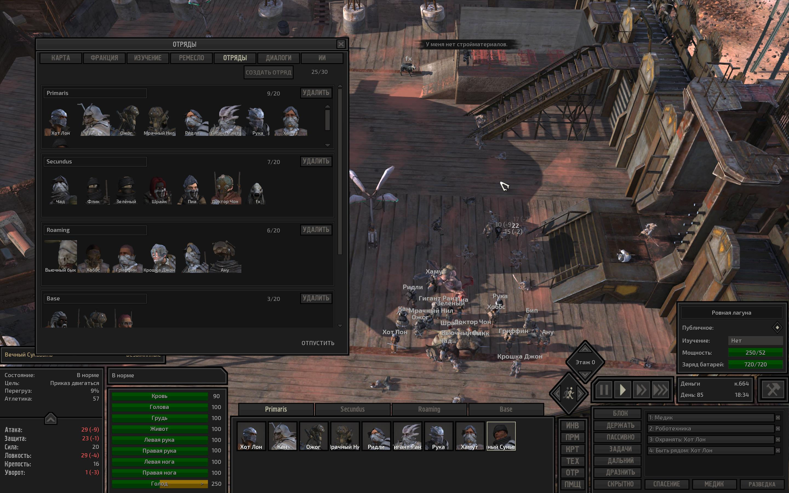

---

### Серия 3 (1 кадр)

- **Файловое время**: с `2026-10-27T14:49:48Z` по `2026-10-27T14:49:48Z`
- **Игровое время (OCR)**: `Не зафиксировано в UI`
- **Локация (OCR)**: Не зафиксирована в UI
- **Персонажи в UI (OCR)**: Не зафиксированы в UI

**Кадры серии:**
- [screenshot_85.jpg](screenshot_85.jpg) ([GitHub](https://github.com/asaf1n/kenshi-campaign-tech/blob/main/published/screenshots/screenshot_85.jpg) | [Raw](https://raw.githubusercontent.com/asaf1n/kenshi-campaign-tech/main/published/screenshots/screenshot_85.jpg))

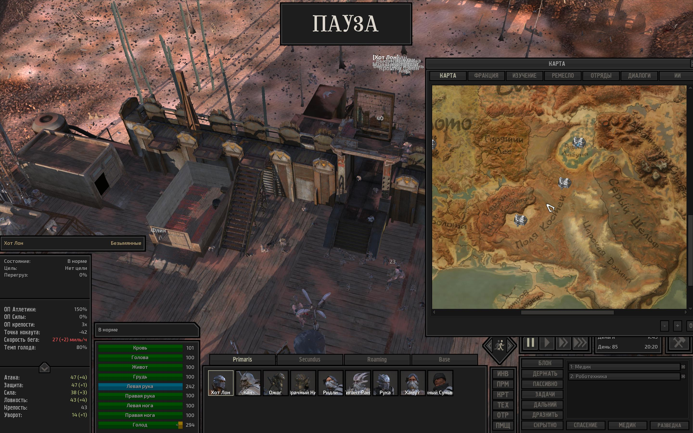

---

### Серия 4 (2 кадра)

- **Файловое время**: с `2026-10-27T15:43:05Z` по `2026-10-27T15:43:34Z`
- **Игровое время (OCR)**: `Не зафиксировано в UI`
- **Локация (OCR)**: Не зафиксирована в UI
- **Персонажи в UI (OCR)**: Не зафиксированы в UI

**Кадры серии:**
- [screenshot_86.jpg](screenshot_86.jpg) ([GitHub](https://github.com/asaf1n/kenshi-campaign-tech/blob/main/published/screenshots/screenshot_86.jpg) | [Raw](https://raw.githubusercontent.com/asaf1n/kenshi-campaign-tech/main/published/screenshots/screenshot_86.jpg))
- [screenshot_87.jpg](screenshot_87.jpg) ([GitHub](https://github.com/asaf1n/kenshi-campaign-tech/blob/main/published/screenshots/screenshot_87.jpg) | [Raw](https://raw.githubusercontent.com/asaf1n/kenshi-campaign-tech/main/published/screenshots/screenshot_87.jpg))

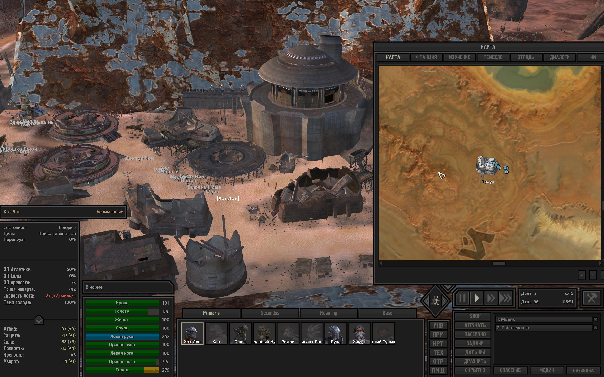

---

### Серия 5 (1 кадр)

- **Файловое время**: с `2026-10-27T15:45:17Z` по `2026-10-27T15:45:17Z`
- **Игровое время (OCR)**: `Не зафиксировано в UI`
- **Локация (OCR)**: Не зафиксирована в UI
- **Персонажи в UI (OCR)**: Не зафиксированы в UI

**Кадры серии:**
- [screenshot_88.jpg](screenshot_88.jpg) ([GitHub](https://github.com/asaf1n/kenshi-campaign-tech/blob/main/published/screenshots/screenshot_88.jpg) | [Raw](https://raw.githubusercontent.com/asaf1n/kenshi-campaign-tech/main/published/screenshots/screenshot_88.jpg))

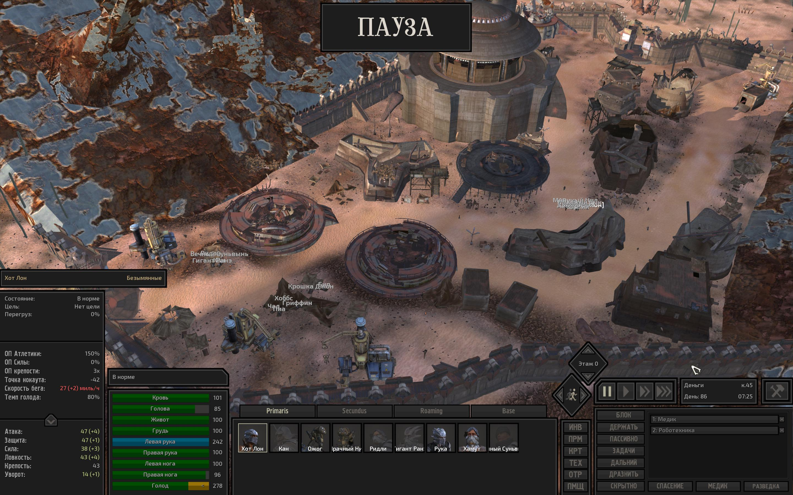

---

### Серия 6 (1 кадр)

- **Файловое время**: с `2026-10-27T15:49:33Z` по `2026-10-27T15:49:33Z`
- **Игровое время (OCR)**: `Не зафиксировано в UI`
- **Локация (OCR)**: Не зафиксирована в UI
- **Персонажи в UI (OCR)**: Не зафиксированы в UI

**Кадры серии:**
- [screenshot_89.jpg](screenshot_89.jpg) ([GitHub](https://github.com/asaf1n/kenshi-campaign-tech/blob/main/published/screenshots/screenshot_89.jpg) | [Raw](https://raw.githubusercontent.com/asaf1n/kenshi-campaign-tech/main/published/screenshots/screenshot_89.jpg))

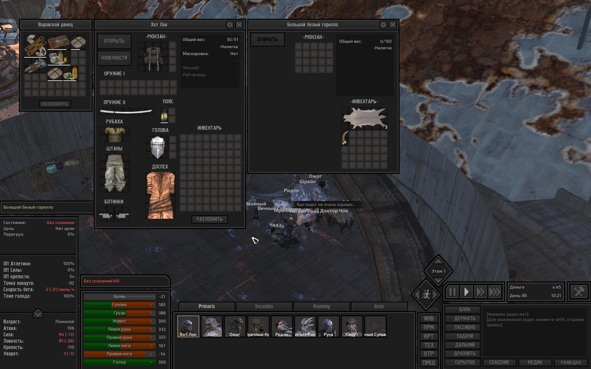

---

### Серия 7 (1 кадр)

- **Файловое время**: с `2026-10-27T17:11:28Z` по `2026-10-27T17:11:28Z`
- **Игровое время (OCR)**: `Не зафиксировано в UI`
- **Локация (OCR)**: Не зафиксирована в UI
- **Персонажи в UI (OCR)**: Не зафиксированы в UI

**Кадры серии:**
- [screenshot_90.jpg](screenshot_90.jpg) ([GitHub](https://github.com/asaf1n/kenshi-campaign-tech/blob/main/published/screenshots/screenshot_90.jpg) | [Raw](https://raw.githubusercontent.com/asaf1n/kenshi-campaign-tech/main/published/screenshots/screenshot_90.jpg))

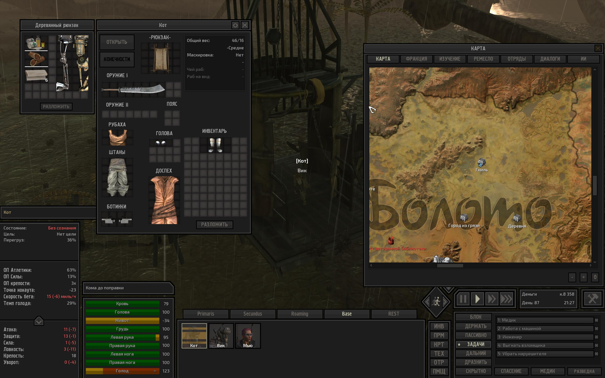

---

### Серия 8 (1 кадр)

- **Файловое время**: с `2026-10-27T17:14:30Z` по `2026-10-27T17:14:30Z`
- **Игровое время (OCR)**: `Не зафиксировано в UI`
- **Локация (OCR)**: Не зафиксирована в UI
- **Персонажи в UI (OCR)**: Не зафиксированы в UI

**Кадры серии:**
- [screenshot_91.jpg](screenshot_91.jpg) ([GitHub](https://github.com/asaf1n/kenshi-campaign-tech/blob/main/published/screenshots/screenshot_91.jpg) | [Raw](https://raw.githubusercontent.com/asaf1n/kenshi-campaign-tech/main/published/screenshots/screenshot_91.jpg))

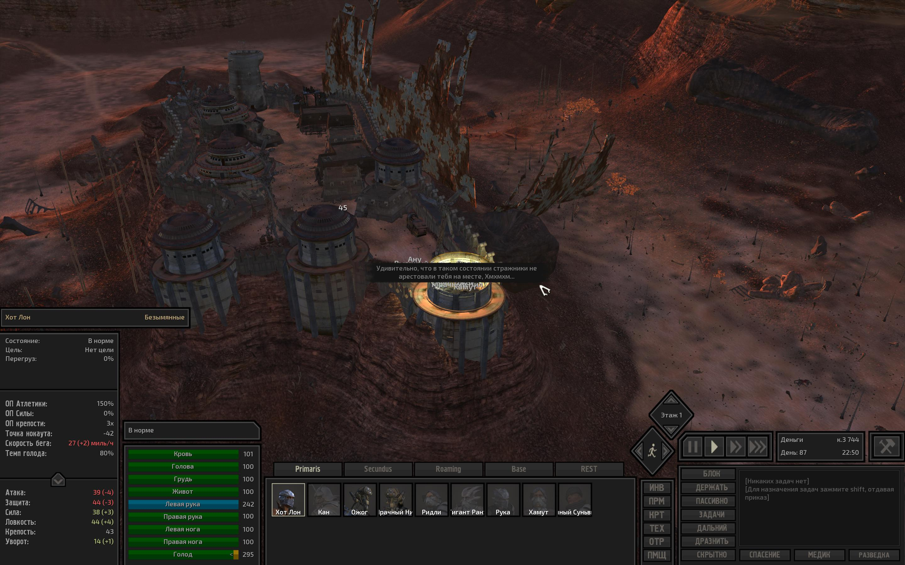

---

### Серия 9 (1 кадр)

- **Файловое время**: с `2026-10-27T17:19:34Z` по `2026-10-27T17:19:34Z`
- **Игровое время (OCR)**: `Не зафиксировано в UI`
- **Локация (OCR)**: Не зафиксирована в UI
- **Персонажи в UI (OCR)**: Не зафиксированы в UI

**Кадры серии:**
- [screenshot_92.jpg](screenshot_92.jpg) ([GitHub](https://github.com/asaf1n/kenshi-campaign-tech/blob/main/published/screenshots/screenshot_92.jpg) | [Raw](https://raw.githubusercontent.com/asaf1n/kenshi-campaign-tech/main/published/screenshots/screenshot_92.jpg))

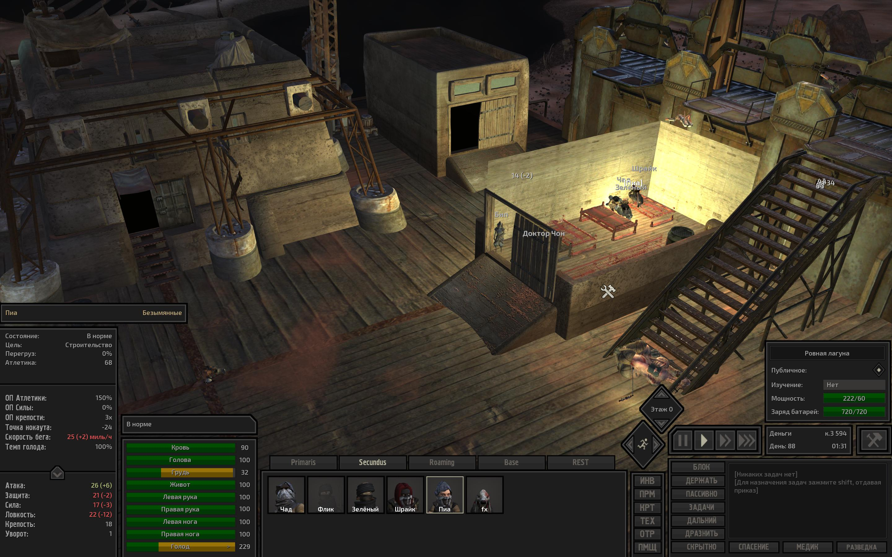

---

### Серия 10 (2 кадра)

- **Файловое время**: с `2026-10-27T17:20:06Z` по `2026-10-27T17:20:16Z`
- **Игровое время (OCR)**: `Не зафиксировано в UI`
- **Локация (OCR)**: Не зафиксирована в UI
- **Персонажи в UI (OCR)**: Не зафиксированы в UI

**Кадры серии:**
- [screenshot_93.jpg](screenshot_93.jpg) ([GitHub](https://github.com/asaf1n/kenshi-campaign-tech/blob/main/published/screenshots/screenshot_93.jpg) | [Raw](https://raw.githubusercontent.com/asaf1n/kenshi-campaign-tech/main/published/screenshots/screenshot_93.jpg))
- [screenshot_94.jpg](screenshot_94.jpg) ([GitHub](https://github.com/asaf1n/kenshi-campaign-tech/blob/main/published/screenshots/screenshot_94.jpg) | [Raw](https://raw.githubusercontent.com/asaf1n/kenshi-campaign-tech/main/published/screenshots/screenshot_94.jpg))

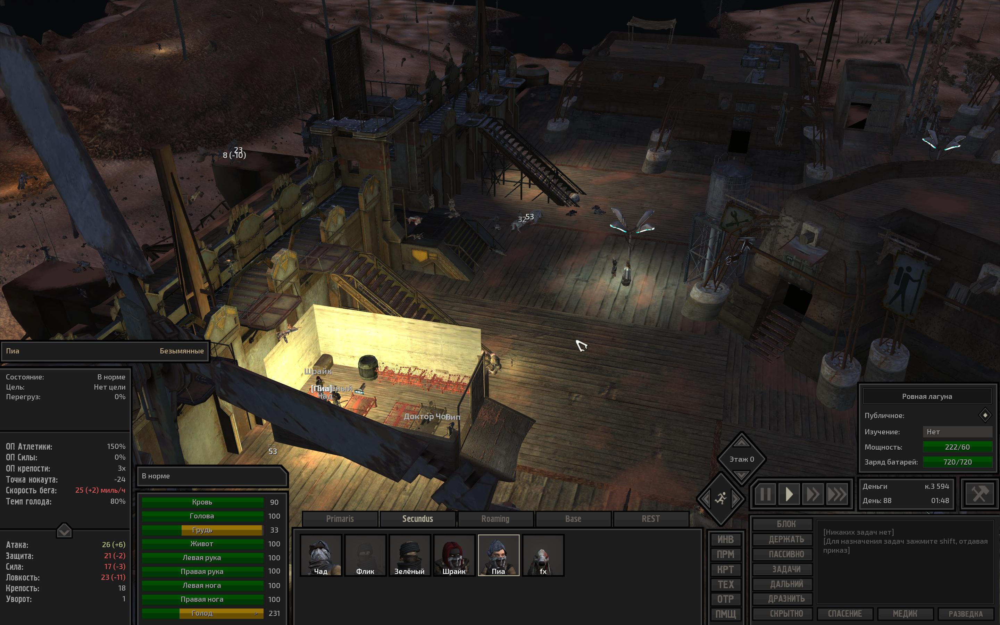

---

### Серия 11 (1 кадр)

- **Файловое время**: с `2026-10-27T23:24:36Z` по `2026-10-27T23:24:36Z`
- **Игровое время (OCR)**: `Не зафиксировано в UI`
- **Локация (OCR)**: Не зафиксирована в UI
- **Персонажи в UI (OCR)**: Не зафиксированы в UI

**Кадры серии:**
- [screenshot_95.jpg](screenshot_95.jpg) ([GitHub](https://github.com/asaf1n/kenshi-campaign-tech/blob/main/published/screenshots/screenshot_95.jpg) | [Raw](https://raw.githubusercontent.com/asaf1n/kenshi-campaign-tech/main/published/screenshots/screenshot_95.jpg))

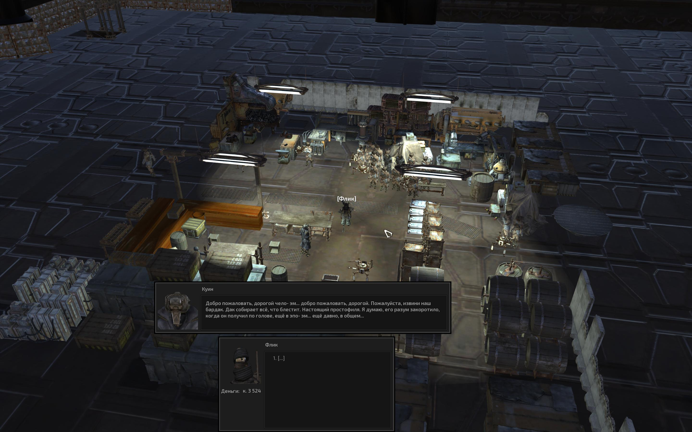

---

### Серия 12 (1 кадр)

- **Файловое время**: с `2026-10-27T23:28:21Z` по `2026-10-27T23:28:21Z`
- **Игровое время (OCR)**: `Не зафиксировано в UI`
- **Локация (OCR)**: Не зафиксирована в UI
- **Персонажи в UI (OCR)**: Не зафиксированы в UI

**Кадры серии:**
- [screenshot_96.jpg](screenshot_96.jpg) ([GitHub](https://github.com/asaf1n/kenshi-campaign-tech/blob/main/published/screenshots/screenshot_96.jpg) | [Raw](https://raw.githubusercontent.com/asaf1n/kenshi-campaign-tech/main/published/screenshots/screenshot_96.jpg))

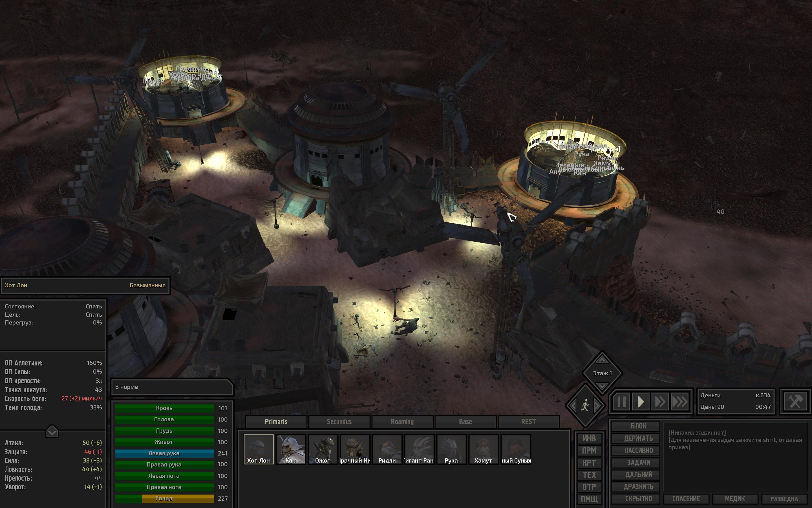

---

### Серия 13 (1 кадр)

- **Файловое время**: с `2026-10-28T01:46:53Z` по `2026-10-28T01:46:53Z`
- **Игровое время (OCR)**: `Не зафиксировано в UI`
- **Локация (OCR)**: Не зафиксирована в UI
- **Персонажи в UI (OCR)**: Не зафиксированы в UI

**Кадры серии:**
- [screenshot_97.jpg](screenshot_97.jpg) ([GitHub](https://github.com/asaf1n/kenshi-campaign-tech/blob/main/published/screenshots/screenshot_97.jpg) | [Raw](https://raw.githubusercontent.com/asaf1n/kenshi-campaign-tech/main/published/screenshots/screenshot_97.jpg))

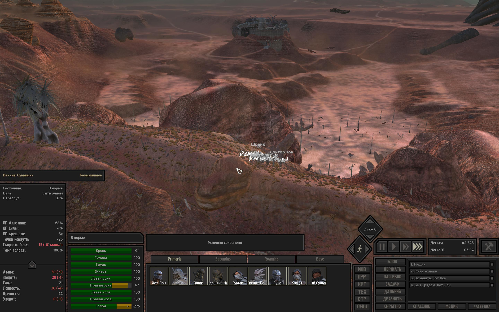

---

### Серия 14 (1 кадр)

- **Файловое время**: с `2026-10-28T01:47:00Z` по `2026-10-28T01:47:00Z`
- **Игровое время (OCR)**: `Не зафиксировано в UI`
- **Локация (OCR)**: Не зафиксирована в UI
- **Персонажи в UI (OCR)**: Не зафиксированы в UI

**Кадры серии:**
- [screenshot_98.jpg](screenshot_98.jpg) ([GitHub](https://github.com/asaf1n/kenshi-campaign-tech/blob/main/published/screenshots/screenshot_98.jpg) | [Raw](https://raw.githubusercontent.com/asaf1n/kenshi-campaign-tech/main/published/screenshots/screenshot_98.jpg))

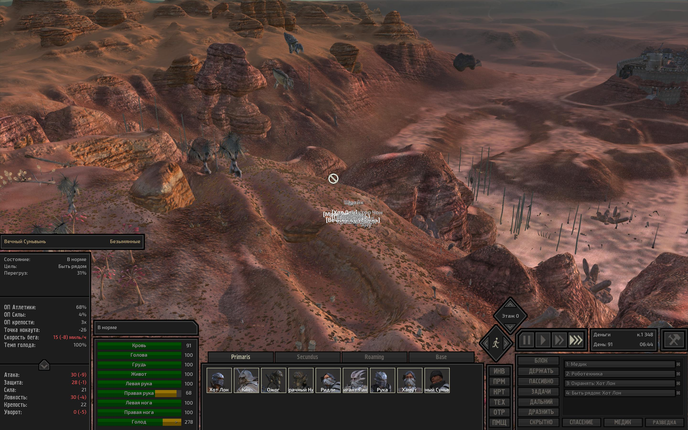

---

### Серия 15 (1 кадр)

- **Файловое время**: с `2026-10-28T05:00:11Z` по `2026-10-28T05:00:11Z`
- **Игровое время (OCR)**: `Не зафиксировано в UI`
- **Локация (OCR)**: Не зафиксирована в UI
- **Персонажи в UI (OCR)**: Не зафиксированы в UI

**Кадры серии:**
- [screenshot_99.jpg](screenshot_99.jpg) ([GitHub](https://github.com/asaf1n/kenshi-campaign-tech/blob/main/published/screenshots/screenshot_99.jpg) | [Raw](https://raw.githubusercontent.com/asaf1n/kenshi-campaign-tech/main/published/screenshots/screenshot_99.jpg))

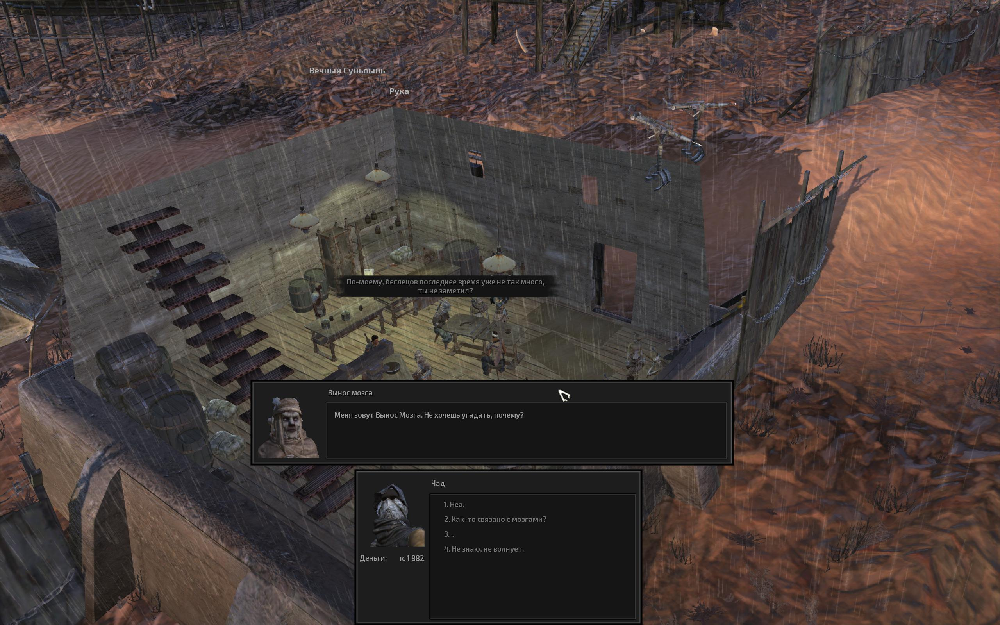

---

### Серия 16 (1 кадр)

- **Файловое время**: с `2026-10-28T05:26:01Z` по `2026-10-28T05:26:01Z`
- **Игровое время (OCR)**: `Не зафиксировано в UI`
- **Локация (OCR)**: Не зафиксирована в UI
- **Персонажи в UI (OCR)**: Не зафиксированы в UI

**Кадры серии:**
- [screenshot_100.jpg](screenshot_100.jpg) ([GitHub](https://github.com/asaf1n/kenshi-campaign-tech/blob/main/published/screenshots/screenshot_100.jpg) | [Raw](https://raw.githubusercontent.com/asaf1n/kenshi-campaign-tech/main/published/screenshots/screenshot_100.jpg))

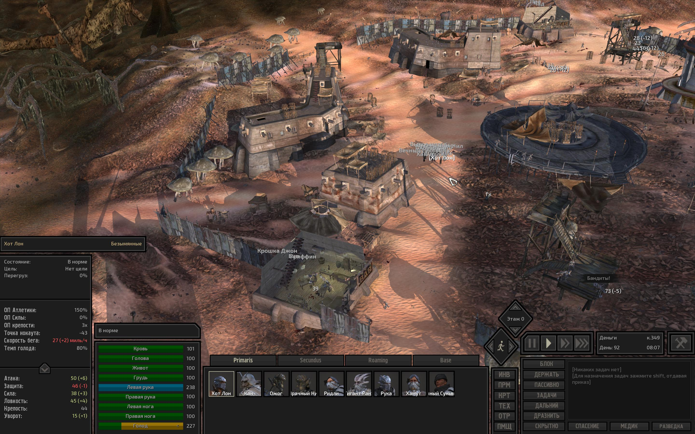

---

### Серия 17 (1 кадр)

- **Файловое время**: с `2026-10-28T06:37:59Z` по `2026-10-28T06:37:59Z`
- **Игровое время (OCR)**: `Не зафиксировано в UI`
- **Локация (OCR)**: Не зафиксирована в UI
- **Персонажи в UI (OCR)**: Не зафиксированы в UI

**Кадры серии:**
- [screenshot_101.jpg](screenshot_101.jpg) ([GitHub](https://github.com/asaf1n/kenshi-campaign-tech/blob/main/published/screenshots/screenshot_101.jpg) | [Raw](https://raw.githubusercontent.com/asaf1n/kenshi-campaign-tech/main/published/screenshots/screenshot_101.jpg))

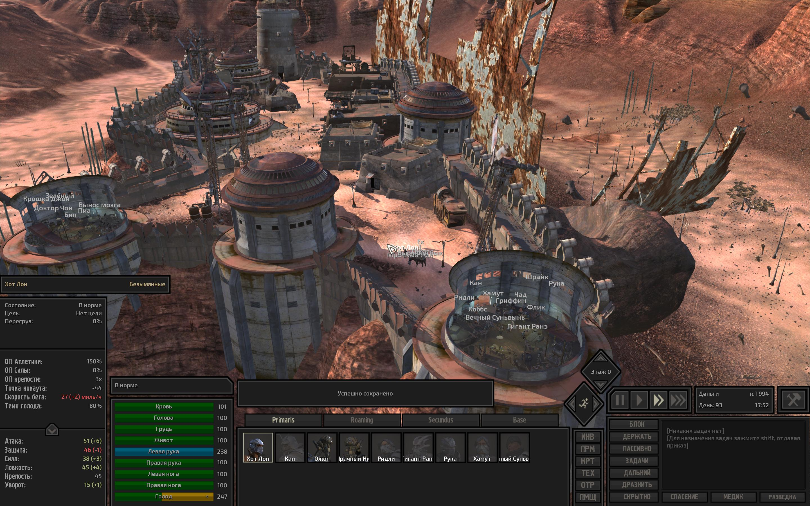

---

### Серия 18 (1 кадр)

- **Файловое время**: с `2026-10-28T09:52:09Z` по `2026-10-28T09:52:09Z`
- **Игровое время (OCR)**: `Не зафиксировано в UI`
- **Локация (OCR)**: Не зафиксирована в UI
- **Персонажи в UI (OCR)**: Не зафиксированы в UI

**Кадры серии:**
- [screenshot_102.jpg](screenshot_102.jpg) ([GitHub](https://github.com/asaf1n/kenshi-campaign-tech/blob/main/published/screenshots/screenshot_102.jpg) | [Raw](https://raw.githubusercontent.com/asaf1n/kenshi-campaign-tech/main/published/screenshots/screenshot_102.jpg))

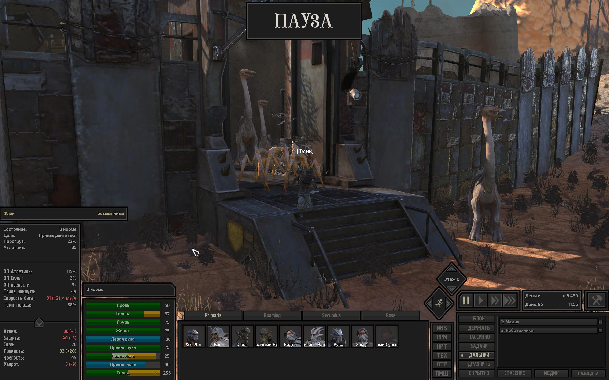

---

### Серия 19 (2 кадра)

- **Файловое время**: с `2026-10-28T09:53:03Z` по `2026-10-28T09:53:54Z`
- **Игровое время (OCR)**: `Не зафиксировано в UI`
- **Локация (OCR)**: Не зафиксирована в UI
- **Персонажи в UI (OCR)**: Не зафиксированы в UI

**Кадры серии:**
- [screenshot_103.jpg](screenshot_103.jpg) ([GitHub](https://github.com/asaf1n/kenshi-campaign-tech/blob/main/published/screenshots/screenshot_103.jpg) | [Raw](https://raw.githubusercontent.com/asaf1n/kenshi-campaign-tech/main/published/screenshots/screenshot_103.jpg))
- [screenshot_104.jpg](screenshot_104.jpg) ([GitHub](https://github.com/asaf1n/kenshi-campaign-tech/blob/main/published/screenshots/screenshot_104.jpg) | [Raw](https://raw.githubusercontent.com/asaf1n/kenshi-campaign-tech/main/published/screenshots/screenshot_104.jpg))

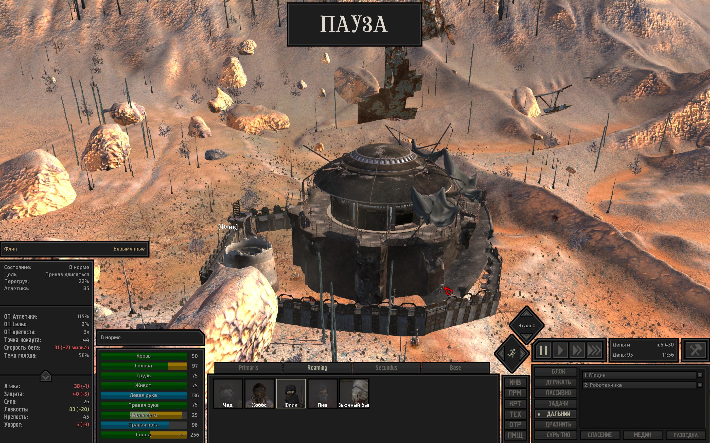

---

### Серия 20 (1 кадр)

- **Файловое время**: с `2026-10-28T10:11:52Z` по `2026-10-28T10:11:52Z`
- **Игровое время (OCR)**: `Не зафиксировано в UI`
- **Локация (OCR)**: Не зафиксирована в UI
- **Персонажи в UI (OCR)**: Не зафиксированы в UI

**Кадры серии:**
- [screenshot_105.jpg](screenshot_105.jpg) ([GitHub](https://github.com/asaf1n/kenshi-campaign-tech/blob/main/published/screenshots/screenshot_105.jpg) | [Raw](https://raw.githubusercontent.com/asaf1n/kenshi-campaign-tech/main/published/screenshots/screenshot_105.jpg))

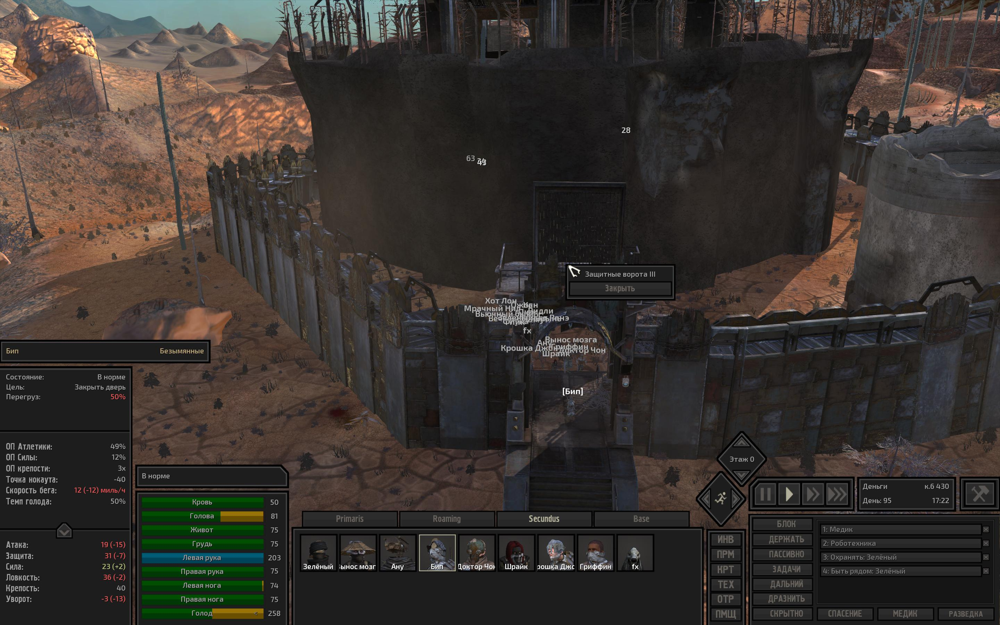

---

### Серия 21 (1 кадр)

- **Файловое время**: с `2026-10-28T10:13:28Z` по `2026-10-28T10:13:28Z`
- **Игровое время (OCR)**: `Не зафиксировано в UI`
- **Локация (OCR)**: Не зафиксирована в UI
- **Персонажи в UI (OCR)**: Не зафиксированы в UI

**Кадры серии:**
- [screenshot_106.jpg](screenshot_106.jpg) ([GitHub](https://github.com/asaf1n/kenshi-campaign-tech/blob/main/published/screenshots/screenshot_106.jpg) | [Raw](https://raw.githubusercontent.com/asaf1n/kenshi-campaign-tech/main/published/screenshots/screenshot_106.jpg))

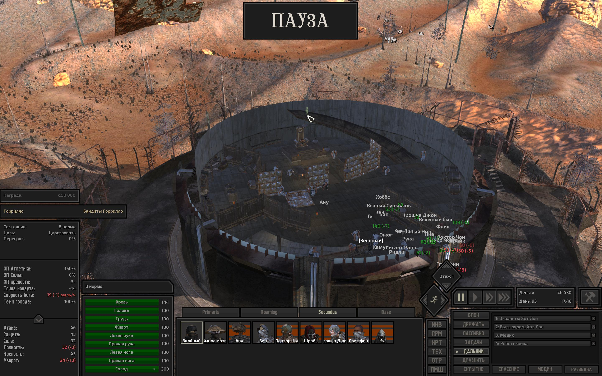

---

### Серия 22 (1 кадр)

- **Файловое время**: с `2026-10-28T10:14:10Z` по `2026-10-28T10:14:10Z`
- **Игровое время (OCR)**: `Не зафиксировано в UI`
- **Локация (OCR)**: Не зафиксирована в UI
- **Персонажи в UI (OCR)**: Не зафиксированы в UI

**Кадры серии:**
- [screenshot_107.jpg](screenshot_107.jpg) ([GitHub](https://github.com/asaf1n/kenshi-campaign-tech/blob/main/published/screenshots/screenshot_107.jpg) | [Raw](https://raw.githubusercontent.com/asaf1n/kenshi-campaign-tech/main/published/screenshots/screenshot_107.jpg))

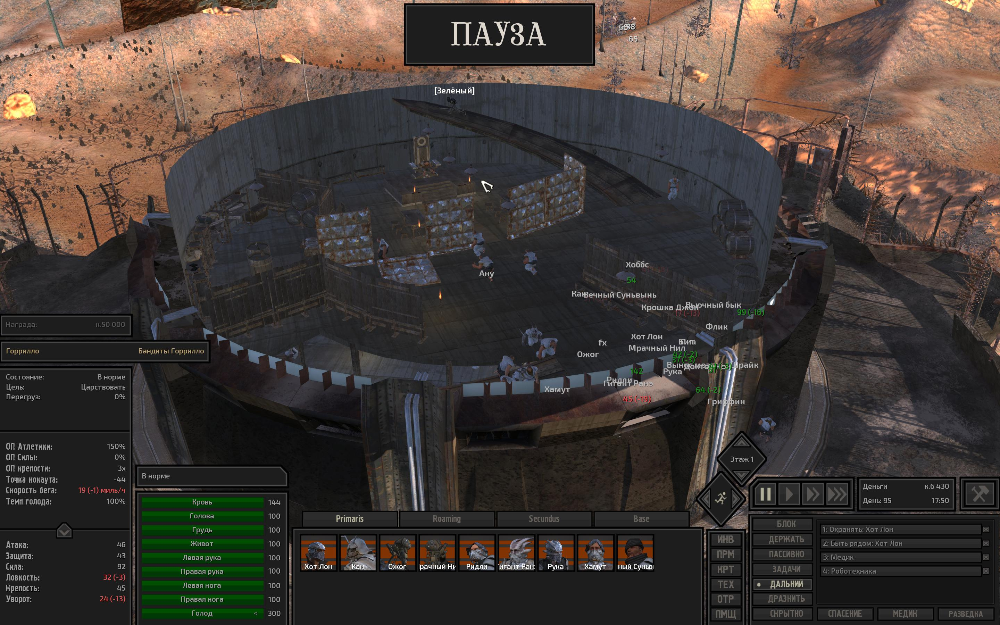

---

### Серия 23 (1 кадр)

- **Файловое время**: с `2026-10-28T10:14:22Z` по `2026-10-28T10:14:22Z`
- **Игровое время (OCR)**: `Не зафиксировано в UI`
- **Локация (OCR)**: Не зафиксирована в UI
- **Персонажи в UI (OCR)**: Не зафиксированы в UI

**Кадры серии:**
- [screenshot_108.jpg](screenshot_108.jpg) ([GitHub](https://github.com/asaf1n/kenshi-campaign-tech/blob/main/published/screenshots/screenshot_108.jpg) | [Raw](https://raw.githubusercontent.com/asaf1n/kenshi-campaign-tech/main/published/screenshots/screenshot_108.jpg))

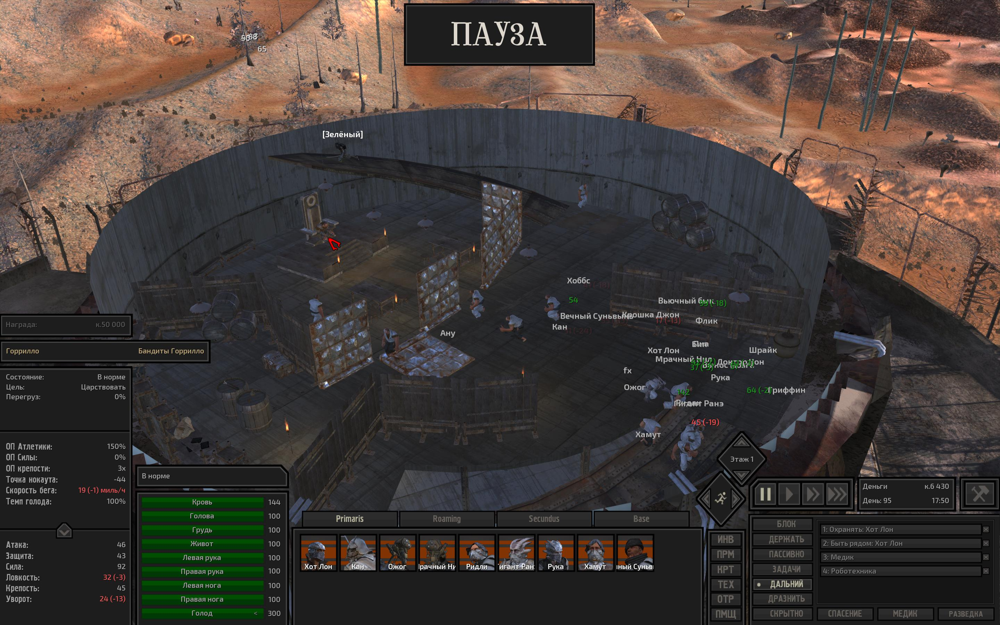

---

### Серия 24 (1 кадр)

- **Файловое время**: с `2026-10-28T10:15:34Z` по `2026-10-28T10:15:34Z`
- **Игровое время (OCR)**: `Не зафиксировано в UI`
- **Локация (OCR)**: Не зафиксирована в UI
- **Персонажи в UI (OCR)**: Не зафиксированы в UI

**Кадры серии:**
- [screenshot_109.jpg](screenshot_109.jpg) ([GitHub](https://github.com/asaf1n/kenshi-campaign-tech/blob/main/published/screenshots/screenshot_109.jpg) | [Raw](https://raw.githubusercontent.com/asaf1n/kenshi-campaign-tech/main/published/screenshots/screenshot_109.jpg))

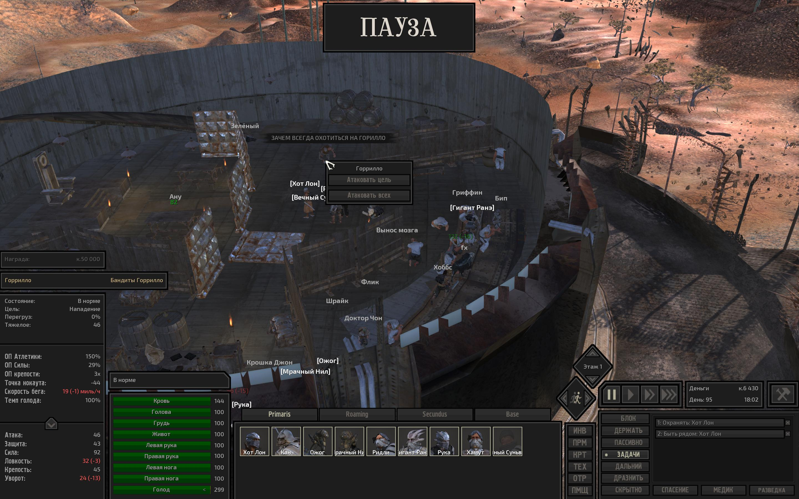

---

### Серия 25 (1 кадр)

- **Файловое время**: с `2026-10-28T10:15:37Z` по `2026-10-28T10:15:37Z`
- **Игровое время (OCR)**: `Не зафиксировано в UI`
- **Локация (OCR)**: Не зафиксирована в UI
- **Персонажи в UI (OCR)**: Не зафиксированы в UI

**Кадры серии:**
- [screenshot_110.jpg](screenshot_110.jpg) ([GitHub](https://github.com/asaf1n/kenshi-campaign-tech/blob/main/published/screenshots/screenshot_110.jpg) | [Raw](https://raw.githubusercontent.com/asaf1n/kenshi-campaign-tech/main/published/screenshots/screenshot_110.jpg))

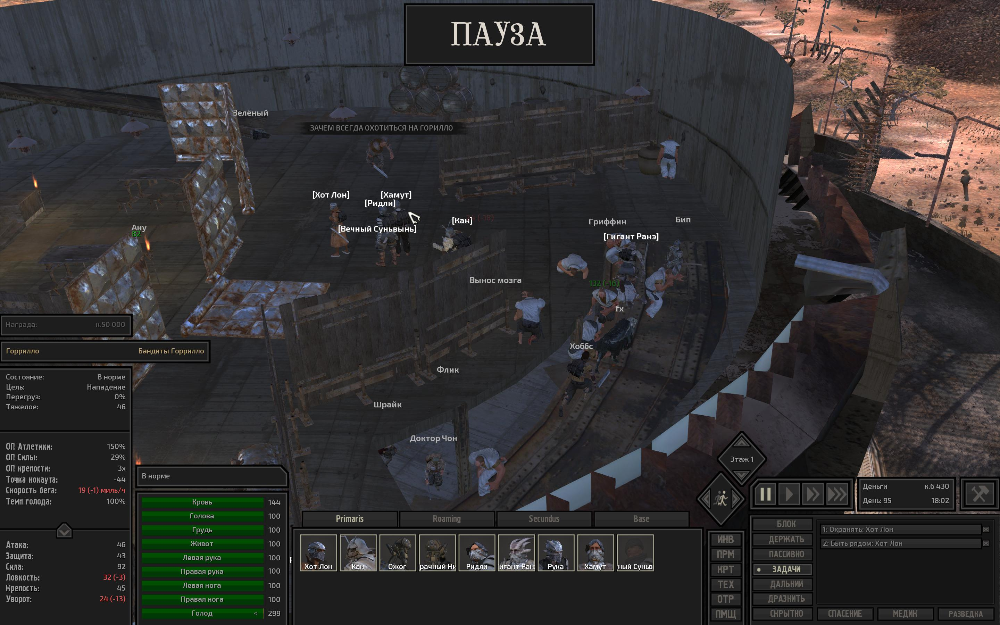

---

### Серия 26 (1 кадр)

- **Файловое время**: с `2026-10-28T10:17:29Z` по `2026-10-28T10:17:29Z`
- **Игровое время (OCR)**: `Не зафиксировано в UI`
- **Локация (OCR)**: Не зафиксирована в UI
- **Персонажи в UI (OCR)**: Не зафиксированы в UI

**Кадры серии:**
- [screenshot_111.jpg](screenshot_111.jpg) ([GitHub](https://github.com/asaf1n/kenshi-campaign-tech/blob/main/published/screenshots/screenshot_111.jpg) | [Raw](https://raw.githubusercontent.com/asaf1n/kenshi-campaign-tech/main/published/screenshots/screenshot_111.jpg))

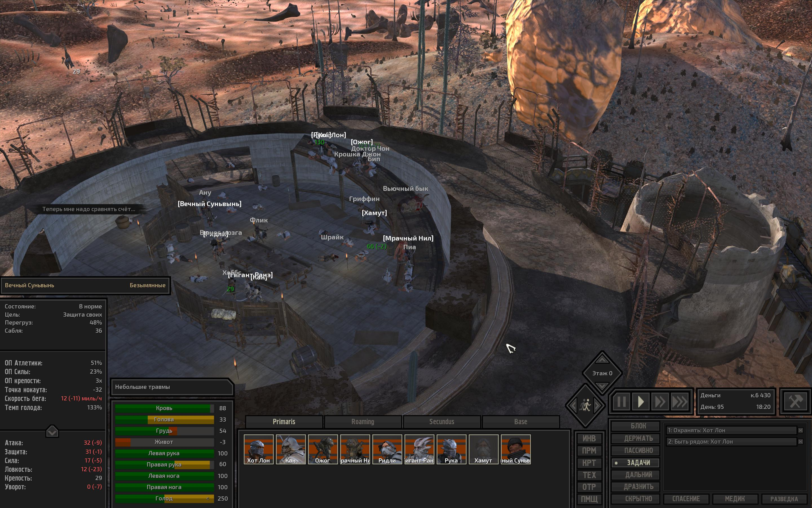

---

### Серия 27 (2 кадра)

- **Файловое время**: с `2026-10-28T10:25:36Z` по `2026-10-28T10:25:38Z`
- **Игровое время (OCR)**: `Не зафиксировано в UI`
- **Локация (OCR)**: Не зафиксирована в UI
- **Персонажи в UI (OCR)**: Не зафиксированы в UI

**Кадры серии:**
- [screenshot_112.jpg](screenshot_112.jpg) ([GitHub](https://github.com/asaf1n/kenshi-campaign-tech/blob/main/published/screenshots/screenshot_112.jpg) | [Raw](https://raw.githubusercontent.com/asaf1n/kenshi-campaign-tech/main/published/screenshots/screenshot_112.jpg))
- [screenshot_113.jpg](screenshot_113.jpg) ([GitHub](https://github.com/asaf1n/kenshi-campaign-tech/blob/main/published/screenshots/screenshot_113.jpg) | [Raw](https://raw.githubusercontent.com/asaf1n/kenshi-campaign-tech/main/published/screenshots/screenshot_113.jpg))

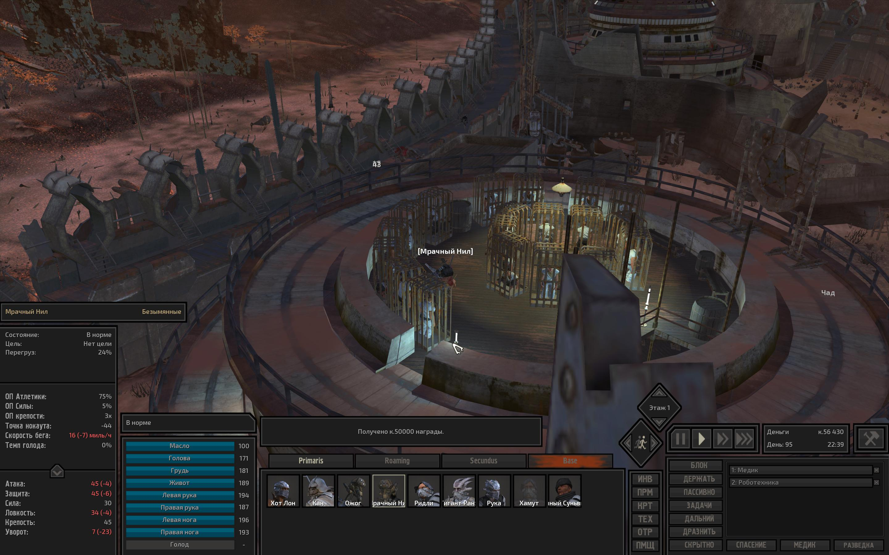

---

### Серия 28 (1 кадр)

- **Файловое время**: с `2026-10-28T12:14:13Z` по `2026-10-28T12:14:13Z`
- **Игровое время (OCR)**: `Не зафиксировано в UI`
- **Локация (OCR)**: Не зафиксирована в UI
- **Персонажи в UI (OCR)**: Не зафиксированы в UI

**Кадры серии:**
- [screenshot_114.jpg](screenshot_114.jpg) ([GitHub](https://github.com/asaf1n/kenshi-campaign-tech/blob/main/published/screenshots/screenshot_114.jpg) | [Raw](https://raw.githubusercontent.com/asaf1n/kenshi-campaign-tech/main/published/screenshots/screenshot_114.jpg))

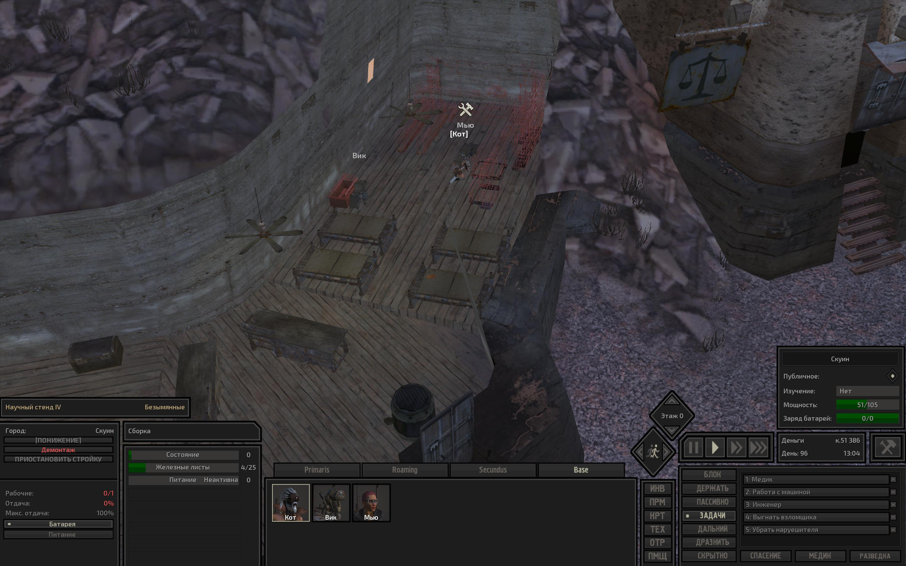

---

### Серия 29 (1 кадр)

- **Файловое время**: с `2026-10-28T12:21:19Z` по `2026-10-28T12:21:19Z`
- **Игровое время (OCR)**: `Не зафиксировано в UI`
- **Локация (OCR)**: Не зафиксирована в UI
- **Персонажи в UI (OCR)**: Не зафиксированы в UI

**Кадры серии:**
- [screenshot_115.jpg](screenshot_115.jpg) ([GitHub](https://github.com/asaf1n/kenshi-campaign-tech/blob/main/published/screenshots/screenshot_115.jpg) | [Raw](https://raw.githubusercontent.com/asaf1n/kenshi-campaign-tech/main/published/screenshots/screenshot_115.jpg))

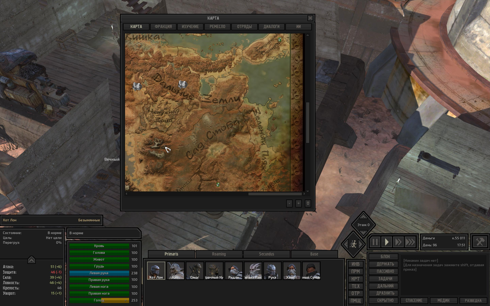

---

### Серия 30 (1 кадр)

- **Файловое время**: с `2026-10-28T13:01:52Z` по `2026-10-28T13:01:52Z`
- **Игровое время (OCR)**: `Не зафиксировано в UI`
- **Локация (OCR)**: Не зафиксирована в UI
- **Персонажи в UI (OCR)**: Не зафиксированы в UI

**Кадры серии:**
- [screenshot_116.jpg](screenshot_116.jpg) ([GitHub](https://github.com/asaf1n/kenshi-campaign-tech/blob/main/published/screenshots/screenshot_116.jpg) | [Raw](https://raw.githubusercontent.com/asaf1n/kenshi-campaign-tech/main/published/screenshots/screenshot_116.jpg))

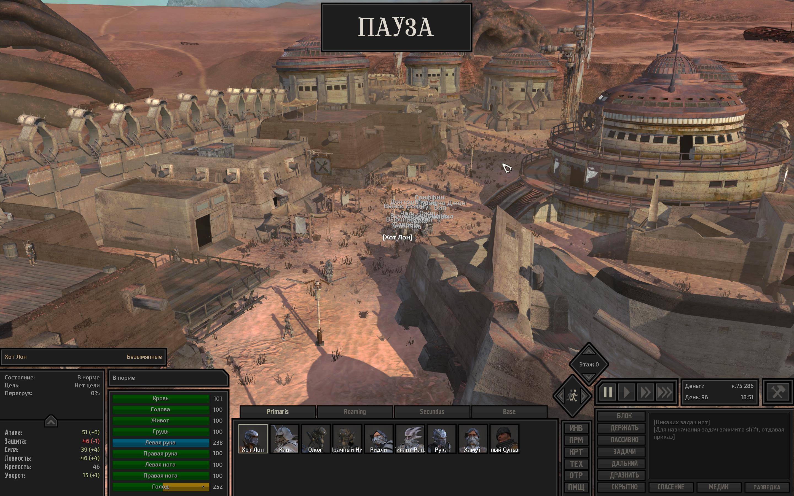

---

### Серия 31 (1 кадр)

- **Файловое время**: с `2026-10-28T15:08:06Z` по `2026-10-28T15:08:06Z`
- **Игровое время (OCR)**: `Не зафиксировано в UI`
- **Локация (OCR)**: Не зафиксирована в UI
- **Персонажи в UI (OCR)**: Не зафиксированы в UI

**Кадры серии:**
- [screenshot_117.jpg](screenshot_117.jpg) ([GitHub](https://github.com/asaf1n/kenshi-campaign-tech/blob/main/published/screenshots/screenshot_117.jpg) | [Raw](https://raw.githubusercontent.com/asaf1n/kenshi-campaign-tech/main/published/screenshots/screenshot_117.jpg))

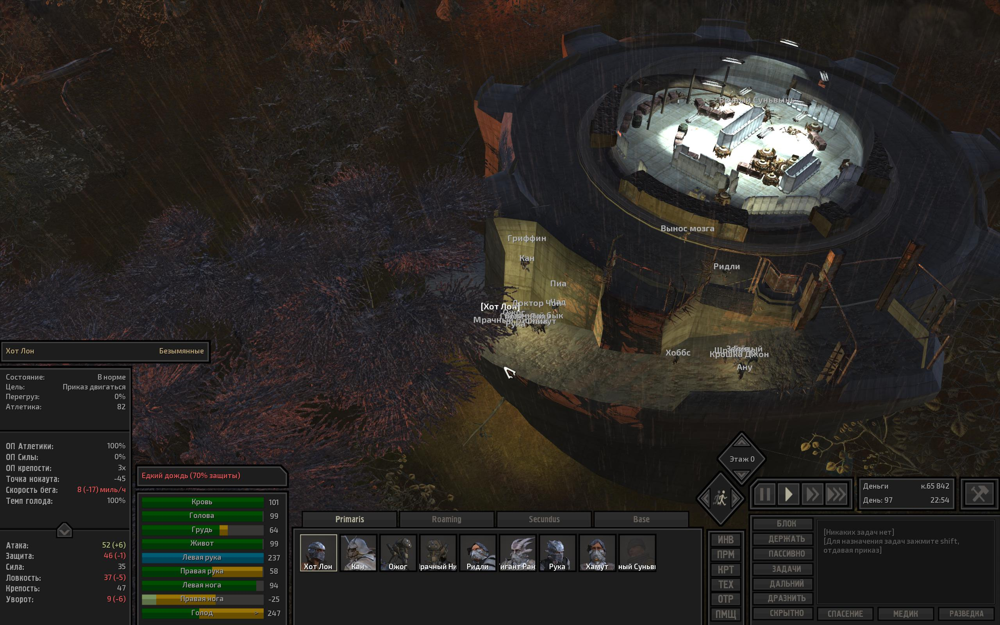

---

### Серия 32 (1 кадр)

- **Файловое время**: с `2026-10-28T15:50:28Z` по `2026-10-28T15:50:28Z`
- **Игровое время (OCR)**: `Не зафиксировано в UI`
- **Локация (OCR)**: Не зафиксирована в UI
- **Персонажи в UI (OCR)**: Не зафиксированы в UI

**Кадры серии:**
- [screenshot_118.jpg](screenshot_118.jpg) ([GitHub](https://github.com/asaf1n/kenshi-campaign-tech/blob/main/published/screenshots/screenshot_118.jpg) | [Raw](https://raw.githubusercontent.com/asaf1n/kenshi-campaign-tech/main/published/screenshots/screenshot_118.jpg))

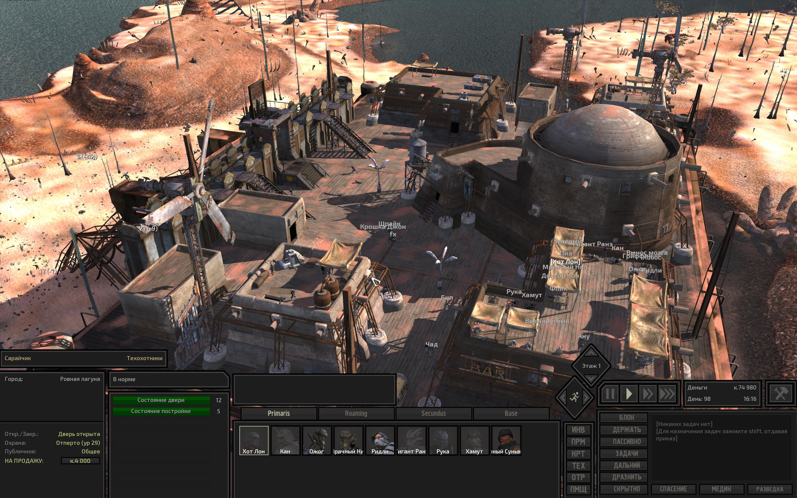

---

### Серия 33 (1 кадр)

- **Файловое время**: с `2026-10-28T15:52:50Z` по `2026-10-28T15:52:50Z`
- **Игровое время (OCR)**: `Не зафиксировано в UI`
- **Локация (OCR)**: Не зафиксирована в UI
- **Персонажи в UI (OCR)**: Не зафиксированы в UI

**Кадры серии:**
- [screenshot_119.jpg](screenshot_119.jpg) ([GitHub](https://github.com/asaf1n/kenshi-campaign-tech/blob/main/published/screenshots/screenshot_119.jpg) | [Raw](https://raw.githubusercontent.com/asaf1n/kenshi-campaign-tech/main/published/screenshots/screenshot_119.jpg))

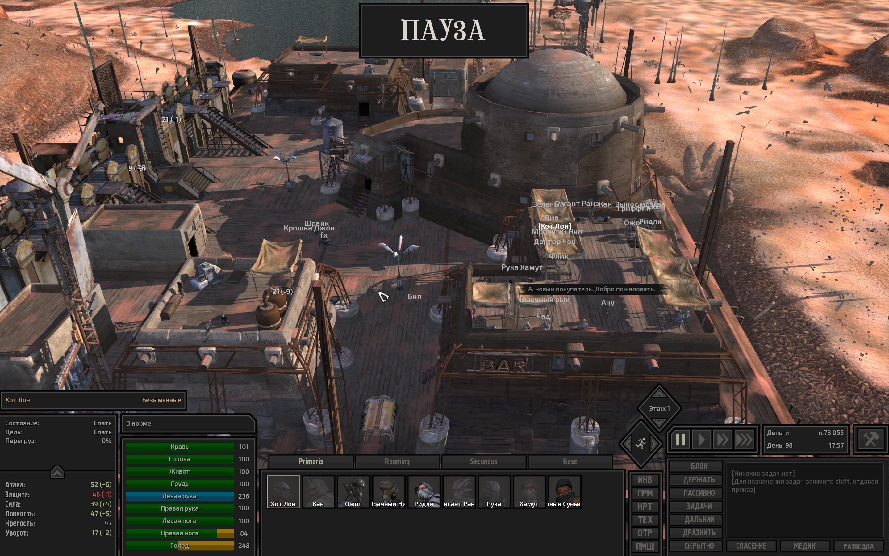

---

### Серия 34 (1 кадр)

- **Файловое время**: с `2026-10-29T04:48:39Z` по `2026-10-29T04:48:39Z`
- **Игровое время (OCR)**: `Не зафиксировано в UI`
- **Локация (OCR)**: Не зафиксирована в UI
- **Персонажи в UI (OCR)**: Не зафиксированы в UI

**Кадры серии:**
- [screenshot_120.jpg](screenshot_120.jpg) ([GitHub](https://github.com/asaf1n/kenshi-campaign-tech/blob/main/published/screenshots/screenshot_120.jpg) | [Raw](https://raw.githubusercontent.com/asaf1n/kenshi-campaign-tech/main/published/screenshots/screenshot_120.jpg))

---

### Серия 35 (1 кадр)

- **Файловое время**: с `2026-10-29T04:56:27Z` по `2026-10-29T04:56:27Z`
- **Игровое время (OCR)**: `Не зафиксировано в UI`
- **Локация (OCR)**: Не зафиксирована в UI
- **Персонажи в UI (OCR)**: Не зафиксированы в UI

**Кадры серии:**
- [screenshot_121.jpg](screenshot_121.jpg) ([GitHub](https://github.com/asaf1n/kenshi-campaign-tech/blob/main/published/screenshots/screenshot_121.jpg) | [Raw](https://raw.githubusercontent.com/asaf1n/kenshi-campaign-tech/main/published/screenshots/screenshot_121.jpg))

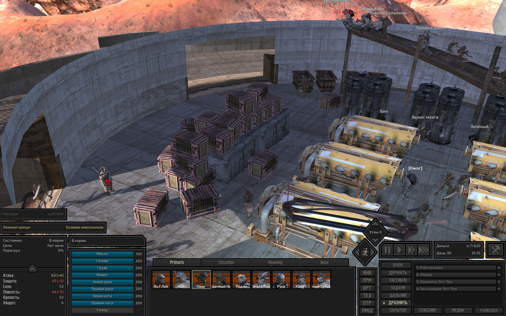

---

### Серия 36 (1 кадр)

- **Файловое время**: с `2026-10-29T04:57:13Z` по `2026-10-29T04:57:13Z`
- **Игровое время (OCR)**: `Не зафиксировано в UI`
- **Локация (OCR)**: Не зафиксирована в UI
- **Персонажи в UI (OCR)**: Не зафиксированы в UI

**Кадры серии:**
- [screenshot_122.jpg](screenshot_122.jpg) ([GitHub](https://github.com/asaf1n/kenshi-campaign-tech/blob/main/published/screenshots/screenshot_122.jpg) | [Raw](https://raw.githubusercontent.com/asaf1n/kenshi-campaign-tech/main/published/screenshots/screenshot_122.jpg))

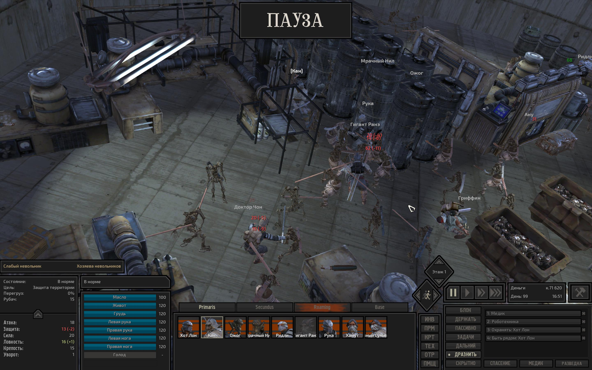

---

### Серия 37 (1 кадр)

- **Файловое время**: с `2026-10-29T04:59:12Z` по `2026-10-29T04:59:12Z`
- **Игровое время (OCR)**: `Не зафиксировано в UI`
- **Локация (OCR)**: Не зафиксирована в UI
- **Персонажи в UI (OCR)**: Не зафиксированы в UI

**Кадры серии:**
- [screenshot_123.jpg](screenshot_123.jpg) ([GitHub](https://github.com/asaf1n/kenshi-campaign-tech/blob/main/published/screenshots/screenshot_123.jpg) | [Raw](https://raw.githubusercontent.com/asaf1n/kenshi-campaign-tech/main/published/screenshots/screenshot_123.jpg))

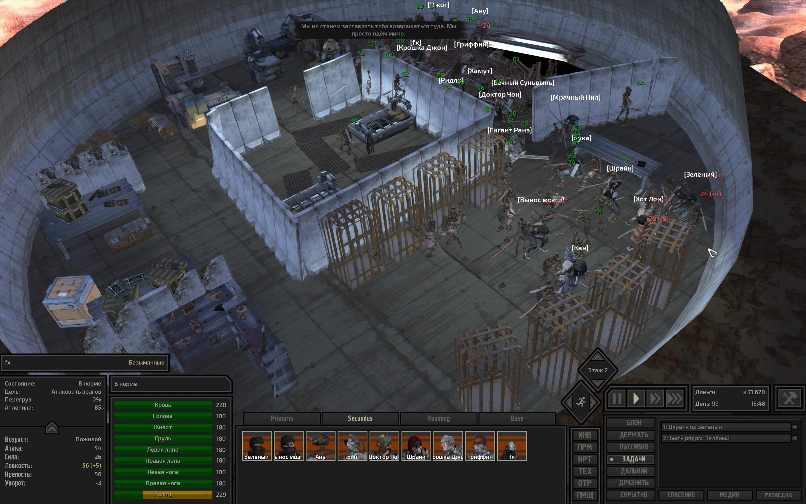

---

### Серия 38 (1 кадр)

- **Файловое время**: с `2026-10-29T04:59:33Z` по `2026-10-29T04:59:33Z`
- **Игровое время (OCR)**: `Не зафиксировано в UI`
- **Локация (OCR)**: Не зафиксирована в UI
- **Персонажи в UI (OCR)**: Не зафиксированы в UI

**Кадры серии:**
- [screenshot_124.jpg](screenshot_124.jpg) ([GitHub](https://github.com/asaf1n/kenshi-campaign-tech/blob/main/published/screenshots/screenshot_124.jpg) | [Raw](https://raw.githubusercontent.com/asaf1n/kenshi-campaign-tech/main/published/screenshots/screenshot_124.jpg))

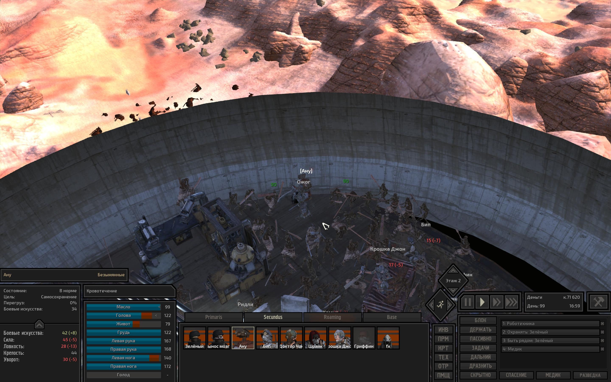

---

### Серия 39 (1 кадр)

- **Файловое время**: с `2026-10-29T05:01:01Z` по `2026-10-29T05:01:01Z`
- **Игровое время (OCR)**: `Не зафиксировано в UI`
- **Локация (OCR)**: Не зафиксирована в UI
- **Персонажи в UI (OCR)**: Не зафиксированы в UI

**Кадры серии:**
- [screenshot_125.jpg](screenshot_125.jpg) ([GitHub](https://github.com/asaf1n/kenshi-campaign-tech/blob/main/published/screenshots/screenshot_125.jpg) | [Raw](https://raw.githubusercontent.com/asaf1n/kenshi-campaign-tech/main/published/screenshots/screenshot_125.jpg))

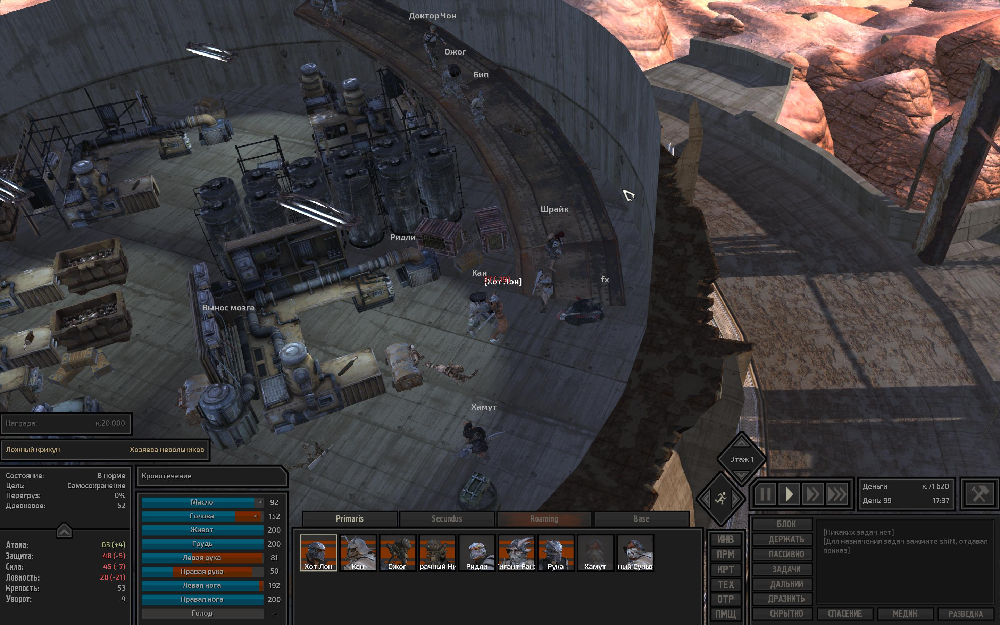

---

### Серия 40 (1 кадр)

- **Файловое время**: с `2026-10-29T05:03:34Z` по `2026-10-29T05:03:34Z`
- **Игровое время (OCR)**: `Не зафиксировано в UI`
- **Локация (OCR)**: Не зафиксирована в UI
- **Персонажи в UI (OCR)**: Не зафиксированы в UI

**Кадры серии:**
- [screenshot_126.jpg](screenshot_126.jpg) ([GitHub](https://github.com/asaf1n/kenshi-campaign-tech/blob/main/published/screenshots/screenshot_126.jpg) | [Raw](https://raw.githubusercontent.com/asaf1n/kenshi-campaign-tech/main/published/screenshots/screenshot_126.jpg))

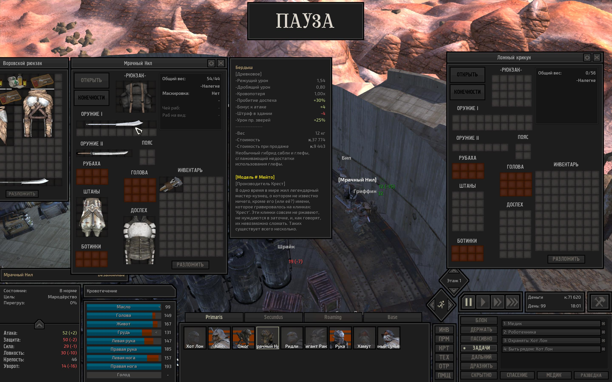

---

### Серия 41 (1 кадр)

- **Файловое время**: с `2026-10-29T05:12:58Z` по `2026-10-29T05:12:58Z`
- **Игровое время (OCR)**: `Не зафиксировано в UI`
- **Локация (OCR)**: Не зафиксирована в UI
- **Персонажи в UI (OCR)**: Не зафиксированы в UI

**Кадры серии:**
- [screenshot_127.jpg](screenshot_127.jpg) ([GitHub](https://github.com/asaf1n/kenshi-campaign-tech/blob/main/published/screenshots/screenshot_127.jpg) | [Raw](https://raw.githubusercontent.com/asaf1n/kenshi-campaign-tech/main/published/screenshots/screenshot_127.jpg))

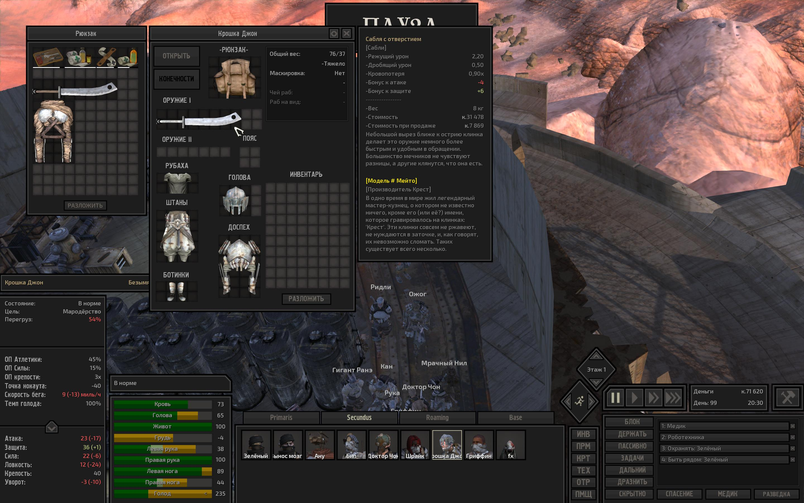

---

### Серия 42 (1 кадр)

- **Файловое время**: с `2026-10-29T05:13:52Z` по `2026-10-29T05:13:52Z`
- **Игровое время (OCR)**: `Не зафиксировано в UI`
- **Локация (OCR)**: Не зафиксирована в UI
- **Персонажи в UI (OCR)**: Не зафиксированы в UI

**Кадры серии:**
- [screenshot_128.jpg](screenshot_128.jpg) ([GitHub](https://github.com/asaf1n/kenshi-campaign-tech/blob/main/published/screenshots/screenshot_128.jpg) | [Raw](https://raw.githubusercontent.com/asaf1n/kenshi-campaign-tech/main/published/screenshots/screenshot_128.jpg))

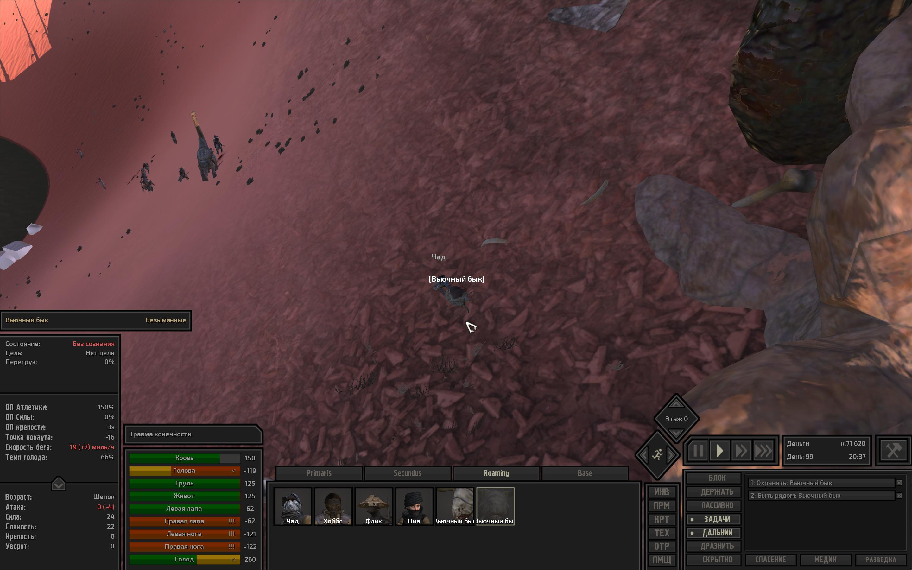

---

### Серия 43 (1 кадр)

- **Файловое время**: с `2026-10-29T05:17:05Z` по `2026-10-29T05:17:05Z`
- **Игровое время (OCR)**: `Не зафиксировано в UI`
- **Локация (OCR)**: Не зафиксирована в UI
- **Персонажи в UI (OCR)**: Не зафиксированы в UI

**Кадры серии:**
- [screenshot_129.jpg](screenshot_129.jpg) ([GitHub](https://github.com/asaf1n/kenshi-campaign-tech/blob/main/published/screenshots/screenshot_129.jpg) | [Raw](https://raw.githubusercontent.com/asaf1n/kenshi-campaign-tech/main/published/screenshots/screenshot_129.jpg))

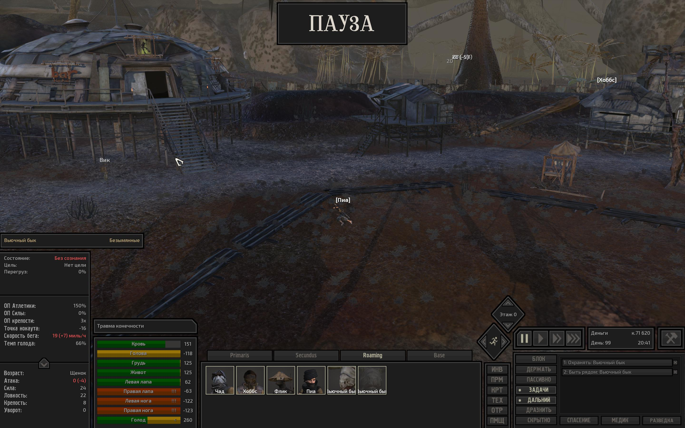

---

### Серия 44 (2 кадра)

- **Файловое время**: с `2026-10-29T06:45:33Z` по `2026-10-29T06:45:37Z`
- **Игровое время (OCR)**: `Не зафиксировано в UI`
- **Локация (OCR)**: Не зафиксирована в UI
- **Персонажи в UI (OCR)**: Не зафиксированы в UI

**Кадры серии:**
- [screenshot_130.jpg](screenshot_130.jpg) ([GitHub](https://github.com/asaf1n/kenshi-campaign-tech/blob/main/published/screenshots/screenshot_130.jpg) | [Raw](https://raw.githubusercontent.com/asaf1n/kenshi-campaign-tech/main/published/screenshots/screenshot_130.jpg))
- [screenshot_131.jpg](screenshot_131.jpg) ([GitHub](https://github.com/asaf1n/kenshi-campaign-tech/blob/main/published/screenshots/screenshot_131.jpg) | [Raw](https://raw.githubusercontent.com/asaf1n/kenshi-campaign-tech/main/published/screenshots/screenshot_131.jpg))

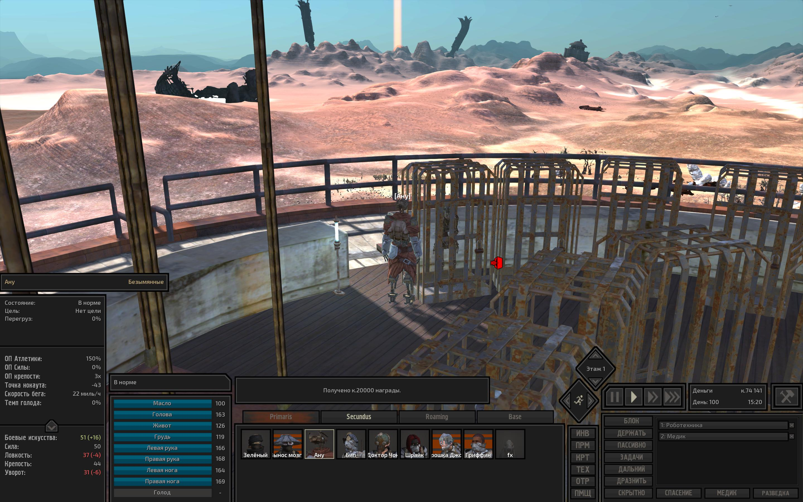

---

### Серия 45 (1 кадр)

- **Файловое время**: с `2026-10-29T06:47:02Z` по `2026-10-29T06:47:02Z`
- **Игровое время (OCR)**: `Не зафиксировано в UI`
- **Локация (OCR)**: Не зафиксирована в UI
- **Персонажи в UI (OCR)**: Не зафиксированы в UI

**Кадры серии:**
- [screenshot_132.jpg](screenshot_132.jpg) ([GitHub](https://github.com/asaf1n/kenshi-campaign-tech/blob/main/published/screenshots/screenshot_132.jpg) | [Raw](https://raw.githubusercontent.com/asaf1n/kenshi-campaign-tech/main/published/screenshots/screenshot_132.jpg))

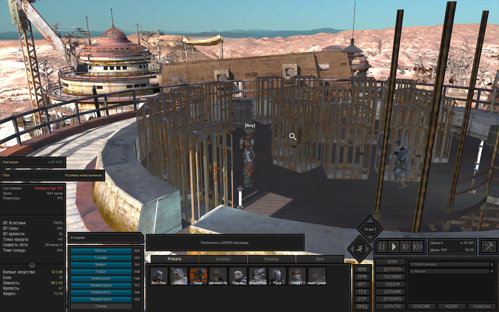

---

### Серия 46 (1 кадр)

- **Файловое время**: с `2026-10-29T06:54:25Z` по `2026-10-29T06:54:25Z`
- **Игровое время (OCR)**: `Не зафиксировано в UI`
- **Локация (OCR)**: Не зафиксирована в UI
- **Персонажи в UI (OCR)**: Не зафиксированы в UI

**Кадры серии:**
- [screenshot_133.jpg](screenshot_133.jpg) ([GitHub](https://github.com/asaf1n/kenshi-campaign-tech/blob/main/published/screenshots/screenshot_133.jpg) | [Raw](https://raw.githubusercontent.com/asaf1n/kenshi-campaign-tech/main/published/screenshots/screenshot_133.jpg))

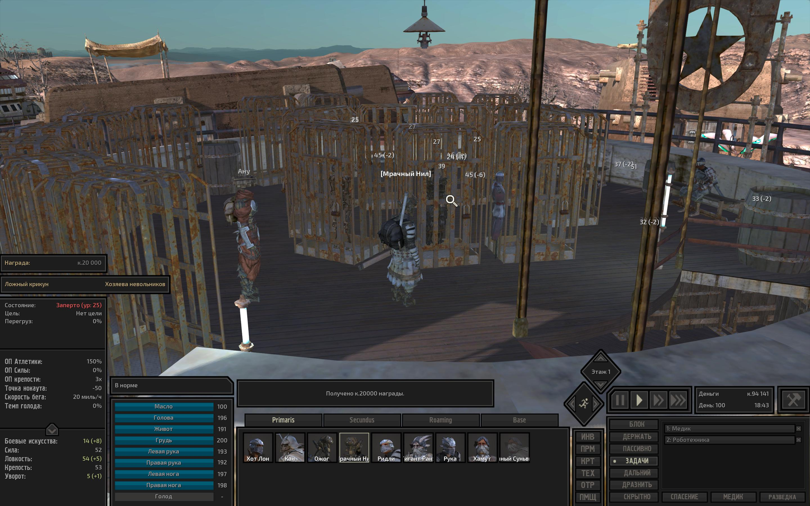

---

### Серия 47 (1 кадр)

- **Файловое время**: с `2026-10-29T06:55:42Z` по `2026-10-29T06:55:42Z`
- **Игровое время (OCR)**: `Не зафиксировано в UI`
- **Локация (OCR)**: Не зафиксирована в UI
- **Персонажи в UI (OCR)**: Не зафиксированы в UI

**Кадры серии:**
- [screenshot_134.jpg](screenshot_134.jpg) ([GitHub](https://github.com/asaf1n/kenshi-campaign-tech/blob/main/published/screenshots/screenshot_134.jpg) | [Raw](https://raw.githubusercontent.com/asaf1n/kenshi-campaign-tech/main/published/screenshots/screenshot_134.jpg))

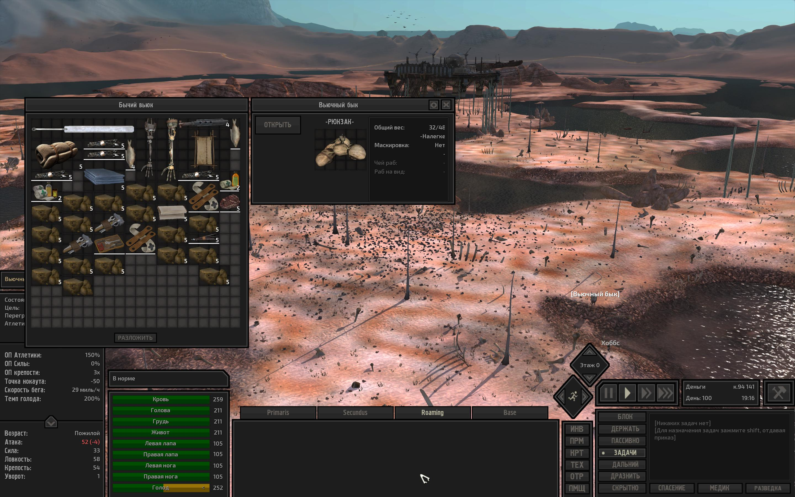

---

### Серия 48 (1 кадр)

- **Файловое время**: с `2026-10-29T06:56:26Z` по `2026-10-29T06:56:26Z`
- **Игровое время (OCR)**: `Не зафиксировано в UI`
- **Локация (OCR)**: Не зафиксирована в UI
- **Персонажи в UI (OCR)**: Не зафиксированы в UI

**Кадры серии:**
- [screenshot_135.jpg](screenshot_135.jpg) ([GitHub](https://github.com/asaf1n/kenshi-campaign-tech/blob/main/published/screenshots/screenshot_135.jpg) | [Raw](https://raw.githubusercontent.com/asaf1n/kenshi-campaign-tech/main/published/screenshots/screenshot_135.jpg))

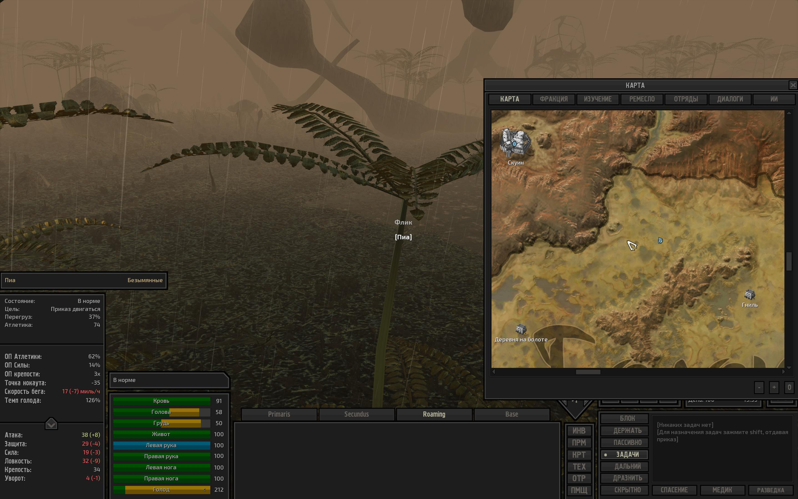

---

### Серия 49 (2 кадра)

- **Файловое время**: с `2026-10-29T06:56:56Z` по `2026-10-29T06:57:11Z`
- **Игровое время (OCR)**: `Не зафиксировано в UI`
- **Локация (OCR)**: Не зафиксирована в UI
- **Персонажи в UI (OCR)**: Не зафиксированы в UI

**Кадры серии:**
- [screenshot_136.jpg](screenshot_136.jpg) ([GitHub](https://github.com/asaf1n/kenshi-campaign-tech/blob/main/published/screenshots/screenshot_136.jpg) | [Raw](https://raw.githubusercontent.com/asaf1n/kenshi-campaign-tech/main/published/screenshots/screenshot_136.jpg))
- [screenshot_137.jpg](screenshot_137.jpg) ([GitHub](https://github.com/asaf1n/kenshi-campaign-tech/blob/main/published/screenshots/screenshot_137.jpg) | [Raw](https://raw.githubusercontent.com/asaf1n/kenshi-campaign-tech/main/published/screenshots/screenshot_137.jpg))

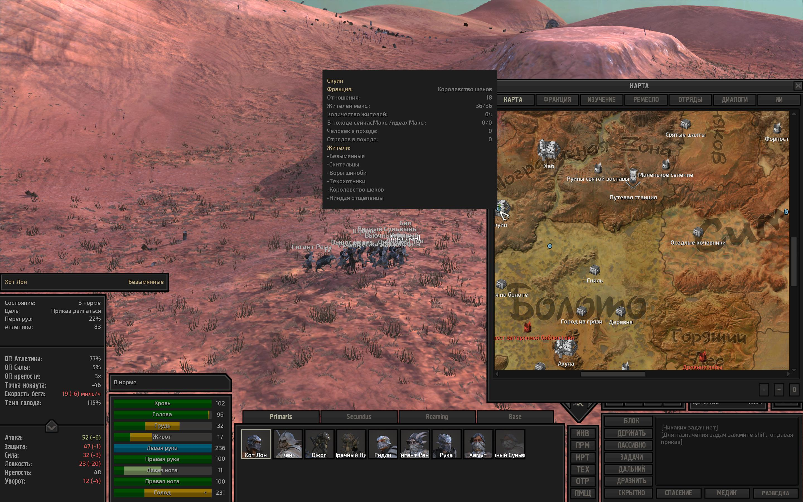

---

### Серия 50 (2 кадра)

- **Файловое время**: с `2026-10-29T08:47:22Z` по `2026-10-29T08:47:29Z`
- **Игровое время (OCR)**: `Не зафиксировано в UI`
- **Локация (OCR)**: Не зафиксирована в UI
- **Персонажи в UI (OCR)**: Не зафиксированы в UI

**Кадры серии:**
- [screenshot_138.jpg](screenshot_138.jpg) ([GitHub](https://github.com/asaf1n/kenshi-campaign-tech/blob/main/published/screenshots/screenshot_138.jpg) | [Raw](https://raw.githubusercontent.com/asaf1n/kenshi-campaign-tech/main/published/screenshots/screenshot_138.jpg))
- [screenshot_139.jpg](screenshot_139.jpg) ([GitHub](https://github.com/asaf1n/kenshi-campaign-tech/blob/main/published/screenshots/screenshot_139.jpg) | [Raw](https://raw.githubusercontent.com/asaf1n/kenshi-campaign-tech/main/published/screenshots/screenshot_139.jpg))

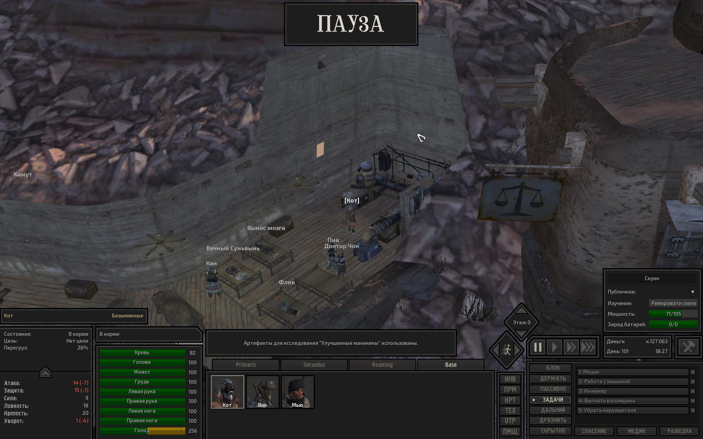

---

### Серия 51 (1 кадр)

- **Файловое время**: с `2026-10-29T09:52:00Z` по `2026-10-29T09:52:00Z`
- **Игровое время (OCR)**: `Не зафиксировано в UI`
- **Локация (OCR)**: Не зафиксирована в UI
- **Персонажи в UI (OCR)**: Не зафиксированы в UI

**Кадры серии:**
- [screenshot_140.jpg](screenshot_140.jpg) ([GitHub](https://github.com/asaf1n/kenshi-campaign-tech/blob/main/published/screenshots/screenshot_140.jpg) | [Raw](https://raw.githubusercontent.com/asaf1n/kenshi-campaign-tech/main/published/screenshots/screenshot_140.jpg))

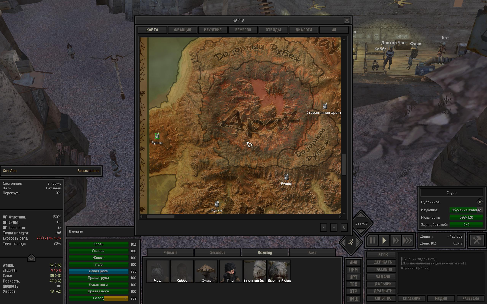

---

### Серия 52 (1 кадр)

- **Файловое время**: с `2026-10-29T09:57:27Z` по `2026-10-29T09:57:27Z`
- **Игровое время (OCR)**: `Не зафиксировано в UI`
- **Локация (OCR)**: Не зафиксирована в UI
- **Персонажи в UI (OCR)**: Не зафиксированы в UI

**Кадры серии:**
- [screenshot_141.jpg](screenshot_141.jpg) ([GitHub](https://github.com/asaf1n/kenshi-campaign-tech/blob/main/published/screenshots/screenshot_141.jpg) | [Raw](https://raw.githubusercontent.com/asaf1n/kenshi-campaign-tech/main/published/screenshots/screenshot_141.jpg))

---

### Серия 53 (1 кадр)

- **Файловое время**: с `2026-10-29T10:21:36Z` по `2026-10-29T10:21:36Z`
- **Игровое время (OCR)**: `Не зафиксировано в UI`
- **Локация (OCR)**: Не зафиксирована в UI
- **Персонажи в UI (OCR)**: Не зафиксированы в UI

**Кадры серии:**
- [screenshot_142.jpg](screenshot_142.jpg) ([GitHub](https://github.com/asaf1n/kenshi-campaign-tech/blob/main/published/screenshots/screenshot_142.jpg) | [Raw](https://raw.githubusercontent.com/asaf1n/kenshi-campaign-tech/main/published/screenshots/screenshot_142.jpg))

---

### Серия 54 (1 кадр)

- **Файловое время**: с `2026-10-29T14:27:41Z` по `2026-10-29T14:27:41Z`
- **Игровое время (OCR)**: `Не зафиксировано в UI`
- **Локация (OCR)**: Не зафиксирована в UI
- **Персонажи в UI (OCR)**: Не зафиксированы в UI

**Кадры серии:**
- [screenshot_143.jpg](screenshot_143.jpg) ([GitHub](https://github.com/asaf1n/kenshi-campaign-tech/blob/main/published/screenshots/screenshot_143.jpg) | [Raw](https://raw.githubusercontent.com/asaf1n/kenshi-campaign-tech/main/published/screenshots/screenshot_143.jpg))

---

### Серия 55 (1 кадр)

- **Файловое время**: с `2026-10-29T14:27:51Z` по `2026-10-29T14:27:51Z`
- **Игровое время (OCR)**: `Не зафиксировано в UI`
- **Локация (OCR)**: Не зафиксирована в UI
- **Персонажи в UI (OCR)**: Не зафиксированы в UI

**Кадры серии:**
- [screenshot_144.jpg](screenshot_144.jpg) ([GitHub](https://github.com/asaf1n/kenshi-campaign-tech/blob/main/published/screenshots/screenshot_144.jpg) | [Raw](https://raw.githubusercontent.com/asaf1n/kenshi-campaign-tech/main/published/screenshots/screenshot_144.jpg))

---

### Серия 56 (1 кадр)

- **Файловое время**: с `2026-10-29T14:31:42Z` по `2026-10-29T14:31:42Z`
- **Игровое время (OCR)**: `Не зафиксировано в UI`
- **Локация (OCR)**: Не зафиксирована в UI
- **Персонажи в UI (OCR)**: Не зафиксированы в UI

**Кадры серии:**
- [screenshot_145.jpg](screenshot_145.jpg) ([GitHub](https://github.com/asaf1n/kenshi-campaign-tech/blob/main/published/screenshots/screenshot_145.jpg) | [Raw](https://raw.githubusercontent.com/asaf1n/kenshi-campaign-tech/main/published/screenshots/screenshot_145.jpg))

---

### Серия 57 (1 кадр)

- **Файловое время**: с `2026-10-29T15:47:20Z` по `2026-10-29T15:47:20Z`
- **Игровое время (OCR)**: `Не зафиксировано в UI`
- **Локация (OCR)**: Не зафиксирована в UI
- **Персонажи в UI (OCR)**: Не зафиксированы в UI

**Кадры серии:**
- [screenshot_146.jpg](screenshot_146.jpg) ([GitHub](https://github.com/asaf1n/kenshi-campaign-tech/blob/main/published/screenshots/screenshot_146.jpg) | [Raw](https://raw.githubusercontent.com/asaf1n/kenshi-campaign-tech/main/published/screenshots/screenshot_146.jpg))

---

### Серия 58 (2 кадра)

- **Файловое время**: с `2026-10-29T15:48:13Z` по `2026-10-29T15:48:57Z`
- **Игровое время (OCR)**: `Не зафиксировано в UI`
- **Локация (OCR)**: Не зафиксирована в UI
- **Персонажи в UI (OCR)**: Не зафиксированы в UI

**Кадры серии:**
- [screenshot_147.jpg](screenshot_147.jpg) ([GitHub](https://github.com/asaf1n/kenshi-campaign-tech/blob/main/published/screenshots/screenshot_147.jpg) | [Raw](https://raw.githubusercontent.com/asaf1n/kenshi-campaign-tech/main/published/screenshots/screenshot_147.jpg))
- [screenshot_148.jpg](screenshot_148.jpg) ([GitHub](https://github.com/asaf1n/kenshi-campaign-tech/blob/main/published/screenshots/screenshot_148.jpg) | [Raw](https://raw.githubusercontent.com/asaf1n/kenshi-campaign-tech/main/published/screenshots/screenshot_148.jpg))

---

### Серия 59 (1 кадр)

- **Файловое время**: с `2026-10-29T16:11:48Z` по `2026-10-29T16:11:48Z`
- **Игровое время (OCR)**: `Не зафиксировано в UI`
- **Локация (OCR)**: Не зафиксирована в UI
- **Персонажи в UI (OCR)**: Не зафиксированы в UI

**Кадры серии:**
- [screenshot_149.jpg](screenshot_149.jpg) ([GitHub](https://github.com/asaf1n/kenshi-campaign-tech/blob/main/published/screenshots/screenshot_149.jpg) | [Raw](https://raw.githubusercontent.com/asaf1n/kenshi-campaign-tech/main/published/screenshots/screenshot_149.jpg))

---

### Серия 60 (2 кадра)

- **Файловое время**: с `2026-10-29T16:54:01Z` по `2026-10-29T16:55:31Z`
- **Игровое время (OCR)**: `Не зафиксировано в UI`
- **Локация (OCR)**: Не зафиксирована в UI
- **Персонажи в UI (OCR)**: Не зафиксированы в UI

**Кадры серии:**
- [screenshot_150.jpg](screenshot_150.jpg) ([GitHub](https://github.com/asaf1n/kenshi-campaign-tech/blob/main/published/screenshots/screenshot_150.jpg) | [Raw](https://raw.githubusercontent.com/asaf1n/kenshi-campaign-tech/main/published/screenshots/screenshot_150.jpg))
- [screenshot_151.jpg](screenshot_151.jpg) ([GitHub](https://github.com/asaf1n/kenshi-campaign-tech/blob/main/published/screenshots/screenshot_151.jpg) | [Raw](https://raw.githubusercontent.com/asaf1n/kenshi-campaign-tech/main/published/screenshots/screenshot_151.jpg))

---

### Серия 61 (1 кадр)

- **Файловое время**: с `2026-10-30T02:30:56Z` по `2026-10-30T02:30:56Z`
- **Игровое время (OCR)**: `Не зафиксировано в UI`
- **Локация (OCR)**: Не зафиксирована в UI
- **Персонажи в UI (OCR)**: Не зафиксированы в UI

**Кадры серии:**
- [screenshot_152.jpg](screenshot_152.jpg) ([GitHub](https://github.com/asaf1n/kenshi-campaign-tech/blob/main/published/screenshots/screenshot_152.jpg) | [Raw](https://raw.githubusercontent.com/asaf1n/kenshi-campaign-tech/main/published/screenshots/screenshot_152.jpg))

---

### Серия 62 (1 кадр)

- **Файловое время**: с `2026-10-30T03:32:45Z` по `2026-10-30T03:32:45Z`
- **Игровое время (OCR)**: `Не зафиксировано в UI`
- **Локация (OCR)**: Не зафиксирована в UI
- **Персонажи в UI (OCR)**: Не зафиксированы в UI

**Кадры серии:**
- [screenshot_153.jpg](screenshot_153.jpg) ([GitHub](https://github.com/asaf1n/kenshi-campaign-tech/blob/main/published/screenshots/screenshot_153.jpg) | [Raw](https://raw.githubusercontent.com/asaf1n/kenshi-campaign-tech/main/published/screenshots/screenshot_153.jpg))

---

### Серия 63 (1 кадр)

- **Файловое время**: с `2026-10-30T03:58:23Z` по `2026-10-30T03:58:23Z`
- **Игровое время (OCR)**: `Не зафиксировано в UI`
- **Локация (OCR)**: Не зафиксирована в UI
- **Персонажи в UI (OCR)**: Не зафиксированы в UI

**Кадры серии:**
- [screenshot_154.jpg](screenshot_154.jpg) ([GitHub](https://github.com/asaf1n/kenshi-campaign-tech/blob/main/published/screenshots/screenshot_154.jpg) | [Raw](https://raw.githubusercontent.com/asaf1n/kenshi-campaign-tech/main/published/screenshots/screenshot_154.jpg))

---

### Серия 64 (1 кадр)

- **Файловое время**: с `2026-10-30T04:08:40Z` по `2026-10-30T04:08:40Z`
- **Игровое время (OCR)**: `Не зафиксировано в UI`
- **Локация (OCR)**: Не зафиксирована в UI
- **Персонажи в UI (OCR)**: Не зафиксированы в UI

**Кадры серии:**
- [screenshot_155.jpg](screenshot_155.jpg) ([GitHub](https://github.com/asaf1n/kenshi-campaign-tech/blob/main/published/screenshots/screenshot_155.jpg) | [Raw](https://raw.githubusercontent.com/asaf1n/kenshi-campaign-tech/main/published/screenshots/screenshot_155.jpg))

---

### Серия 65 (1 кадр)

- **Файловое время**: с `2026-10-30T04:39:23Z` по `2026-10-30T04:39:23Z`
- **Игровое время (OCR)**: `Не зафиксировано в UI`
- **Локация (OCR)**: Не зафиксирована в UI
- **Персонажи в UI (OCR)**: Не зафиксированы в UI

**Кадры серии:**
- [screenshot_156.jpg](screenshot_156.jpg) ([GitHub](https://github.com/asaf1n/kenshi-campaign-tech/blob/main/published/screenshots/screenshot_156.jpg) | [Raw](https://raw.githubusercontent.com/asaf1n/kenshi-campaign-tech/main/published/screenshots/screenshot_156.jpg))

---

### Серия 66 (2 кадра)

- **Файловое время**: с `2026-10-30T04:43:35Z` по `2026-10-30T04:43:40Z`
- **Игровое время (OCR)**: `Не зафиксировано в UI`
- **Локация (OCR)**: Не зафиксирована в UI
- **Персонажи в UI (OCR)**: Не зафиксированы в UI

**Кадры серии:**
- [screenshot_157.jpg](screenshot_157.jpg) ([GitHub](https://github.com/asaf1n/kenshi-campaign-tech/blob/main/published/screenshots/screenshot_157.jpg) | [Raw](https://raw.githubusercontent.com/asaf1n/kenshi-campaign-tech/main/published/screenshots/screenshot_157.jpg))
- [screenshot_158.jpg](screenshot_158.jpg) ([GitHub](https://github.com/asaf1n/kenshi-campaign-tech/blob/main/published/screenshots/screenshot_158.jpg) | [Raw](https://raw.githubusercontent.com/asaf1n/kenshi-campaign-tech/main/published/screenshots/screenshot_158.jpg))

---

### Серия 67 (1 кадр)

- **Файловое время**: с `2026-10-30T04:45:13Z` по `2026-10-30T04:45:13Z`
- **Игровое время (OCR)**: `Не зафиксировано в UI`
- **Локация (OCR)**: Не зафиксирована в UI
- **Персонажи в UI (OCR)**: Не зафиксированы в UI

**Кадры серии:**
- [screenshot_159.jpg](screenshot_159.jpg) ([GitHub](https://github.com/asaf1n/kenshi-campaign-tech/blob/main/published/screenshots/screenshot_159.jpg) | [Raw](https://raw.githubusercontent.com/asaf1n/kenshi-campaign-tech/main/published/screenshots/screenshot_159.jpg))

---

### Серия 68 (2 кадра)

- **Файловое время**: с `2026-10-30T04:46:00Z` по `2026-10-30T04:46:03Z`
- **Игровое время (OCR)**: `Не зафиксировано в UI`
- **Локация (OCR)**: Не зафиксирована в UI
- **Персонажи в UI (OCR)**: Не зафиксированы в UI

**Кадры серии:**
- [screenshot_160.jpg](screenshot_160.jpg) ([GitHub](https://github.com/asaf1n/kenshi-campaign-tech/blob/main/published/screenshots/screenshot_160.jpg) | [Raw](https://raw.githubusercontent.com/asaf1n/kenshi-campaign-tech/main/published/screenshots/screenshot_160.jpg))
- [screenshot_161.jpg](screenshot_161.jpg) ([GitHub](https://github.com/asaf1n/kenshi-campaign-tech/blob/main/published/screenshots/screenshot_161.jpg) | [Raw](https://raw.githubusercontent.com/asaf1n/kenshi-campaign-tech/main/published/screenshots/screenshot_161.jpg))

---

### Серия 69 (1 кадр)

- **Файловое время**: с `2026-10-30T04:48:50Z` по `2026-10-30T04:48:50Z`
- **Игровое время (OCR)**: `Не зафиксировано в UI`
- **Локация (OCR)**: Не зафиксирована в UI
- **Персонажи в UI (OCR)**: Не зафиксированы в UI

**Кадры серии:**
- [screenshot_162.jpg](screenshot_162.jpg) ([GitHub](https://github.com/asaf1n/kenshi-campaign-tech/blob/main/published/screenshots/screenshot_162.jpg) | [Raw](https://raw.githubusercontent.com/asaf1n/kenshi-campaign-tech/main/published/screenshots/screenshot_162.jpg))

---

### Серия 70 (1 кадр)

- **Файловое время**: с `2026-10-30T04:53:46Z` по `2026-10-30T04:53:46Z`
- **Игровое время (OCR)**: `Не зафиксировано в UI`
- **Локация (OCR)**: Не зафиксирована в UI
- **Персонажи в UI (OCR)**: Не зафиксированы в UI

**Кадры серии:**
- [screenshot_163.jpg](screenshot_163.jpg) ([GitHub](https://github.com/asaf1n/kenshi-campaign-tech/blob/main/published/screenshots/screenshot_163.jpg) | [Raw](https://raw.githubusercontent.com/asaf1n/kenshi-campaign-tech/main/published/screenshots/screenshot_163.jpg))

---

### Серия 71 (2 кадра)

- **Файловое время**: с `2026-10-30T05:33:21Z` по `2026-10-30T05:33:24Z`
- **Игровое время (OCR)**: `Не зафиксировано в UI`
- **Локация (OCR)**: Не зафиксирована в UI
- **Персонажи в UI (OCR)**: Не зафиксированы в UI

**Кадры серии:**
- [screenshot_164.jpg](screenshot_164.jpg) ([GitHub](https://github.com/asaf1n/kenshi-campaign-tech/blob/main/published/screenshots/screenshot_164.jpg) | [Raw](https://raw.githubusercontent.com/asaf1n/kenshi-campaign-tech/main/published/screenshots/screenshot_164.jpg))
- [screenshot_165.jpg](screenshot_165.jpg) ([GitHub](https://github.com/asaf1n/kenshi-campaign-tech/blob/main/published/screenshots/screenshot_165.jpg) | [Raw](https://raw.githubusercontent.com/asaf1n/kenshi-campaign-tech/main/published/screenshots/screenshot_165.jpg))

---

### Серия 72 (1 кадр)

- **Файловое время**: с `2026-10-30T05:33:28Z` по `2026-10-30T05:33:28Z`
- **Игровое время (OCR)**: `Не зафиксировано в UI`
- **Локация (OCR)**: Не зафиксирована в UI
- **Персонажи в UI (OCR)**: Не зафиксированы в UI

**Кадры серии:**
- [screenshot_166.jpg](screenshot_166.jpg) ([GitHub](https://github.com/asaf1n/kenshi-campaign-tech/blob/main/published/screenshots/screenshot_166.jpg) | [Raw](https://raw.githubusercontent.com/asaf1n/kenshi-campaign-tech/main/published/screenshots/screenshot_166.jpg))

---

### Серия 73 (1 кадр)

- **Файловое время**: с `2026-10-30T05:37:32Z` по `2026-10-30T05:37:32Z`
- **Игровое время (OCR)**: `Не зафиксировано в UI`
- **Локация (OCR)**: Не зафиксирована в UI
- **Персонажи в UI (OCR)**: Не зафиксированы в UI

**Кадры серии:**
- [screenshot_167.jpg](screenshot_167.jpg) ([GitHub](https://github.com/asaf1n/kenshi-campaign-tech/blob/main/published/screenshots/screenshot_167.jpg) | [Raw](https://raw.githubusercontent.com/asaf1n/kenshi-campaign-tech/main/published/screenshots/screenshot_167.jpg))

---

### Серия 74 (1 кадр)

- **Файловое время**: с `2026-10-30T06:52:42Z` по `2026-10-30T06:52:42Z`
- **Игровое время (OCR)**: `Не зафиксировано в UI`
- **Локация (OCR)**: Не зафиксирована в UI
- **Персонажи в UI (OCR)**: Не зафиксированы в UI

**Кадры серии:**
- [screenshot_168.jpg](screenshot_168.jpg) ([GitHub](https://github.com/asaf1n/kenshi-campaign-tech/blob/main/published/screenshots/screenshot_168.jpg) | [Raw](https://raw.githubusercontent.com/asaf1n/kenshi-campaign-tech/main/published/screenshots/screenshot_168.jpg))

---

### Серия 75 (1 кадр)

- **Файловое время**: с `2026-10-30T08:00:21Z` по `2026-10-30T08:00:21Z`
- **Игровое время (OCR)**: `Не зафиксировано в UI`
- **Локация (OCR)**: Не зафиксирована в UI
- **Персонажи в UI (OCR)**: Не зафиксированы в UI

**Кадры серии:**
- [screenshot_169.jpg](screenshot_169.jpg) ([GitHub](https://github.com/asaf1n/kenshi-campaign-tech/blob/main/published/screenshots/screenshot_169.jpg) | [Raw](https://raw.githubusercontent.com/asaf1n/kenshi-campaign-tech/main/published/screenshots/screenshot_169.jpg))

---

### Серия 76 (1 кадр)

- **Файловое время**: с `2026-10-30T08:32:30Z` по `2026-10-30T08:32:30Z`
- **Игровое время (OCR)**: `Не зафиксировано в UI`
- **Локация (OCR)**: Не зафиксирована в UI
- **Персонажи в UI (OCR)**: Не зафиксированы в UI

**Кадры серии:**
- [screenshot_170.jpg](screenshot_170.jpg) ([GitHub](https://github.com/asaf1n/kenshi-campaign-tech/blob/main/published/screenshots/screenshot_170.jpg) | [Raw](https://raw.githubusercontent.com/asaf1n/kenshi-campaign-tech/main/published/screenshots/screenshot_170.jpg))

---

### Серия 77 (1 кадр)

- **Файловое время**: с `2026-10-30T08:36:12Z` по `2026-10-30T08:36:12Z`
- **Игровое время (OCR)**: `Не зафиксировано в UI`
- **Локация (OCR)**: Не зафиксирована в UI
- **Персонажи в UI (OCR)**: Не зафиксированы в UI

**Кадры серии:**
- [screenshot_171.jpg](screenshot_171.jpg) ([GitHub](https://github.com/asaf1n/kenshi-campaign-tech/blob/main/published/screenshots/screenshot_171.jpg) | [Raw](https://raw.githubusercontent.com/asaf1n/kenshi-campaign-tech/main/published/screenshots/screenshot_171.jpg))

---

### Серия 78 (1 кадр)

- **Файловое время**: с `2026-10-30T09:49:49Z` по `2026-10-30T09:49:49Z`
- **Игровое время (OCR)**: `Не зафиксировано в UI`
- **Локация (OCR)**: Не зафиксирована в UI
- **Персонажи в UI (OCR)**: Не зафиксированы в UI

**Кадры серии:**
- [screenshot_172.jpg](screenshot_172.jpg) ([GitHub](https://github.com/asaf1n/kenshi-campaign-tech/blob/main/published/screenshots/screenshot_172.jpg) | [Raw](https://raw.githubusercontent.com/asaf1n/kenshi-campaign-tech/main/published/screenshots/screenshot_172.jpg))

---

### Серия 79 (1 кадр)

- **Файловое время**: с `2026-10-30T09:50:51Z` по `2026-10-30T09:50:51Z`
- **Игровое время (OCR)**: `Не зафиксировано в UI`
- **Локация (OCR)**: Не зафиксирована в UI
- **Персонажи в UI (OCR)**: Не зафиксированы в UI

**Кадры серии:**
- [screenshot_173.jpg](screenshot_173.jpg) ([GitHub](https://github.com/asaf1n/kenshi-campaign-tech/blob/main/published/screenshots/screenshot_173.jpg) | [Raw](https://raw.githubusercontent.com/asaf1n/kenshi-campaign-tech/main/published/screenshots/screenshot_173.jpg))

---

### Серия 80 (1 кадр)

- **Файловое время**: с `2026-10-30T09:57:44Z` по `2026-10-30T09:57:44Z`
- **Игровое время (OCR)**: `Не зафиксировано в UI`
- **Локация (OCR)**: Не зафиксирована в UI
- **Персонажи в UI (OCR)**: Не зафиксированы в UI

**Кадры серии:**
- [screenshot_174.jpg](screenshot_174.jpg) ([GitHub](https://github.com/asaf1n/kenshi-campaign-tech/blob/main/published/screenshots/screenshot_174.jpg) | [Raw](https://raw.githubusercontent.com/asaf1n/kenshi-campaign-tech/main/published/screenshots/screenshot_174.jpg))

---

### Серия 81 (1 кадр)

- **Файловое время**: с `2026-10-30T10:24:27Z` по `2026-10-30T10:24:27Z`
- **Игровое время (OCR)**: `Не зафиксировано в UI`
- **Локация (OCR)**: Не зафиксирована в UI
- **Персонажи в UI (OCR)**: Не зафиксированы в UI

**Кадры серии:**
- [screenshot_175.jpg](screenshot_175.jpg) ([GitHub](https://github.com/asaf1n/kenshi-campaign-tech/blob/main/published/screenshots/screenshot_175.jpg) | [Raw](https://raw.githubusercontent.com/asaf1n/kenshi-campaign-tech/main/published/screenshots/screenshot_175.jpg))

---

### Серия 82 (1 кадр)

- **Файловое время**: с `2026-10-30T10:40:27Z` по `2026-10-30T10:40:27Z`
- **Игровое время (OCR)**: `Не зафиксировано в UI`
- **Локация (OCR)**: Не зафиксирована в UI
- **Персонажи в UI (OCR)**: Не зафиксированы в UI

**Кадры серии:**
- [screenshot_176.jpg](screenshot_176.jpg) ([GitHub](https://github.com/asaf1n/kenshi-campaign-tech/blob/main/published/screenshots/screenshot_176.jpg) | [Raw](https://raw.githubusercontent.com/asaf1n/kenshi-campaign-tech/main/published/screenshots/screenshot_176.jpg))

---

### Серия 83 (1 кадр)

- **Файловое время**: с `2026-10-30T10:41:40Z` по `2026-10-30T10:41:40Z`
- **Игровое время (OCR)**: `Не зафиксировано в UI`
- **Локация (OCR)**: Не зафиксирована в UI
- **Персонажи в UI (OCR)**: Не зафиксированы в UI

**Кадры серии:**
- [screenshot_177.jpg](screenshot_177.jpg) ([GitHub](https://github.com/asaf1n/kenshi-campaign-tech/blob/main/published/screenshots/screenshot_177.jpg) | [Raw](https://raw.githubusercontent.com/asaf1n/kenshi-campaign-tech/main/published/screenshots/screenshot_177.jpg))

---

### Серия 84 (1 кадр)

- **Файловое время**: с `2026-10-30T10:46:55Z` по `2026-10-30T10:46:55Z`
- **Игровое время (OCR)**: `Не зафиксировано в UI`
- **Локация (OCR)**: Не зафиксирована в UI
- **Персонажи в UI (OCR)**: Не зафиксированы в UI

**Кадры серии:**
- [screenshot_178.jpg](screenshot_178.jpg) ([GitHub](https://github.com/asaf1n/kenshi-campaign-tech/blob/main/published/screenshots/screenshot_178.jpg) | [Raw](https://raw.githubusercontent.com/asaf1n/kenshi-campaign-tech/main/published/screenshots/screenshot_178.jpg))

---

### Серия 85 (1 кадр)

- **Файловое время**: с `2026-10-30T10:58:18Z` по `2026-10-30T10:58:18Z`
- **Игровое время (OCR)**: `Не зафиксировано в UI`
- **Локация (OCR)**: Не зафиксирована в UI
- **Персонажи в UI (OCR)**: Не зафиксированы в UI

**Кадры серии:**
- [screenshot_179.jpg](screenshot_179.jpg) ([GitHub](https://github.com/asaf1n/kenshi-campaign-tech/blob/main/published/screenshots/screenshot_179.jpg) | [Raw](https://raw.githubusercontent.com/asaf1n/kenshi-campaign-tech/main/published/screenshots/screenshot_179.jpg))

---

### Серия 86 (1 кадр)

- **Файловое время**: с `2026-10-30T13:11:05Z` по `2026-10-30T13:11:05Z`
- **Игровое время (OCR)**: `Не зафиксировано в UI`
- **Локация (OCR)**: Не зафиксирована в UI
- **Персонажи в UI (OCR)**: Не зафиксированы в UI

**Кадры серии:**
- [screenshot_180.jpg](screenshot_180.jpg) ([GitHub](https://github.com/asaf1n/kenshi-campaign-tech/blob/main/published/screenshots/screenshot_180.jpg) | [Raw](https://raw.githubusercontent.com/asaf1n/kenshi-campaign-tech/main/published/screenshots/screenshot_180.jpg))

---

### Серия 87 (2 кадра)

- **Файловое время**: с `2026-10-30T14:10:19Z` по `2026-10-30T14:10:54Z`
- **Игровое время (OCR)**: `Не зафиксировано в UI`
- **Локация (OCR)**: Не зафиксирована в UI
- **Персонажи в UI (OCR)**: Не зафиксированы в UI

**Кадры серии:**
- [screenshot_181.jpg](screenshot_181.jpg) ([GitHub](https://github.com/asaf1n/kenshi-campaign-tech/blob/main/published/screenshots/screenshot_181.jpg) | [Raw](https://raw.githubusercontent.com/asaf1n/kenshi-campaign-tech/main/published/screenshots/screenshot_181.jpg))
- [screenshot_182.jpg](screenshot_182.jpg) ([GitHub](https://github.com/asaf1n/kenshi-campaign-tech/blob/main/published/screenshots/screenshot_182.jpg) | [Raw](https://raw.githubusercontent.com/asaf1n/kenshi-campaign-tech/main/published/screenshots/screenshot_182.jpg))

---

### Серия 88 (1 кадр)

- **Файловое время**: с `2026-10-30T14:22:12Z` по `2026-10-30T14:22:12Z`
- **Игровое время (OCR)**: `Не зафиксировано в UI`
- **Локация (OCR)**: Не зафиксирована в UI
- **Персонажи в UI (OCR)**: Не зафиксированы в UI

**Кадры серии:**
- [screenshot_183.jpg](screenshot_183.jpg) ([GitHub](https://github.com/asaf1n/kenshi-campaign-tech/blob/main/published/screenshots/screenshot_183.jpg) | [Raw](https://raw.githubusercontent.com/asaf1n/kenshi-campaign-tech/main/published/screenshots/screenshot_183.jpg))

---

### Серия 89 (1 кадр)

- **Файловое время**: с `2026-10-30T14:22:56Z` по `2026-10-30T14:22:56Z`
- **Игровое время (OCR)**: `Не зафиксировано в UI`
- **Локация (OCR)**: Не зафиксирована в UI
- **Персонажи в UI (OCR)**: Не зафиксированы в UI

**Кадры серии:**
- [screenshot_184.jpg](screenshot_184.jpg) ([GitHub](https://github.com/asaf1n/kenshi-campaign-tech/blob/main/published/screenshots/screenshot_184.jpg) | [Raw](https://raw.githubusercontent.com/asaf1n/kenshi-campaign-tech/main/published/screenshots/screenshot_184.jpg))

---

### Серия 90 (1 кадр)

- **Файловое время**: с `2026-10-30T14:22:59Z` по `2026-10-30T14:22:59Z`
- **Игровое время (OCR)**: `Не зафиксировано в UI`
- **Локация (OCR)**: Не зафиксирована в UI
- **Персонажи в UI (OCR)**: Не зафиксированы в UI

**Кадры серии:**
- [screenshot_185.jpg](screenshot_185.jpg) ([GitHub](https://github.com/asaf1n/kenshi-campaign-tech/blob/main/published/screenshots/screenshot_185.jpg) | [Raw](https://raw.githubusercontent.com/asaf1n/kenshi-campaign-tech/main/published/screenshots/screenshot_185.jpg))

---

### Серия 91 (1 кадр)

- **Файловое время**: с `2026-10-30T14:26:04Z` по `2026-10-30T14:26:04Z`
- **Игровое время (OCR)**: `Не зафиксировано в UI`
- **Локация (OCR)**: Не зафиксирована в UI
- **Персонажи в UI (OCR)**: Не зафиксированы в UI

**Кадры серии:**
- [screenshot_186.jpg](screenshot_186.jpg) ([GitHub](https://github.com/asaf1n/kenshi-campaign-tech/blob/main/published/screenshots/screenshot_186.jpg) | [Raw](https://raw.githubusercontent.com/asaf1n/kenshi-campaign-tech/main/published/screenshots/screenshot_186.jpg))

---

### Серия 92 (1 кадр)

- **Файловое время**: с `2026-10-30T14:28:48Z` по `2026-10-30T14:28:48Z`
- **Игровое время (OCR)**: `Не зафиксировано в UI`
- **Локация (OCR)**: Не зафиксирована в UI
- **Персонажи в UI (OCR)**: Не зафиксированы в UI

**Кадры серии:**
- [screenshot_187.jpg](screenshot_187.jpg) ([GitHub](https://github.com/asaf1n/kenshi-campaign-tech/blob/main/published/screenshots/screenshot_187.jpg) | [Raw](https://raw.githubusercontent.com/asaf1n/kenshi-campaign-tech/main/published/screenshots/screenshot_187.jpg))

---

### Серия 93 (1 кадр)

- **Файловое время**: с `2026-10-30T14:35:22Z` по `2026-10-30T14:35:22Z`
- **Игровое время (OCR)**: `Не зафиксировано в UI`
- **Локация (OCR)**: Не зафиксирована в UI
- **Персонажи в UI (OCR)**: Не зафиксированы в UI

**Кадры серии:**
- [screenshot_188.jpg](screenshot_188.jpg) ([GitHub](https://github.com/asaf1n/kenshi-campaign-tech/blob/main/published/screenshots/screenshot_188.jpg) | [Raw](https://raw.githubusercontent.com/asaf1n/kenshi-campaign-tech/main/published/screenshots/screenshot_188.jpg))

---

### Серия 94 (1 кадр)

- **Файловое время**: с `2026-10-30T14:37:51Z` по `2026-10-30T14:37:51Z`
- **Игровое время (OCR)**: `Не зафиксировано в UI`
- **Локация (OCR)**: Не зафиксирована в UI
- **Персонажи в UI (OCR)**: Не зафиксированы в UI

**Кадры серии:**
- [screenshot_189.jpg](screenshot_189.jpg) ([GitHub](https://github.com/asaf1n/kenshi-campaign-tech/blob/main/published/screenshots/screenshot_189.jpg) | [Raw](https://raw.githubusercontent.com/asaf1n/kenshi-campaign-tech/main/published/screenshots/screenshot_189.jpg))

---

### Серия 95 (1 кадр)

- **Файловое время**: с `2026-10-30T16:43:26Z` по `2026-10-30T16:43:26Z`
- **Игровое время (OCR)**: `Не зафиксировано в UI`
- **Локация (OCR)**: Не зафиксирована в UI
- **Персонажи в UI (OCR)**: Не зафиксированы в UI

**Кадры серии:**
- [screenshot_190.jpg](screenshot_190.jpg) ([GitHub](https://github.com/asaf1n/kenshi-campaign-tech/blob/main/published/screenshots/screenshot_190.jpg) | [Raw](https://raw.githubusercontent.com/asaf1n/kenshi-campaign-tech/main/published/screenshots/screenshot_190.jpg))

---

### Серия 96 (1 кадр)

- **Файловое время**: с `2026-10-30T16:45:03Z` по `2026-10-30T16:45:03Z`
- **Игровое время (OCR)**: `Не зафиксировано в UI`
- **Локация (OCR)**: Не зафиксирована в UI
- **Персонажи в UI (OCR)**: Не зафиксированы в UI

**Кадры серии:**
- [screenshot_191.jpg](screenshot_191.jpg) ([GitHub](https://github.com/asaf1n/kenshi-campaign-tech/blob/main/published/screenshots/screenshot_191.jpg) | [Raw](https://raw.githubusercontent.com/asaf1n/kenshi-campaign-tech/main/published/screenshots/screenshot_191.jpg))

---

### Серия 97 (1 кадр)

- **Файловое время**: с `2026-10-30T16:52:16Z` по `2026-10-30T16:52:16Z`
- **Игровое время (OCR)**: `Не зафиксировано в UI`
- **Локация (OCR)**: Не зафиксирована в UI
- **Персонажи в UI (OCR)**: Не зафиксированы в UI

**Кадры серии:**
- [screenshot_192.jpg](screenshot_192.jpg) ([GitHub](https://github.com/asaf1n/kenshi-campaign-tech/blob/main/published/screenshots/screenshot_192.jpg) | [Raw](https://raw.githubusercontent.com/asaf1n/kenshi-campaign-tech/main/published/screenshots/screenshot_192.jpg))

---

### Серия 98 (1 кадр)

- **Файловое время**: с `2026-10-30T18:08:33Z` по `2026-10-30T18:08:33Z`
- **Игровое время (OCR)**: `Не зафиксировано в UI`
- **Локация (OCR)**: Не зафиксирована в UI
- **Персонажи в UI (OCR)**: Не зафиксированы в UI

**Кадры серии:**
- [screenshot_193.jpg](screenshot_193.jpg) ([GitHub](https://github.com/asaf1n/kenshi-campaign-tech/blob/main/published/screenshots/screenshot_193.jpg) | [Raw](https://raw.githubusercontent.com/asaf1n/kenshi-campaign-tech/main/published/screenshots/screenshot_193.jpg))

---

### Серия 99 (1 кадр)

- **Файловое время**: с `2026-10-30T18:09:18Z` по `2026-10-30T18:09:18Z`
- **Игровое время (OCR)**: `Не зафиксировано в UI`
- **Локация (OCR)**: Не зафиксирована в UI
- **Персонажи в UI (OCR)**: Не зафиксированы в UI

**Кадры серии:**
- [screenshot_194.jpg](screenshot_194.jpg) ([GitHub](https://github.com/asaf1n/kenshi-campaign-tech/blob/main/published/screenshots/screenshot_194.jpg) | [Raw](https://raw.githubusercontent.com/asaf1n/kenshi-campaign-tech/main/published/screenshots/screenshot_194.jpg))

---

### Серия 100 (2 кадра)

- **Файловое время**: с `2026-10-30T18:14:42Z` по `2026-10-30T18:14:45Z`
- **Игровое время (OCR)**: `Не зафиксировано в UI`
- **Локация (OCR)**: Не зафиксирована в UI
- **Персонажи в UI (OCR)**: Не зафиксированы в UI

**Кадры серии:**
- [screenshot_195.jpg](screenshot_195.jpg) ([GitHub](https://github.com/asaf1n/kenshi-campaign-tech/blob/main/published/screenshots/screenshot_195.jpg) | [Raw](https://raw.githubusercontent.com/asaf1n/kenshi-campaign-tech/main/published/screenshots/screenshot_195.jpg))
- [screenshot_196.jpg](screenshot_196.jpg) ([GitHub](https://github.com/asaf1n/kenshi-campaign-tech/blob/main/published/screenshots/screenshot_196.jpg) | [Raw](https://raw.githubusercontent.com/asaf1n/kenshi-campaign-tech/main/published/screenshots/screenshot_196.jpg))

---

### Серия 101 (1 кадр)

- **Файловое время**: с `2026-10-30T19:19:41Z` по `2026-10-30T19:19:41Z`
- **Игровое время (OCR)**: `Не зафиксировано в UI`
- **Локация (OCR)**: Не зафиксирована в UI
- **Персонажи в UI (OCR)**: Не зафиксированы в UI

**Кадры серии:**
- [screenshot_197.jpg](screenshot_197.jpg) ([GitHub](https://github.com/asaf1n/kenshi-campaign-tech/blob/main/published/screenshots/screenshot_197.jpg) | [Raw](https://raw.githubusercontent.com/asaf1n/kenshi-campaign-tech/main/published/screenshots/screenshot_197.jpg))

---

### Серия 102 (1 кадр)

- **Файловое время**: с `2026-10-30T19:23:04Z` по `2026-10-30T19:23:04Z`
- **Игровое время (OCR)**: `Не зафиксировано в UI`
- **Локация (OCR)**: Не зафиксирована в UI
- **Персонажи в UI (OCR)**: Не зафиксированы в UI

**Кадры серии:**
- [screenshot_198.jpg](screenshot_198.jpg) ([GitHub](https://github.com/asaf1n/kenshi-campaign-tech/blob/main/published/screenshots/screenshot_198.jpg) | [Raw](https://raw.githubusercontent.com/asaf1n/kenshi-campaign-tech/main/published/screenshots/screenshot_198.jpg))

---

### Серия 103 (1 кадр)

- **Файловое время**: с `2026-10-31T02:00:06Z` по `2026-10-31T02:00:06Z`
- **Игровое время (OCR)**: `Не зафиксировано в UI`
- **Локация (OCR)**: Не зафиксирована в UI
- **Персонажи в UI (OCR)**: Не зафиксированы в UI

**Кадры серии:**
- [screenshot_199.jpg](screenshot_199.jpg) ([GitHub](https://github.com/asaf1n/kenshi-campaign-tech/blob/main/published/screenshots/screenshot_199.jpg) | [Raw](https://raw.githubusercontent.com/asaf1n/kenshi-campaign-tech/main/published/screenshots/screenshot_199.jpg))

---

### Серия 104 (1 кадр)

- **Файловое время**: с `2026-10-31T02:07:11Z` по `2026-10-31T02:07:11Z`
- **Игровое время (OCR)**: `Не зафиксировано в UI`
- **Локация (OCR)**: Не зафиксирована в UI
- **Персонажи в UI (OCR)**: Не зафиксированы в UI

**Кадры серии:**
- [screenshot_200.jpg](screenshot_200.jpg) ([GitHub](https://github.com/asaf1n/kenshi-campaign-tech/blob/main/published/screenshots/screenshot_200.jpg) | [Raw](https://raw.githubusercontent.com/asaf1n/kenshi-campaign-tech/main/published/screenshots/screenshot_200.jpg))

---

### Серия 105 (1 кадр)

- **Файловое время**: с `2026-10-31T02:09:06Z` по `2026-10-31T02:09:06Z`
- **Игровое время (OCR)**: `Не зафиксировано в UI`
- **Локация (OCR)**: Не зафиксирована в UI
- **Персонажи в UI (OCR)**: Не зафиксированы в UI

**Кадры серии:**
- [screenshot_201.jpg](screenshot_201.jpg) ([GitHub](https://github.com/asaf1n/kenshi-campaign-tech/blob/main/published/screenshots/screenshot_201.jpg) | [Raw](https://raw.githubusercontent.com/asaf1n/kenshi-campaign-tech/main/published/screenshots/screenshot_201.jpg))

---

### Серия 106 (1 кадр)

- **Файловое время**: с `2026-10-31T02:09:42Z` по `2026-10-31T02:09:42Z`
- **Игровое время (OCR)**: `Не зафиксировано в UI`
- **Локация (OCR)**: Не зафиксирована в UI
- **Персонажи в UI (OCR)**: Не зафиксированы в UI

**Кадры серии:**
- [screenshot_202.jpg](screenshot_202.jpg) ([GitHub](https://github.com/asaf1n/kenshi-campaign-tech/blob/main/published/screenshots/screenshot_202.jpg) | [Raw](https://raw.githubusercontent.com/asaf1n/kenshi-campaign-tech/main/published/screenshots/screenshot_202.jpg))

---

### Серия 107 (1 кадр)

- **Файловое время**: с `2026-10-31T02:16:47Z` по `2026-10-31T02:16:47Z`
- **Игровое время (OCR)**: `Не зафиксировано в UI`
- **Локация (OCR)**: Не зафиксирована в UI
- **Персонажи в UI (OCR)**: Не зафиксированы в UI

**Кадры серии:**
- [screenshot_203.jpg](screenshot_203.jpg) ([GitHub](https://github.com/asaf1n/kenshi-campaign-tech/blob/main/published/screenshots/screenshot_203.jpg) | [Raw](https://raw.githubusercontent.com/asaf1n/kenshi-campaign-tech/main/published/screenshots/screenshot_203.jpg))

---

### Серия 108 (1 кадр)

- **Файловое время**: с `2026-10-31T02:34:25Z` по `2026-10-31T02:34:25Z`
- **Игровое время (OCR)**: `Не зафиксировано в UI`
- **Локация (OCR)**: Не зафиксирована в UI
- **Персонажи в UI (OCR)**: Не зафиксированы в UI

**Кадры серии:**
- [screenshot_204.jpg](screenshot_204.jpg) ([GitHub](https://github.com/asaf1n/kenshi-campaign-tech/blob/main/published/screenshots/screenshot_204.jpg) | [Raw](https://raw.githubusercontent.com/asaf1n/kenshi-campaign-tech/main/published/screenshots/screenshot_204.jpg))

---

### Серия 109 (1 кадр)

- **Файловое время**: с `2026-10-31T02:34:56Z` по `2026-10-31T02:34:56Z`
- **Игровое время (OCR)**: `Не зафиксировано в UI`
- **Локация (OCR)**: Не зафиксирована в UI
- **Персонажи в UI (OCR)**: Не зафиксированы в UI

**Кадры серии:**
- [screenshot_205.jpg](screenshot_205.jpg) ([GitHub](https://github.com/asaf1n/kenshi-campaign-tech/blob/main/published/screenshots/screenshot_205.jpg) | [Raw](https://raw.githubusercontent.com/asaf1n/kenshi-campaign-tech/main/published/screenshots/screenshot_205.jpg))

---

### Серия 110 (1 кадр)

- **Файловое время**: с `2026-10-31T02:35:45Z` по `2026-10-31T02:35:45Z`
- **Игровое время (OCR)**: `Не зафиксировано в UI`
- **Локация (OCR)**: Не зафиксирована в UI
- **Персонажи в UI (OCR)**: Не зафиксированы в UI

**Кадры серии:**
- [screenshot_206.jpg](screenshot_206.jpg) ([GitHub](https://github.com/asaf1n/kenshi-campaign-tech/blob/main/published/screenshots/screenshot_206.jpg) | [Raw](https://raw.githubusercontent.com/asaf1n/kenshi-campaign-tech/main/published/screenshots/screenshot_206.jpg))

---

### Серия 111 (1 кадр)

- **Файловое время**: с `2026-10-31T02:38:51Z` по `2026-10-31T02:38:51Z`
- **Игровое время (OCR)**: `Не зафиксировано в UI`
- **Локация (OCR)**: Не зафиксирована в UI
- **Персонажи в UI (OCR)**: Не зафиксированы в UI

**Кадры серии:**
- [screenshot_207.jpg](screenshot_207.jpg) ([GitHub](https://github.com/asaf1n/kenshi-campaign-tech/blob/main/published/screenshots/screenshot_207.jpg) | [Raw](https://raw.githubusercontent.com/asaf1n/kenshi-campaign-tech/main/published/screenshots/screenshot_207.jpg))

---

### Серия 112 (1 кадр)

- **Файловое время**: с `2026-10-31T03:46:04Z` по `2026-10-31T03:46:04Z`
- **Игровое время (OCR)**: `Не зафиксировано в UI`
- **Локация (OCR)**: Не зафиксирована в UI
- **Персонажи в UI (OCR)**: Не зафиксированы в UI

**Кадры серии:**
- [screenshot_208.jpg](screenshot_208.jpg) ([GitHub](https://github.com/asaf1n/kenshi-campaign-tech/blob/main/published/screenshots/screenshot_208.jpg) | [Raw](https://raw.githubusercontent.com/asaf1n/kenshi-campaign-tech/main/published/screenshots/screenshot_208.jpg))

---

### Серия 113 (1 кадр)

- **Файловое время**: с `2026-10-31T04:37:39Z` по `2026-10-31T04:37:39Z`
- **Игровое время (OCR)**: `Не зафиксировано в UI`
- **Локация (OCR)**: Не зафиксирована в UI
- **Персонажи в UI (OCR)**: Не зафиксированы в UI

**Кадры серии:**
- [screenshot_209.jpg](screenshot_209.jpg) ([GitHub](https://github.com/asaf1n/kenshi-campaign-tech/blob/main/published/screenshots/screenshot_209.jpg) | [Raw](https://raw.githubusercontent.com/asaf1n/kenshi-campaign-tech/main/published/screenshots/screenshot_209.jpg))

---

### Серия 114 (1 кадр)

- **Файловое время**: с `2026-10-31T04:50:53Z` по `2026-10-31T04:50:53Z`
- **Игровое время (OCR)**: `Не зафиксировано в UI`
- **Локация (OCR)**: Не зафиксирована в UI
- **Персонажи в UI (OCR)**: Не зафиксированы в UI

**Кадры серии:**
- [screenshot_210.jpg](screenshot_210.jpg) ([GitHub](https://github.com/asaf1n/kenshi-campaign-tech/blob/main/published/screenshots/screenshot_210.jpg) | [Raw](https://raw.githubusercontent.com/asaf1n/kenshi-campaign-tech/main/published/screenshots/screenshot_210.jpg))

---

### Серия 115 (1 кадр)

- **Файловое время**: с `2026-10-31T04:51:07Z` по `2026-10-31T04:51:07Z`
- **Игровое время (OCR)**: `Не зафиксировано в UI`
- **Локация (OCR)**: Не зафиксирована в UI
- **Персонажи в UI (OCR)**: Не зафиксированы в UI

**Кадры серии:**
- [screenshot_211.jpg](screenshot_211.jpg) ([GitHub](https://github.com/asaf1n/kenshi-campaign-tech/blob/main/published/screenshots/screenshot_211.jpg) | [Raw](https://raw.githubusercontent.com/asaf1n/kenshi-campaign-tech/main/published/screenshots/screenshot_211.jpg))

---

### Серия 116 (1 кадр)

- **Файловое время**: с `2026-10-31T04:57:26Z` по `2026-10-31T04:57:26Z`
- **Игровое время (OCR)**: `Не зафиксировано в UI`
- **Локация (OCR)**: Не зафиксирована в UI
- **Персонажи в UI (OCR)**: Не зафиксированы в UI

**Кадры серии:**
- [screenshot_212.jpg](screenshot_212.jpg) ([GitHub](https://github.com/asaf1n/kenshi-campaign-tech/blob/main/published/screenshots/screenshot_212.jpg) | [Raw](https://raw.githubusercontent.com/asaf1n/kenshi-campaign-tech/main/published/screenshots/screenshot_212.jpg))

---

### Серия 117 (1 кадр)

- **Файловое время**: с `2026-10-31T05:15:39Z` по `2026-10-31T05:15:39Z`
- **Игровое время (OCR)**: `Не зафиксировано в UI`
- **Локация (OCR)**: Не зафиксирована в UI
- **Персонажи в UI (OCR)**: Не зафиксированы в UI

**Кадры серии:**
- [screenshot_213.jpg](screenshot_213.jpg) ([GitHub](https://github.com/asaf1n/kenshi-campaign-tech/blob/main/published/screenshots/screenshot_213.jpg) | [Raw](https://raw.githubusercontent.com/asaf1n/kenshi-campaign-tech/main/published/screenshots/screenshot_213.jpg))

---

### Серия 118 (1 кадр)

- **Файловое время**: с `2026-10-31T05:17:10Z` по `2026-10-31T05:17:10Z`
- **Игровое время (OCR)**: `Не зафиксировано в UI`
- **Локация (OCR)**: Не зафиксирована в UI
- **Персонажи в UI (OCR)**: Не зафиксированы в UI

**Кадры серии:**
- [screenshot_214.jpg](screenshot_214.jpg) ([GitHub](https://github.com/asaf1n/kenshi-campaign-tech/blob/main/published/screenshots/screenshot_214.jpg) | [Raw](https://raw.githubusercontent.com/asaf1n/kenshi-campaign-tech/main/published/screenshots/screenshot_214.jpg))

---

### Серия 119 (1 кадр)

- **Файловое время**: с `2026-10-31T08:24:07Z` по `2026-10-31T08:24:07Z`
- **Игровое время (OCR)**: `Не зафиксировано в UI`
- **Локация (OCR)**: Не зафиксирована в UI
- **Персонажи в UI (OCR)**: Не зафиксированы в UI

**Кадры серии:**
- [screenshot_215.jpg](screenshot_215.jpg) ([GitHub](https://github.com/asaf1n/kenshi-campaign-tech/blob/main/published/screenshots/screenshot_215.jpg) | [Raw](https://raw.githubusercontent.com/asaf1n/kenshi-campaign-tech/main/published/screenshots/screenshot_215.jpg))

---

### Серия 120 (1 кадр)

- **Файловое время**: с `2026-10-31T08:24:13Z` по `2026-10-31T08:24:13Z`
- **Игровое время (OCR)**: `Не зафиксировано в UI`
- **Локация (OCR)**: Не зафиксирована в UI
- **Персонажи в UI (OCR)**: Не зафиксированы в UI

**Кадры серии:**
- [screenshot_216.jpg](screenshot_216.jpg) ([GitHub](https://github.com/asaf1n/kenshi-campaign-tech/blob/main/published/screenshots/screenshot_216.jpg) | [Raw](https://raw.githubusercontent.com/asaf1n/kenshi-campaign-tech/main/published/screenshots/screenshot_216.jpg))

---

### Серия 121 (1 кадр)

- **Файловое время**: с `2026-10-31T08:31:33Z` по `2026-10-31T08:31:33Z`
- **Игровое время (OCR)**: `Не зафиксировано в UI`
- **Локация (OCR)**: Не зафиксирована в UI
- **Персонажи в UI (OCR)**: Не зафиксированы в UI

**Кадры серии:**
- [screenshot_217.jpg](screenshot_217.jpg) ([GitHub](https://github.com/asaf1n/kenshi-campaign-tech/blob/main/published/screenshots/screenshot_217.jpg) | [Raw](https://raw.githubusercontent.com/asaf1n/kenshi-campaign-tech/main/published/screenshots/screenshot_217.jpg))

---

### Серия 122 (1 кадр)

- **Файловое время**: с `2026-10-31T08:32:59Z` по `2026-10-31T08:32:59Z`
- **Игровое время (OCR)**: `Не зафиксировано в UI`
- **Локация (OCR)**: Не зафиксирована в UI
- **Персонажи в UI (OCR)**: Не зафиксированы в UI

**Кадры серии:**
- [screenshot_218.jpg](screenshot_218.jpg) ([GitHub](https://github.com/asaf1n/kenshi-campaign-tech/blob/main/published/screenshots/screenshot_218.jpg) | [Raw](https://raw.githubusercontent.com/asaf1n/kenshi-campaign-tech/main/published/screenshots/screenshot_218.jpg))

---

### Серия 123 (1 кадр)

- **Файловое время**: с `2026-10-31T08:35:58Z` по `2026-10-31T08:35:58Z`
- **Игровое время (OCR)**: `Не зафиксировано в UI`
- **Локация (OCR)**: Не зафиксирована в UI
- **Персонажи в UI (OCR)**: Не зафиксированы в UI

**Кадры серии:**
- [screenshot_219.jpg](screenshot_219.jpg) ([GitHub](https://github.com/asaf1n/kenshi-campaign-tech/blob/main/published/screenshots/screenshot_219.jpg) | [Raw](https://raw.githubusercontent.com/asaf1n/kenshi-campaign-tech/main/published/screenshots/screenshot_219.jpg))

---

### Серия 124 (1 кадр)

- **Файловое время**: с `2026-10-31T08:39:44Z` по `2026-10-31T08:39:44Z`
- **Игровое время (OCR)**: `Не зафиксировано в UI`
- **Локация (OCR)**: Не зафиксирована в UI
- **Персонажи в UI (OCR)**: Не зафиксированы в UI

**Кадры серии:**
- [screenshot_220.jpg](screenshot_220.jpg) ([GitHub](https://github.com/asaf1n/kenshi-campaign-tech/blob/main/published/screenshots/screenshot_220.jpg) | [Raw](https://raw.githubusercontent.com/asaf1n/kenshi-campaign-tech/main/published/screenshots/screenshot_220.jpg))

---

### Серия 125 (1 кадр)

- **Файловое время**: с `2026-10-31T08:39:55Z` по `2026-10-31T08:39:55Z`
- **Игровое время (OCR)**: `Не зафиксировано в UI`
- **Локация (OCR)**: Не зафиксирована в UI
- **Персонажи в UI (OCR)**: Не зафиксированы в UI

**Кадры серии:**
- [screenshot_221.jpg](screenshot_221.jpg) ([GitHub](https://github.com/asaf1n/kenshi-campaign-tech/blob/main/published/screenshots/screenshot_221.jpg) | [Raw](https://raw.githubusercontent.com/asaf1n/kenshi-campaign-tech/main/published/screenshots/screenshot_221.jpg))

---

### Серия 126 (1 кадр)

- **Файловое время**: с `2026-10-31T08:40:31Z` по `2026-10-31T08:40:31Z`
- **Игровое время (OCR)**: `Не зафиксировано в UI`
- **Локация (OCR)**: Не зафиксирована в UI
- **Персонажи в UI (OCR)**: Не зафиксированы в UI

**Кадры серии:**
- [screenshot_222.jpg](screenshot_222.jpg) ([GitHub](https://github.com/asaf1n/kenshi-campaign-tech/blob/main/published/screenshots/screenshot_222.jpg) | [Raw](https://raw.githubusercontent.com/asaf1n/kenshi-campaign-tech/main/published/screenshots/screenshot_222.jpg))

---

### Серия 127 (1 кадр)

- **Файловое время**: с `2026-10-31T08:42:24Z` по `2026-10-31T08:42:24Z`
- **Игровое время (OCR)**: `Не зафиксировано в UI`
- **Локация (OCR)**: Не зафиксирована в UI
- **Персонажи в UI (OCR)**: Не зафиксированы в UI

**Кадры серии:**
- [screenshot_223.jpg](screenshot_223.jpg) ([GitHub](https://github.com/asaf1n/kenshi-campaign-tech/blob/main/published/screenshots/screenshot_223.jpg) | [Raw](https://raw.githubusercontent.com/asaf1n/kenshi-campaign-tech/main/published/screenshots/screenshot_223.jpg))

---

### Серия 128 (1 кадр)

- **Файловое время**: с `2026-10-31T08:42:42Z` по `2026-10-31T08:42:42Z`
- **Игровое время (OCR)**: `Не зафиксировано в UI`
- **Локация (OCR)**: Не зафиксирована в UI
- **Персонажи в UI (OCR)**: Не зафиксированы в UI

**Кадры серии:**
- [screenshot_224.jpg](screenshot_224.jpg) ([GitHub](https://github.com/asaf1n/kenshi-campaign-tech/blob/main/published/screenshots/screenshot_224.jpg) | [Raw](https://raw.githubusercontent.com/asaf1n/kenshi-campaign-tech/main/published/screenshots/screenshot_224.jpg))

---

### Серия 129 (1 кадр)

- **Файловое время**: с `2026-10-31T08:42:45Z` по `2026-10-31T08:42:45Z`
- **Игровое время (OCR)**: `Не зафиксировано в UI`
- **Локация (OCR)**: Не зафиксирована в UI
- **Персонажи в UI (OCR)**: Не зафиксированы в UI

**Кадры серии:**
- [screenshot_225.jpg](screenshot_225.jpg) ([GitHub](https://github.com/asaf1n/kenshi-campaign-tech/blob/main/published/screenshots/screenshot_225.jpg) | [Raw](https://raw.githubusercontent.com/asaf1n/kenshi-campaign-tech/main/published/screenshots/screenshot_225.jpg))

---

### Серия 130 (1 кадр)

- **Файловое время**: с `2026-10-31T08:43:29Z` по `2026-10-31T08:43:29Z`
- **Игровое время (OCR)**: `Не зафиксировано в UI`
- **Локация (OCR)**: Не зафиксирована в UI
- **Персонажи в UI (OCR)**: Не зафиксированы в UI

**Кадры серии:**
- [screenshot_226.jpg](screenshot_226.jpg) ([GitHub](https://github.com/asaf1n/kenshi-campaign-tech/blob/main/published/screenshots/screenshot_226.jpg) | [Raw](https://raw.githubusercontent.com/asaf1n/kenshi-campaign-tech/main/published/screenshots/screenshot_226.jpg))

---

### Серия 131 (1 кадр)

- **Файловое время**: с `2026-10-31T08:44:47Z` по `2026-10-31T08:44:47Z`
- **Игровое время (OCR)**: `Не зафиксировано в UI`
- **Локация (OCR)**: Не зафиксирована в UI
- **Персонажи в UI (OCR)**: Не зафиксированы в UI

**Кадры серии:**
- [screenshot_227.jpg](screenshot_227.jpg) ([GitHub](https://github.com/asaf1n/kenshi-campaign-tech/blob/main/published/screenshots/screenshot_227.jpg) | [Raw](https://raw.githubusercontent.com/asaf1n/kenshi-campaign-tech/main/published/screenshots/screenshot_227.jpg))

---

### Серия 132 (1 кадр)

- **Файловое время**: с `2026-10-31T11:46:44Z` по `2026-10-31T11:46:44Z`
- **Игровое время (OCR)**: `Не зафиксировано в UI`
- **Локация (OCR)**: Не зафиксирована в UI
- **Персонажи в UI (OCR)**: Не зафиксированы в UI

**Кадры серии:**
- [screenshot_228.jpg](screenshot_228.jpg) ([GitHub](https://github.com/asaf1n/kenshi-campaign-tech/blob/main/published/screenshots/screenshot_228.jpg) | [Raw](https://raw.githubusercontent.com/asaf1n/kenshi-campaign-tech/main/published/screenshots/screenshot_228.jpg))

---

### Серия 133 (1 кадр)

- **Файловое время**: с `2026-10-31T11:58:21Z` по `2026-10-31T11:58:21Z`
- **Игровое время (OCR)**: `Не зафиксировано в UI`
- **Локация (OCR)**: Не зафиксирована в UI
- **Персонажи в UI (OCR)**: Не зафиксированы в UI

**Кадры серии:**
- [screenshot_229.jpg](screenshot_229.jpg) ([GitHub](https://github.com/asaf1n/kenshi-campaign-tech/blob/main/published/screenshots/screenshot_229.jpg) | [Raw](https://raw.githubusercontent.com/asaf1n/kenshi-campaign-tech/main/published/screenshots/screenshot_229.jpg))

---

### Серия 134 (1 кадр)

- **Файловое время**: с `2026-10-31T11:59:09Z` по `2026-10-31T11:59:09Z`
- **Игровое время (OCR)**: `Не зафиксировано в UI`
- **Локация (OCR)**: Не зафиксирована в UI
- **Персонажи в UI (OCR)**: Не зафиксированы в UI

**Кадры серии:**
- [screenshot_230.jpg](screenshot_230.jpg) ([GitHub](https://github.com/asaf1n/kenshi-campaign-tech/blob/main/published/screenshots/screenshot_230.jpg) | [Raw](https://raw.githubusercontent.com/asaf1n/kenshi-campaign-tech/main/published/screenshots/screenshot_230.jpg))

---

### Серия 135 (1 кадр)

- **Файловое время**: с `2026-10-31T12:10:59Z` по `2026-10-31T12:10:59Z`
- **Игровое время (OCR)**: `Не зафиксировано в UI`
- **Локация (OCR)**: Не зафиксирована в UI
- **Персонажи в UI (OCR)**: Не зафиксированы в UI

**Кадры серии:**
- [screenshot_231.jpg](screenshot_231.jpg) ([GitHub](https://github.com/asaf1n/kenshi-campaign-tech/blob/main/published/screenshots/screenshot_231.jpg) | [Raw](https://raw.githubusercontent.com/asaf1n/kenshi-campaign-tech/main/published/screenshots/screenshot_231.jpg))

---

### Серия 136 (1 кадр)

- **Файловое время**: с `2026-10-31T12:17:33Z` по `2026-10-31T12:17:33Z`
- **Игровое время (OCR)**: `Не зафиксировано в UI`
- **Локация (OCR)**: Не зафиксирована в UI
- **Персонажи в UI (OCR)**: Не зафиксированы в UI

**Кадры серии:**
- [screenshot_232.jpg](screenshot_232.jpg) ([GitHub](https://github.com/asaf1n/kenshi-campaign-tech/blob/main/published/screenshots/screenshot_232.jpg) | [Raw](https://raw.githubusercontent.com/asaf1n/kenshi-campaign-tech/main/published/screenshots/screenshot_232.jpg))

---

### Серия 137 (1 кадр)

- **Файловое время**: с `2026-10-31T12:18:35Z` по `2026-10-31T12:18:35Z`
- **Игровое время (OCR)**: `Не зафиксировано в UI`
- **Локация (OCR)**: Не зафиксирована в UI
- **Персонажи в UI (OCR)**: Не зафиксированы в UI

**Кадры серии:**
- [screenshot_233.jpg](screenshot_233.jpg) ([GitHub](https://github.com/asaf1n/kenshi-campaign-tech/blob/main/published/screenshots/screenshot_233.jpg) | [Raw](https://raw.githubusercontent.com/asaf1n/kenshi-campaign-tech/main/published/screenshots/screenshot_233.jpg))

---

### Серия 138 (1 кадр)

- **Файловое время**: с `2026-10-31T12:19:04Z` по `2026-10-31T12:19:04Z`
- **Игровое время (OCR)**: `Не зафиксировано в UI`
- **Локация (OCR)**: Не зафиксирована в UI
- **Персонажи в UI (OCR)**: Не зафиксированы в UI

**Кадры серии:**
- [screenshot_234.jpg](screenshot_234.jpg) ([GitHub](https://github.com/asaf1n/kenshi-campaign-tech/blob/main/published/screenshots/screenshot_234.jpg) | [Raw](https://raw.githubusercontent.com/asaf1n/kenshi-campaign-tech/main/published/screenshots/screenshot_234.jpg))

---

### Серия 139 (1 кадр)

- **Файловое время**: с `2026-10-31T12:19:55Z` по `2026-10-31T12:19:55Z`
- **Игровое время (OCR)**: `Не зафиксировано в UI`
- **Локация (OCR)**: Не зафиксирована в UI
- **Персонажи в UI (OCR)**: Не зафиксированы в UI

**Кадры серии:**
- [screenshot_235.jpg](screenshot_235.jpg) ([GitHub](https://github.com/asaf1n/kenshi-campaign-tech/blob/main/published/screenshots/screenshot_235.jpg) | [Raw](https://raw.githubusercontent.com/asaf1n/kenshi-campaign-tech/main/published/screenshots/screenshot_235.jpg))

---

### Серия 140 (1 кадр)

- **Файловое время**: с `2026-10-31T12:21:44Z` по `2026-10-31T12:21:44Z`
- **Игровое время (OCR)**: `Не зафиксировано в UI`
- **Локация (OCR)**: Не зафиксирована в UI
- **Персонажи в UI (OCR)**: Не зафиксированы в UI

**Кадры серии:**
- [screenshot_236.jpg](screenshot_236.jpg) ([GitHub](https://github.com/asaf1n/kenshi-campaign-tech/blob/main/published/screenshots/screenshot_236.jpg) | [Raw](https://raw.githubusercontent.com/asaf1n/kenshi-campaign-tech/main/published/screenshots/screenshot_236.jpg))

---

### Серия 141 (1 кадр)

- **Файловое время**: с `2026-10-31T12:32:20Z` по `2026-10-31T12:32:20Z`
- **Игровое время (OCR)**: `Не зафиксировано в UI`
- **Локация (OCR)**: Не зафиксирована в UI
- **Персонажи в UI (OCR)**: Не зафиксированы в UI

**Кадры серии:**
- [screenshot_237.jpg](screenshot_237.jpg) ([GitHub](https://github.com/asaf1n/kenshi-campaign-tech/blob/main/published/screenshots/screenshot_237.jpg) | [Raw](https://raw.githubusercontent.com/asaf1n/kenshi-campaign-tech/main/published/screenshots/screenshot_237.jpg))

---

### Серия 142 (1 кадр)

- **Файловое время**: с `2026-10-31T13:21:24Z` по `2026-10-31T13:21:24Z`
- **Игровое время (OCR)**: `Не зафиксировано в UI`
- **Локация (OCR)**: Не зафиксирована в UI
- **Персонажи в UI (OCR)**: Не зафиксированы в UI

**Кадры серии:**
- [screenshot_238.jpg](screenshot_238.jpg) ([GitHub](https://github.com/asaf1n/kenshi-campaign-tech/blob/main/published/screenshots/screenshot_238.jpg) | [Raw](https://raw.githubusercontent.com/asaf1n/kenshi-campaign-tech/main/published/screenshots/screenshot_238.jpg))

---

### Серия 143 (1 кадр)

- **Файловое время**: с `2026-10-31T13:33:12Z` по `2026-10-31T13:33:12Z`
- **Игровое время (OCR)**: `Не зафиксировано в UI`
- **Локация (OCR)**: Не зафиксирована в UI
- **Персонажи в UI (OCR)**: Не зафиксированы в UI

**Кадры серии:**
- [screenshot_239.jpg](screenshot_239.jpg) ([GitHub](https://github.com/asaf1n/kenshi-campaign-tech/blob/main/published/screenshots/screenshot_239.jpg) | [Raw](https://raw.githubusercontent.com/asaf1n/kenshi-campaign-tech/main/published/screenshots/screenshot_239.jpg))

---

### Серия 144 (1 кадр)

- **Файловое время**: с `2026-10-31T13:34:25Z` по `2026-10-31T13:34:25Z`
- **Игровое время (OCR)**: `Не зафиксировано в UI`
- **Локация (OCR)**: Не зафиксирована в UI
- **Персонажи в UI (OCR)**: Не зафиксированы в UI

**Кадры серии:**
- [screenshot_240.jpg](screenshot_240.jpg) ([GitHub](https://github.com/asaf1n/kenshi-campaign-tech/blob/main/published/screenshots/screenshot_240.jpg) | [Raw](https://raw.githubusercontent.com/asaf1n/kenshi-campaign-tech/main/published/screenshots/screenshot_240.jpg))

---

### Серия 145 (1 кадр)

- **Файловое время**: с `2026-10-31T13:43:54Z` по `2026-10-31T13:43:54Z`
- **Игровое время (OCR)**: `Не зафиксировано в UI`
- **Локация (OCR)**: Не зафиксирована в UI
- **Персонажи в UI (OCR)**: Не зафиксированы в UI

**Кадры серии:**
- [screenshot_241.jpg](screenshot_241.jpg) ([GitHub](https://github.com/asaf1n/kenshi-campaign-tech/blob/main/published/screenshots/screenshot_241.jpg) | [Raw](https://raw.githubusercontent.com/asaf1n/kenshi-campaign-tech/main/published/screenshots/screenshot_241.jpg))

---

### Серия 146 (1 кадр)

- **Файловое время**: с `2026-10-31T13:54:34Z` по `2026-10-31T13:54:34Z`
- **Игровое время (OCR)**: `Не зафиксировано в UI`
- **Локация (OCR)**: Не зафиксирована в UI
- **Персонажи в UI (OCR)**: Не зафиксированы в UI

**Кадры серии:**
- [screenshot_242.jpg](screenshot_242.jpg) ([GitHub](https://github.com/asaf1n/kenshi-campaign-tech/blob/main/published/screenshots/screenshot_242.jpg) | [Raw](https://raw.githubusercontent.com/asaf1n/kenshi-campaign-tech/main/published/screenshots/screenshot_242.jpg))

---

### Серия 147 (2 кадра)

- **Файловое время**: с `2026-10-31T14:53:57Z` по `2026-10-31T14:53:58Z`
- **Игровое время (OCR)**: `Не зафиксировано в UI`
- **Локация (OCR)**: Не зафиксирована в UI
- **Персонажи в UI (OCR)**: Не зафиксированы в UI

**Кадры серии:**
- [screenshot_243.jpg](screenshot_243.jpg) ([GitHub](https://github.com/asaf1n/kenshi-campaign-tech/blob/main/published/screenshots/screenshot_243.jpg) | [Raw](https://raw.githubusercontent.com/asaf1n/kenshi-campaign-tech/main/published/screenshots/screenshot_243.jpg))
- [screenshot_244.jpg](screenshot_244.jpg) ([GitHub](https://github.com/asaf1n/kenshi-campaign-tech/blob/main/published/screenshots/screenshot_244.jpg) | [Raw](https://raw.githubusercontent.com/asaf1n/kenshi-campaign-tech/main/published/screenshots/screenshot_244.jpg))

---

### Серия 148 (1 кадр)

- **Файловое время**: с `2026-10-31T15:02:53Z` по `2026-10-31T15:02:53Z`
- **Игровое время (OCR)**: `Не зафиксировано в UI`
- **Локация (OCR)**: Не зафиксирована в UI
- **Персонажи в UI (OCR)**: Не зафиксированы в UI

**Кадры серии:**
- [screenshot_245.jpg](screenshot_245.jpg) ([GitHub](https://github.com/asaf1n/kenshi-campaign-tech/blob/main/published/screenshots/screenshot_245.jpg) | [Raw](https://raw.githubusercontent.com/asaf1n/kenshi-campaign-tech/main/published/screenshots/screenshot_245.jpg))

---

### Серия 149 (1 кадр)

- **Файловое время**: с `2026-10-31T15:06:20Z` по `2026-10-31T15:06:20Z`
- **Игровое время (OCR)**: `Не зафиксировано в UI`
- **Локация (OCR)**: Не зафиксирована в UI
- **Персонажи в UI (OCR)**: Не зафиксированы в UI

**Кадры серии:**
- [screenshot_246.jpg](screenshot_246.jpg) ([GitHub](https://github.com/asaf1n/kenshi-campaign-tech/blob/main/published/screenshots/screenshot_246.jpg) | [Raw](https://raw.githubusercontent.com/asaf1n/kenshi-campaign-tech/main/published/screenshots/screenshot_246.jpg))

---

### Серия 150 (1 кадр)

- **Файловое время**: с `2026-10-31T15:07:01Z` по `2026-10-31T15:07:01Z`
- **Игровое время (OCR)**: `Не зафиксировано в UI`
- **Локация (OCR)**: Не зафиксирована в UI
- **Персонажи в UI (OCR)**: Не зафиксированы в UI

**Кадры серии:**
- [screenshot_247.jpg](screenshot_247.jpg) ([GitHub](https://github.com/asaf1n/kenshi-campaign-tech/blob/main/published/screenshots/screenshot_247.jpg) | [Raw](https://raw.githubusercontent.com/asaf1n/kenshi-campaign-tech/main/published/screenshots/screenshot_247.jpg))

---

### Серия 151 (1 кадр)

- **Файловое время**: с `2026-10-31T15:18:16Z` по `2026-10-31T15:18:16Z`
- **Игровое время (OCR)**: `Не зафиксировано в UI`
- **Локация (OCR)**: Не зафиксирована в UI
- **Персонажи в UI (OCR)**: Не зафиксированы в UI

**Кадры серии:**
- [screenshot_248.jpg](screenshot_248.jpg) ([GitHub](https://github.com/asaf1n/kenshi-campaign-tech/blob/main/published/screenshots/screenshot_248.jpg) | [Raw](https://raw.githubusercontent.com/asaf1n/kenshi-campaign-tech/main/published/screenshots/screenshot_248.jpg))

---

### Серия 152 (1 кадр)

- **Файловое время**: с `2026-10-31T15:18:29Z` по `2026-10-31T15:18:29Z`
- **Игровое время (OCR)**: `Не зафиксировано в UI`
- **Локация (OCR)**: Не зафиксирована в UI
- **Персонажи в UI (OCR)**: Не зафиксированы в UI

**Кадры серии:**
- [screenshot_249.jpg](screenshot_249.jpg) ([GitHub](https://github.com/asaf1n/kenshi-campaign-tech/blob/main/published/screenshots/screenshot_249.jpg) | [Raw](https://raw.githubusercontent.com/asaf1n/kenshi-campaign-tech/main/published/screenshots/screenshot_249.jpg))

---

### Серия 153 (1 кадр)

- **Файловое время**: с `2026-10-31T15:22:52Z` по `2026-10-31T15:22:52Z`
- **Игровое время (OCR)**: `Не зафиксировано в UI`
- **Локация (OCR)**: Не зафиксирована в UI
- **Персонажи в UI (OCR)**: Не зафиксированы в UI

**Кадры серии:**
- [screenshot_250.jpg](screenshot_250.jpg) ([GitHub](https://github.com/asaf1n/kenshi-campaign-tech/blob/main/published/screenshots/screenshot_250.jpg) | [Raw](https://raw.githubusercontent.com/asaf1n/kenshi-campaign-tech/main/published/screenshots/screenshot_250.jpg))

---

### Серия 154 (1 кадр)

- **Файловое время**: с `2026-10-31T18:38:56Z` по `2026-10-31T18:38:56Z`
- **Игровое время (OCR)**: `Не зафиксировано в UI`
- **Локация (OCR)**: Не зафиксирована в UI
- **Персонажи в UI (OCR)**: Не зафиксированы в UI

**Кадры серии:**
- [screenshot_251.jpg](screenshot_251.jpg) ([GitHub](https://github.com/asaf1n/kenshi-campaign-tech/blob/main/published/screenshots/screenshot_251.jpg) | [Raw](https://raw.githubusercontent.com/asaf1n/kenshi-campaign-tech/main/published/screenshots/screenshot_251.jpg))

---

### Серия 155 (1 кадр)

- **Файловое время**: с `2026-10-31T18:47:05Z` по `2026-10-31T18:47:05Z`
- **Игровое время (OCR)**: `Не зафиксировано в UI`
- **Локация (OCR)**: Не зафиксирована в UI
- **Персонажи в UI (OCR)**: Не зафиксированы в UI

**Кадры серии:**
- [screenshot_252.jpg](screenshot_252.jpg) ([GitHub](https://github.com/asaf1n/kenshi-campaign-tech/blob/main/published/screenshots/screenshot_252.jpg) | [Raw](https://raw.githubusercontent.com/asaf1n/kenshi-campaign-tech/main/published/screenshots/screenshot_252.jpg))

---

### Серия 156 (1 кадр)

- **Файловое время**: с `2026-11-01T01:02:41Z` по `2026-11-01T01:02:41Z`
- **Игровое время (OCR)**: `Не зафиксировано в UI`
- **Локация (OCR)**: Не зафиксирована в UI
- **Персонажи в UI (OCR)**: Не зафиксированы в UI

**Кадры серии:**
- [screenshot_253.jpg](screenshot_253.jpg) ([GitHub](https://github.com/asaf1n/kenshi-campaign-tech/blob/main/published/screenshots/screenshot_253.jpg) | [Raw](https://raw.githubusercontent.com/asaf1n/kenshi-campaign-tech/main/published/screenshots/screenshot_253.jpg))

---

### Серия 157 (1 кадр)

- **Файловое время**: с `2026-11-01T01:13:40Z` по `2026-11-01T01:13:40Z`
- **Игровое время (OCR)**: `Не зафиксировано в UI`
- **Локация (OCR)**: Не зафиксирована в UI
- **Персонажи в UI (OCR)**: Не зафиксированы в UI

**Кадры серии:**
- [screenshot_254.jpg](screenshot_254.jpg) ([GitHub](https://github.com/asaf1n/kenshi-campaign-tech/blob/main/published/screenshots/screenshot_254.jpg) | [Raw](https://raw.githubusercontent.com/asaf1n/kenshi-campaign-tech/main/published/screenshots/screenshot_254.jpg))

---

### Серия 158 (1 кадр)

- **Файловое время**: с `2026-11-01T01:23:18Z` по `2026-11-01T01:23:18Z`
- **Игровое время (OCR)**: `Не зафиксировано в UI`
- **Локация (OCR)**: Не зафиксирована в UI
- **Персонажи в UI (OCR)**: Не зафиксированы в UI

**Кадры серии:**
- [screenshot_255.jpg](screenshot_255.jpg) ([GitHub](https://github.com/asaf1n/kenshi-campaign-tech/blob/main/published/screenshots/screenshot_255.jpg) | [Raw](https://raw.githubusercontent.com/asaf1n/kenshi-campaign-tech/main/published/screenshots/screenshot_255.jpg))

---

### Серия 159 (1 кадр)

- **Файловое время**: с `2026-11-01T01:34:31Z` по `2026-11-01T01:34:31Z`
- **Игровое время (OCR)**: `Не зафиксировано в UI`
- **Локация (OCR)**: Не зафиксирована в UI
- **Персонажи в UI (OCR)**: Не зафиксированы в UI

**Кадры серии:**
- [screenshot_256.jpg](screenshot_256.jpg) ([GitHub](https://github.com/asaf1n/kenshi-campaign-tech/blob/main/published/screenshots/screenshot_256.jpg) | [Raw](https://raw.githubusercontent.com/asaf1n/kenshi-campaign-tech/main/published/screenshots/screenshot_256.jpg))

---

### Серия 160 (1 кадр)

- **Файловое время**: с `2026-11-01T01:36:00Z` по `2026-11-01T01:36:00Z`
- **Игровое время (OCR)**: `Не зафиксировано в UI`
- **Локация (OCR)**: Не зафиксирована в UI
- **Персонажи в UI (OCR)**: Не зафиксированы в UI

**Кадры серии:**
- [screenshot_257.jpg](screenshot_257.jpg) ([GitHub](https://github.com/asaf1n/kenshi-campaign-tech/blob/main/published/screenshots/screenshot_257.jpg) | [Raw](https://raw.githubusercontent.com/asaf1n/kenshi-campaign-tech/main/published/screenshots/screenshot_257.jpg))

---

### Серия 161 (1 кадр)

- **Файловое время**: с `2026-11-01T01:36:20Z` по `2026-11-01T01:36:20Z`
- **Игровое время (OCR)**: `Не зафиксировано в UI`
- **Локация (OCR)**: Не зафиксирована в UI
- **Персонажи в UI (OCR)**: Не зафиксированы в UI

**Кадры серии:**
- [screenshot_258.jpg](screenshot_258.jpg) ([GitHub](https://github.com/asaf1n/kenshi-campaign-tech/blob/main/published/screenshots/screenshot_258.jpg) | [Raw](https://raw.githubusercontent.com/asaf1n/kenshi-campaign-tech/main/published/screenshots/screenshot_258.jpg))

---

### Серия 162 (1 кадр)

- **Файловое время**: с `2026-11-01T01:39:22Z` по `2026-11-01T01:39:22Z`
- **Игровое время (OCR)**: `Не зафиксировано в UI`
- **Локация (OCR)**: Не зафиксирована в UI
- **Персонажи в UI (OCR)**: Не зафиксированы в UI

**Кадры серии:**
- [screenshot_259.jpg](screenshot_259.jpg) ([GitHub](https://github.com/asaf1n/kenshi-campaign-tech/blob/main/published/screenshots/screenshot_259.jpg) | [Raw](https://raw.githubusercontent.com/asaf1n/kenshi-campaign-tech/main/published/screenshots/screenshot_259.jpg))

---

### Серия 163 (1 кадр)

- **Файловое время**: с `2026-11-01T01:55:58Z` по `2026-11-01T01:55:58Z`
- **Игровое время (OCR)**: `Не зафиксировано в UI`
- **Локация (OCR)**: Не зафиксирована в UI
- **Персонажи в UI (OCR)**: Не зафиксированы в UI

**Кадры серии:**
- [screenshot_260.jpg](screenshot_260.jpg) ([GitHub](https://github.com/asaf1n/kenshi-campaign-tech/blob/main/published/screenshots/screenshot_260.jpg) | [Raw](https://raw.githubusercontent.com/asaf1n/kenshi-campaign-tech/main/published/screenshots/screenshot_260.jpg))

---

### Серия 164 (1 кадр)

- **Файловое время**: с `2026-11-01T03:47:28Z` по `2026-11-01T03:47:28Z`
- **Игровое время (OCR)**: `Не зафиксировано в UI`
- **Локация (OCR)**: Не зафиксирована в UI
- **Персонажи в UI (OCR)**: Не зафиксированы в UI

**Кадры серии:**
- [screenshot_261.jpg](screenshot_261.jpg) ([GitHub](https://github.com/asaf1n/kenshi-campaign-tech/blob/main/published/screenshots/screenshot_261.jpg) | [Raw](https://raw.githubusercontent.com/asaf1n/kenshi-campaign-tech/main/published/screenshots/screenshot_261.jpg))

---

### Серия 165 (1 кадр)

- **Файловое время**: с `2026-11-01T04:27:01Z` по `2026-11-01T04:27:01Z`
- **Игровое время (OCR)**: `Не зафиксировано в UI`
- **Локация (OCR)**: Не зафиксирована в UI
- **Персонажи в UI (OCR)**: Не зафиксированы в UI

**Кадры серии:**
- [screenshot_262.jpg](screenshot_262.jpg) ([GitHub](https://github.com/asaf1n/kenshi-campaign-tech/blob/main/published/screenshots/screenshot_262.jpg) | [Raw](https://raw.githubusercontent.com/asaf1n/kenshi-campaign-tech/main/published/screenshots/screenshot_262.jpg))

---

### Серия 166 (1 кадр)

- **Файловое время**: с `2026-11-01T04:27:35Z` по `2026-11-01T04:27:35Z`
- **Игровое время (OCR)**: `Не зафиксировано в UI`
- **Локация (OCR)**: Не зафиксирована в UI
- **Персонажи в UI (OCR)**: Не зафиксированы в UI

**Кадры серии:**
- [screenshot_263.jpg](screenshot_263.jpg) ([GitHub](https://github.com/asaf1n/kenshi-campaign-tech/blob/main/published/screenshots/screenshot_263.jpg) | [Raw](https://raw.githubusercontent.com/asaf1n/kenshi-campaign-tech/main/published/screenshots/screenshot_263.jpg))

---

### Серия 167 (1 кадр)

- **Файловое время**: с `2026-11-01T04:29:19Z` по `2026-11-01T04:29:19Z`
- **Игровое время (OCR)**: `Не зафиксировано в UI`
- **Локация (OCR)**: Не зафиксирована в UI
- **Персонажи в UI (OCR)**: Не зафиксированы в UI

**Кадры серии:**
- [screenshot_264.jpg](screenshot_264.jpg) ([GitHub](https://github.com/asaf1n/kenshi-campaign-tech/blob/main/published/screenshots/screenshot_264.jpg) | [Raw](https://raw.githubusercontent.com/asaf1n/kenshi-campaign-tech/main/published/screenshots/screenshot_264.jpg))

---

### Серия 168 (1 кадр)

- **Файловое время**: с `2026-11-01T04:29:42Z` по `2026-11-01T04:29:42Z`
- **Игровое время (OCR)**: `Не зафиксировано в UI`
- **Локация (OCR)**: Не зафиксирована в UI
- **Персонажи в UI (OCR)**: Не зафиксированы в UI

**Кадры серии:**
- [screenshot_265.jpg](screenshot_265.jpg) ([GitHub](https://github.com/asaf1n/kenshi-campaign-tech/blob/main/published/screenshots/screenshot_265.jpg) | [Raw](https://raw.githubusercontent.com/asaf1n/kenshi-campaign-tech/main/published/screenshots/screenshot_265.jpg))

---

### Серия 169 (1 кадр)

- **Файловое время**: с `2026-11-01T04:30:59Z` по `2026-11-01T04:30:59Z`
- **Игровое время (OCR)**: `Не зафиксировано в UI`
- **Локация (OCR)**: Не зафиксирована в UI
- **Персонажи в UI (OCR)**: Не зафиксированы в UI

**Кадры серии:**
- [screenshot_266.jpg](screenshot_266.jpg) ([GitHub](https://github.com/asaf1n/kenshi-campaign-tech/blob/main/published/screenshots/screenshot_266.jpg) | [Raw](https://raw.githubusercontent.com/asaf1n/kenshi-campaign-tech/main/published/screenshots/screenshot_266.jpg))

---

### Серия 170 (1 кадр)

- **Файловое время**: с `2026-11-01T04:31:01Z` по `2026-11-01T04:31:01Z`
- **Игровое время (OCR)**: `Не зафиксировано в UI`
- **Локация (OCR)**: Не зафиксирована в UI
- **Персонажи в UI (OCR)**: Не зафиксированы в UI

**Кадры серии:**
- [screenshot_267.jpg](screenshot_267.jpg) ([GitHub](https://github.com/asaf1n/kenshi-campaign-tech/blob/main/published/screenshots/screenshot_267.jpg) | [Raw](https://raw.githubusercontent.com/asaf1n/kenshi-campaign-tech/main/published/screenshots/screenshot_267.jpg))

---

### Серия 171 (1 кадр)

- **Файловое время**: с `2026-11-01T04:50:19Z` по `2026-11-01T04:50:19Z`
- **Игровое время (OCR)**: `Не зафиксировано в UI`
- **Локация (OCR)**: Не зафиксирована в UI
- **Персонажи в UI (OCR)**: Не зафиксированы в UI

**Кадры серии:**
- [screenshot_268.jpg](screenshot_268.jpg) ([GitHub](https://github.com/asaf1n/kenshi-campaign-tech/blob/main/published/screenshots/screenshot_268.jpg) | [Raw](https://raw.githubusercontent.com/asaf1n/kenshi-campaign-tech/main/published/screenshots/screenshot_268.jpg))

---

### Серия 172 (1 кадр)

- **Файловое время**: с `2026-11-01T04:55:45Z` по `2026-11-01T04:55:45Z`
- **Игровое время (OCR)**: `Не зафиксировано в UI`
- **Локация (OCR)**: Не зафиксирована в UI
- **Персонажи в UI (OCR)**: Не зафиксированы в UI

**Кадры серии:**
- [screenshot_269.jpg](screenshot_269.jpg) ([GitHub](https://github.com/asaf1n/kenshi-campaign-tech/blob/main/published/screenshots/screenshot_269.jpg) | [Raw](https://raw.githubusercontent.com/asaf1n/kenshi-campaign-tech/main/published/screenshots/screenshot_269.jpg))

---

### Серия 173 (1 кадр)

- **Файловое время**: с `2026-11-01T04:58:26Z` по `2026-11-01T04:58:26Z`
- **Игровое время (OCR)**: `Не зафиксировано в UI`
- **Локация (OCR)**: Не зафиксирована в UI
- **Персонажи в UI (OCR)**: Не зафиксированы в UI

**Кадры серии:**
- [screenshot_270.jpg](screenshot_270.jpg) ([GitHub](https://github.com/asaf1n/kenshi-campaign-tech/blob/main/published/screenshots/screenshot_270.jpg) | [Raw](https://raw.githubusercontent.com/asaf1n/kenshi-campaign-tech/main/published/screenshots/screenshot_270.jpg))

---

### Серия 174 (2 кадра)

- **Файловое время**: с `2026-11-01T05:00:17Z` по `2026-11-01T05:00:31Z`
- **Игровое время (OCR)**: `Не зафиксировано в UI`
- **Локация (OCR)**: Не зафиксирована в UI
- **Персонажи в UI (OCR)**: Не зафиксированы в UI

**Кадры серии:**
- [screenshot_271.jpg](screenshot_271.jpg) ([GitHub](https://github.com/asaf1n/kenshi-campaign-tech/blob/main/published/screenshots/screenshot_271.jpg) | [Raw](https://raw.githubusercontent.com/asaf1n/kenshi-campaign-tech/main/published/screenshots/screenshot_271.jpg))
- [screenshot_272.jpg](screenshot_272.jpg) ([GitHub](https://github.com/asaf1n/kenshi-campaign-tech/blob/main/published/screenshots/screenshot_272.jpg) | [Raw](https://raw.githubusercontent.com/asaf1n/kenshi-campaign-tech/main/published/screenshots/screenshot_272.jpg))

---

### Серия 175 (1 кадр)

- **Файловое время**: с `2026-11-01T05:11:45Z` по `2026-11-01T05:11:45Z`
- **Игровое время (OCR)**: `Не зафиксировано в UI`
- **Локация (OCR)**: Не зафиксирована в UI
- **Персонажи в UI (OCR)**: Не зафиксированы в UI

**Кадры серии:**
- [screenshot_273.jpg](screenshot_273.jpg) ([GitHub](https://github.com/asaf1n/kenshi-campaign-tech/blob/main/published/screenshots/screenshot_273.jpg) | [Raw](https://raw.githubusercontent.com/asaf1n/kenshi-campaign-tech/main/published/screenshots/screenshot_273.jpg))

---

### Серия 176 (1 кадр)

- **Файловое время**: с `2026-11-01T05:13:53Z` по `2026-11-01T05:13:53Z`
- **Игровое время (OCR)**: `Не зафиксировано в UI`
- **Локация (OCR)**: Не зафиксирована в UI
- **Персонажи в UI (OCR)**: Не зафиксированы в UI

**Кадры серии:**
- [screenshot_274.jpg](screenshot_274.jpg) ([GitHub](https://github.com/asaf1n/kenshi-campaign-tech/blob/main/published/screenshots/screenshot_274.jpg) | [Raw](https://raw.githubusercontent.com/asaf1n/kenshi-campaign-tech/main/published/screenshots/screenshot_274.jpg))

---

### Серия 177 (1 кадр)

- **Файловое время**: с `2026-11-01T05:21:23Z` по `2026-11-01T05:21:23Z`
- **Игровое время (OCR)**: `Не зафиксировано в UI`
- **Локация (OCR)**: Не зафиксирована в UI
- **Персонажи в UI (OCR)**: Не зафиксированы в UI

**Кадры серии:**
- [screenshot_275.jpg](screenshot_275.jpg) ([GitHub](https://github.com/asaf1n/kenshi-campaign-tech/blob/main/published/screenshots/screenshot_275.jpg) | [Raw](https://raw.githubusercontent.com/asaf1n/kenshi-campaign-tech/main/published/screenshots/screenshot_275.jpg))

---

### Серия 178 (1 кадр)

- **Файловое время**: с `2026-11-01T05:21:26Z` по `2026-11-01T05:21:26Z`
- **Игровое время (OCR)**: `Не зафиксировано в UI`
- **Локация (OCR)**: Не зафиксирована в UI
- **Персонажи в UI (OCR)**: Не зафиксированы в UI

**Кадры серии:**
- [screenshot_276.jpg](screenshot_276.jpg) ([GitHub](https://github.com/asaf1n/kenshi-campaign-tech/blob/main/published/screenshots/screenshot_276.jpg) | [Raw](https://raw.githubusercontent.com/asaf1n/kenshi-campaign-tech/main/published/screenshots/screenshot_276.jpg))

---

### Серия 179 (1 кадр)

- **Файловое время**: с `2026-11-01T05:21:36Z` по `2026-11-01T05:21:36Z`
- **Игровое время (OCR)**: `Не зафиксировано в UI`
- **Локация (OCR)**: Не зафиксирована в UI
- **Персонажи в UI (OCR)**: Не зафиксированы в UI

**Кадры серии:**
- [screenshot_277.jpg](screenshot_277.jpg) ([GitHub](https://github.com/asaf1n/kenshi-campaign-tech/blob/main/published/screenshots/screenshot_277.jpg) | [Raw](https://raw.githubusercontent.com/asaf1n/kenshi-campaign-tech/main/published/screenshots/screenshot_277.jpg))

---

### Серия 180 (1 кадр)

- **Файловое время**: с `2026-11-01T09:34:49Z` по `2026-11-01T09:34:49Z`
- **Игровое время (OCR)**: `Не зафиксировано в UI`
- **Локация (OCR)**: Не зафиксирована в UI
- **Персонажи в UI (OCR)**: Не зафиксированы в UI

**Кадры серии:**
- [screenshot_278.jpg](screenshot_278.jpg) ([GitHub](https://github.com/asaf1n/kenshi-campaign-tech/blob/main/published/screenshots/screenshot_278.jpg) | [Raw](https://raw.githubusercontent.com/asaf1n/kenshi-campaign-tech/main/published/screenshots/screenshot_278.jpg))

---

### Серия 181 (1 кадр)

- **Файловое время**: с `2026-11-01T09:38:34Z` по `2026-11-01T09:38:34Z`
- **Игровое время (OCR)**: `Не зафиксировано в UI`
- **Локация (OCR)**: Не зафиксирована в UI
- **Персонажи в UI (OCR)**: Не зафиксированы в UI

**Кадры серии:**
- [screenshot_279.jpg](screenshot_279.jpg) ([GitHub](https://github.com/asaf1n/kenshi-campaign-tech/blob/main/published/screenshots/screenshot_279.jpg) | [Raw](https://raw.githubusercontent.com/asaf1n/kenshi-campaign-tech/main/published/screenshots/screenshot_279.jpg))

---

### Серия 182 (1 кадр)

- **Файловое время**: с `2026-11-01T09:44:52Z` по `2026-11-01T09:44:52Z`
- **Игровое время (OCR)**: `Не зафиксировано в UI`
- **Локация (OCR)**: Не зафиксирована в UI
- **Персонажи в UI (OCR)**: Не зафиксированы в UI

**Кадры серии:**
- [screenshot_280.jpg](screenshot_280.jpg) ([GitHub](https://github.com/asaf1n/kenshi-campaign-tech/blob/main/published/screenshots/screenshot_280.jpg) | [Raw](https://raw.githubusercontent.com/asaf1n/kenshi-campaign-tech/main/published/screenshots/screenshot_280.jpg))

---

### Серия 183 (1 кадр)

- **Файловое время**: с `2026-11-01T09:45:40Z` по `2026-11-01T09:45:40Z`
- **Игровое время (OCR)**: `Не зафиксировано в UI`
- **Локация (OCR)**: Не зафиксирована в UI
- **Персонажи в UI (OCR)**: Не зафиксированы в UI

**Кадры серии:**
- [screenshot_281.jpg](screenshot_281.jpg) ([GitHub](https://github.com/asaf1n/kenshi-campaign-tech/blob/main/published/screenshots/screenshot_281.jpg) | [Raw](https://raw.githubusercontent.com/asaf1n/kenshi-campaign-tech/main/published/screenshots/screenshot_281.jpg))

---

### Серия 184 (1 кадр)

- **Файловое время**: с `2026-11-01T09:52:44Z` по `2026-11-01T09:52:44Z`
- **Игровое время (OCR)**: `Не зафиксировано в UI`
- **Локация (OCR)**: Не зафиксирована в UI
- **Персонажи в UI (OCR)**: Не зафиксированы в UI

**Кадры серии:**
- [screenshot_282.jpg](screenshot_282.jpg) ([GitHub](https://github.com/asaf1n/kenshi-campaign-tech/blob/main/published/screenshots/screenshot_282.jpg) | [Raw](https://raw.githubusercontent.com/asaf1n/kenshi-campaign-tech/main/published/screenshots/screenshot_282.jpg))

---

### Серия 185 (2 кадра)

- **Файловое время**: с `2026-11-01T09:57:16Z` по `2026-11-01T09:57:17Z`
- **Игровое время (OCR)**: `Не зафиксировано в UI`
- **Локация (OCR)**: Не зафиксирована в UI
- **Персонажи в UI (OCR)**: Не зафиксированы в UI

**Кадры серии:**
- [screenshot_283.jpg](screenshot_283.jpg) ([GitHub](https://github.com/asaf1n/kenshi-campaign-tech/blob/main/published/screenshots/screenshot_283.jpg) | [Raw](https://raw.githubusercontent.com/asaf1n/kenshi-campaign-tech/main/published/screenshots/screenshot_283.jpg))
- [screenshot_284.jpg](screenshot_284.jpg) ([GitHub](https://github.com/asaf1n/kenshi-campaign-tech/blob/main/published/screenshots/screenshot_284.jpg) | [Raw](https://raw.githubusercontent.com/asaf1n/kenshi-campaign-tech/main/published/screenshots/screenshot_284.jpg))

---

### Серия 186 (1 кадр)

- **Файловое время**: с `2026-11-01T09:57:40Z` по `2026-11-01T09:57:40Z`
- **Игровое время (OCR)**: `Не зафиксировано в UI`
- **Локация (OCR)**: Не зафиксирована в UI
- **Персонажи в UI (OCR)**: Не зафиксированы в UI

**Кадры серии:**
- [screenshot_285.jpg](screenshot_285.jpg) ([GitHub](https://github.com/asaf1n/kenshi-campaign-tech/blob/main/published/screenshots/screenshot_285.jpg) | [Raw](https://raw.githubusercontent.com/asaf1n/kenshi-campaign-tech/main/published/screenshots/screenshot_285.jpg))

---

### Серия 187 (1 кадр)

- **Файловое время**: с `2026-11-01T10:03:38Z` по `2026-11-01T10:03:38Z`
- **Игровое время (OCR)**: `Не зафиксировано в UI`
- **Локация (OCR)**: Не зафиксирована в UI
- **Персонажи в UI (OCR)**: Не зафиксированы в UI

**Кадры серии:**
- [screenshot_286.jpg](screenshot_286.jpg) ([GitHub](https://github.com/asaf1n/kenshi-campaign-tech/blob/main/published/screenshots/screenshot_286.jpg) | [Raw](https://raw.githubusercontent.com/asaf1n/kenshi-campaign-tech/main/published/screenshots/screenshot_286.jpg))

---

### Серия 188 (1 кадр)

- **Файловое время**: с `2026-11-01T10:26:57Z` по `2026-11-01T10:26:57Z`
- **Игровое время (OCR)**: `Не зафиксировано в UI`
- **Локация (OCR)**: Не зафиксирована в UI
- **Персонажи в UI (OCR)**: Не зафиксированы в UI

**Кадры серии:**
- [screenshot_287.jpg](screenshot_287.jpg) ([GitHub](https://github.com/asaf1n/kenshi-campaign-tech/blob/main/published/screenshots/screenshot_287.jpg) | [Raw](https://raw.githubusercontent.com/asaf1n/kenshi-campaign-tech/main/published/screenshots/screenshot_287.jpg))

---

### Серия 189 (1 кадр)

- **Файловое время**: с `2026-11-01T10:27:41Z` по `2026-11-01T10:27:41Z`
- **Игровое время (OCR)**: `Не зафиксировано в UI`
- **Локация (OCR)**: Не зафиксирована в UI
- **Персонажи в UI (OCR)**: Не зафиксированы в UI

**Кадры серии:**
- [screenshot_288.jpg](screenshot_288.jpg) ([GitHub](https://github.com/asaf1n/kenshi-campaign-tech/blob/main/published/screenshots/screenshot_288.jpg) | [Raw](https://raw.githubusercontent.com/asaf1n/kenshi-campaign-tech/main/published/screenshots/screenshot_288.jpg))

---

### Серия 190 (1 кадр)

- **Файловое время**: с `2026-11-01T10:28:21Z` по `2026-11-01T10:28:21Z`
- **Игровое время (OCR)**: `Не зафиксировано в UI`
- **Локация (OCR)**: Не зафиксирована в UI
- **Персонажи в UI (OCR)**: Не зафиксированы в UI

**Кадры серии:**
- [screenshot_289.jpg](screenshot_289.jpg) ([GitHub](https://github.com/asaf1n/kenshi-campaign-tech/blob/main/published/screenshots/screenshot_289.jpg) | [Raw](https://raw.githubusercontent.com/asaf1n/kenshi-campaign-tech/main/published/screenshots/screenshot_289.jpg))

---

### Серия 191 (1 кадр)

- **Файловое время**: с `2026-11-01T10:28:49Z` по `2026-11-01T10:28:49Z`
- **Игровое время (OCR)**: `Не зафиксировано в UI`
- **Локация (OCR)**: Не зафиксирована в UI
- **Персонажи в UI (OCR)**: Не зафиксированы в UI

**Кадры серии:**
- [screenshot_290.jpg](screenshot_290.jpg) ([GitHub](https://github.com/asaf1n/kenshi-campaign-tech/blob/main/published/screenshots/screenshot_290.jpg) | [Raw](https://raw.githubusercontent.com/asaf1n/kenshi-campaign-tech/main/published/screenshots/screenshot_290.jpg))

---

### Серия 192 (1 кадр)

- **Файловое время**: с `2026-11-01T10:29:21Z` по `2026-11-01T10:29:21Z`
- **Игровое время (OCR)**: `Не зафиксировано в UI`
- **Локация (OCR)**: Не зафиксирована в UI
- **Персонажи в UI (OCR)**: Не зафиксированы в UI

**Кадры серии:**
- [screenshot_291.jpg](screenshot_291.jpg) ([GitHub](https://github.com/asaf1n/kenshi-campaign-tech/blob/main/published/screenshots/screenshot_291.jpg) | [Raw](https://raw.githubusercontent.com/asaf1n/kenshi-campaign-tech/main/published/screenshots/screenshot_291.jpg))

---

### Серия 193 (1 кадр)

- **Файловое время**: с `2026-11-01T10:29:55Z` по `2026-11-01T10:29:55Z`
- **Игровое время (OCR)**: `Не зафиксировано в UI`
- **Локация (OCR)**: Не зафиксирована в UI
- **Персонажи в UI (OCR)**: Не зафиксированы в UI

**Кадры серии:**
- [screenshot_292.jpg](screenshot_292.jpg) ([GitHub](https://github.com/asaf1n/kenshi-campaign-tech/blob/main/published/screenshots/screenshot_292.jpg) | [Raw](https://raw.githubusercontent.com/asaf1n/kenshi-campaign-tech/main/published/screenshots/screenshot_292.jpg))

---

### Серия 194 (1 кадр)

- **Файловое время**: с `2026-11-01T10:30:50Z` по `2026-11-01T10:30:50Z`
- **Игровое время (OCR)**: `Не зафиксировано в UI`
- **Локация (OCR)**: Не зафиксирована в UI
- **Персонажи в UI (OCR)**: Не зафиксированы в UI

**Кадры серии:**
- [screenshot_293.jpg](screenshot_293.jpg) ([GitHub](https://github.com/asaf1n/kenshi-campaign-tech/blob/main/published/screenshots/screenshot_293.jpg) | [Raw](https://raw.githubusercontent.com/asaf1n/kenshi-campaign-tech/main/published/screenshots/screenshot_293.jpg))

---

### Серия 195 (1 кадр)

- **Файловое время**: с `2026-11-01T10:32:18Z` по `2026-11-01T10:32:18Z`
- **Игровое время (OCR)**: `Не зафиксировано в UI`
- **Локация (OCR)**: Не зафиксирована в UI
- **Персонажи в UI (OCR)**: Не зафиксированы в UI

**Кадры серии:**
- [screenshot_294.jpg](screenshot_294.jpg) ([GitHub](https://github.com/asaf1n/kenshi-campaign-tech/blob/main/published/screenshots/screenshot_294.jpg) | [Raw](https://raw.githubusercontent.com/asaf1n/kenshi-campaign-tech/main/published/screenshots/screenshot_294.jpg))

---

### Серия 196 (1 кадр)

- **Файловое время**: с `2026-11-01T10:32:32Z` по `2026-11-01T10:32:32Z`
- **Игровое время (OCR)**: `Не зафиксировано в UI`
- **Локация (OCR)**: Не зафиксирована в UI
- **Персонажи в UI (OCR)**: Не зафиксированы в UI

**Кадры серии:**
- [screenshot_295.jpg](screenshot_295.jpg) ([GitHub](https://github.com/asaf1n/kenshi-campaign-tech/blob/main/published/screenshots/screenshot_295.jpg) | [Raw](https://raw.githubusercontent.com/asaf1n/kenshi-campaign-tech/main/published/screenshots/screenshot_295.jpg))

---

### Серия 197 (1 кадр)

- **Файловое время**: с `2026-11-01T10:34:03Z` по `2026-11-01T10:34:03Z`
- **Игровое время (OCR)**: `Не зафиксировано в UI`
- **Локация (OCR)**: Не зафиксирована в UI
- **Персонажи в UI (OCR)**: Не зафиксированы в UI

**Кадры серии:**
- [screenshot_296.jpg](screenshot_296.jpg) ([GitHub](https://github.com/asaf1n/kenshi-campaign-tech/blob/main/published/screenshots/screenshot_296.jpg) | [Raw](https://raw.githubusercontent.com/asaf1n/kenshi-campaign-tech/main/published/screenshots/screenshot_296.jpg))

---

### Серия 198 (1 кадр)

- **Файловое время**: с `2026-11-01T10:34:12Z` по `2026-11-01T10:34:12Z`
- **Игровое время (OCR)**: `Не зафиксировано в UI`
- **Локация (OCR)**: Не зафиксирована в UI
- **Персонажи в UI (OCR)**: Не зафиксированы в UI

**Кадры серии:**
- [screenshot_297.jpg](screenshot_297.jpg) ([GitHub](https://github.com/asaf1n/kenshi-campaign-tech/blob/main/published/screenshots/screenshot_297.jpg) | [Raw](https://raw.githubusercontent.com/asaf1n/kenshi-campaign-tech/main/published/screenshots/screenshot_297.jpg))

---

### Серия 199 (1 кадр)

- **Файловое время**: с `2026-11-01T10:35:37Z` по `2026-11-01T10:35:37Z`
- **Игровое время (OCR)**: `Не зафиксировано в UI`
- **Локация (OCR)**: Не зафиксирована в UI
- **Персонажи в UI (OCR)**: Не зафиксированы в UI

**Кадры серии:**
- [screenshot_298.jpg](screenshot_298.jpg) ([GitHub](https://github.com/asaf1n/kenshi-campaign-tech/blob/main/published/screenshots/screenshot_298.jpg) | [Raw](https://raw.githubusercontent.com/asaf1n/kenshi-campaign-tech/main/published/screenshots/screenshot_298.jpg))

---

### Серия 200 (1 кадр)

- **Файловое время**: с `2026-11-01T10:58:01Z` по `2026-11-01T10:58:01Z`
- **Игровое время (OCR)**: `Не зафиксировано в UI`
- **Локация (OCR)**: Не зафиксирована в UI
- **Персонажи в UI (OCR)**: Не зафиксированы в UI

**Кадры серии:**
- [screenshot_299.jpg](screenshot_299.jpg) ([GitHub](https://github.com/asaf1n/kenshi-campaign-tech/blob/main/published/screenshots/screenshot_299.jpg) | [Raw](https://raw.githubusercontent.com/asaf1n/kenshi-campaign-tech/main/published/screenshots/screenshot_299.jpg))

---

### Серия 201 (1 кадр)

- **Файловое время**: с `2026-11-01T10:58:14Z` по `2026-11-01T10:58:14Z`
- **Игровое время (OCR)**: `Не зафиксировано в UI`
- **Локация (OCR)**: Не зафиксирована в UI
- **Персонажи в UI (OCR)**: Не зафиксированы в UI

**Кадры серии:**
- [screenshot_300.jpg](screenshot_300.jpg) ([GitHub](https://github.com/asaf1n/kenshi-campaign-tech/blob/main/published/screenshots/screenshot_300.jpg) | [Raw](https://raw.githubusercontent.com/asaf1n/kenshi-campaign-tech/main/published/screenshots/screenshot_300.jpg))

---

### Серия 202 (1 кадр)

- **Файловое время**: с `2026-11-01T11:00:00Z` по `2026-11-01T11:00:00Z`
- **Игровое время (OCR)**: `Не зафиксировано в UI`
- **Локация (OCR)**: Не зафиксирована в UI
- **Персонажи в UI (OCR)**: Не зафиксированы в UI

**Кадры серии:**
- [screenshot_301.jpg](screenshot_301.jpg) ([GitHub](https://github.com/asaf1n/kenshi-campaign-tech/blob/main/published/screenshots/screenshot_301.jpg) | [Raw](https://raw.githubusercontent.com/asaf1n/kenshi-campaign-tech/main/published/screenshots/screenshot_301.jpg))

---

### Серия 203 (1 кадр)

- **Файловое время**: с `2026-11-01T11:00:16Z` по `2026-11-01T11:00:16Z`
- **Игровое время (OCR)**: `Не зафиксировано в UI`
- **Локация (OCR)**: Не зафиксирована в UI
- **Персонажи в UI (OCR)**: Не зафиксированы в UI

**Кадры серии:**
- [screenshot_302.jpg](screenshot_302.jpg) ([GitHub](https://github.com/asaf1n/kenshi-campaign-tech/blob/main/published/screenshots/screenshot_302.jpg) | [Raw](https://raw.githubusercontent.com/asaf1n/kenshi-campaign-tech/main/published/screenshots/screenshot_302.jpg))

---

### Серия 204 (1 кадр)

- **Файловое время**: с `2026-11-01T11:01:18Z` по `2026-11-01T11:01:18Z`
- **Игровое время (OCR)**: `Не зафиксировано в UI`
- **Локация (OCR)**: Не зафиксирована в UI
- **Персонажи в UI (OCR)**: Не зафиксированы в UI

**Кадры серии:**
- [screenshot_303.jpg](screenshot_303.jpg) ([GitHub](https://github.com/asaf1n/kenshi-campaign-tech/blob/main/published/screenshots/screenshot_303.jpg) | [Raw](https://raw.githubusercontent.com/asaf1n/kenshi-campaign-tech/main/published/screenshots/screenshot_303.jpg))

---

### Серия 205 (1 кадр)

- **Файловое время**: с `2026-11-01T11:01:34Z` по `2026-11-01T11:01:34Z`
- **Игровое время (OCR)**: `Не зафиксировано в UI`
- **Локация (OCR)**: Не зафиксирована в UI
- **Персонажи в UI (OCR)**: Не зафиксированы в UI

**Кадры серии:**
- [screenshot_304.jpg](screenshot_304.jpg) ([GitHub](https://github.com/asaf1n/kenshi-campaign-tech/blob/main/published/screenshots/screenshot_304.jpg) | [Raw](https://raw.githubusercontent.com/asaf1n/kenshi-campaign-tech/main/published/screenshots/screenshot_304.jpg))

---

### Серия 206 (1 кадр)

- **Файловое время**: с `2026-11-01T11:02:03Z` по `2026-11-01T11:02:03Z`
- **Игровое время (OCR)**: `Не зафиксировано в UI`
- **Локация (OCR)**: Не зафиксирована в UI
- **Персонажи в UI (OCR)**: Не зафиксированы в UI

**Кадры серии:**
- [screenshot_305.jpg](screenshot_305.jpg) ([GitHub](https://github.com/asaf1n/kenshi-campaign-tech/blob/main/published/screenshots/screenshot_305.jpg) | [Raw](https://raw.githubusercontent.com/asaf1n/kenshi-campaign-tech/main/published/screenshots/screenshot_305.jpg))

---

### Серия 207 (1 кадр)

- **Файловое время**: с `2026-11-01T11:09:18Z` по `2026-11-01T11:09:18Z`
- **Игровое время (OCR)**: `Не зафиксировано в UI`
- **Локация (OCR)**: Не зафиксирована в UI
- **Персонажи в UI (OCR)**: Не зафиксированы в UI

**Кадры серии:**
- [screenshot_306.jpg](screenshot_306.jpg) ([GitHub](https://github.com/asaf1n/kenshi-campaign-tech/blob/main/published/screenshots/screenshot_306.jpg) | [Raw](https://raw.githubusercontent.com/asaf1n/kenshi-campaign-tech/main/published/screenshots/screenshot_306.jpg))

---

### Серия 208 (1 кадр)

- **Файловое время**: с `2026-11-01T11:11:49Z` по `2026-11-01T11:11:49Z`
- **Игровое время (OCR)**: `Не зафиксировано в UI`
- **Локация (OCR)**: Не зафиксирована в UI
- **Персонажи в UI (OCR)**: Не зафиксированы в UI

**Кадры серии:**
- [screenshot_307.jpg](screenshot_307.jpg) ([GitHub](https://github.com/asaf1n/kenshi-campaign-tech/blob/main/published/screenshots/screenshot_307.jpg) | [Raw](https://raw.githubusercontent.com/asaf1n/kenshi-campaign-tech/main/published/screenshots/screenshot_307.jpg))

---

### Серия 209 (1 кадр)

- **Файловое время**: с `2026-11-01T11:48:31Z` по `2026-11-01T11:48:31Z`
- **Игровое время (OCR)**: `Не зафиксировано в UI`
- **Локация (OCR)**: Не зафиксирована в UI
- **Персонажи в UI (OCR)**: Не зафиксированы в UI

**Кадры серии:**
- [screenshot_308.jpg](screenshot_308.jpg) ([GitHub](https://github.com/asaf1n/kenshi-campaign-tech/blob/main/published/screenshots/screenshot_308.jpg) | [Raw](https://raw.githubusercontent.com/asaf1n/kenshi-campaign-tech/main/published/screenshots/screenshot_308.jpg))

---

### Серия 210 (1 кадр)

- **Файловое время**: с `2026-11-01T11:56:05Z` по `2026-11-01T11:56:05Z`
- **Игровое время (OCR)**: `Не зафиксировано в UI`
- **Локация (OCR)**: Не зафиксирована в UI
- **Персонажи в UI (OCR)**: Не зафиксированы в UI

**Кадры серии:**
- [screenshot_309.jpg](screenshot_309.jpg) ([GitHub](https://github.com/asaf1n/kenshi-campaign-tech/blob/main/published/screenshots/screenshot_309.jpg) | [Raw](https://raw.githubusercontent.com/asaf1n/kenshi-campaign-tech/main/published/screenshots/screenshot_309.jpg))

---

### Серия 211 (1 кадр)

- **Файловое время**: с `2026-11-01T11:56:39Z` по `2026-11-01T11:56:39Z`
- **Игровое время (OCR)**: `Не зафиксировано в UI`
- **Локация (OCR)**: Не зафиксирована в UI
- **Персонажи в UI (OCR)**: Не зафиксированы в UI

**Кадры серии:**
- [screenshot_310.jpg](screenshot_310.jpg) ([GitHub](https://github.com/asaf1n/kenshi-campaign-tech/blob/main/published/screenshots/screenshot_310.jpg) | [Raw](https://raw.githubusercontent.com/asaf1n/kenshi-campaign-tech/main/published/screenshots/screenshot_310.jpg))

---

### Серия 212 (1 кадр)

- **Файловое время**: с `2026-11-01T11:57:12Z` по `2026-11-01T11:57:12Z`
- **Игровое время (OCR)**: `Не зафиксировано в UI`
- **Локация (OCR)**: Не зафиксирована в UI
- **Персонажи в UI (OCR)**: Не зафиксированы в UI

**Кадры серии:**
- [screenshot_311.jpg](screenshot_311.jpg) ([GitHub](https://github.com/asaf1n/kenshi-campaign-tech/blob/main/published/screenshots/screenshot_311.jpg) | [Raw](https://raw.githubusercontent.com/asaf1n/kenshi-campaign-tech/main/published/screenshots/screenshot_311.jpg))

---

### Серия 213 (1 кадр)

- **Файловое время**: с `2026-11-01T11:57:37Z` по `2026-11-01T11:57:37Z`
- **Игровое время (OCR)**: `Не зафиксировано в UI`
- **Локация (OCR)**: Не зафиксирована в UI
- **Персонажи в UI (OCR)**: Не зафиксированы в UI

**Кадры серии:**
- [screenshot_312.jpg](screenshot_312.jpg) ([GitHub](https://github.com/asaf1n/kenshi-campaign-tech/blob/main/published/screenshots/screenshot_312.jpg) | [Raw](https://raw.githubusercontent.com/asaf1n/kenshi-campaign-tech/main/published/screenshots/screenshot_312.jpg))

---

### Серия 214 (1 кадр)

- **Файловое время**: с `2026-11-01T12:03:04Z` по `2026-11-01T12:03:04Z`
- **Игровое время (OCR)**: `Не зафиксировано в UI`
- **Локация (OCR)**: Не зафиксирована в UI
- **Персонажи в UI (OCR)**: Не зафиксированы в UI

**Кадры серии:**
- [screenshot_313.jpg](screenshot_313.jpg) ([GitHub](https://github.com/asaf1n/kenshi-campaign-tech/blob/main/published/screenshots/screenshot_313.jpg) | [Raw](https://raw.githubusercontent.com/asaf1n/kenshi-campaign-tech/main/published/screenshots/screenshot_313.jpg))

---

### Серия 215 (1 кадр)

- **Файловое время**: с `2026-11-01T12:03:53Z` по `2026-11-01T12:03:53Z`
- **Игровое время (OCR)**: `Не зафиксировано в UI`
- **Локация (OCR)**: Не зафиксирована в UI
- **Персонажи в UI (OCR)**: Не зафиксированы в UI

**Кадры серии:**
- [screenshot_314.jpg](screenshot_314.jpg) ([GitHub](https://github.com/asaf1n/kenshi-campaign-tech/blob/main/published/screenshots/screenshot_314.jpg) | [Raw](https://raw.githubusercontent.com/asaf1n/kenshi-campaign-tech/main/published/screenshots/screenshot_314.jpg))

---

### Серия 216 (1 кадр)

- **Файловое время**: с `2026-11-01T12:08:24Z` по `2026-11-01T12:08:24Z`
- **Игровое время (OCR)**: `Не зафиксировано в UI`
- **Локация (OCR)**: Не зафиксирована в UI
- **Персонажи в UI (OCR)**: Не зафиксированы в UI

**Кадры серии:**
- [screenshot_315.jpg](screenshot_315.jpg) ([GitHub](https://github.com/asaf1n/kenshi-campaign-tech/blob/main/published/screenshots/screenshot_315.jpg) | [Raw](https://raw.githubusercontent.com/asaf1n/kenshi-campaign-tech/main/published/screenshots/screenshot_315.jpg))

---

### Серия 217 (1 кадр)

- **Файловое время**: с `2026-11-01T12:11:13Z` по `2026-11-01T12:11:13Z`
- **Игровое время (OCR)**: `Не зафиксировано в UI`
- **Локация (OCR)**: Не зафиксирована в UI
- **Персонажи в UI (OCR)**: Не зафиксированы в UI

**Кадры серии:**
- [screenshot_316.jpg](screenshot_316.jpg) ([GitHub](https://github.com/asaf1n/kenshi-campaign-tech/blob/main/published/screenshots/screenshot_316.jpg) | [Raw](https://raw.githubusercontent.com/asaf1n/kenshi-campaign-tech/main/published/screenshots/screenshot_316.jpg))

---

### Серия 218 (1 кадр)

- **Файловое время**: с `2026-11-01T12:20:30Z` по `2026-11-01T12:20:30Z`
- **Игровое время (OCR)**: `Не зафиксировано в UI`
- **Локация (OCR)**: Не зафиксирована в UI
- **Персонажи в UI (OCR)**: Не зафиксированы в UI

**Кадры серии:**
- [screenshot_317.jpg](screenshot_317.jpg) ([GitHub](https://github.com/asaf1n/kenshi-campaign-tech/blob/main/published/screenshots/screenshot_317.jpg) | [Raw](https://raw.githubusercontent.com/asaf1n/kenshi-campaign-tech/main/published/screenshots/screenshot_317.jpg))

---

### Серия 219 (1 кадр)

- **Файловое время**: с `2026-11-01T12:38:11Z` по `2026-11-01T12:38:11Z`
- **Игровое время (OCR)**: `Не зафиксировано в UI`
- **Локация (OCR)**: Не зафиксирована в UI
- **Персонажи в UI (OCR)**: Не зафиксированы в UI

**Кадры серии:**
- [screenshot_318.jpg](screenshot_318.jpg) ([GitHub](https://github.com/asaf1n/kenshi-campaign-tech/blob/main/published/screenshots/screenshot_318.jpg) | [Raw](https://raw.githubusercontent.com/asaf1n/kenshi-campaign-tech/main/published/screenshots/screenshot_318.jpg))

---

### Серия 220 (1 кадр)

- **Файловое время**: с `2026-11-01T12:39:07Z` по `2026-11-01T12:39:07Z`
- **Игровое время (OCR)**: `Не зафиксировано в UI`
- **Локация (OCR)**: Не зафиксирована в UI
- **Персонажи в UI (OCR)**: Не зафиксированы в UI

**Кадры серии:**
- [screenshot_319.jpg](screenshot_319.jpg) ([GitHub](https://github.com/asaf1n/kenshi-campaign-tech/blob/main/published/screenshots/screenshot_319.jpg) | [Raw](https://raw.githubusercontent.com/asaf1n/kenshi-campaign-tech/main/published/screenshots/screenshot_319.jpg))

---

### Серия 221 (1 кадр)

- **Файловое время**: с `2026-11-01T12:40:20Z` по `2026-11-01T12:40:20Z`
- **Игровое время (OCR)**: `Не зафиксировано в UI`
- **Локация (OCR)**: Не зафиксирована в UI
- **Персонажи в UI (OCR)**: Не зафиксированы в UI

**Кадры серии:**
- [screenshot_320.jpg](screenshot_320.jpg) ([GitHub](https://github.com/asaf1n/kenshi-campaign-tech/blob/main/published/screenshots/screenshot_320.jpg) | [Raw](https://raw.githubusercontent.com/asaf1n/kenshi-campaign-tech/main/published/screenshots/screenshot_320.jpg))

---

### Серия 222 (1 кадр)

- **Файловое время**: с `2026-11-01T12:41:26Z` по `2026-11-01T12:41:26Z`
- **Игровое время (OCR)**: `Не зафиксировано в UI`
- **Локация (OCR)**: Не зафиксирована в UI
- **Персонажи в UI (OCR)**: Не зафиксированы в UI

**Кадры серии:**
- [screenshot_321.jpg](screenshot_321.jpg) ([GitHub](https://github.com/asaf1n/kenshi-campaign-tech/blob/main/published/screenshots/screenshot_321.jpg) | [Raw](https://raw.githubusercontent.com/asaf1n/kenshi-campaign-tech/main/published/screenshots/screenshot_321.jpg))

---

### Серия 223 (2 кадра)

- **Файловое время**: с `2026-11-01T12:46:59Z` по `2026-11-01T12:47:03Z`
- **Игровое время (OCR)**: `Не зафиксировано в UI`
- **Локация (OCR)**: Не зафиксирована в UI
- **Персонажи в UI (OCR)**: Не зафиксированы в UI

**Кадры серии:**
- [screenshot_322.jpg](screenshot_322.jpg) ([GitHub](https://github.com/asaf1n/kenshi-campaign-tech/blob/main/published/screenshots/screenshot_322.jpg) | [Raw](https://raw.githubusercontent.com/asaf1n/kenshi-campaign-tech/main/published/screenshots/screenshot_322.jpg))
- [screenshot_323.jpg](screenshot_323.jpg) ([GitHub](https://github.com/asaf1n/kenshi-campaign-tech/blob/main/published/screenshots/screenshot_323.jpg) | [Raw](https://raw.githubusercontent.com/asaf1n/kenshi-campaign-tech/main/published/screenshots/screenshot_323.jpg))

---

### Серия 224 (2 кадра)

- **Файловое время**: с `2026-11-01T12:49:04Z` по `2026-11-01T12:49:11Z`
- **Игровое время (OCR)**: `Не зафиксировано в UI`
- **Локация (OCR)**: Не зафиксирована в UI
- **Персонажи в UI (OCR)**: Не зафиксированы в UI

**Кадры серии:**
- [screenshot_324.jpg](screenshot_324.jpg) ([GitHub](https://github.com/asaf1n/kenshi-campaign-tech/blob/main/published/screenshots/screenshot_324.jpg) | [Raw](https://raw.githubusercontent.com/asaf1n/kenshi-campaign-tech/main/published/screenshots/screenshot_324.jpg))
- [screenshot_325.jpg](screenshot_325.jpg) ([GitHub](https://github.com/asaf1n/kenshi-campaign-tech/blob/main/published/screenshots/screenshot_325.jpg) | [Raw](https://raw.githubusercontent.com/asaf1n/kenshi-campaign-tech/main/published/screenshots/screenshot_325.jpg))

---

### Серия 225 (2 кадра)

- **Файловое время**: с `2026-11-01T13:01:25Z` по `2026-11-01T13:01:28Z`
- **Игровое время (OCR)**: `Не зафиксировано в UI`
- **Локация (OCR)**: Не зафиксирована в UI
- **Персонажи в UI (OCR)**: Не зафиксированы в UI

**Кадры серии:**
- [screenshot_326.jpg](screenshot_326.jpg) ([GitHub](https://github.com/asaf1n/kenshi-campaign-tech/blob/main/published/screenshots/screenshot_326.jpg) | [Raw](https://raw.githubusercontent.com/asaf1n/kenshi-campaign-tech/main/published/screenshots/screenshot_326.jpg))
- [screenshot_327.jpg](screenshot_327.jpg) ([GitHub](https://github.com/asaf1n/kenshi-campaign-tech/blob/main/published/screenshots/screenshot_327.jpg) | [Raw](https://raw.githubusercontent.com/asaf1n/kenshi-campaign-tech/main/published/screenshots/screenshot_327.jpg))

---

### Серия 226 (1 кадр)

- **Файловое время**: с `2026-11-01T13:07:04Z` по `2026-11-01T13:07:04Z`
- **Игровое время (OCR)**: `Не зафиксировано в UI`
- **Локация (OCR)**: Не зафиксирована в UI
- **Персонажи в UI (OCR)**: Не зафиксированы в UI

**Кадры серии:**
- [screenshot_328.jpg](screenshot_328.jpg) ([GitHub](https://github.com/asaf1n/kenshi-campaign-tech/blob/main/published/screenshots/screenshot_328.jpg) | [Raw](https://raw.githubusercontent.com/asaf1n/kenshi-campaign-tech/main/published/screenshots/screenshot_328.jpg))

---

### Серия 227 (1 кадр)

- **Файловое время**: с `2026-11-01T13:07:32Z` по `2026-11-01T13:07:32Z`
- **Игровое время (OCR)**: `Не зафиксировано в UI`
- **Локация (OCR)**: Не зафиксирована в UI
- **Персонажи в UI (OCR)**: Не зафиксированы в UI

**Кадры серии:**
- [screenshot_329.jpg](screenshot_329.jpg) ([GitHub](https://github.com/asaf1n/kenshi-campaign-tech/blob/main/published/screenshots/screenshot_329.jpg) | [Raw](https://raw.githubusercontent.com/asaf1n/kenshi-campaign-tech/main/published/screenshots/screenshot_329.jpg))

---

### Серия 228 (1 кадр)

- **Файловое время**: с `2026-11-01T13:09:04Z` по `2026-11-01T13:09:04Z`
- **Игровое время (OCR)**: `Не зафиксировано в UI`
- **Локация (OCR)**: Не зафиксирована в UI
- **Персонажи в UI (OCR)**: Не зафиксированы в UI

**Кадры серии:**
- [screenshot_330.jpg](screenshot_330.jpg) ([GitHub](https://github.com/asaf1n/kenshi-campaign-tech/blob/main/published/screenshots/screenshot_330.jpg) | [Raw](https://raw.githubusercontent.com/asaf1n/kenshi-campaign-tech/main/published/screenshots/screenshot_330.jpg))

---

### Серия 229 (1 кадр)

- **Файловое время**: с `2026-11-01T13:09:29Z` по `2026-11-01T13:09:29Z`
- **Игровое время (OCR)**: `Не зафиксировано в UI`
- **Локация (OCR)**: Не зафиксирована в UI
- **Персонажи в UI (OCR)**: Не зафиксированы в UI

**Кадры серии:**
- [screenshot_331.jpg](screenshot_331.jpg) ([GitHub](https://github.com/asaf1n/kenshi-campaign-tech/blob/main/published/screenshots/screenshot_331.jpg) | [Raw](https://raw.githubusercontent.com/asaf1n/kenshi-campaign-tech/main/published/screenshots/screenshot_331.jpg))

---

### Серия 230 (1 кадр)

- **Файловое время**: с `2026-11-01T13:14:00Z` по `2026-11-01T13:14:00Z`
- **Игровое время (OCR)**: `Не зафиксировано в UI`
- **Локация (OCR)**: Не зафиксирована в UI
- **Персонажи в UI (OCR)**: Не зафиксированы в UI

**Кадры серии:**
- [screenshot_332.jpg](screenshot_332.jpg) ([GitHub](https://github.com/asaf1n/kenshi-campaign-tech/blob/main/published/screenshots/screenshot_332.jpg) | [Raw](https://raw.githubusercontent.com/asaf1n/kenshi-campaign-tech/main/published/screenshots/screenshot_332.jpg))

---

### Серия 231 (1 кадр)

- **Файловое время**: с `2026-11-01T13:15:51Z` по `2026-11-01T13:15:51Z`
- **Игровое время (OCR)**: `Не зафиксировано в UI`
- **Локация (OCR)**: Не зафиксирована в UI
- **Персонажи в UI (OCR)**: Не зафиксированы в UI

**Кадры серии:**
- [screenshot_333.jpg](screenshot_333.jpg) ([GitHub](https://github.com/asaf1n/kenshi-campaign-tech/blob/main/published/screenshots/screenshot_333.jpg) | [Raw](https://raw.githubusercontent.com/asaf1n/kenshi-campaign-tech/main/published/screenshots/screenshot_333.jpg))

---

### Серия 232 (1 кадр)

- **Файловое время**: с `2026-11-01T13:24:08Z` по `2026-11-01T13:24:08Z`
- **Игровое время (OCR)**: `Не зафиксировано в UI`
- **Локация (OCR)**: Не зафиксирована в UI
- **Персонажи в UI (OCR)**: Не зафиксированы в UI

**Кадры серии:**
- [screenshot_334.jpg](screenshot_334.jpg) ([GitHub](https://github.com/asaf1n/kenshi-campaign-tech/blob/main/published/screenshots/screenshot_334.jpg) | [Raw](https://raw.githubusercontent.com/asaf1n/kenshi-campaign-tech/main/published/screenshots/screenshot_334.jpg))

---

### Серия 233 (1 кадр)

- **Файловое время**: с `2026-11-01T13:24:19Z` по `2026-11-01T13:24:19Z`
- **Игровое время (OCR)**: `Не зафиксировано в UI`
- **Локация (OCR)**: Не зафиксирована в UI
- **Персонажи в UI (OCR)**: Не зафиксированы в UI

**Кадры серии:**
- [screenshot_335.jpg](screenshot_335.jpg) ([GitHub](https://github.com/asaf1n/kenshi-campaign-tech/blob/main/published/screenshots/screenshot_335.jpg) | [Raw](https://raw.githubusercontent.com/asaf1n/kenshi-campaign-tech/main/published/screenshots/screenshot_335.jpg))

---

### Серия 234 (1 кадр)

- **Файловое время**: с `2026-11-01T15:20:53Z` по `2026-11-01T15:20:53Z`
- **Игровое время (OCR)**: `Не зафиксировано в UI`
- **Локация (OCR)**: Не зафиксирована в UI
- **Персонажи в UI (OCR)**: Не зафиксированы в UI

**Кадры серии:**
- [screenshot_336.jpg](screenshot_336.jpg) ([GitHub](https://github.com/asaf1n/kenshi-campaign-tech/blob/main/published/screenshots/screenshot_336.jpg) | [Raw](https://raw.githubusercontent.com/asaf1n/kenshi-campaign-tech/main/published/screenshots/screenshot_336.jpg))

---

### Серия 235 (1 кадр)

- **Файловое время**: с `2026-11-01T15:26:32Z` по `2026-11-01T15:26:32Z`
- **Игровое время (OCR)**: `Не зафиксировано в UI`
- **Локация (OCR)**: Не зафиксирована в UI
- **Персонажи в UI (OCR)**: Не зафиксированы в UI

**Кадры серии:**
- [screenshot_337.jpg](screenshot_337.jpg) ([GitHub](https://github.com/asaf1n/kenshi-campaign-tech/blob/main/published/screenshots/screenshot_337.jpg) | [Raw](https://raw.githubusercontent.com/asaf1n/kenshi-campaign-tech/main/published/screenshots/screenshot_337.jpg))

---

### Серия 236 (1 кадр)

- **Файловое время**: с `2026-11-01T15:31:17Z` по `2026-11-01T15:31:17Z`
- **Игровое время (OCR)**: `Не зафиксировано в UI`
- **Локация (OCR)**: Не зафиксирована в UI
- **Персонажи в UI (OCR)**: Не зафиксированы в UI

**Кадры серии:**
- [screenshot_338.jpg](screenshot_338.jpg) ([GitHub](https://github.com/asaf1n/kenshi-campaign-tech/blob/main/published/screenshots/screenshot_338.jpg) | [Raw](https://raw.githubusercontent.com/asaf1n/kenshi-campaign-tech/main/published/screenshots/screenshot_338.jpg))

---

### Серия 237 (1 кадр)

- **Файловое время**: с `2026-11-01T15:48:09Z` по `2026-11-01T15:48:09Z`
- **Игровое время (OCR)**: `Не зафиксировано в UI`
- **Локация (OCR)**: Не зафиксирована в UI
- **Персонажи в UI (OCR)**: Не зафиксированы в UI

**Кадры серии:**
- [screenshot_339.jpg](screenshot_339.jpg) ([GitHub](https://github.com/asaf1n/kenshi-campaign-tech/blob/main/published/screenshots/screenshot_339.jpg) | [Raw](https://raw.githubusercontent.com/asaf1n/kenshi-campaign-tech/main/published/screenshots/screenshot_339.jpg))

---

### Серия 238 (1 кадр)

- **Файловое время**: с `2026-11-01T15:49:47Z` по `2026-11-01T15:49:47Z`
- **Игровое время (OCR)**: `Не зафиксировано в UI`
- **Локация (OCR)**: Не зафиксирована в UI
- **Персонажи в UI (OCR)**: Не зафиксированы в UI

**Кадры серии:**
- [screenshot_340.jpg](screenshot_340.jpg) ([GitHub](https://github.com/asaf1n/kenshi-campaign-tech/blob/main/published/screenshots/screenshot_340.jpg) | [Raw](https://raw.githubusercontent.com/asaf1n/kenshi-campaign-tech/main/published/screenshots/screenshot_340.jpg))

---

### Серия 239 (1 кадр)

- **Файловое время**: с `2026-11-01T15:51:31Z` по `2026-11-01T15:51:31Z`
- **Игровое время (OCR)**: `Не зафиксировано в UI`
- **Локация (OCR)**: Не зафиксирована в UI
- **Персонажи в UI (OCR)**: Не зафиксированы в UI

**Кадры серии:**
- [screenshot_341.jpg](screenshot_341.jpg) ([GitHub](https://github.com/asaf1n/kenshi-campaign-tech/blob/main/published/screenshots/screenshot_341.jpg) | [Raw](https://raw.githubusercontent.com/asaf1n/kenshi-campaign-tech/main/published/screenshots/screenshot_341.jpg))

---

### Серия 240 (1 кадр)

- **Файловое время**: с `2026-11-01T15:56:55Z` по `2026-11-01T15:56:55Z`
- **Игровое время (OCR)**: `Не зафиксировано в UI`
- **Локация (OCR)**: Не зафиксирована в UI
- **Персонажи в UI (OCR)**: Не зафиксированы в UI

**Кадры серии:**
- [screenshot_342.jpg](screenshot_342.jpg) ([GitHub](https://github.com/asaf1n/kenshi-campaign-tech/blob/main/published/screenshots/screenshot_342.jpg) | [Raw](https://raw.githubusercontent.com/asaf1n/kenshi-campaign-tech/main/published/screenshots/screenshot_342.jpg))

---

### Серия 241 (1 кадр)

- **Файловое время**: с `2026-11-01T16:21:03Z` по `2026-11-01T16:21:03Z`
- **Игровое время (OCR)**: `Не зафиксировано в UI`
- **Локация (OCR)**: Не зафиксирована в UI
- **Персонажи в UI (OCR)**: Не зафиксированы в UI

**Кадры серии:**
- [screenshot_343.jpg](screenshot_343.jpg) ([GitHub](https://github.com/asaf1n/kenshi-campaign-tech/blob/main/published/screenshots/screenshot_343.jpg) | [Raw](https://raw.githubusercontent.com/asaf1n/kenshi-campaign-tech/main/published/screenshots/screenshot_343.jpg))

---

### Серия 242 (1 кадр)

- **Файловое время**: с `2026-11-01T16:26:00Z` по `2026-11-01T16:26:00Z`
- **Игровое время (OCR)**: `Не зафиксировано в UI`
- **Локация (OCR)**: Не зафиксирована в UI
- **Персонажи в UI (OCR)**: Не зафиксированы в UI

**Кадры серии:**
- [screenshot_344.jpg](screenshot_344.jpg) ([GitHub](https://github.com/asaf1n/kenshi-campaign-tech/blob/main/published/screenshots/screenshot_344.jpg) | [Raw](https://raw.githubusercontent.com/asaf1n/kenshi-campaign-tech/main/published/screenshots/screenshot_344.jpg))

---

### Серия 243 (2 кадра)

- **Файловое время**: с `2026-11-01T16:29:13Z` по `2026-11-01T16:29:15Z`
- **Игровое время (OCR)**: `Не зафиксировано в UI`
- **Локация (OCR)**: Не зафиксирована в UI
- **Персонажи в UI (OCR)**: Не зафиксированы в UI

**Кадры серии:**
- [screenshot_345.jpg](screenshot_345.jpg) ([GitHub](https://github.com/asaf1n/kenshi-campaign-tech/blob/main/published/screenshots/screenshot_345.jpg) | [Raw](https://raw.githubusercontent.com/asaf1n/kenshi-campaign-tech/main/published/screenshots/screenshot_345.jpg))
- [screenshot_346.jpg](screenshot_346.jpg) ([GitHub](https://github.com/asaf1n/kenshi-campaign-tech/blob/main/published/screenshots/screenshot_346.jpg) | [Raw](https://raw.githubusercontent.com/asaf1n/kenshi-campaign-tech/main/published/screenshots/screenshot_346.jpg))

---

### Серия 244 (1 кадр)

- **Файловое время**: с `2026-11-01T16:30:56Z` по `2026-11-01T16:30:56Z`
- **Игровое время (OCR)**: `Не зафиксировано в UI`
- **Локация (OCR)**: Не зафиксирована в UI
- **Персонажи в UI (OCR)**: Не зафиксированы в UI

**Кадры серии:**
- [screenshot_347.jpg](screenshot_347.jpg) ([GitHub](https://github.com/asaf1n/kenshi-campaign-tech/blob/main/published/screenshots/screenshot_347.jpg) | [Raw](https://raw.githubusercontent.com/asaf1n/kenshi-campaign-tech/main/published/screenshots/screenshot_347.jpg))

---

### Серия 245 (1 кадр)

- **Файловое время**: с `2026-11-01T17:37:48Z` по `2026-11-01T17:37:48Z`
- **Игровое время (OCR)**: `Не зафиксировано в UI`
- **Локация (OCR)**: Не зафиксирована в UI
- **Персонажи в UI (OCR)**: Не зафиксированы в UI

**Кадры серии:**
- [screenshot_348.jpg](screenshot_348.jpg) ([GitHub](https://github.com/asaf1n/kenshi-campaign-tech/blob/main/published/screenshots/screenshot_348.jpg) | [Raw](https://raw.githubusercontent.com/asaf1n/kenshi-campaign-tech/main/published/screenshots/screenshot_348.jpg))

---

### Серия 246 (1 кадр)

- **Файловое время**: с `2026-11-01T17:42:30Z` по `2026-11-01T17:42:30Z`
- **Игровое время (OCR)**: `Не зафиксировано в UI`
- **Локация (OCR)**: Не зафиксирована в UI
- **Персонажи в UI (OCR)**: Не зафиксированы в UI

**Кадры серии:**
- [screenshot_349.jpg](screenshot_349.jpg) ([GitHub](https://github.com/asaf1n/kenshi-campaign-tech/blob/main/published/screenshots/screenshot_349.jpg) | [Raw](https://raw.githubusercontent.com/asaf1n/kenshi-campaign-tech/main/published/screenshots/screenshot_349.jpg))

---

### Серия 247 (1 кадр)

- **Файловое время**: с `2026-11-01T17:42:49Z` по `2026-11-01T17:42:49Z`
- **Игровое время (OCR)**: `Не зафиксировано в UI`
- **Локация (OCR)**: Не зафиксирована в UI
- **Персонажи в UI (OCR)**: Не зафиксированы в UI

**Кадры серии:**
- [screenshot_350.jpg](screenshot_350.jpg) ([GitHub](https://github.com/asaf1n/kenshi-campaign-tech/blob/main/published/screenshots/screenshot_350.jpg) | [Raw](https://raw.githubusercontent.com/asaf1n/kenshi-campaign-tech/main/published/screenshots/screenshot_350.jpg))

---

### Серия 248 (1 кадр)

- **Файловое время**: с `2026-11-01T17:44:39Z` по `2026-11-01T17:44:39Z`
- **Игровое время (OCR)**: `Не зафиксировано в UI`
- **Локация (OCR)**: Не зафиксирована в UI
- **Персонажи в UI (OCR)**: Не зафиксированы в UI

**Кадры серии:**
- [screenshot_351.jpg](screenshot_351.jpg) ([GitHub](https://github.com/asaf1n/kenshi-campaign-tech/blob/main/published/screenshots/screenshot_351.jpg) | [Raw](https://raw.githubusercontent.com/asaf1n/kenshi-campaign-tech/main/published/screenshots/screenshot_351.jpg))

---

### Серия 249 (1 кадр)

- **Файловое время**: с `2026-11-01T17:45:35Z` по `2026-11-01T17:45:35Z`
- **Игровое время (OCR)**: `Не зафиксировано в UI`
- **Локация (OCR)**: Не зафиксирована в UI
- **Персонажи в UI (OCR)**: Не зафиксированы в UI

**Кадры серии:**
- [screenshot_352.jpg](screenshot_352.jpg) ([GitHub](https://github.com/asaf1n/kenshi-campaign-tech/blob/main/published/screenshots/screenshot_352.jpg) | [Raw](https://raw.githubusercontent.com/asaf1n/kenshi-campaign-tech/main/published/screenshots/screenshot_352.jpg))

---

### Серия 250 (1 кадр)

- **Файловое время**: с `2026-11-01T17:49:33Z` по `2026-11-01T17:49:33Z`
- **Игровое время (OCR)**: `Не зафиксировано в UI`
- **Локация (OCR)**: Не зафиксирована в UI
- **Персонажи в UI (OCR)**: Не зафиксированы в UI

**Кадры серии:**
- [screenshot_353.jpg](screenshot_353.jpg) ([GitHub](https://github.com/asaf1n/kenshi-campaign-tech/blob/main/published/screenshots/screenshot_353.jpg) | [Raw](https://raw.githubusercontent.com/asaf1n/kenshi-campaign-tech/main/published/screenshots/screenshot_353.jpg))

---

### Серия 251 (1 кадр)

- **Файловое время**: с `2026-11-01T17:53:37Z` по `2026-11-01T17:53:37Z`
- **Игровое время (OCR)**: `Не зафиксировано в UI`
- **Локация (OCR)**: Не зафиксирована в UI
- **Персонажи в UI (OCR)**: Не зафиксированы в UI

**Кадры серии:**
- [screenshot_354.jpg](screenshot_354.jpg) ([GitHub](https://github.com/asaf1n/kenshi-campaign-tech/blob/main/published/screenshots/screenshot_354.jpg) | [Raw](https://raw.githubusercontent.com/asaf1n/kenshi-campaign-tech/main/published/screenshots/screenshot_354.jpg))

---

### Серия 252 (1 кадр)

- **Файловое время**: с `2026-11-01T17:54:48Z` по `2026-11-01T17:54:48Z`
- **Игровое время (OCR)**: `Не зафиксировано в UI`
- **Локация (OCR)**: Не зафиксирована в UI
- **Персонажи в UI (OCR)**: Не зафиксированы в UI

**Кадры серии:**
- [screenshot_355.jpg](screenshot_355.jpg) ([GitHub](https://github.com/asaf1n/kenshi-campaign-tech/blob/main/published/screenshots/screenshot_355.jpg) | [Raw](https://raw.githubusercontent.com/asaf1n/kenshi-campaign-tech/main/published/screenshots/screenshot_355.jpg))

---

### Серия 253 (1 кадр)

- **Файловое время**: с `2026-11-01T17:56:13Z` по `2026-11-01T17:56:13Z`
- **Игровое время (OCR)**: `Не зафиксировано в UI`
- **Локация (OCR)**: Не зафиксирована в UI
- **Персонажи в UI (OCR)**: Не зафиксированы в UI

**Кадры серии:**
- [screenshot_356.jpg](screenshot_356.jpg) ([GitHub](https://github.com/asaf1n/kenshi-campaign-tech/blob/main/published/screenshots/screenshot_356.jpg) | [Raw](https://raw.githubusercontent.com/asaf1n/kenshi-campaign-tech/main/published/screenshots/screenshot_356.jpg))

---

### Серия 254 (1 кадр)

- **Файловое время**: с `2026-11-01T23:50:19Z` по `2026-11-01T23:50:19Z`
- **Игровое время (OCR)**: `Не зафиксировано в UI`
- **Локация (OCR)**: Не зафиксирована в UI
- **Персонажи в UI (OCR)**: Не зафиксированы в UI

**Кадры серии:**
- [screenshot_357.jpg](screenshot_357.jpg) ([GitHub](https://github.com/asaf1n/kenshi-campaign-tech/blob/main/published/screenshots/screenshot_357.jpg) | [Raw](https://raw.githubusercontent.com/asaf1n/kenshi-campaign-tech/main/published/screenshots/screenshot_357.jpg))

---

### Серия 255 (2 кадра)

- **Файловое время**: с `2026-11-01T23:51:12Z` по `2026-11-01T23:51:15Z`
- **Игровое время (OCR)**: `Не зафиксировано в UI`
- **Локация (OCR)**: Не зафиксирована в UI
- **Персонажи в UI (OCR)**: Не зафиксированы в UI

**Кадры серии:**
- [screenshot_358.jpg](screenshot_358.jpg) ([GitHub](https://github.com/asaf1n/kenshi-campaign-tech/blob/main/published/screenshots/screenshot_358.jpg) | [Raw](https://raw.githubusercontent.com/asaf1n/kenshi-campaign-tech/main/published/screenshots/screenshot_358.jpg))
- [screenshot_359.jpg](screenshot_359.jpg) ([GitHub](https://github.com/asaf1n/kenshi-campaign-tech/blob/main/published/screenshots/screenshot_359.jpg) | [Raw](https://raw.githubusercontent.com/asaf1n/kenshi-campaign-tech/main/published/screenshots/screenshot_359.jpg))

---

### Серия 256 (1 кадр)

- **Файловое время**: с `2026-11-02T00:00:07Z` по `2026-11-02T00:00:07Z`
- **Игровое время (OCR)**: `Не зафиксировано в UI`
- **Локация (OCR)**: Не зафиксирована в UI
- **Персонажи в UI (OCR)**: Не зафиксированы в UI

**Кадры серии:**
- [screenshot_360.jpg](screenshot_360.jpg) ([GitHub](https://github.com/asaf1n/kenshi-campaign-tech/blob/main/published/screenshots/screenshot_360.jpg) | [Raw](https://raw.githubusercontent.com/asaf1n/kenshi-campaign-tech/main/published/screenshots/screenshot_360.jpg))

---

### Серия 257 (1 кадр)

- **Файловое время**: с `2026-11-02T00:08:26Z` по `2026-11-02T00:08:26Z`
- **Игровое время (OCR)**: `Не зафиксировано в UI`
- **Локация (OCR)**: Не зафиксирована в UI
- **Персонажи в UI (OCR)**: Не зафиксированы в UI

**Кадры серии:**
- [screenshot_361.jpg](screenshot_361.jpg) ([GitHub](https://github.com/asaf1n/kenshi-campaign-tech/blob/main/published/screenshots/screenshot_361.jpg) | [Raw](https://raw.githubusercontent.com/asaf1n/kenshi-campaign-tech/main/published/screenshots/screenshot_361.jpg))

---

### Серия 258 (1 кадр)

- **Файловое время**: с `2026-11-02T00:09:48Z` по `2026-11-02T00:09:48Z`
- **Игровое время (OCR)**: `Не зафиксировано в UI`
- **Локация (OCR)**: Не зафиксирована в UI
- **Персонажи в UI (OCR)**: Не зафиксированы в UI

**Кадры серии:**
- [screenshot_362.jpg](screenshot_362.jpg) ([GitHub](https://github.com/asaf1n/kenshi-campaign-tech/blob/main/published/screenshots/screenshot_362.jpg) | [Raw](https://raw.githubusercontent.com/asaf1n/kenshi-campaign-tech/main/published/screenshots/screenshot_362.jpg))

---

### Серия 259 (1 кадр)

- **Файловое время**: с `2026-11-02T00:12:36Z` по `2026-11-02T00:12:36Z`
- **Игровое время (OCR)**: `Не зафиксировано в UI`
- **Локация (OCR)**: Не зафиксирована в UI
- **Персонажи в UI (OCR)**: Не зафиксированы в UI

**Кадры серии:**
- [screenshot_363.jpg](screenshot_363.jpg) ([GitHub](https://github.com/asaf1n/kenshi-campaign-tech/blob/main/published/screenshots/screenshot_363.jpg) | [Raw](https://raw.githubusercontent.com/asaf1n/kenshi-campaign-tech/main/published/screenshots/screenshot_363.jpg))

---

### Серия 260 (1 кадр)

- **Файловое время**: с `2026-11-02T00:14:39Z` по `2026-11-02T00:14:39Z`
- **Игровое время (OCR)**: `Не зафиксировано в UI`
- **Локация (OCR)**: Не зафиксирована в UI
- **Персонажи в UI (OCR)**: Не зафиксированы в UI

**Кадры серии:**
- [screenshot_364.jpg](screenshot_364.jpg) ([GitHub](https://github.com/asaf1n/kenshi-campaign-tech/blob/main/published/screenshots/screenshot_364.jpg) | [Raw](https://raw.githubusercontent.com/asaf1n/kenshi-campaign-tech/main/published/screenshots/screenshot_364.jpg))

---

### Серия 261 (1 кадр)

- **Файловое время**: с `2026-11-02T00:35:11Z` по `2026-11-02T00:35:11Z`
- **Игровое время (OCR)**: `Не зафиксировано в UI`
- **Локация (OCR)**: Не зафиксирована в UI
- **Персонажи в UI (OCR)**: Не зафиксированы в UI

**Кадры серии:**
- [screenshot_365.jpg](screenshot_365.jpg) ([GitHub](https://github.com/asaf1n/kenshi-campaign-tech/blob/main/published/screenshots/screenshot_365.jpg) | [Raw](https://raw.githubusercontent.com/asaf1n/kenshi-campaign-tech/main/published/screenshots/screenshot_365.jpg))

---

### Серия 262 (1 кадр)

- **Файловое время**: с `2026-11-02T00:39:11Z` по `2026-11-02T00:39:11Z`
- **Игровое время (OCR)**: `Не зафиксировано в UI`
- **Локация (OCR)**: Не зафиксирована в UI
- **Персонажи в UI (OCR)**: Не зафиксированы в UI

**Кадры серии:**
- [screenshot_366.jpg](screenshot_366.jpg) ([GitHub](https://github.com/asaf1n/kenshi-campaign-tech/blob/main/published/screenshots/screenshot_366.jpg) | [Raw](https://raw.githubusercontent.com/asaf1n/kenshi-campaign-tech/main/published/screenshots/screenshot_366.jpg))

---

### Серия 263 (1 кадр)

- **Файловое время**: с `2026-11-02T00:40:34Z` по `2026-11-02T00:40:34Z`
- **Игровое время (OCR)**: `Не зафиксировано в UI`
- **Локация (OCR)**: Не зафиксирована в UI
- **Персонажи в UI (OCR)**: Не зафиксированы в UI

**Кадры серии:**
- [screenshot_367.jpg](screenshot_367.jpg) ([GitHub](https://github.com/asaf1n/kenshi-campaign-tech/blob/main/published/screenshots/screenshot_367.jpg) | [Raw](https://raw.githubusercontent.com/asaf1n/kenshi-campaign-tech/main/published/screenshots/screenshot_367.jpg))

---

### Серия 264 (1 кадр)

- **Файловое время**: с `2026-11-02T00:41:06Z` по `2026-11-02T00:41:06Z`
- **Игровое время (OCR)**: `Не зафиксировано в UI`
- **Локация (OCR)**: Не зафиксирована в UI
- **Персонажи в UI (OCR)**: Не зафиксированы в UI

**Кадры серии:**
- [screenshot_368.jpg](screenshot_368.jpg) ([GitHub](https://github.com/asaf1n/kenshi-campaign-tech/blob/main/published/screenshots/screenshot_368.jpg) | [Raw](https://raw.githubusercontent.com/asaf1n/kenshi-campaign-tech/main/published/screenshots/screenshot_368.jpg))

---

### Серия 265 (1 кадр)

- **Файловое время**: с `2026-11-02T00:42:17Z` по `2026-11-02T00:42:17Z`
- **Игровое время (OCR)**: `Не зафиксировано в UI`
- **Локация (OCR)**: Не зафиксирована в UI
- **Персонажи в UI (OCR)**: Не зафиксированы в UI

**Кадры серии:**
- [screenshot_369.jpg](screenshot_369.jpg) ([GitHub](https://github.com/asaf1n/kenshi-campaign-tech/blob/main/published/screenshots/screenshot_369.jpg) | [Raw](https://raw.githubusercontent.com/asaf1n/kenshi-campaign-tech/main/published/screenshots/screenshot_369.jpg))

---

### Серия 266 (1 кадр)

- **Файловое время**: с `2026-11-02T00:48:17Z` по `2026-11-02T00:48:17Z`
- **Игровое время (OCR)**: `Не зафиксировано в UI`
- **Локация (OCR)**: Не зафиксирована в UI
- **Персонажи в UI (OCR)**: Не зафиксированы в UI

**Кадры серии:**
- [screenshot_370.jpg](screenshot_370.jpg) ([GitHub](https://github.com/asaf1n/kenshi-campaign-tech/blob/main/published/screenshots/screenshot_370.jpg) | [Raw](https://raw.githubusercontent.com/asaf1n/kenshi-campaign-tech/main/published/screenshots/screenshot_370.jpg))

---

### Серия 267 (1 кадр)

- **Файловое время**: с `2026-11-02T01:05:16Z` по `2026-11-02T01:05:16Z`
- **Игровое время (OCR)**: `Не зафиксировано в UI`
- **Локация (OCR)**: Не зафиксирована в UI
- **Персонажи в UI (OCR)**: Не зафиксированы в UI

**Кадры серии:**
- [screenshot_371.jpg](screenshot_371.jpg) ([GitHub](https://github.com/asaf1n/kenshi-campaign-tech/blob/main/published/screenshots/screenshot_371.jpg) | [Raw](https://raw.githubusercontent.com/asaf1n/kenshi-campaign-tech/main/published/screenshots/screenshot_371.jpg))

---

### Серия 268 (1 кадр)

- **Файловое время**: с `2026-11-02T06:33:56Z` по `2026-11-02T06:33:56Z`
- **Игровое время (OCR)**: `Не зафиксировано в UI`
- **Локация (OCR)**: Не зафиксирована в UI
- **Персонажи в UI (OCR)**: Не зафиксированы в UI

**Кадры серии:**
- [screenshot_372.jpg](screenshot_372.jpg) ([GitHub](https://github.com/asaf1n/kenshi-campaign-tech/blob/main/published/screenshots/screenshot_372.jpg) | [Raw](https://raw.githubusercontent.com/asaf1n/kenshi-campaign-tech/main/published/screenshots/screenshot_372.jpg))

---

### Серия 269 (1 кадр)

- **Файловое время**: с `2026-11-02T15:59:52Z` по `2026-11-02T15:59:52Z`
- **Игровое время (OCR)**: `Не зафиксировано в UI`
- **Локация (OCR)**: Не зафиксирована в UI
- **Персонажи в UI (OCR)**: Не зафиксированы в UI

**Кадры серии:**
- [screenshot_373.jpg](screenshot_373.jpg) ([GitHub](https://github.com/asaf1n/kenshi-campaign-tech/blob/main/published/screenshots/screenshot_373.jpg) | [Raw](https://raw.githubusercontent.com/asaf1n/kenshi-campaign-tech/main/published/screenshots/screenshot_373.jpg))

---

### Серия 270 (1 кадр)

- **Файловое время**: с `2026-11-03T01:03:27Z` по `2026-11-03T01:03:27Z`
- **Игровое время (OCR)**: `Не зафиксировано в UI`
- **Локация (OCR)**: Не зафиксирована в UI
- **Персонажи в UI (OCR)**: Не зафиксированы в UI

**Кадры серии:**
- [screenshot_374.jpg](screenshot_374.jpg) ([GitHub](https://github.com/asaf1n/kenshi-campaign-tech/blob/main/published/screenshots/screenshot_374.jpg) | [Raw](https://raw.githubusercontent.com/asaf1n/kenshi-campaign-tech/main/published/screenshots/screenshot_374.jpg))

---

### Серия 271 (1 кадр)

- **Файловое время**: с `2026-11-03T01:07:08Z` по `2026-11-03T01:07:08Z`
- **Игровое время (OCR)**: `Не зафиксировано в UI`
- **Локация (OCR)**: Не зафиксирована в UI
- **Персонажи в UI (OCR)**: Не зафиксированы в UI

**Кадры серии:**
- [screenshot_375.jpg](screenshot_375.jpg) ([GitHub](https://github.com/asaf1n/kenshi-campaign-tech/blob/main/published/screenshots/screenshot_375.jpg) | [Raw](https://raw.githubusercontent.com/asaf1n/kenshi-campaign-tech/main/published/screenshots/screenshot_375.jpg))

---

### Серия 272 (1 кадр)

- **Файловое время**: с `2026-11-03T01:07:21Z` по `2026-11-03T01:07:21Z`
- **Игровое время (OCR)**: `Не зафиксировано в UI`
- **Локация (OCR)**: Не зафиксирована в UI
- **Персонажи в UI (OCR)**: Не зафиксированы в UI

**Кадры серии:**
- [screenshot_376.jpg](screenshot_376.jpg) ([GitHub](https://github.com/asaf1n/kenshi-campaign-tech/blob/main/published/screenshots/screenshot_376.jpg) | [Raw](https://raw.githubusercontent.com/asaf1n/kenshi-campaign-tech/main/published/screenshots/screenshot_376.jpg))

---

### Серия 273 (1 кадр)

- **Файловое время**: с `2026-11-03T01:07:28Z` по `2026-11-03T01:07:28Z`
- **Игровое время (OCR)**: `Не зафиксировано в UI`
- **Локация (OCR)**: Не зафиксирована в UI
- **Персонажи в UI (OCR)**: Не зафиксированы в UI

**Кадры серии:**
- [screenshot_377.jpg](screenshot_377.jpg) ([GitHub](https://github.com/asaf1n/kenshi-campaign-tech/blob/main/published/screenshots/screenshot_377.jpg) | [Raw](https://raw.githubusercontent.com/asaf1n/kenshi-campaign-tech/main/published/screenshots/screenshot_377.jpg))

---

### Серия 274 (1 кадр)

- **Файловое время**: с `2026-11-03T01:09:28Z` по `2026-11-03T01:09:28Z`
- **Игровое время (OCR)**: `Не зафиксировано в UI`
- **Локация (OCR)**: Не зафиксирована в UI
- **Персонажи в UI (OCR)**: Не зафиксированы в UI

**Кадры серии:**
- [screenshot_378.jpg](screenshot_378.jpg) ([GitHub](https://github.com/asaf1n/kenshi-campaign-tech/blob/main/published/screenshots/screenshot_378.jpg) | [Raw](https://raw.githubusercontent.com/asaf1n/kenshi-campaign-tech/main/published/screenshots/screenshot_378.jpg))

---

### Серия 275 (1 кадр)

- **Файловое время**: с `2026-11-03T01:11:58Z` по `2026-11-03T01:11:58Z`
- **Игровое время (OCR)**: `Не зафиксировано в UI`
- **Локация (OCR)**: Не зафиксирована в UI
- **Персонажи в UI (OCR)**: Не зафиксированы в UI

**Кадры серии:**
- [screenshot_379.jpg](screenshot_379.jpg) ([GitHub](https://github.com/asaf1n/kenshi-campaign-tech/blob/main/published/screenshots/screenshot_379.jpg) | [Raw](https://raw.githubusercontent.com/asaf1n/kenshi-campaign-tech/main/published/screenshots/screenshot_379.jpg))

---

### Серия 276 (1 кадр)

- **Файловое время**: с `2026-11-03T01:24:25Z` по `2026-11-03T01:24:25Z`
- **Игровое время (OCR)**: `Не зафиксировано в UI`
- **Локация (OCR)**: Не зафиксирована в UI
- **Персонажи в UI (OCR)**: Не зафиксированы в UI

**Кадры серии:**
- [screenshot_380.jpg](screenshot_380.jpg) ([GitHub](https://github.com/asaf1n/kenshi-campaign-tech/blob/main/published/screenshots/screenshot_380.jpg) | [Raw](https://raw.githubusercontent.com/asaf1n/kenshi-campaign-tech/main/published/screenshots/screenshot_380.jpg))

---

### Серия 277 (1 кадр)

- **Файловое время**: с `2026-11-03T01:24:38Z` по `2026-11-03T01:24:38Z`
- **Игровое время (OCR)**: `Не зафиксировано в UI`
- **Локация (OCR)**: Не зафиксирована в UI
- **Персонажи в UI (OCR)**: Не зафиксированы в UI

**Кадры серии:**
- [screenshot_381.jpg](screenshot_381.jpg) ([GitHub](https://github.com/asaf1n/kenshi-campaign-tech/blob/main/published/screenshots/screenshot_381.jpg) | [Raw](https://raw.githubusercontent.com/asaf1n/kenshi-campaign-tech/main/published/screenshots/screenshot_381.jpg))

---

### Серия 278 (1 кадр)

- **Файловое время**: с `2026-11-03T01:26:34Z` по `2026-11-03T01:26:34Z`
- **Игровое время (OCR)**: `Не зафиксировано в UI`
- **Локация (OCR)**: Не зафиксирована в UI
- **Персонажи в UI (OCR)**: Не зафиксированы в UI

**Кадры серии:**
- [screenshot_382.jpg](screenshot_382.jpg) ([GitHub](https://github.com/asaf1n/kenshi-campaign-tech/blob/main/published/screenshots/screenshot_382.jpg) | [Raw](https://raw.githubusercontent.com/asaf1n/kenshi-campaign-tech/main/published/screenshots/screenshot_382.jpg))

---

### Серия 279 (1 кадр)

- **Файловое время**: с `2026-11-03T01:28:41Z` по `2026-11-03T01:28:41Z`
- **Игровое время (OCR)**: `Не зафиксировано в UI`
- **Локация (OCR)**: Не зафиксирована в UI
- **Персонажи в UI (OCR)**: Не зафиксированы в UI

**Кадры серии:**
- [screenshot_383.jpg](screenshot_383.jpg) ([GitHub](https://github.com/asaf1n/kenshi-campaign-tech/blob/main/published/screenshots/screenshot_383.jpg) | [Raw](https://raw.githubusercontent.com/asaf1n/kenshi-campaign-tech/main/published/screenshots/screenshot_383.jpg))

---

### Серия 280 (1 кадр)

- **Файловое время**: с `2026-11-03T01:29:02Z` по `2026-11-03T01:29:02Z`
- **Игровое время (OCR)**: `Не зафиксировано в UI`
- **Локация (OCR)**: Не зафиксирована в UI
- **Персонажи в UI (OCR)**: Не зафиксированы в UI

**Кадры серии:**
- [screenshot_384.jpg](screenshot_384.jpg) ([GitHub](https://github.com/asaf1n/kenshi-campaign-tech/blob/main/published/screenshots/screenshot_384.jpg) | [Raw](https://raw.githubusercontent.com/asaf1n/kenshi-campaign-tech/main/published/screenshots/screenshot_384.jpg))

---

### Серия 281 (1 кадр)

- **Файловое время**: с `2026-11-03T01:29:35Z` по `2026-11-03T01:29:35Z`
- **Игровое время (OCR)**: `Не зафиксировано в UI`
- **Локация (OCR)**: Не зафиксирована в UI
- **Персонажи в UI (OCR)**: Не зафиксированы в UI

**Кадры серии:**
- [screenshot_385.jpg](screenshot_385.jpg) ([GitHub](https://github.com/asaf1n/kenshi-campaign-tech/blob/main/published/screenshots/screenshot_385.jpg) | [Raw](https://raw.githubusercontent.com/asaf1n/kenshi-campaign-tech/main/published/screenshots/screenshot_385.jpg))

---

### Серия 282 (1 кадр)

- **Файловое время**: с `2026-11-03T01:29:43Z` по `2026-11-03T01:29:43Z`
- **Игровое время (OCR)**: `Не зафиксировано в UI`
- **Локация (OCR)**: Не зафиксирована в UI
- **Персонажи в UI (OCR)**: Не зафиксированы в UI

**Кадры серии:**
- [screenshot_386.jpg](screenshot_386.jpg) ([GitHub](https://github.com/asaf1n/kenshi-campaign-tech/blob/main/published/screenshots/screenshot_386.jpg) | [Raw](https://raw.githubusercontent.com/asaf1n/kenshi-campaign-tech/main/published/screenshots/screenshot_386.jpg))

---

### Серия 283 (2 кадра)

- **Файловое время**: с `2026-11-03T01:31:33Z` по `2026-11-03T01:31:35Z`
- **Игровое время (OCR)**: `Не зафиксировано в UI`
- **Локация (OCR)**: Не зафиксирована в UI
- **Персонажи в UI (OCR)**: Не зафиксированы в UI

**Кадры серии:**
- [screenshot_387.jpg](screenshot_387.jpg) ([GitHub](https://github.com/asaf1n/kenshi-campaign-tech/blob/main/published/screenshots/screenshot_387.jpg) | [Raw](https://raw.githubusercontent.com/asaf1n/kenshi-campaign-tech/main/published/screenshots/screenshot_387.jpg))
- [screenshot_388.jpg](screenshot_388.jpg) ([GitHub](https://github.com/asaf1n/kenshi-campaign-tech/blob/main/published/screenshots/screenshot_388.jpg) | [Raw](https://raw.githubusercontent.com/asaf1n/kenshi-campaign-tech/main/published/screenshots/screenshot_388.jpg))

---

### Серия 284 (1 кадр)

- **Файловое время**: с `2026-11-03T01:32:07Z` по `2026-11-03T01:32:07Z`
- **Игровое время (OCR)**: `Не зафиксировано в UI`
- **Локация (OCR)**: Не зафиксирована в UI
- **Персонажи в UI (OCR)**: Не зафиксированы в UI

**Кадры серии:**
- [screenshot_389.jpg](screenshot_389.jpg) ([GitHub](https://github.com/asaf1n/kenshi-campaign-tech/blob/main/published/screenshots/screenshot_389.jpg) | [Raw](https://raw.githubusercontent.com/asaf1n/kenshi-campaign-tech/main/published/screenshots/screenshot_389.jpg))

---

### Серия 285 (1 кадр)

- **Файловое время**: с `2026-11-03T01:33:54Z` по `2026-11-03T01:33:54Z`
- **Игровое время (OCR)**: `Не зафиксировано в UI`
- **Локация (OCR)**: Не зафиксирована в UI
- **Персонажи в UI (OCR)**: Не зафиксированы в UI

**Кадры серии:**
- [screenshot_390.jpg](screenshot_390.jpg) ([GitHub](https://github.com/asaf1n/kenshi-campaign-tech/blob/main/published/screenshots/screenshot_390.jpg) | [Raw](https://raw.githubusercontent.com/asaf1n/kenshi-campaign-tech/main/published/screenshots/screenshot_390.jpg))

---

### Серия 286 (1 кадр)

- **Файловое время**: с `2026-11-03T01:34:13Z` по `2026-11-03T01:34:13Z`
- **Игровое время (OCR)**: `Не зафиксировано в UI`
- **Локация (OCR)**: Не зафиксирована в UI
- **Персонажи в UI (OCR)**: Не зафиксированы в UI

**Кадры серии:**
- [screenshot_391.jpg](screenshot_391.jpg) ([GitHub](https://github.com/asaf1n/kenshi-campaign-tech/blob/main/published/screenshots/screenshot_391.jpg) | [Raw](https://raw.githubusercontent.com/asaf1n/kenshi-campaign-tech/main/published/screenshots/screenshot_391.jpg))

---

### Серия 287 (1 кадр)

- **Файловое время**: с `2026-11-03T01:35:29Z` по `2026-11-03T01:35:29Z`
- **Игровое время (OCR)**: `Не зафиксировано в UI`
- **Локация (OCR)**: Не зафиксирована в UI
- **Персонажи в UI (OCR)**: Не зафиксированы в UI

**Кадры серии:**
- [screenshot_392.jpg](screenshot_392.jpg) ([GitHub](https://github.com/asaf1n/kenshi-campaign-tech/blob/main/published/screenshots/screenshot_392.jpg) | [Raw](https://raw.githubusercontent.com/asaf1n/kenshi-campaign-tech/main/published/screenshots/screenshot_392.jpg))

---

### Серия 288 (1 кадр)

- **Файловое время**: с `2026-11-03T01:35:52Z` по `2026-11-03T01:35:52Z`
- **Игровое время (OCR)**: `Не зафиксировано в UI`
- **Локация (OCR)**: Не зафиксирована в UI
- **Персонажи в UI (OCR)**: Не зафиксированы в UI

**Кадры серии:**
- [screenshot_393.jpg](screenshot_393.jpg) ([GitHub](https://github.com/asaf1n/kenshi-campaign-tech/blob/main/published/screenshots/screenshot_393.jpg) | [Raw](https://raw.githubusercontent.com/asaf1n/kenshi-campaign-tech/main/published/screenshots/screenshot_393.jpg))

---

### Серия 289 (1 кадр)

- **Файловое время**: с `2026-11-03T01:36:12Z` по `2026-11-03T01:36:12Z`
- **Игровое время (OCR)**: `Не зафиксировано в UI`
- **Локация (OCR)**: Не зафиксирована в UI
- **Персонажи в UI (OCR)**: Не зафиксированы в UI

**Кадры серии:**
- [screenshot_394.jpg](screenshot_394.jpg) ([GitHub](https://github.com/asaf1n/kenshi-campaign-tech/blob/main/published/screenshots/screenshot_394.jpg) | [Raw](https://raw.githubusercontent.com/asaf1n/kenshi-campaign-tech/main/published/screenshots/screenshot_394.jpg))

---

### Серия 290 (2 кадра)

- **Файловое время**: с `2026-11-03T02:06:49Z` по `2026-11-03T02:07:17Z`
- **Игровое время (OCR)**: `Не зафиксировано в UI`
- **Локация (OCR)**: Не зафиксирована в UI
- **Персонажи в UI (OCR)**: Не зафиксированы в UI

**Кадры серии:**
- [screenshot_395.jpg](screenshot_395.jpg) ([GitHub](https://github.com/asaf1n/kenshi-campaign-tech/blob/main/published/screenshots/screenshot_395.jpg) | [Raw](https://raw.githubusercontent.com/asaf1n/kenshi-campaign-tech/main/published/screenshots/screenshot_395.jpg))
- [screenshot_396.jpg](screenshot_396.jpg) ([GitHub](https://github.com/asaf1n/kenshi-campaign-tech/blob/main/published/screenshots/screenshot_396.jpg) | [Raw](https://raw.githubusercontent.com/asaf1n/kenshi-campaign-tech/main/published/screenshots/screenshot_396.jpg))

---

### Серия 291 (1 кадр)

- **Файловое время**: с `2026-11-03T02:08:32Z` по `2026-11-03T02:08:32Z`
- **Игровое время (OCR)**: `Не зафиксировано в UI`
- **Локация (OCR)**: Не зафиксирована в UI
- **Персонажи в UI (OCR)**: Не зафиксированы в UI

**Кадры серии:**
- [screenshot_397.jpg](screenshot_397.jpg) ([GitHub](https://github.com/asaf1n/kenshi-campaign-tech/blob/main/published/screenshots/screenshot_397.jpg) | [Raw](https://raw.githubusercontent.com/asaf1n/kenshi-campaign-tech/main/published/screenshots/screenshot_397.jpg))

---

### Серия 292 (1 кадр)

- **Файловое время**: с `2026-11-03T02:10:40Z` по `2026-11-03T02:10:40Z`
- **Игровое время (OCR)**: `Не зафиксировано в UI`
- **Локация (OCR)**: Не зафиксирована в UI
- **Персонажи в UI (OCR)**: Не зафиксированы в UI

**Кадры серии:**
- [screenshot_398.jpg](screenshot_398.jpg) ([GitHub](https://github.com/asaf1n/kenshi-campaign-tech/blob/main/published/screenshots/screenshot_398.jpg) | [Raw](https://raw.githubusercontent.com/asaf1n/kenshi-campaign-tech/main/published/screenshots/screenshot_398.jpg))

---

### Серия 293 (1 кадр)

- **Файловое время**: с `2026-11-03T02:10:47Z` по `2026-11-03T02:10:47Z`
- **Игровое время (OCR)**: `Не зафиксировано в UI`
- **Локация (OCR)**: Не зафиксирована в UI
- **Персонажи в UI (OCR)**: Не зафиксированы в UI

**Кадры серии:**
- [screenshot_399.jpg](screenshot_399.jpg) ([GitHub](https://github.com/asaf1n/kenshi-campaign-tech/blob/main/published/screenshots/screenshot_399.jpg) | [Raw](https://raw.githubusercontent.com/asaf1n/kenshi-campaign-tech/main/published/screenshots/screenshot_399.jpg))

---

### Серия 294 (2 кадра)

- **Файловое время**: с `2026-11-03T02:11:07Z` по `2026-11-03T02:11:16Z`
- **Игровое время (OCR)**: `Не зафиксировано в UI`
- **Локация (OCR)**: Не зафиксирована в UI
- **Персонажи в UI (OCR)**: Не зафиксированы в UI

**Кадры серии:**
- [screenshot_400.jpg](screenshot_400.jpg) ([GitHub](https://github.com/asaf1n/kenshi-campaign-tech/blob/main/published/screenshots/screenshot_400.jpg) | [Raw](https://raw.githubusercontent.com/asaf1n/kenshi-campaign-tech/main/published/screenshots/screenshot_400.jpg))
- [screenshot_401.jpg](screenshot_401.jpg) ([GitHub](https://github.com/asaf1n/kenshi-campaign-tech/blob/main/published/screenshots/screenshot_401.jpg) | [Raw](https://raw.githubusercontent.com/asaf1n/kenshi-campaign-tech/main/published/screenshots/screenshot_401.jpg))

---

### Серия 295 (1 кадр)

- **Файловое время**: с `2026-11-03T02:12:10Z` по `2026-11-03T02:12:10Z`
- **Игровое время (OCR)**: `Не зафиксировано в UI`
- **Локация (OCR)**: Не зафиксирована в UI
- **Персонажи в UI (OCR)**: Не зафиксированы в UI

**Кадры серии:**
- [screenshot_402.jpg](screenshot_402.jpg) ([GitHub](https://github.com/asaf1n/kenshi-campaign-tech/blob/main/published/screenshots/screenshot_402.jpg) | [Raw](https://raw.githubusercontent.com/asaf1n/kenshi-campaign-tech/main/published/screenshots/screenshot_402.jpg))

---

### Серия 296 (1 кадр)

- **Файловое время**: с `2026-11-03T02:24:41Z` по `2026-11-03T02:24:41Z`
- **Игровое время (OCR)**: `Не зафиксировано в UI`
- **Локация (OCR)**: Не зафиксирована в UI
- **Персонажи в UI (OCR)**: Не зафиксированы в UI

**Кадры серии:**
- [screenshot_403.jpg](screenshot_403.jpg) ([GitHub](https://github.com/asaf1n/kenshi-campaign-tech/blob/main/published/screenshots/screenshot_403.jpg) | [Raw](https://raw.githubusercontent.com/asaf1n/kenshi-campaign-tech/main/published/screenshots/screenshot_403.jpg))

---

### Серия 297 (1 кадр)

- **Файловое время**: с `2026-11-03T02:25:05Z` по `2026-11-03T02:25:05Z`
- **Игровое время (OCR)**: `Не зафиксировано в UI`
- **Локация (OCR)**: Не зафиксирована в UI
- **Персонажи в UI (OCR)**: Не зафиксированы в UI

**Кадры серии:**
- [screenshot_404.jpg](screenshot_404.jpg) ([GitHub](https://github.com/asaf1n/kenshi-campaign-tech/blob/main/published/screenshots/screenshot_404.jpg) | [Raw](https://raw.githubusercontent.com/asaf1n/kenshi-campaign-tech/main/published/screenshots/screenshot_404.jpg))

---

### Серия 298 (1 кадр)

- **Файловое время**: с `2026-11-03T02:25:44Z` по `2026-11-03T02:25:44Z`
- **Игровое время (OCR)**: `Не зафиксировано в UI`
- **Локация (OCR)**: Не зафиксирована в UI
- **Персонажи в UI (OCR)**: Не зафиксированы в UI

**Кадры серии:**
- [screenshot_405.jpg](screenshot_405.jpg) ([GitHub](https://github.com/asaf1n/kenshi-campaign-tech/blob/main/published/screenshots/screenshot_405.jpg) | [Raw](https://raw.githubusercontent.com/asaf1n/kenshi-campaign-tech/main/published/screenshots/screenshot_405.jpg))

---

### Серия 299 (1 кадр)

- **Файловое время**: с `2026-11-03T02:33:22Z` по `2026-11-03T02:33:22Z`
- **Игровое время (OCR)**: `Не зафиксировано в UI`
- **Локация (OCR)**: Не зафиксирована в UI
- **Персонажи в UI (OCR)**: Не зафиксированы в UI

**Кадры серии:**
- [screenshot_406.jpg](screenshot_406.jpg) ([GitHub](https://github.com/asaf1n/kenshi-campaign-tech/blob/main/published/screenshots/screenshot_406.jpg) | [Raw](https://raw.githubusercontent.com/asaf1n/kenshi-campaign-tech/main/published/screenshots/screenshot_406.jpg))

---

### Серия 300 (1 кадр)

- **Файловое время**: с `2026-11-03T02:34:20Z` по `2026-11-03T02:34:20Z`
- **Игровое время (OCR)**: `Не зафиксировано в UI`
- **Локация (OCR)**: Не зафиксирована в UI
- **Персонажи в UI (OCR)**: Не зафиксированы в UI

**Кадры серии:**
- [screenshot_407.jpg](screenshot_407.jpg) ([GitHub](https://github.com/asaf1n/kenshi-campaign-tech/blob/main/published/screenshots/screenshot_407.jpg) | [Raw](https://raw.githubusercontent.com/asaf1n/kenshi-campaign-tech/main/published/screenshots/screenshot_407.jpg))

---

### Серия 301 (2 кадра)

- **Файловое время**: с `2026-11-03T02:41:09Z` по `2026-11-03T02:41:36Z`
- **Игровое время (OCR)**: `Не зафиксировано в UI`
- **Локация (OCR)**: Не зафиксирована в UI
- **Персонажи в UI (OCR)**: Не зафиксированы в UI

**Кадры серии:**
- [screenshot_408.jpg](screenshot_408.jpg) ([GitHub](https://github.com/asaf1n/kenshi-campaign-tech/blob/main/published/screenshots/screenshot_408.jpg) | [Raw](https://raw.githubusercontent.com/asaf1n/kenshi-campaign-tech/main/published/screenshots/screenshot_408.jpg))
- [screenshot_409.jpg](screenshot_409.jpg) ([GitHub](https://github.com/asaf1n/kenshi-campaign-tech/blob/main/published/screenshots/screenshot_409.jpg) | [Raw](https://raw.githubusercontent.com/asaf1n/kenshi-campaign-tech/main/published/screenshots/screenshot_409.jpg))

---

### Серия 302 (1 кадр)

- **Файловое время**: с `2026-11-03T02:44:08Z` по `2026-11-03T02:44:08Z`
- **Игровое время (OCR)**: `Не зафиксировано в UI`
- **Локация (OCR)**: Не зафиксирована в UI
- **Персонажи в UI (OCR)**: Не зафиксированы в UI

**Кадры серии:**
- [screenshot_410.jpg](screenshot_410.jpg) ([GitHub](https://github.com/asaf1n/kenshi-campaign-tech/blob/main/published/screenshots/screenshot_410.jpg) | [Raw](https://raw.githubusercontent.com/asaf1n/kenshi-campaign-tech/main/published/screenshots/screenshot_410.jpg))

---

### Серия 303 (1 кадр)

- **Файловое время**: с `2026-11-03T02:44:53Z` по `2026-11-03T02:44:53Z`
- **Игровое время (OCR)**: `Не зафиксировано в UI`
- **Локация (OCR)**: Не зафиксирована в UI
- **Персонажи в UI (OCR)**: Не зафиксированы в UI

**Кадры серии:**
- [screenshot_411.jpg](screenshot_411.jpg) ([GitHub](https://github.com/asaf1n/kenshi-campaign-tech/blob/main/published/screenshots/screenshot_411.jpg) | [Raw](https://raw.githubusercontent.com/asaf1n/kenshi-campaign-tech/main/published/screenshots/screenshot_411.jpg))

---

### Серия 304 (1 кадр)

- **Файловое время**: с `2026-11-03T02:44:55Z` по `2026-11-03T02:44:55Z`
- **Игровое время (OCR)**: `Не зафиксировано в UI`
- **Локация (OCR)**: Не зафиксирована в UI
- **Персонажи в UI (OCR)**: Не зафиксированы в UI

**Кадры серии:**
- [screenshot_412.jpg](screenshot_412.jpg) ([GitHub](https://github.com/asaf1n/kenshi-campaign-tech/blob/main/published/screenshots/screenshot_412.jpg) | [Raw](https://raw.githubusercontent.com/asaf1n/kenshi-campaign-tech/main/published/screenshots/screenshot_412.jpg))

---

### Серия 305 (1 кадр)

- **Файловое время**: с `2026-11-03T02:45:39Z` по `2026-11-03T02:45:39Z`
- **Игровое время (OCR)**: `Не зафиксировано в UI`
- **Локация (OCR)**: Не зафиксирована в UI
- **Персонажи в UI (OCR)**: Не зафиксированы в UI

**Кадры серии:**
- [screenshot_413.jpg](screenshot_413.jpg) ([GitHub](https://github.com/asaf1n/kenshi-campaign-tech/blob/main/published/screenshots/screenshot_413.jpg) | [Raw](https://raw.githubusercontent.com/asaf1n/kenshi-campaign-tech/main/published/screenshots/screenshot_413.jpg))

---

### Серия 306 (1 кадр)

- **Файловое время**: с `2026-11-03T02:46:01Z` по `2026-11-03T02:46:01Z`
- **Игровое время (OCR)**: `Не зафиксировано в UI`
- **Локация (OCR)**: Не зафиксирована в UI
- **Персонажи в UI (OCR)**: Не зафиксированы в UI

**Кадры серии:**
- [screenshot_414.jpg](screenshot_414.jpg) ([GitHub](https://github.com/asaf1n/kenshi-campaign-tech/blob/main/published/screenshots/screenshot_414.jpg) | [Raw](https://raw.githubusercontent.com/asaf1n/kenshi-campaign-tech/main/published/screenshots/screenshot_414.jpg))

---

### Серия 307 (1 кадр)

- **Файловое время**: с `2026-11-03T02:46:34Z` по `2026-11-03T02:46:34Z`
- **Игровое время (OCR)**: `Не зафиксировано в UI`
- **Локация (OCR)**: Не зафиксирована в UI
- **Персонажи в UI (OCR)**: Не зафиксированы в UI

**Кадры серии:**
- [screenshot_415.jpg](screenshot_415.jpg) ([GitHub](https://github.com/asaf1n/kenshi-campaign-tech/blob/main/published/screenshots/screenshot_415.jpg) | [Raw](https://raw.githubusercontent.com/asaf1n/kenshi-campaign-tech/main/published/screenshots/screenshot_415.jpg))

---

### Серия 308 (1 кадр)

- **Файловое время**: с `2026-11-03T02:48:19Z` по `2026-11-03T02:48:19Z`
- **Игровое время (OCR)**: `Не зафиксировано в UI`
- **Локация (OCR)**: Не зафиксирована в UI
- **Персонажи в UI (OCR)**: Не зафиксированы в UI

**Кадры серии:**
- [screenshot_416.jpg](screenshot_416.jpg) ([GitHub](https://github.com/asaf1n/kenshi-campaign-tech/blob/main/published/screenshots/screenshot_416.jpg) | [Raw](https://raw.githubusercontent.com/asaf1n/kenshi-campaign-tech/main/published/screenshots/screenshot_416.jpg))

---

### Серия 309 (1 кадр)

- **Файловое время**: с `2026-11-03T02:48:48Z` по `2026-11-03T02:48:48Z`
- **Игровое время (OCR)**: `Не зафиксировано в UI`
- **Локация (OCR)**: Не зафиксирована в UI
- **Персонажи в UI (OCR)**: Не зафиксированы в UI

**Кадры серии:**
- [screenshot_417.jpg](screenshot_417.jpg) ([GitHub](https://github.com/asaf1n/kenshi-campaign-tech/blob/main/published/screenshots/screenshot_417.jpg) | [Raw](https://raw.githubusercontent.com/asaf1n/kenshi-campaign-tech/main/published/screenshots/screenshot_417.jpg))

---

### Серия 310 (1 кадр)

- **Файловое время**: с `2026-11-03T02:56:07Z` по `2026-11-03T02:56:07Z`
- **Игровое время (OCR)**: `Не зафиксировано в UI`
- **Локация (OCR)**: Не зафиксирована в UI
- **Персонажи в UI (OCR)**: Не зафиксированы в UI

**Кадры серии:**
- [screenshot_418.jpg](screenshot_418.jpg) ([GitHub](https://github.com/asaf1n/kenshi-campaign-tech/blob/main/published/screenshots/screenshot_418.jpg) | [Raw](https://raw.githubusercontent.com/asaf1n/kenshi-campaign-tech/main/published/screenshots/screenshot_418.jpg))

---

### Серия 311 (1 кадр)

- **Файловое время**: с `2026-11-03T03:57:33Z` по `2026-11-03T03:57:33Z`
- **Игровое время (OCR)**: `Не зафиксировано в UI`
- **Локация (OCR)**: Не зафиксирована в UI
- **Персонажи в UI (OCR)**: Не зафиксированы в UI

**Кадры серии:**
- [screenshot_419.jpg](screenshot_419.jpg) ([GitHub](https://github.com/asaf1n/kenshi-campaign-tech/blob/main/published/screenshots/screenshot_419.jpg) | [Raw](https://raw.githubusercontent.com/asaf1n/kenshi-campaign-tech/main/published/screenshots/screenshot_419.jpg))

---

### Серия 312 (1 кадр)

- **Файловое время**: с `2026-11-03T04:06:25Z` по `2026-11-03T04:06:25Z`
- **Игровое время (OCR)**: `Не зафиксировано в UI`
- **Локация (OCR)**: Не зафиксирована в UI
- **Персонажи в UI (OCR)**: Не зафиксированы в UI

**Кадры серии:**
- [screenshot_420.jpg](screenshot_420.jpg) ([GitHub](https://github.com/asaf1n/kenshi-campaign-tech/blob/main/published/screenshots/screenshot_420.jpg) | [Raw](https://raw.githubusercontent.com/asaf1n/kenshi-campaign-tech/main/published/screenshots/screenshot_420.jpg))

---

### Серия 313 (1 кадр)

- **Файловое время**: с `2026-11-03T06:38:17Z` по `2026-11-03T06:38:17Z`
- **Игровое время (OCR)**: `Не зафиксировано в UI`
- **Локация (OCR)**: Не зафиксирована в UI
- **Персонажи в UI (OCR)**: Не зафиксированы в UI

**Кадры серии:**
- [screenshot_421.jpg](screenshot_421.jpg) ([GitHub](https://github.com/asaf1n/kenshi-campaign-tech/blob/main/published/screenshots/screenshot_421.jpg) | [Raw](https://raw.githubusercontent.com/asaf1n/kenshi-campaign-tech/main/published/screenshots/screenshot_421.jpg))

---

### Серия 314 (1 кадр)

- **Файловое время**: с `2026-11-03T06:38:58Z` по `2026-11-03T06:38:58Z`
- **Игровое время (OCR)**: `Не зафиксировано в UI`
- **Локация (OCR)**: Не зафиксирована в UI
- **Персонажи в UI (OCR)**: Не зафиксированы в UI

**Кадры серии:**
- [screenshot_422.jpg](screenshot_422.jpg) ([GitHub](https://github.com/asaf1n/kenshi-campaign-tech/blob/main/published/screenshots/screenshot_422.jpg) | [Raw](https://raw.githubusercontent.com/asaf1n/kenshi-campaign-tech/main/published/screenshots/screenshot_422.jpg))

---

### Серия 315 (2 кадра)

- **Файловое время**: с `2026-11-03T06:40:05Z` по `2026-11-03T06:40:43Z`
- **Игровое время (OCR)**: `Не зафиксировано в UI`
- **Локация (OCR)**: Не зафиксирована в UI
- **Персонажи в UI (OCR)**: Не зафиксированы в UI

**Кадры серии:**
- [screenshot_423.jpg](screenshot_423.jpg) ([GitHub](https://github.com/asaf1n/kenshi-campaign-tech/blob/main/published/screenshots/screenshot_423.jpg) | [Raw](https://raw.githubusercontent.com/asaf1n/kenshi-campaign-tech/main/published/screenshots/screenshot_423.jpg))
- [screenshot_424.jpg](screenshot_424.jpg) ([GitHub](https://github.com/asaf1n/kenshi-campaign-tech/blob/main/published/screenshots/screenshot_424.jpg) | [Raw](https://raw.githubusercontent.com/asaf1n/kenshi-campaign-tech/main/published/screenshots/screenshot_424.jpg))

---

### Серия 316 (1 кадр)

- **Файловое время**: с `2026-11-03T06:49:05Z` по `2026-11-03T06:49:05Z`
- **Игровое время (OCR)**: `Не зафиксировано в UI`
- **Локация (OCR)**: Не зафиксирована в UI
- **Персонажи в UI (OCR)**: Не зафиксированы в UI

**Кадры серии:**
- [screenshot_425.jpg](screenshot_425.jpg) ([GitHub](https://github.com/asaf1n/kenshi-campaign-tech/blob/main/published/screenshots/screenshot_425.jpg) | [Raw](https://raw.githubusercontent.com/asaf1n/kenshi-campaign-tech/main/published/screenshots/screenshot_425.jpg))

---
