# Техническая лента скриншотов Kenshi

- **Сформировано**: `2026-11-04T19:31:43Z`
- **Окно выборки**: последние 7 суток (с `2026-10-28T19:31:43Z` по `2026-11-04T19:31:43Z`)
- **Всего скриншотов в окне**: 30
- **Сгруппировано серий/кадров**: 30

Техническая лента сгруппированных по сходству кадров с извлеченным текстом интерфейса (OCR). Интерпретация происходящего в игре полностью принадлежит LLM-компаньону по оригинальным изображениям.

---

### Серия 1 (1 кадр)

- **Файловое время**: с `2026-10-29T04:48:39Z` по `2026-10-29T04:48:39Z`
- **Игровое время (OCR)**: `День 99, 16:35`
- **Локация (OCR)**: Не зафиксирована в UI
- **Персонажи в UI (OCR)**: Не зафиксированы в UI

**Кадры серии:**
- [screenshot_120-1735176e.jpg](screenshot_120-1735176e.jpg) ([GitHub](https://github.com/asaf1n/Kenshi-Compain/blob/main/published/screenshots/screenshot_120-1735176e.jpg) | [Raw](https://raw.githubusercontent.com/asaf1n/Kenshi-Compain/main/published/screenshots/screenshot_120-1735176e.jpg))

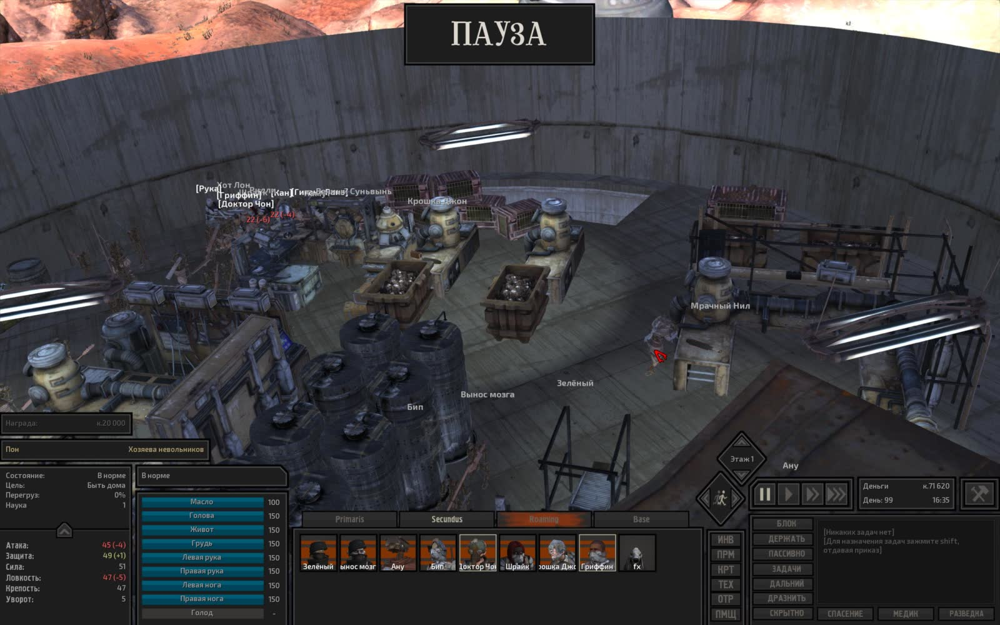

---

### Серия 2 (1 кадр)

- **Файловое время**: с `2026-10-29T06:45:33Z` по `2026-10-29T06:45:33Z`
- **Игровое время (OCR)**: `День 100, 15:20`
- **Локация (OCR)**: Не зафиксирована в UI
- **Персонажи в UI (OCR)**: Ану
- **Задачи/предметы в UI**: Медик, Роботехника

**Кадры серии:**
- [screenshot_130-85d9d008.jpg](screenshot_130-85d9d008.jpg) ([GitHub](https://github.com/asaf1n/Kenshi-Compain/blob/main/published/screenshots/screenshot_130-85d9d008.jpg) | [Raw](https://raw.githubusercontent.com/asaf1n/Kenshi-Compain/main/published/screenshots/screenshot_130-85d9d008.jpg))

---

### Серия 3 (1 кадр)

- **Файловое время**: с `2026-10-29T14:27:51Z` по `2026-10-29T14:27:51Z`
- **Игровое время (OCR)**: `День 104, 02:01`
- **Локация (OCR)**: Не зафиксирована в UI
- **Персонажи в UI (OCR)**: Хот Лон
- **Задачи/предметы в UI**: Медик, Роботехника

**Кадры серии:**
- [screenshot_144-985b52b1.jpg](screenshot_144-985b52b1.jpg) ([GitHub](https://github.com/asaf1n/Kenshi-Compain/blob/main/published/screenshots/screenshot_144-985b52b1.jpg) | [Raw](https://raw.githubusercontent.com/asaf1n/Kenshi-Compain/main/published/screenshots/screenshot_144-985b52b1.jpg))

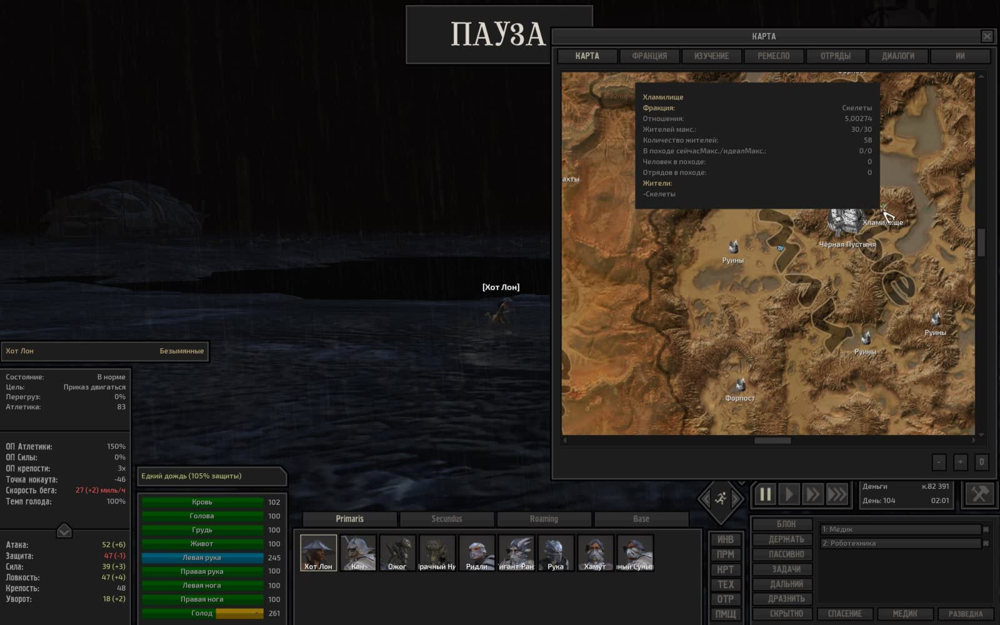

---

### Серия 4 (1 кадр)

- **Файловое время**: с `2026-10-30T04:39:23Z` по `2026-10-30T04:39:23Z`
- **Игровое время (OCR)**: `День 108, 05:04`
- **Локация (OCR)**: Не зафиксирована в UI
- **Персонажи в UI (OCR)**: Не зафиксированы в UI
- **Задачи/предметы в UI**: Быть рядом: Хот Лон, Медик, Роботехника

**Кадры серии:**
- [screenshot_156-e26a05f2.jpg](screenshot_156-e26a05f2.jpg) ([GitHub](https://github.com/asaf1n/Kenshi-Compain/blob/main/published/screenshots/screenshot_156-e26a05f2.jpg) | [Raw](https://raw.githubusercontent.com/asaf1n/Kenshi-Compain/main/published/screenshots/screenshot_156-e26a05f2.jpg))

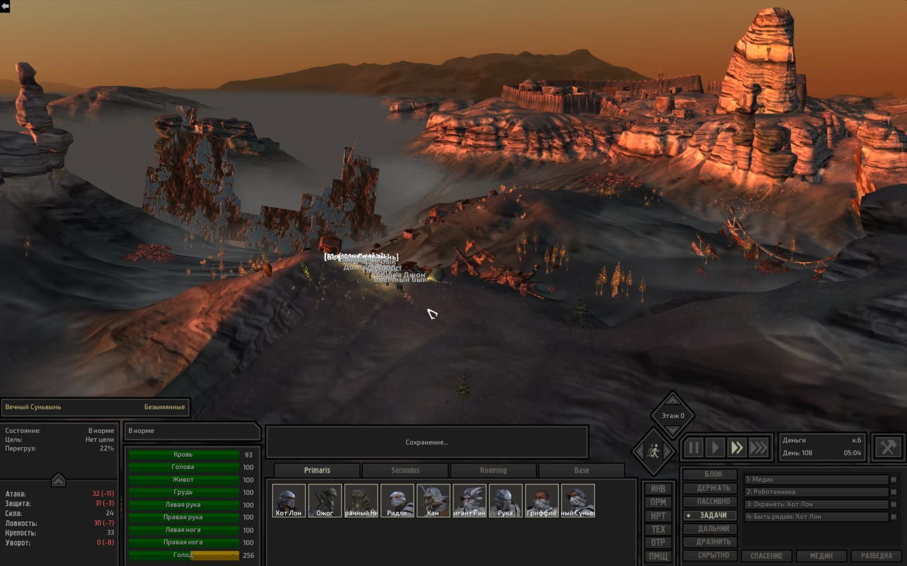

---

### Серия 5 (1 кадр)

- **Файловое время**: с `2026-10-30T08:00:21Z` по `2026-10-30T08:00:21Z`
- **Игровое время (OCR)**: `Не зафиксировано в UI`
- **Локация (OCR)**: Не зафиксирована в UI
- **Персонажи в UI (OCR)**: Хот Лон

**Кадры серии:**
- [screenshot_169-2f9ce32c.jpg](screenshot_169-2f9ce32c.jpg) ([GitHub](https://github.com/asaf1n/Kenshi-Compain/blob/main/published/screenshots/screenshot_169-2f9ce32c.jpg) | [Raw](https://raw.githubusercontent.com/asaf1n/Kenshi-Compain/main/published/screenshots/screenshot_169-2f9ce32c.jpg))

---

### Серия 6 (1 кадр)

- **Файловое время**: с `2026-10-30T13:11:05Z` по `2026-10-30T13:11:05Z`
- **Игровое время (OCR)**: `День 111, 21:26`
- **Локация (OCR)**: Не зафиксирована в UI
- **Персонажи в UI (OCR)**: Не зафиксированы в UI

**Кадры серии:**
- [screenshot_180-e8178bc5.jpg](screenshot_180-e8178bc5.jpg) ([GitHub](https://github.com/asaf1n/Kenshi-Compain/blob/main/published/screenshots/screenshot_180-e8178bc5.jpg) | [Raw](https://raw.githubusercontent.com/asaf1n/Kenshi-Compain/main/published/screenshots/screenshot_180-e8178bc5.jpg))

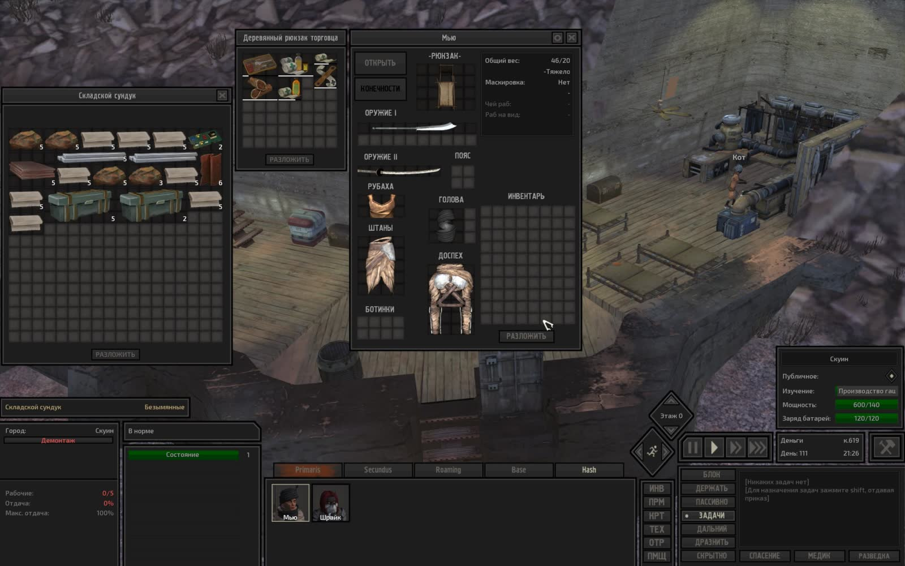

---

### Серия 7 (1 кадр)

- **Файловое время**: с `2026-10-30T16:45:03Z` по `2026-10-30T16:45:03Z`
- **Игровое время (OCR)**: `День 114, 08:04`
- **Локация (OCR)**: Не зафиксирована в UI
- **Персонажи в UI (OCR)**: Не зафиксированы в UI
- **Задачи/предметы в UI**: Работа с машиной: Пеньковая ферма 1-, Работа с машиной: Пеньковая ферма L

**Кадры серии:**
- [screenshot_191-f57f4429.jpg](screenshot_191-f57f4429.jpg) ([GitHub](https://github.com/asaf1n/Kenshi-Compain/blob/main/published/screenshots/screenshot_191-f57f4429.jpg) | [Raw](https://raw.githubusercontent.com/asaf1n/Kenshi-Compain/main/published/screenshots/screenshot_191-f57f4429.jpg))

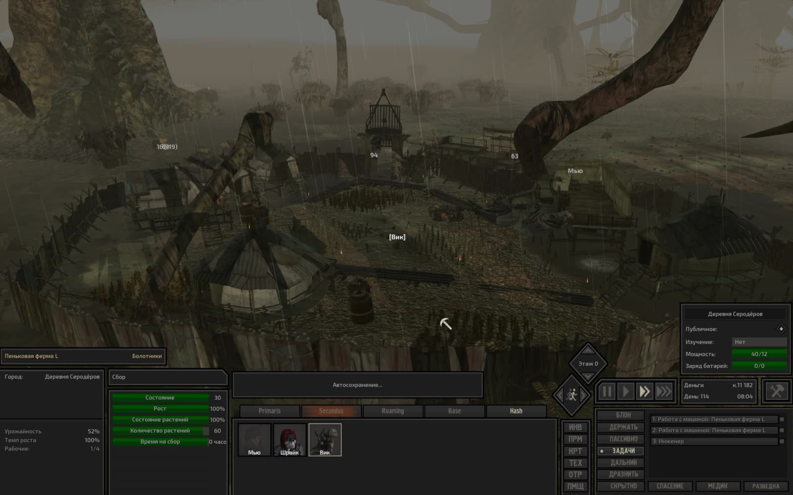

---

### Серия 8 (1 кадр)

- **Файловое время**: с `2026-10-31T02:09:42Z` по `2026-10-31T02:09:42Z`
- **Игровое время (OCR)**: `День 116, 17:50`
- **Локация (OCR)**: Не зафиксирована в UI
- **Персонажи в UI (OCR)**: Не зафиксированы в UI

**Кадры серии:**
- [screenshot_202-326033fa.jpg](screenshot_202-326033fa.jpg) ([GitHub](https://github.com/asaf1n/Kenshi-Compain/blob/main/published/screenshots/screenshot_202-326033fa.jpg) | [Raw](https://raw.githubusercontent.com/asaf1n/Kenshi-Compain/main/published/screenshots/screenshot_202-326033fa.jpg))

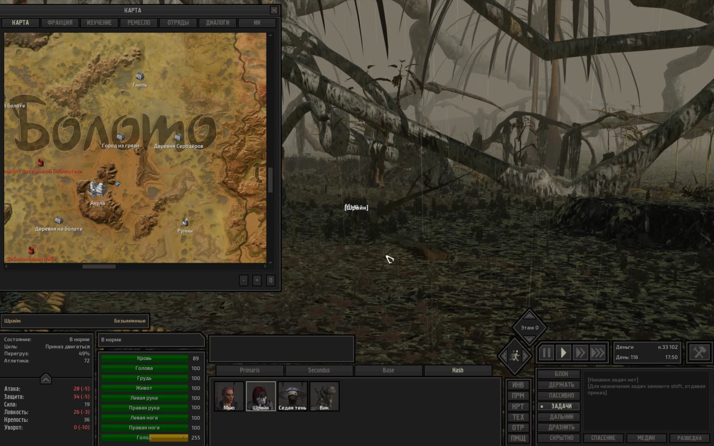

---

### Серия 9 (1 кадр)

- **Файловое время**: с `2026-10-31T04:57:26Z` по `2026-10-31T04:57:26Z`
- **Игровое время (OCR)**: `День 117, 06:54`
- **Локация (OCR)**: Не зафиксирована в UI
- **Персонажи в UI (OCR)**: Чад
- **Задачи/предметы в UI**: Медик, Роботехника

**Кадры серии:**
- [screenshot_212-f7b98deb.jpg](screenshot_212-f7b98deb.jpg) ([GitHub](https://github.com/asaf1n/Kenshi-Compain/blob/main/published/screenshots/screenshot_212-f7b98deb.jpg) | [Raw](https://raw.githubusercontent.com/asaf1n/Kenshi-Compain/main/published/screenshots/screenshot_212-f7b98deb.jpg))

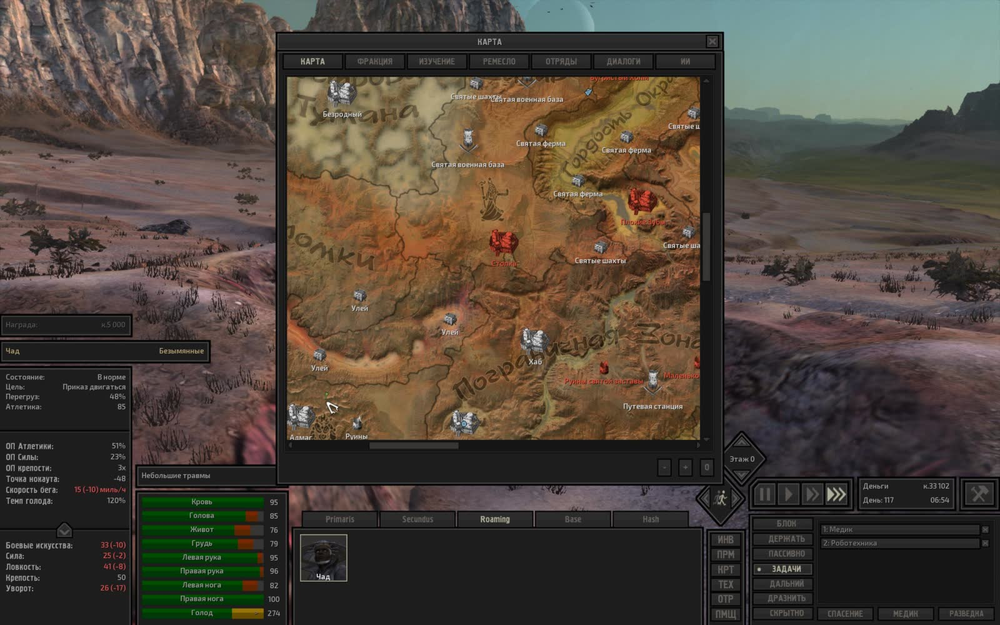

---

### Серия 10 (1 кадр)

- **Файловое время**: с `2026-10-31T08:42:24Z` по `2026-10-31T08:42:24Z`
- **Игровое время (OCR)**: `Не зафиксировано в UI`
- **Локация (OCR)**: Не зафиксирована в UI
- **Персонажи в UI (OCR)**: Не зафиксированы в UI

**Кадры серии:**
- [screenshot_223-4f55f3a6.jpg](screenshot_223-4f55f3a6.jpg) ([GitHub](https://github.com/asaf1n/Kenshi-Compain/blob/main/published/screenshots/screenshot_223-4f55f3a6.jpg) | [Raw](https://raw.githubusercontent.com/asaf1n/Kenshi-Compain/main/published/screenshots/screenshot_223-4f55f3a6.jpg))

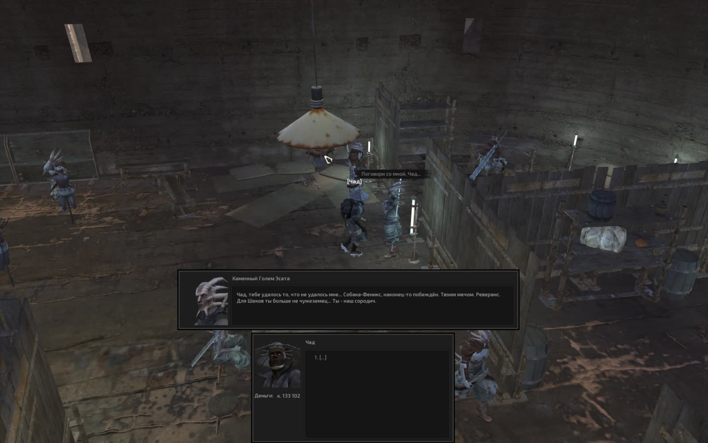

---

### Серия 11 (1 кадр)

- **Файловое время**: с `2026-10-31T12:18:35Z` по `2026-10-31T12:18:35Z`
- **Игровое время (OCR)**: `День 118, 06:41`
- **Локация (OCR)**: Не зафиксирована в UI
- **Персонажи в UI (OCR)**: Пиа

**Кадры серии:**
- [screenshot_233-0b6b3b83.jpg](screenshot_233-0b6b3b83.jpg) ([GitHub](https://github.com/asaf1n/Kenshi-Compain/blob/main/published/screenshots/screenshot_233-0b6b3b83.jpg) | [Raw](https://raw.githubusercontent.com/asaf1n/Kenshi-Compain/main/published/screenshots/screenshot_233-0b6b3b83.jpg))

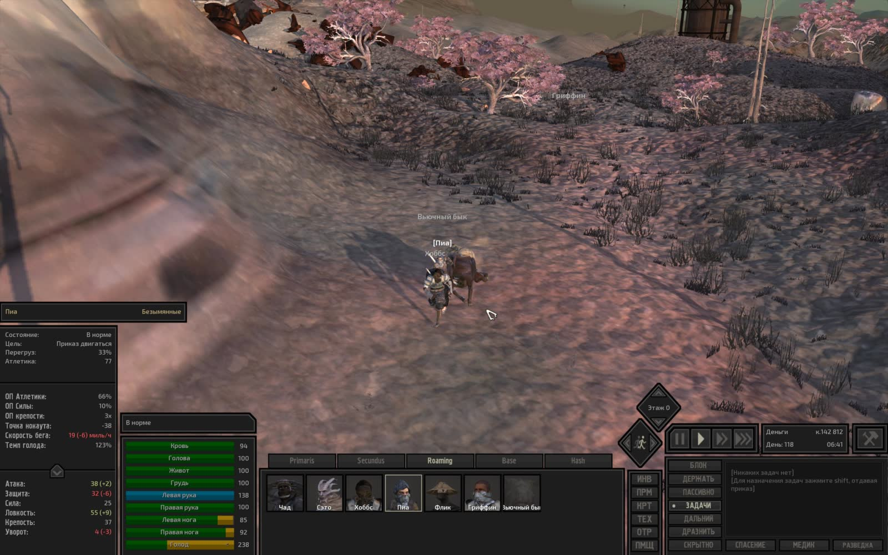

---

### Серия 12 (1 кадр)

- **Файловое время**: с `2026-10-31T14:53:57Z` по `2026-10-31T14:53:57Z`
- **Игровое время (OCR)**: `День 119, 11:10`
- **Локация (OCR)**: Не зафиксирована в UI
- **Персонажи в UI (OCR)**: Хот Лон

**Кадры серии:**
- [screenshot_243-fc570778.jpg](screenshot_243-fc570778.jpg) ([GitHub](https://github.com/asaf1n/Kenshi-Compain/blob/main/published/screenshots/screenshot_243-fc570778.jpg) | [Raw](https://raw.githubusercontent.com/asaf1n/Kenshi-Compain/main/published/screenshots/screenshot_243-fc570778.jpg))

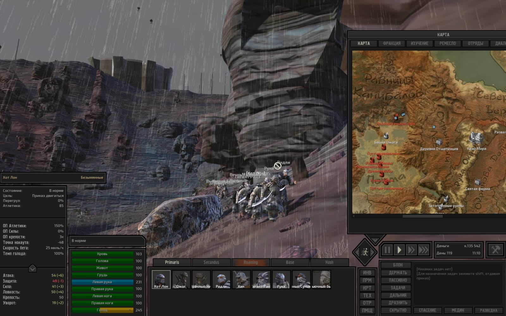

---

### Серия 13 (1 кадр)

- **Файловое время**: с `2026-11-01T01:23:18Z` по `2026-11-01T01:23:18Z`
- **Игровое время (OCR)**: `День 120, 11:26`
- **Локация (OCR)**: Не зафиксирована в UI
- **Персонажи в UI (OCR)**: Седая тень
- **Задачи/предметы в UI**: Работа с машиной, Тащить в

**Кадры серии:**
- [screenshot_255-1bd0bcd3.jpg](screenshot_255-1bd0bcd3.jpg) ([GitHub](https://github.com/asaf1n/Kenshi-Compain/blob/main/published/screenshots/screenshot_255-1bd0bcd3.jpg) | [Raw](https://raw.githubusercontent.com/asaf1n/Kenshi-Compain/main/published/screenshots/screenshot_255-1bd0bcd3.jpg))

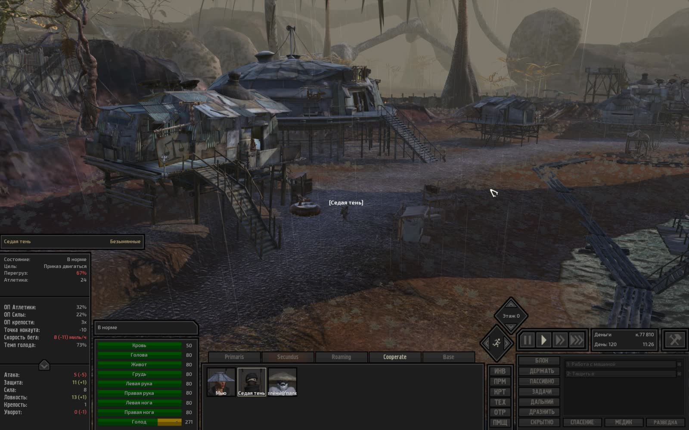

---

### Серия 14 (1 кадр)

- **Файловое время**: с `2026-11-01T04:29:42Z` по `2026-11-01T04:29:42Z`
- **Игровое время (OCR)**: `День 121, 06:58`
- **Локация (OCR)**: Не зафиксирована в UI
- **Персонажи в UI (OCR)**: Не зафиксированы в UI
- **Задачи/предметы в UI**: Быть рядом: Хот Лон, Медик, Роботехника

**Кадры серии:**
- [screenshot_265-aae09eac.jpg](screenshot_265-aae09eac.jpg) ([GitHub](https://github.com/asaf1n/Kenshi-Compain/blob/main/published/screenshots/screenshot_265-aae09eac.jpg) | [Raw](https://raw.githubusercontent.com/asaf1n/Kenshi-Compain/main/published/screenshots/screenshot_265-aae09eac.jpg))

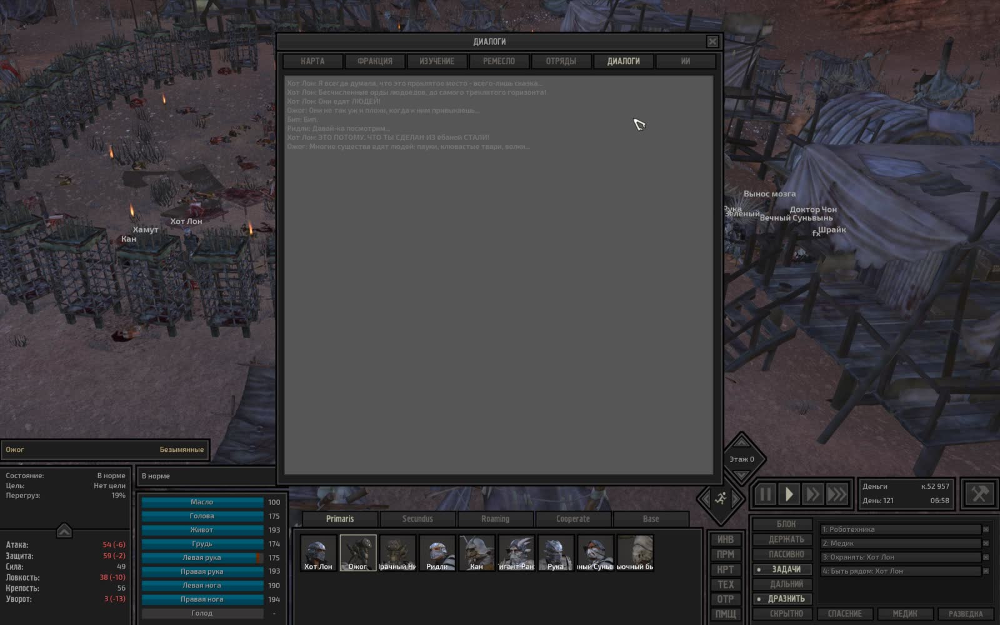

---

### Серия 15 (1 кадр)

- **Файловое время**: с `2026-11-01T05:21:26Z` по `2026-11-01T05:21:26Z`
- **Игровое время (OCR)**: `День 121, 23:09`
- **Локация (OCR)**: Не зафиксирована в UI
- **Персонажи в UI (OCR)**: Флик
- **Задачи/предметы в UI**: Быть рядом: Кот, Медик, Роботехника

**Кадры серии:**
- [screenshot_276-8016d51f.jpg](screenshot_276-8016d51f.jpg) ([GitHub](https://github.com/asaf1n/Kenshi-Compain/blob/main/published/screenshots/screenshot_276-8016d51f.jpg) | [Raw](https://raw.githubusercontent.com/asaf1n/Kenshi-Compain/main/published/screenshots/screenshot_276-8016d51f.jpg))

---

### Серия 16 (1 кадр)

- **Файловое время**: с `2026-11-01T10:27:41Z` по `2026-11-01T10:27:41Z`
- **Игровое время (OCR)**: `День 122, 14:08`
- **Локация (OCR)**: Не зафиксирована в UI
- **Персонажи в UI (OCR)**: Мрачный Нил
- **Задачи/предметы в UI**: Быть рядом: Хот Лон, Медик, Роботехника

**Кадры серии:**
- [screenshot_288-5535f30d.jpg](screenshot_288-5535f30d.jpg) ([GitHub](https://github.com/asaf1n/Kenshi-Compain/blob/main/published/screenshots/screenshot_288-5535f30d.jpg) | [Raw](https://raw.githubusercontent.com/asaf1n/Kenshi-Compain/main/published/screenshots/screenshot_288-5535f30d.jpg))

---

### Серия 17 (1 кадр)

- **Файловое время**: с `2026-11-01T10:35:37Z` по `2026-11-01T10:35:37Z`
- **Игровое время (OCR)**: `День 122, 16:47`
- **Локация (OCR)**: Не зафиксирована в UI
- **Персонажи в UI (OCR)**: Хот Лон

**Кадры серии:**
- [screenshot_298-deb3e75d.jpg](screenshot_298-deb3e75d.jpg) ([GitHub](https://github.com/asaf1n/Kenshi-Compain/blob/main/published/screenshots/screenshot_298-deb3e75d.jpg) | [Raw](https://raw.githubusercontent.com/asaf1n/Kenshi-Compain/main/published/screenshots/screenshot_298-deb3e75d.jpg))

---

### Серия 18 (1 кадр)

- **Файловое время**: с `2026-11-01T11:48:31Z` по `2026-11-01T11:48:31Z`
- **Игровое время (OCR)**: `День 123, 18:25`
- **Локация (OCR)**: Не зафиксирована в UI
- **Персонажи в UI (OCR)**: Флик
- **Задачи/предметы в UI**: Медик, Роботехника

**Кадры серии:**
- [screenshot_308-1f02e349.jpg](screenshot_308-1f02e349.jpg) ([GitHub](https://github.com/asaf1n/Kenshi-Compain/blob/main/published/screenshots/screenshot_308-1f02e349.jpg) | [Raw](https://raw.githubusercontent.com/asaf1n/Kenshi-Compain/main/published/screenshots/screenshot_308-1f02e349.jpg))

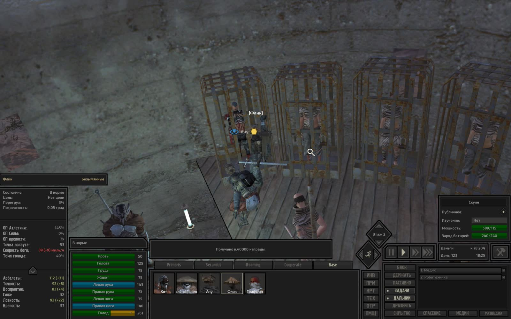

---

### Серия 19 (1 кадр)

- **Файловое время**: с `2026-11-01T12:39:07Z` по `2026-11-01T12:39:07Z`
- **Игровое время (OCR)**: `День 124, 08:06`
- **Локация (OCR)**: Не зафиксирована в UI
- **Персонажи в UI (OCR)**: Вьючный бык
- **Задачи/предметы в UI**: Быть рядом: Хот Лон, Охранять: Хот Лон

**Кадры серии:**
- [screenshot_319-19eff87a.jpg](screenshot_319-19eff87a.jpg) ([GitHub](https://github.com/asaf1n/Kenshi-Compain/blob/main/published/screenshots/screenshot_319-19eff87a.jpg) | [Raw](https://raw.githubusercontent.com/asaf1n/Kenshi-Compain/main/published/screenshots/screenshot_319-19eff87a.jpg))

---

### Серия 20 (1 кадр)

- **Файловое время**: с `2026-11-01T13:14:00Z` по `2026-11-01T13:14:00Z`
- **Игровое время (OCR)**: `День 124, 18:46`
- **Локация (OCR)**: Не зафиксирована в UI
- **Персонажи в UI (OCR)**: Хот Лон

**Кадры серии:**
- [screenshot_332-fdeb0bad.jpg](screenshot_332-fdeb0bad.jpg) ([GitHub](https://github.com/asaf1n/Kenshi-Compain/blob/main/published/screenshots/screenshot_332-fdeb0bad.jpg) | [Raw](https://raw.githubusercontent.com/asaf1n/Kenshi-Compain/main/published/screenshots/screenshot_332-fdeb0bad.jpg))

---

### Серия 21 (1 кадр)

- **Файловое время**: с `2026-11-01T15:56:55Z` по `2026-11-01T15:56:55Z`
- **Игровое время (OCR)**: `День 125, 17:17`
- **Локация (OCR)**: Не зафиксирована в UI
- **Персонажи в UI (OCR)**: Не зафиксированы в UI
- **Задачи/предметы в UI**: Быть рядом: Зелёный, Охранять: Зелёный

**Кадры серии:**
- [screenshot_342-42b0e53a.jpg](screenshot_342-42b0e53a.jpg) ([GitHub](https://github.com/asaf1n/Kenshi-Compain/blob/main/published/screenshots/screenshot_342-42b0e53a.jpg) | [Raw](https://raw.githubusercontent.com/asaf1n/Kenshi-Compain/main/published/screenshots/screenshot_342-42b0e53a.jpg))

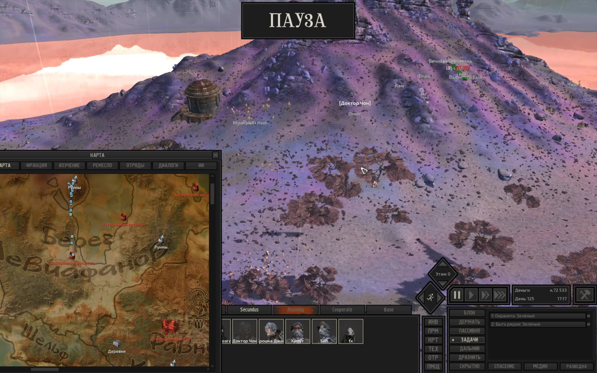

---

### Серия 22 (1 кадр)

- **Файловое время**: с `2026-11-01T17:53:37Z` по `2026-11-01T17:53:37Z`
- **Игровое время (OCR)**: `День 127, 03:13`
- **Локация (OCR)**: Не зафиксирована в UI
- **Персонажи в UI (OCR)**: Не зафиксированы в UI
- **Задачи/предметы в UI**: Работа с машиной, Тащить в

**Кадры серии:**
- [screenshot_354-6bfd6720.jpg](screenshot_354-6bfd6720.jpg) ([GitHub](https://github.com/asaf1n/Kenshi-Compain/blob/main/published/screenshots/screenshot_354-6bfd6720.jpg) | [Raw](https://raw.githubusercontent.com/asaf1n/Kenshi-Compain/main/published/screenshots/screenshot_354-6bfd6720.jpg))

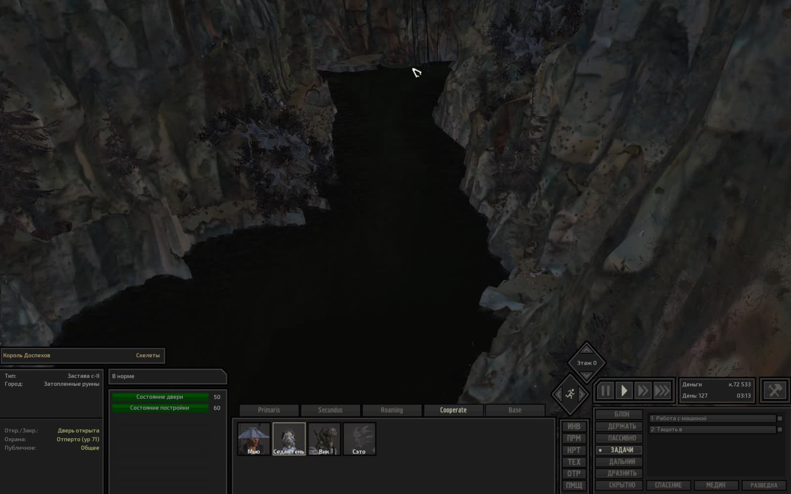

---

### Серия 23 (1 кадр)

- **Файловое время**: с `2026-11-02T00:35:11Z` по `2026-11-02T00:35:11Z`
- **Игровое время (OCR)**: `День 127, 17:06`
- **Локация (OCR)**: Не зафиксирована в UI
- **Персонажи в UI (OCR)**: Не зафиксированы в UI

**Кадры серии:**
- [screenshot_365-7175b352.jpg](screenshot_365-7175b352.jpg) ([GitHub](https://github.com/asaf1n/Kenshi-Compain/blob/main/published/screenshots/screenshot_365-7175b352.jpg) | [Raw](https://raw.githubusercontent.com/asaf1n/Kenshi-Compain/main/published/screenshots/screenshot_365-7175b352.jpg))

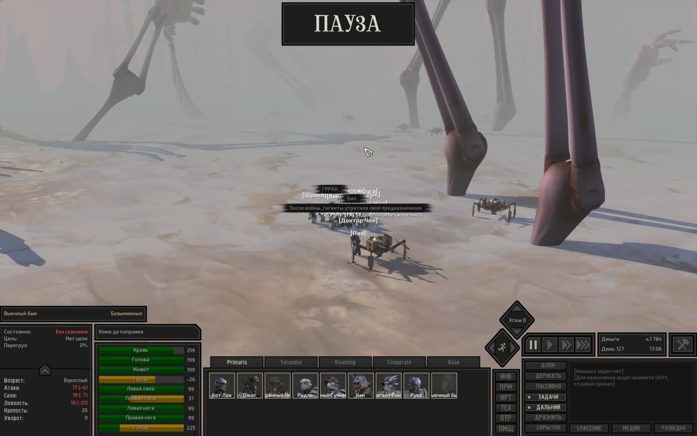

---

### Серия 24 (1 кадр)

- **Файловое время**: с `2026-11-03T01:07:08Z` по `2026-11-03T01:07:08Z`
- **Игровое время (OCR)**: `День 129, 15:24`
- **Локация (OCR)**: Не зафиксирована в UI
- **Персонажи в UI (OCR)**: Каменная крыса

**Кадры серии:**
- [screenshot_375-b77d3512.jpg](screenshot_375-b77d3512.jpg) ([GitHub](https://github.com/asaf1n/Kenshi-Compain/blob/main/published/screenshots/screenshot_375-b77d3512.jpg) | [Raw](https://raw.githubusercontent.com/asaf1n/Kenshi-Compain/main/published/screenshots/screenshot_375-b77d3512.jpg))

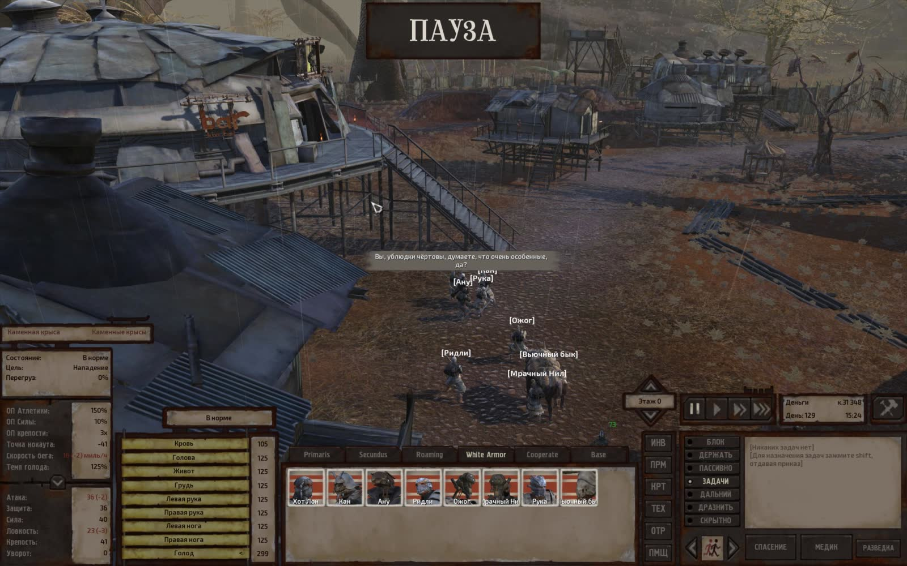

---

### Серия 25 (1 кадр)

- **Файловое время**: с `2026-11-03T01:29:35Z` по `2026-11-03T01:29:35Z`
- **Игровое время (OCR)**: `День 129, 22:23`
- **Локация (OCR)**: Не зафиксирована в UI
- **Персонажи в UI (OCR)**: Тень

**Кадры серии:**
- [screenshot_385-ae0ec601.jpg](screenshot_385-ae0ec601.jpg) ([GitHub](https://github.com/asaf1n/Kenshi-Compain/blob/main/published/screenshots/screenshot_385-ae0ec601.jpg) | [Raw](https://raw.githubusercontent.com/asaf1n/Kenshi-Compain/main/published/screenshots/screenshot_385-ae0ec601.jpg))

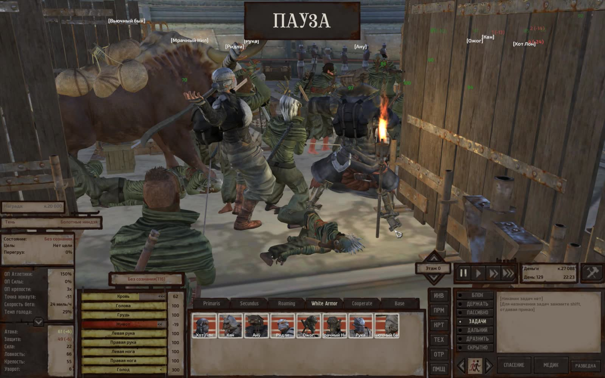

---

### Серия 26 (1 кадр)

- **Файловое время**: с `2026-11-03T02:10:40Z` по `2026-11-03T02:10:40Z`
- **Игровое время (OCR)**: `День 130, 06:13`
- **Локация (OCR)**: Не зафиксирована в UI
- **Персонажи в UI (OCR)**: туз эл

**Кадры серии:**
- [screenshot_398-5218712f.jpg](screenshot_398-5218712f.jpg) ([GitHub](https://github.com/asaf1n/Kenshi-Compain/blob/main/published/screenshots/screenshot_398-5218712f.jpg) | [Raw](https://raw.githubusercontent.com/asaf1n/Kenshi-Compain/main/published/screenshots/screenshot_398-5218712f.jpg))

---

### Серия 27 (1 кадр)

- **Файловое время**: с `2026-11-03T02:44:08Z` по `2026-11-03T02:44:08Z`
- **Игровое время (OCR)**: `День 130, 08:58`
- **Локация (OCR)**: Не зафиксирована в UI
- **Персонажи в UI (OCR)**: Хот Лон
- **Задачи/предметы в UI**: Медик, Роботехника

**Кадры серии:**
- [screenshot_410-b469c2b3.jpg](screenshot_410-b469c2b3.jpg) ([GitHub](https://github.com/asaf1n/Kenshi-Compain/blob/main/published/screenshots/screenshot_410-b469c2b3.jpg) | [Raw](https://raw.githubusercontent.com/asaf1n/Kenshi-Compain/main/published/screenshots/screenshot_410-b469c2b3.jpg))

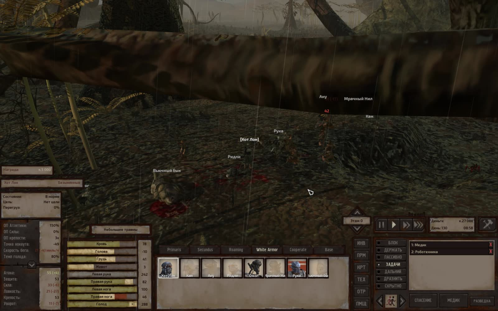

---

### Серия 28 (1 кадр)

- **Файловое время**: с `2026-11-03T04:06:25Z` по `2026-11-03T04:06:25Z`
- **Игровое время (OCR)**: `День 130, 21:30`
- **Локация (OCR)**: Не зафиксирована в UI
- **Персонажи в UI (OCR)**: Ану
- **Задачи/предметы в UI**: Медик, Роботехника

**Кадры серии:**
- [screenshot_420-8e064d65.jpg](screenshot_420-8e064d65.jpg) ([GitHub](https://github.com/asaf1n/Kenshi-Compain/blob/main/published/screenshots/screenshot_420-8e064d65.jpg) | [Raw](https://raw.githubusercontent.com/asaf1n/Kenshi-Compain/main/published/screenshots/screenshot_420-8e064d65.jpg))

---

### Серия 29 (1 кадр)

- **Файловое время**: с `2026-11-04T08:44:49Z` по `2026-11-04T08:44:49Z`
- **Игровое время (OCR)**: `День 132, 10:11`
- **Локация (OCR)**: Не зафиксирована в UI
- **Персонажи в UI (OCR)**: Зелёный палец
- **Задачи/предметы в UI**: Работа с машиной: Пеньковая ферма 1-, Работа с машиной: Пеньковая ферма L, Работа с машиной: Рисовая ферма 1-, Тащить в: Хранение: рис

**Кадры серии:**
- [screenshot_432-cb332892.jpg](screenshot_432-cb332892.jpg) ([GitHub](https://github.com/asaf1n/Kenshi-Compain/blob/main/published/screenshots/screenshot_432-cb332892.jpg) | [Raw](https://raw.githubusercontent.com/asaf1n/Kenshi-Compain/main/published/screenshots/screenshot_432-cb332892.jpg))

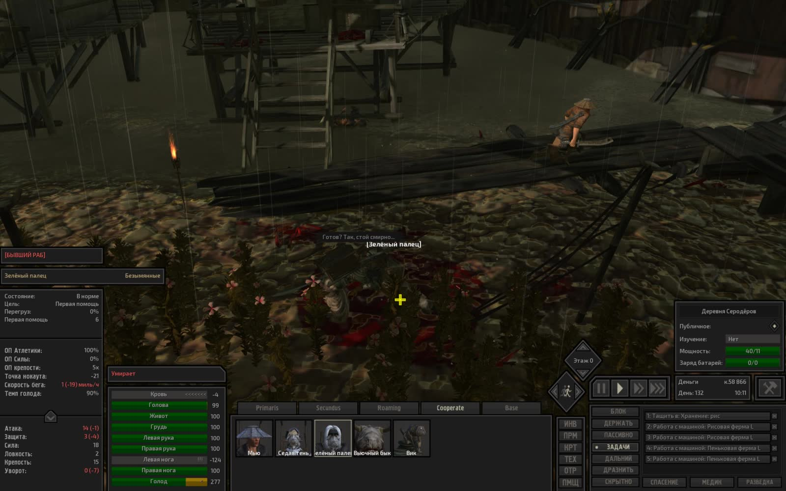

---

### Серия 30 (1 кадр)

- **Файловое время**: с `2026-11-04T16:53:43Z` по `2026-11-04T16:53:43Z`
- **Игровое время (OCR)**: `День 132, 21:23`
- **Локация (OCR)**: Не зафиксирована в UI
- **Персонажи в UI (OCR)**: Зелёный палец
- **Задачи/предметы в UI**: Работа с машиной: Пеньковая ферма, Работа с машиной: Пеньковая ферма 1-, Работа с машиной: Рисовая ферма L, Тащить в: Хранение: рис

**Кадры серии:**
- [screenshot_443-97b97dd4.jpg](screenshot_443-97b97dd4.jpg) ([GitHub](https://github.com/asaf1n/Kenshi-Compain/blob/main/published/screenshots/screenshot_443-97b97dd4.jpg) | [Raw](https://raw.githubusercontent.com/asaf1n/Kenshi-Compain/main/published/screenshots/screenshot_443-97b97dd4.jpg))

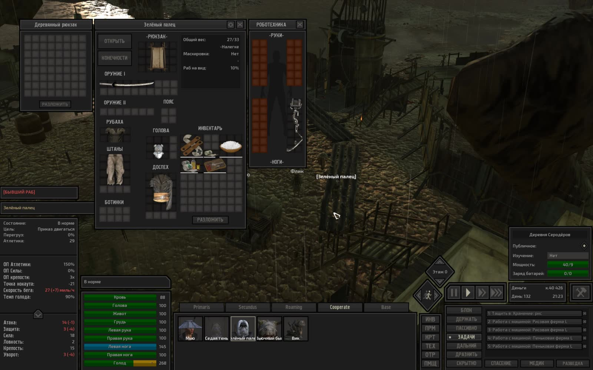

---
