# Визуальная лента скриншотов Kenshi

- **Обновлено**: `2026-11-03T03:10:48Z`
- **Окно выборки**: последние 7 суток (с `2026-10-27T03:10:48Z` по `2026-11-03T03:10:48Z`)
- **Количество скриншотов**: 336

Визуальная лента игрового процесса в хронологическом порядке для контекста чат-моделей (ChatGPT, Claude, Gemini). Изображения сохраняются в оригинальном разрешении и качестве.

---

### 1. screenshot_83.jpg

- **Время записи (UTC)**: `2026-10-27T07:52:48Z`
- **Размер**: 681.5 КБ
- **SHA-256**: `fc7fc36767120d957787691d1109c6820b1a00a2a42ef27b21fbad09b5f0b262`
- **Ссылки**: [Просмотр в GitHub](https://github.com/asaf1n/kenshi-campaign-tech/blob/main/published/screenshots/screenshot_83.jpg) | [Прямой Raw URL](https://raw.githubusercontent.com/asaf1n/kenshi-campaign-tech/main/published/screenshots/screenshot_83.jpg)

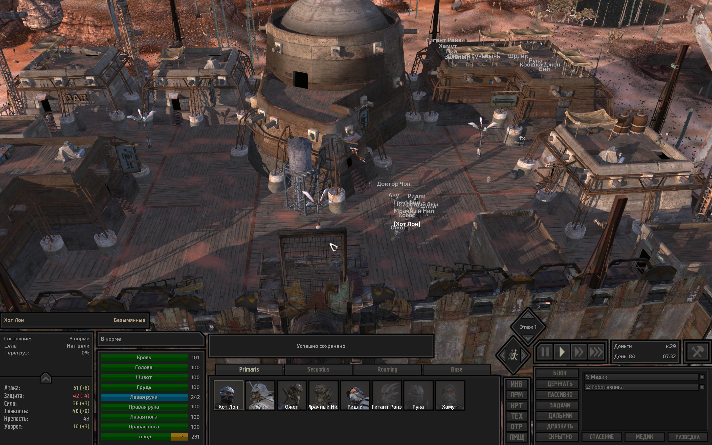

---

### 2. screenshot_84.jpg

- **Время записи (UTC)**: `2026-10-27T14:39:28Z`
- **Размер**: 576.3 КБ
- **SHA-256**: `91a5ceffbf9245657f5b402dfb34f1bf33237dde99d63041dba52cd997506584`
- **Ссылки**: [Просмотр в GitHub](https://github.com/asaf1n/kenshi-campaign-tech/blob/main/published/screenshots/screenshot_84.jpg) | [Прямой Raw URL](https://raw.githubusercontent.com/asaf1n/kenshi-campaign-tech/main/published/screenshots/screenshot_84.jpg)

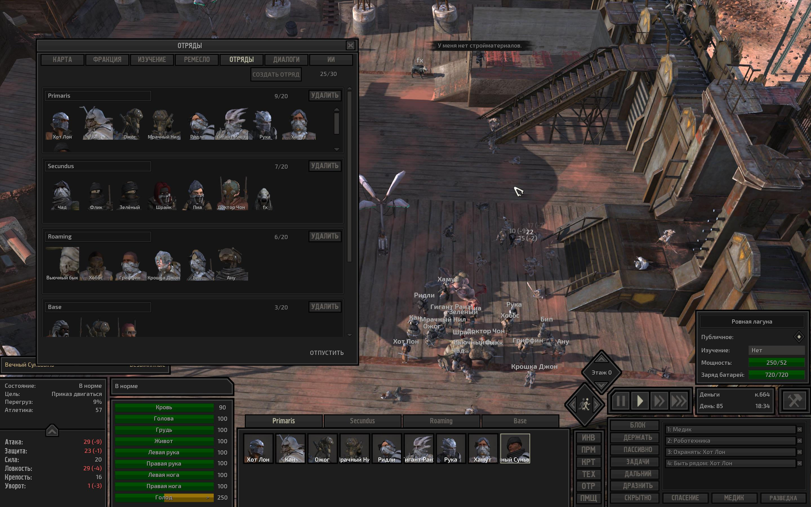

---

### 3. screenshot_85.jpg

- **Время записи (UTC)**: `2026-10-27T14:49:48Z`
- **Размер**: 671.7 КБ
- **SHA-256**: `214ad824ac37933d0b3878788f3f29257a19b6c8b925033ab4bc54a9836ca695`
- **Ссылки**: [Просмотр в GitHub](https://github.com/asaf1n/kenshi-campaign-tech/blob/main/published/screenshots/screenshot_85.jpg) | [Прямой Raw URL](https://raw.githubusercontent.com/asaf1n/kenshi-campaign-tech/main/published/screenshots/screenshot_85.jpg)

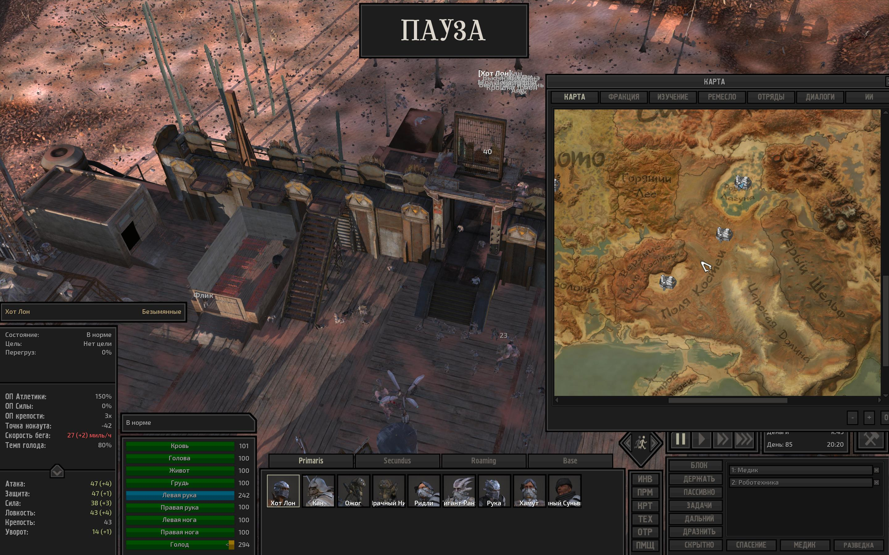

---

### 4. screenshot_86.jpg

- **Время записи (UTC)**: `2026-10-27T15:43:05Z`
- **Размер**: 640.1 КБ
- **SHA-256**: `3a9cf9955551bedf0d61ed1d49d7f89cd7df9ce0215d05186eb6cb4d1c758c36`
- **Ссылки**: [Просмотр в GitHub](https://github.com/asaf1n/kenshi-campaign-tech/blob/main/published/screenshots/screenshot_86.jpg) | [Прямой Raw URL](https://raw.githubusercontent.com/asaf1n/kenshi-campaign-tech/main/published/screenshots/screenshot_86.jpg)

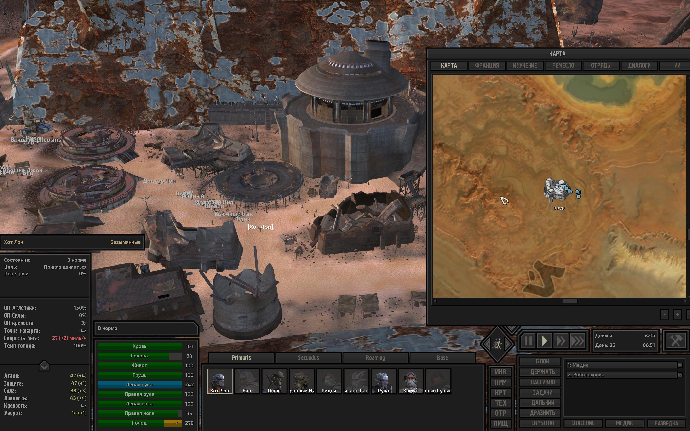

---

### 5. screenshot_87.jpg

- **Время записи (UTC)**: `2026-10-27T15:43:34Z`
- **Размер**: 680.2 КБ
- **SHA-256**: `92f5535e9c66a6181860f355c22b31bf91e06e21ff9ee6bd6f98943eb167a767`
- **Ссылки**: [Просмотр в GitHub](https://github.com/asaf1n/kenshi-campaign-tech/blob/main/published/screenshots/screenshot_87.jpg) | [Прямой Raw URL](https://raw.githubusercontent.com/asaf1n/kenshi-campaign-tech/main/published/screenshots/screenshot_87.jpg)

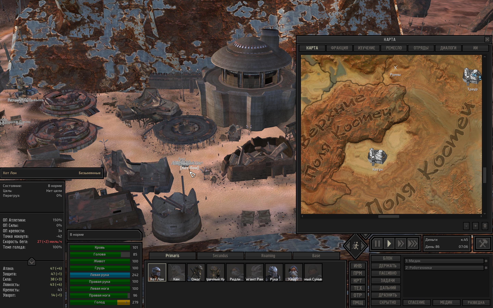

---

### 6. screenshot_88.jpg

- **Время записи (UTC)**: `2026-10-27T15:45:17Z`
- **Размер**: 685.7 КБ
- **SHA-256**: `60ae83a112ca2249271f54213efbaafe86636ffcfd69ef1289c936047ab8aeb5`
- **Ссылки**: [Просмотр в GitHub](https://github.com/asaf1n/kenshi-campaign-tech/blob/main/published/screenshots/screenshot_88.jpg) | [Прямой Raw URL](https://raw.githubusercontent.com/asaf1n/kenshi-campaign-tech/main/published/screenshots/screenshot_88.jpg)

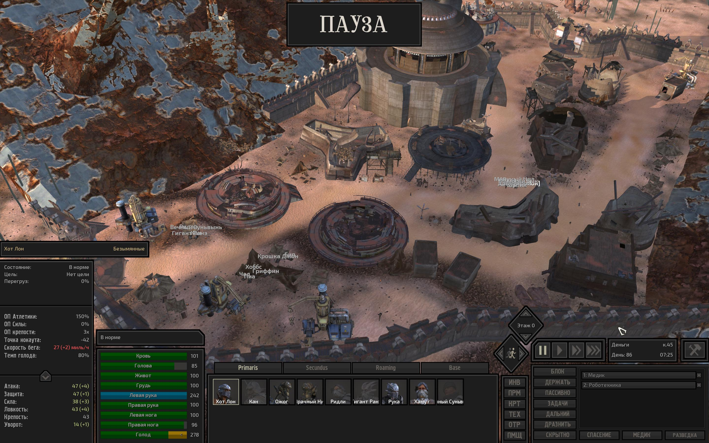

---

### 7. screenshot_89.jpg

- **Время записи (UTC)**: `2026-10-27T15:49:33Z`
- **Размер**: 441.6 КБ
- **SHA-256**: `026d7852a86160dbc4a8f228411044b2cd5c9039fe41cf8d33b03d3bd0080c21`
- **Ссылки**: [Просмотр в GitHub](https://github.com/asaf1n/kenshi-campaign-tech/blob/main/published/screenshots/screenshot_89.jpg) | [Прямой Raw URL](https://raw.githubusercontent.com/asaf1n/kenshi-campaign-tech/main/published/screenshots/screenshot_89.jpg)

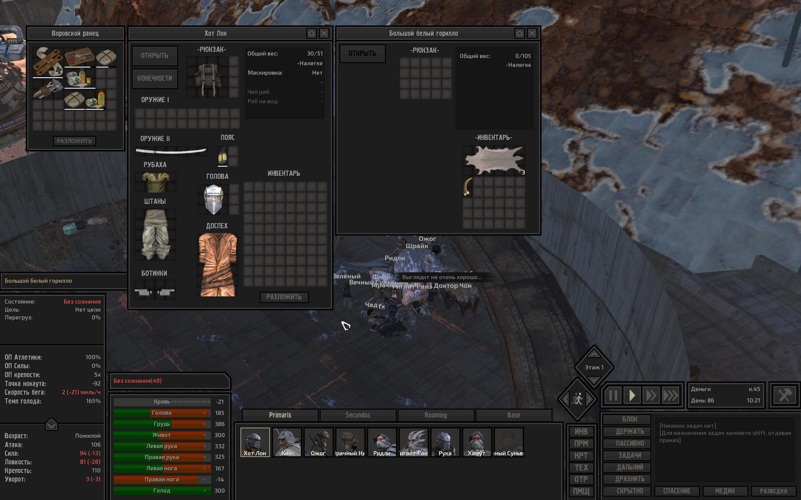

---

### 8. screenshot_90.jpg

- **Время записи (UTC)**: `2026-10-27T17:11:28Z`
- **Размер**: 499.5 КБ
- **SHA-256**: `fe870100ada96c468c3023c0d75f5cfaa92ec107fabfefb3e0952065579f31f9`
- **Ссылки**: [Просмотр в GitHub](https://github.com/asaf1n/kenshi-campaign-tech/blob/main/published/screenshots/screenshot_90.jpg) | [Прямой Raw URL](https://raw.githubusercontent.com/asaf1n/kenshi-campaign-tech/main/published/screenshots/screenshot_90.jpg)

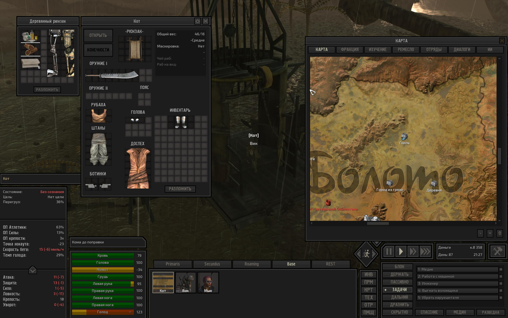

---

### 9. screenshot_91.jpg

- **Время записи (UTC)**: `2026-10-27T17:14:30Z`
- **Размер**: 533.9 КБ
- **SHA-256**: `0e4ff1c55abbd6cfff435e994df6b90be1793cb901c3e47bd808f071edea6227`
- **Ссылки**: [Просмотр в GitHub](https://github.com/asaf1n/kenshi-campaign-tech/blob/main/published/screenshots/screenshot_91.jpg) | [Прямой Raw URL](https://raw.githubusercontent.com/asaf1n/kenshi-campaign-tech/main/published/screenshots/screenshot_91.jpg)

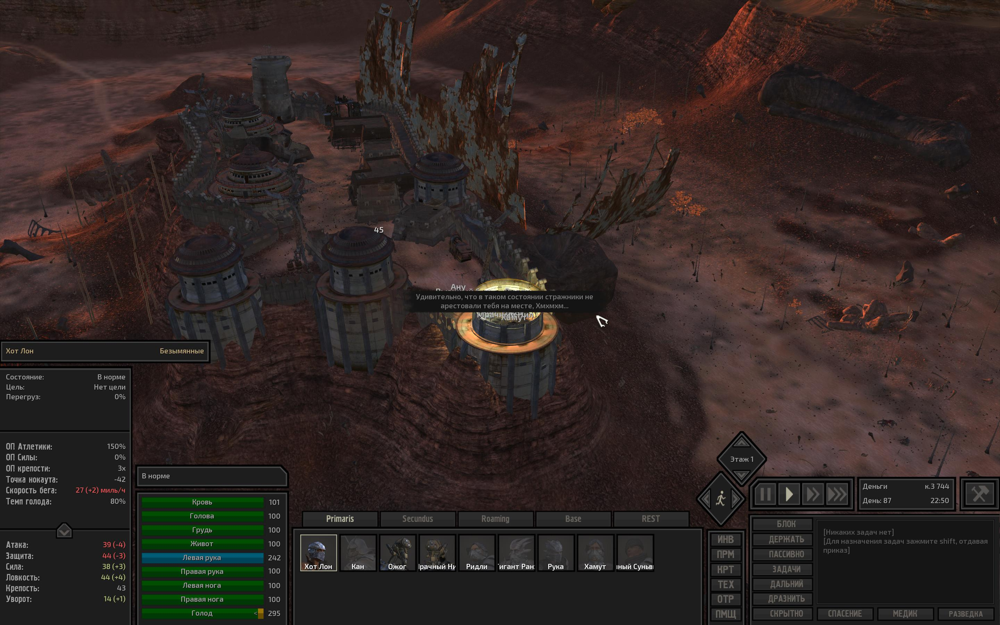

---

### 10. screenshot_92.jpg

- **Время записи (UTC)**: `2026-10-27T17:19:34Z`
- **Размер**: 573.8 КБ
- **SHA-256**: `2c23531c2cbc5fda0c66959a56b55ba0a4f166dc40005b99a42053a826d4e978`
- **Ссылки**: [Просмотр в GitHub](https://github.com/asaf1n/kenshi-campaign-tech/blob/main/published/screenshots/screenshot_92.jpg) | [Прямой Raw URL](https://raw.githubusercontent.com/asaf1n/kenshi-campaign-tech/main/published/screenshots/screenshot_92.jpg)

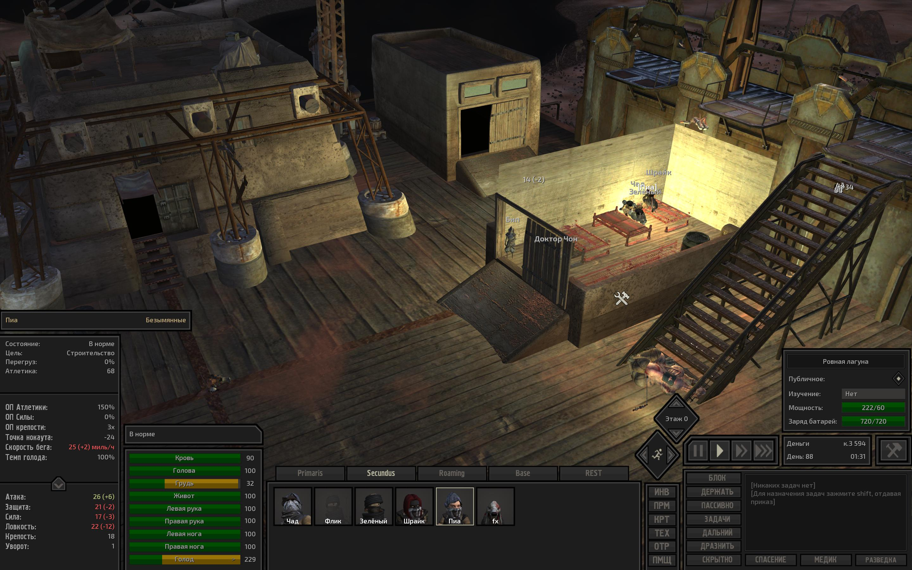

---

### 11. screenshot_93.jpg

- **Время записи (UTC)**: `2026-10-27T17:20:06Z`
- **Размер**: 498.3 КБ
- **SHA-256**: `fc781ba16673bd247f219000d18cfdfa0d0cbea797447398b19186320d4f31f2`
- **Ссылки**: [Просмотр в GitHub](https://github.com/asaf1n/kenshi-campaign-tech/blob/main/published/screenshots/screenshot_93.jpg) | [Прямой Raw URL](https://raw.githubusercontent.com/asaf1n/kenshi-campaign-tech/main/published/screenshots/screenshot_93.jpg)

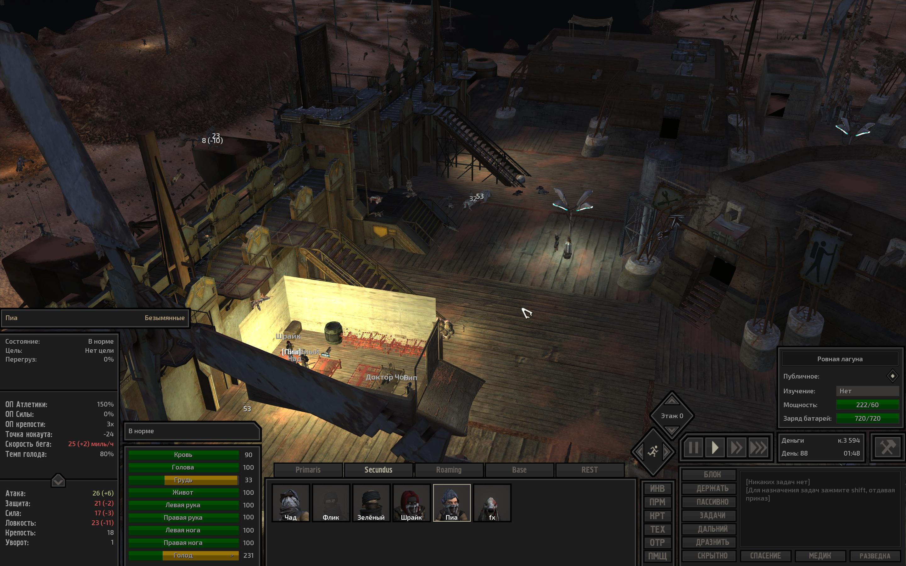

---

### 12. screenshot_94.jpg

- **Время записи (UTC)**: `2026-10-27T17:20:16Z`
- **Размер**: 506.2 КБ
- **SHA-256**: `74e20e13682e02c853b7b2b93dc2d2fa680e5fc9b1f07b2e619d0ea295a494cf`
- **Ссылки**: [Просмотр в GitHub](https://github.com/asaf1n/kenshi-campaign-tech/blob/main/published/screenshots/screenshot_94.jpg) | [Прямой Raw URL](https://raw.githubusercontent.com/asaf1n/kenshi-campaign-tech/main/published/screenshots/screenshot_94.jpg)

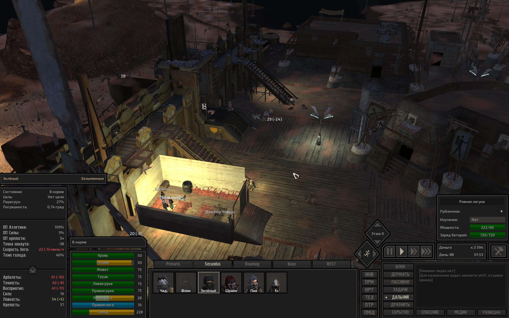

---

### 13. screenshot_95.jpg

- **Время записи (UTC)**: `2026-10-27T23:24:36Z`
- **Размер**: 452.7 КБ
- **SHA-256**: `ccbe028b53f69e002593e5c966f59b2d7d939ce63df25c2f5e090488f582aa67`
- **Ссылки**: [Просмотр в GitHub](https://github.com/asaf1n/kenshi-campaign-tech/blob/main/published/screenshots/screenshot_95.jpg) | [Прямой Raw URL](https://raw.githubusercontent.com/asaf1n/kenshi-campaign-tech/main/published/screenshots/screenshot_95.jpg)

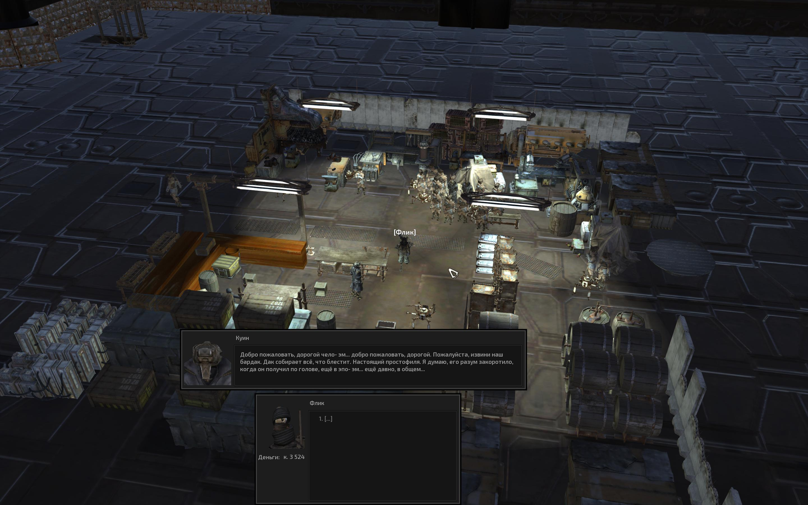

---

### 14. screenshot_96.jpg

- **Время записи (UTC)**: `2026-10-27T23:28:21Z`
- **Размер**: 477.0 КБ
- **SHA-256**: `37c51bb82c167aa854a27652caf15786295c44affe4ec60e779dbace5078d7ce`
- **Ссылки**: [Просмотр в GitHub](https://github.com/asaf1n/kenshi-campaign-tech/blob/main/published/screenshots/screenshot_96.jpg) | [Прямой Raw URL](https://raw.githubusercontent.com/asaf1n/kenshi-campaign-tech/main/published/screenshots/screenshot_96.jpg)

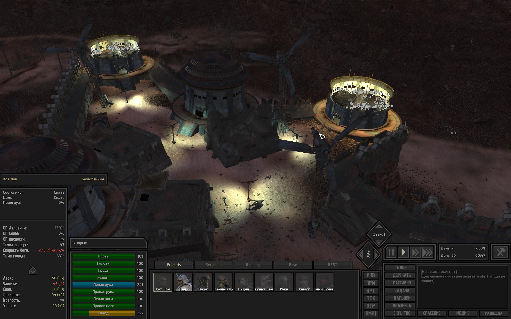

---

### 15. screenshot_97.jpg

- **Время записи (UTC)**: `2026-10-28T01:46:53Z`
- **Размер**: 592.0 КБ
- **SHA-256**: `02ab69def94d632c385813548357943426fa1c57ed9e0fc043c80d7325ad53e2`
- **Ссылки**: [Просмотр в GitHub](https://github.com/asaf1n/kenshi-campaign-tech/blob/main/published/screenshots/screenshot_97.jpg) | [Прямой Raw URL](https://raw.githubusercontent.com/asaf1n/kenshi-campaign-tech/main/published/screenshots/screenshot_97.jpg)

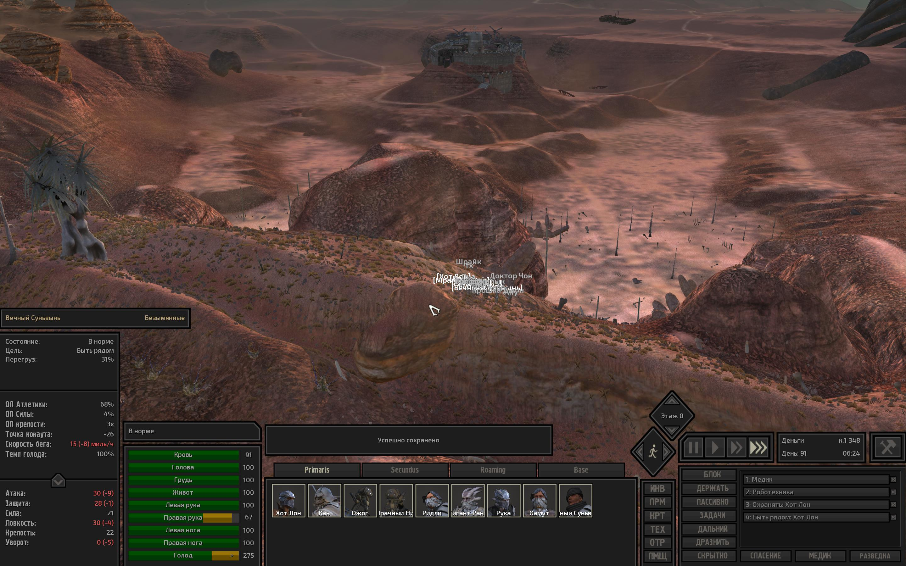

---

### 16. screenshot_98.jpg

- **Время записи (UTC)**: `2026-10-28T01:47:00Z`
- **Размер**: 667.2 КБ
- **SHA-256**: `223168fc8079c2452c632d193786bc0f3980749e7a34bab9e60cea65fa3b1281`
- **Ссылки**: [Просмотр в GitHub](https://github.com/asaf1n/kenshi-campaign-tech/blob/main/published/screenshots/screenshot_98.jpg) | [Прямой Raw URL](https://raw.githubusercontent.com/asaf1n/kenshi-campaign-tech/main/published/screenshots/screenshot_98.jpg)

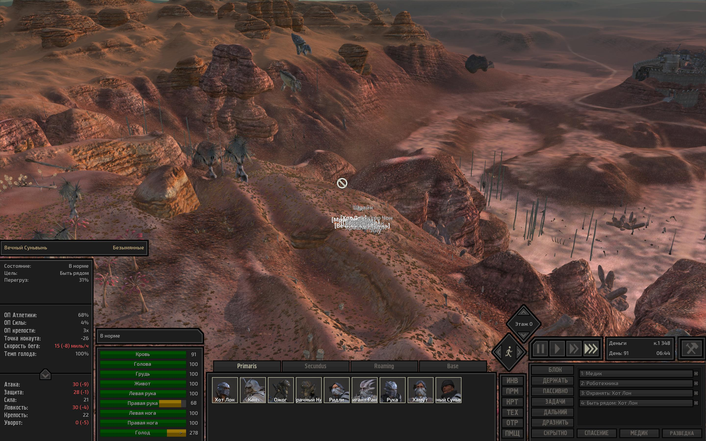

---

### 17. screenshot_99.jpg

- **Время записи (UTC)**: `2026-10-28T05:00:11Z`
- **Размер**: 488.5 КБ
- **SHA-256**: `70a760520475d7e8f8d4b655e9873dc19a54d2d5c51c56cbbf43e6d9ff9ee3e0`
- **Ссылки**: [Просмотр в GitHub](https://github.com/asaf1n/kenshi-campaign-tech/blob/main/published/screenshots/screenshot_99.jpg) | [Прямой Raw URL](https://raw.githubusercontent.com/asaf1n/kenshi-campaign-tech/main/published/screenshots/screenshot_99.jpg)

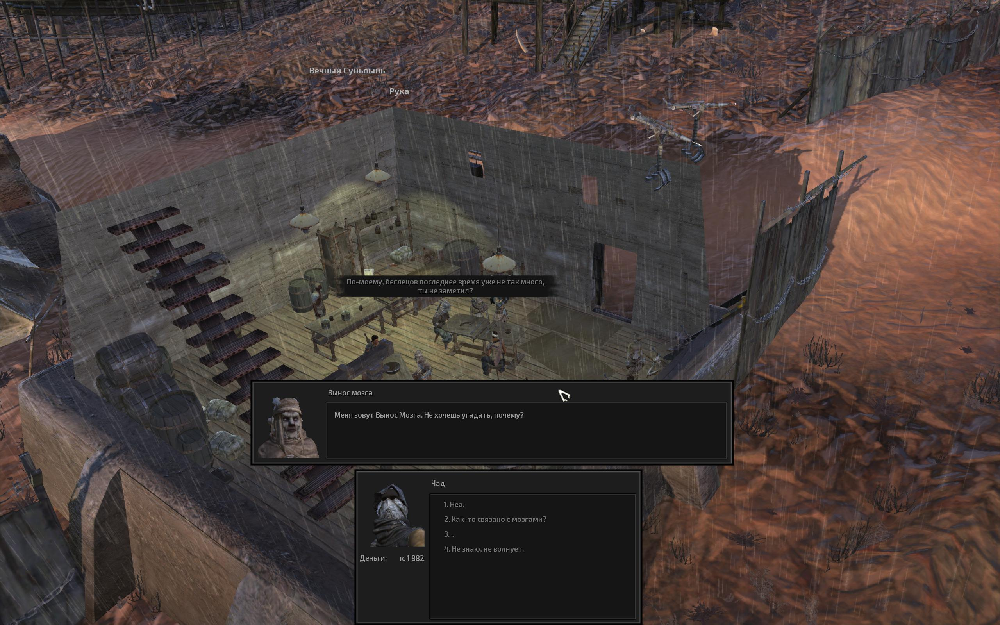

---

### 18. screenshot_100.jpg

- **Время записи (UTC)**: `2026-10-28T05:26:01Z`
- **Размер**: 772.0 КБ
- **SHA-256**: `c9c9650ea9da0e2cc029710598724b55dfa482137310f9cac895b7cf7f6256fc`
- **Ссылки**: [Просмотр в GitHub](https://github.com/asaf1n/kenshi-campaign-tech/blob/main/published/screenshots/screenshot_100.jpg) | [Прямой Raw URL](https://raw.githubusercontent.com/asaf1n/kenshi-campaign-tech/main/published/screenshots/screenshot_100.jpg)

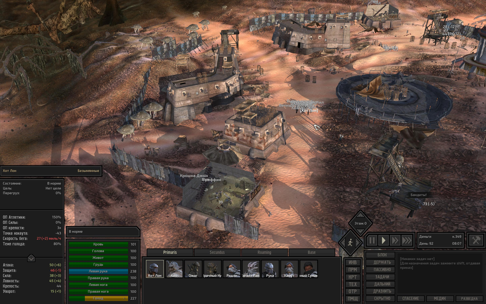

---

### 19. screenshot_101.jpg

- **Время записи (UTC)**: `2026-10-28T06:37:59Z`
- **Размер**: 768.7 КБ
- **SHA-256**: `7594a83e97756a757c6fbb05ebd4b0059e38f186a7567e0d0dd43c8e966e04ba`
- **Ссылки**: [Просмотр в GitHub](https://github.com/asaf1n/kenshi-campaign-tech/blob/main/published/screenshots/screenshot_101.jpg) | [Прямой Raw URL](https://raw.githubusercontent.com/asaf1n/kenshi-campaign-tech/main/published/screenshots/screenshot_101.jpg)

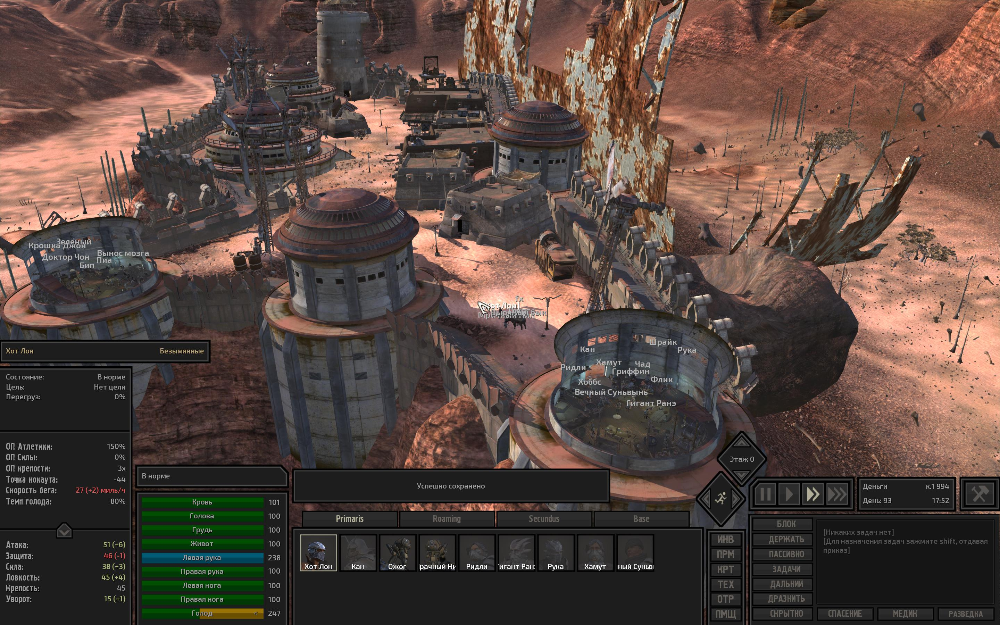

---

### 20. screenshot_102.jpg

- **Время записи (UTC)**: `2026-10-28T09:52:09Z`
- **Размер**: 485.8 КБ
- **SHA-256**: `34999e10962011669f307e7dd7304ebbeeac94821297dacb951e05173b2c8753`
- **Ссылки**: [Просмотр в GitHub](https://github.com/asaf1n/kenshi-campaign-tech/blob/main/published/screenshots/screenshot_102.jpg) | [Прямой Raw URL](https://raw.githubusercontent.com/asaf1n/kenshi-campaign-tech/main/published/screenshots/screenshot_102.jpg)

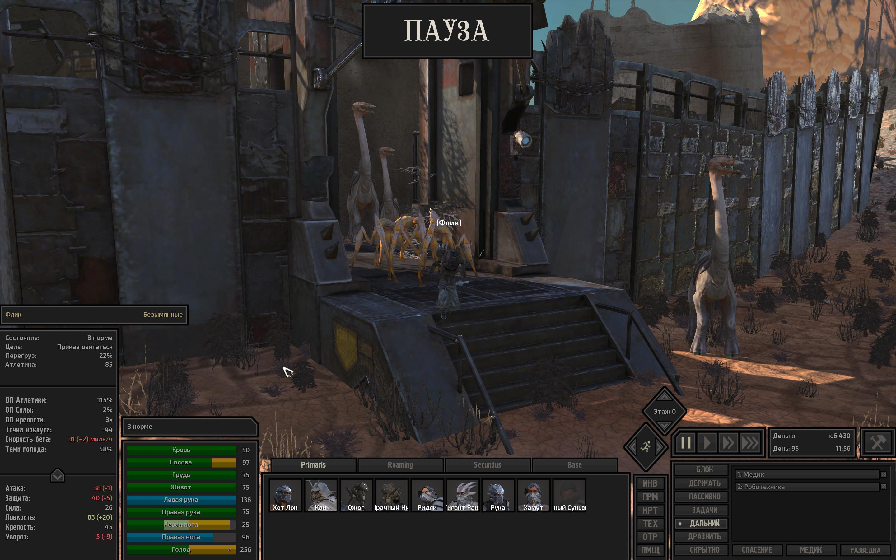

---

### 21. screenshot_103.jpg

- **Время записи (UTC)**: `2026-10-28T09:53:03Z`
- **Размер**: 868.5 КБ
- **SHA-256**: `44a1432a60c055b31098a2ebdcadcad1b338cefc5a2999182957e3bcf7804356`
- **Ссылки**: [Просмотр в GitHub](https://github.com/asaf1n/kenshi-campaign-tech/blob/main/published/screenshots/screenshot_103.jpg) | [Прямой Raw URL](https://raw.githubusercontent.com/asaf1n/kenshi-campaign-tech/main/published/screenshots/screenshot_103.jpg)

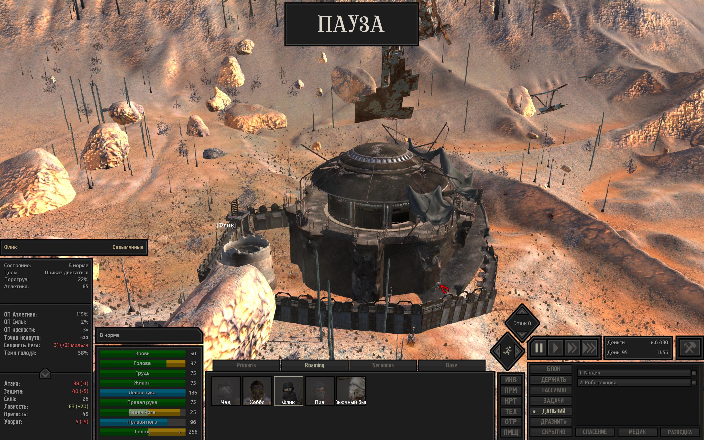

---

### 22. screenshot_104.jpg

- **Время записи (UTC)**: `2026-10-28T09:53:54Z`
- **Размер**: 814.0 КБ
- **SHA-256**: `d302c7e595e95a83cc3402e156c263e7c6d92caa9bad84b1fd49b0d27f60957b`
- **Ссылки**: [Просмотр в GitHub](https://github.com/asaf1n/kenshi-campaign-tech/blob/main/published/screenshots/screenshot_104.jpg) | [Прямой Raw URL](https://raw.githubusercontent.com/asaf1n/kenshi-campaign-tech/main/published/screenshots/screenshot_104.jpg)

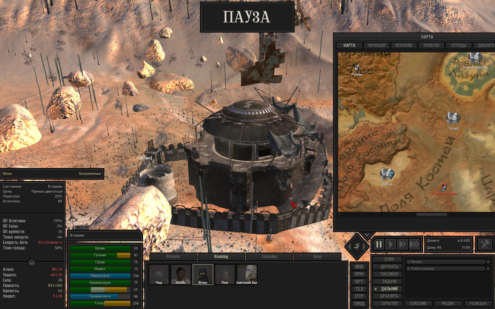

---

### 23. screenshot_105.jpg

- **Время записи (UTC)**: `2026-10-28T10:11:52Z`
- **Размер**: 569.8 КБ
- **SHA-256**: `9640a72f02e58e25db63e45a375c2af6c8b2b274a61d556556de9453be760e72`
- **Ссылки**: [Просмотр в GitHub](https://github.com/asaf1n/kenshi-campaign-tech/blob/main/published/screenshots/screenshot_105.jpg) | [Прямой Raw URL](https://raw.githubusercontent.com/asaf1n/kenshi-campaign-tech/main/published/screenshots/screenshot_105.jpg)

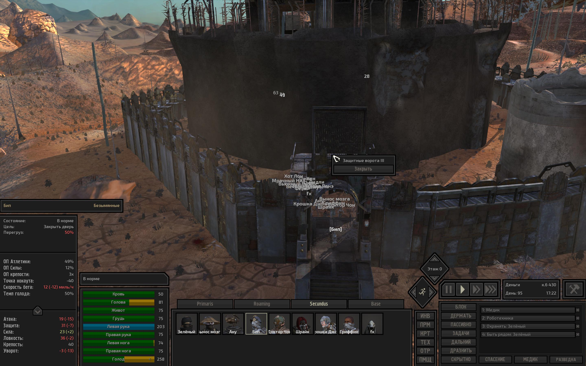

---

### 24. screenshot_106.jpg

- **Время записи (UTC)**: `2026-10-28T10:13:28Z`
- **Размер**: 737.4 КБ
- **SHA-256**: `b485840edcaf8b6b8ddc93519df87d5ed64000cb7a458dc8310ad2766f3c4370`
- **Ссылки**: [Просмотр в GitHub](https://github.com/asaf1n/kenshi-campaign-tech/blob/main/published/screenshots/screenshot_106.jpg) | [Прямой Raw URL](https://raw.githubusercontent.com/asaf1n/kenshi-campaign-tech/main/published/screenshots/screenshot_106.jpg)

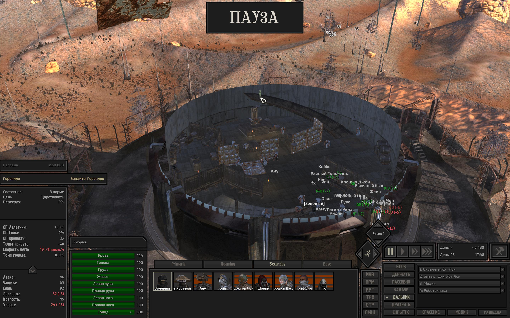

---

### 25. screenshot_107.jpg

- **Время записи (UTC)**: `2026-10-28T10:14:10Z`
- **Размер**: 661.5 КБ
- **SHA-256**: `cd57a3832d31080f2be12c4bb176aece7cc3a7d9062671b1b31c1931f4d97103`
- **Ссылки**: [Просмотр в GitHub](https://github.com/asaf1n/kenshi-campaign-tech/blob/main/published/screenshots/screenshot_107.jpg) | [Прямой Raw URL](https://raw.githubusercontent.com/asaf1n/kenshi-campaign-tech/main/published/screenshots/screenshot_107.jpg)

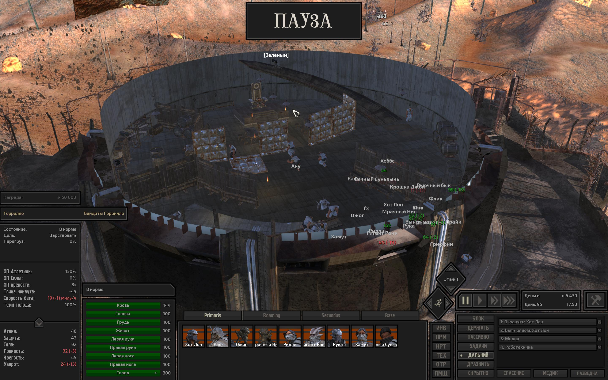

---

### 26. screenshot_108.jpg

- **Время записи (UTC)**: `2026-10-28T10:14:22Z`
- **Размер**: 649.9 КБ
- **SHA-256**: `cdd48227cff20e483947ddcf07c8489d799c31c950172077fc4bf6135d8b8df6`
- **Ссылки**: [Просмотр в GitHub](https://github.com/asaf1n/kenshi-campaign-tech/blob/main/published/screenshots/screenshot_108.jpg) | [Прямой Raw URL](https://raw.githubusercontent.com/asaf1n/kenshi-campaign-tech/main/published/screenshots/screenshot_108.jpg)

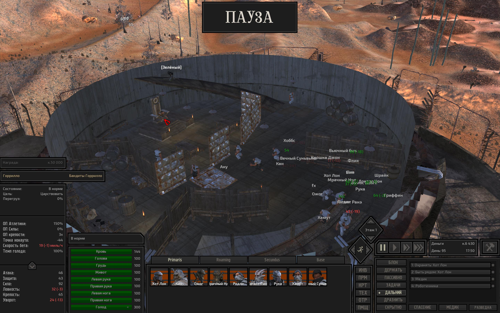

---

### 27. screenshot_109.jpg

- **Время записи (UTC)**: `2026-10-28T10:15:34Z`
- **Размер**: 606.2 КБ
- **SHA-256**: `707d89fee5f61e0df7a2f6136930aaf8be555888c67aa67ae05a7de3f28fa008`
- **Ссылки**: [Просмотр в GitHub](https://github.com/asaf1n/kenshi-campaign-tech/blob/main/published/screenshots/screenshot_109.jpg) | [Прямой Raw URL](https://raw.githubusercontent.com/asaf1n/kenshi-campaign-tech/main/published/screenshots/screenshot_109.jpg)

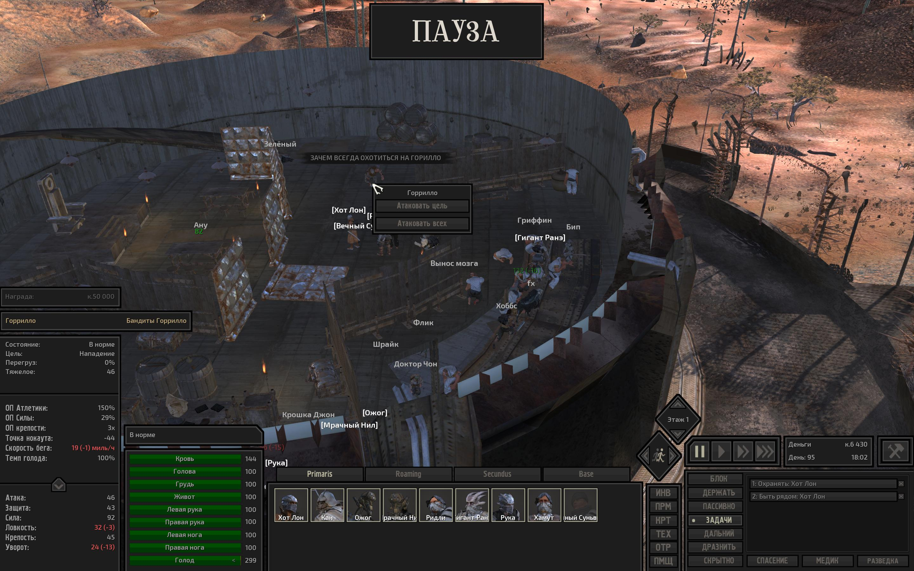

---

### 28. screenshot_110.jpg

- **Время записи (UTC)**: `2026-10-28T10:15:37Z`
- **Размер**: 519.4 КБ
- **SHA-256**: `a03f52fae373031ccc0d68b9b4672b845197c65904e24faeebf8213af1c01683`
- **Ссылки**: [Просмотр в GitHub](https://github.com/asaf1n/kenshi-campaign-tech/blob/main/published/screenshots/screenshot_110.jpg) | [Прямой Raw URL](https://raw.githubusercontent.com/asaf1n/kenshi-campaign-tech/main/published/screenshots/screenshot_110.jpg)

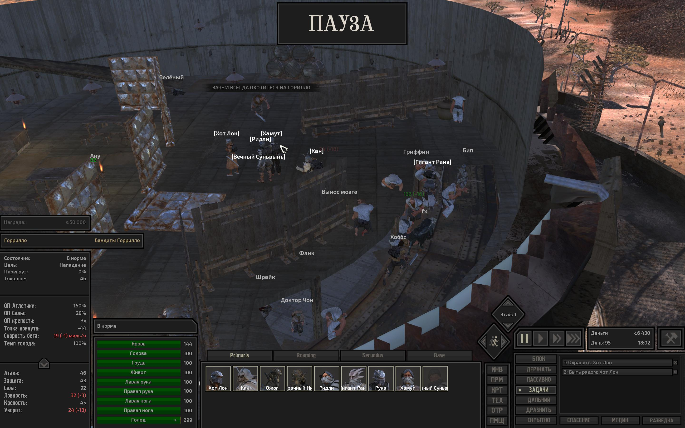

---

### 29. screenshot_111.jpg

- **Время записи (UTC)**: `2026-10-28T10:17:29Z`
- **Размер**: 691.3 КБ
- **SHA-256**: `d97d25e97914cde7db8533d586ba0fe66241e3566992cf80c79b2c76bca11965`
- **Ссылки**: [Просмотр в GitHub](https://github.com/asaf1n/kenshi-campaign-tech/blob/main/published/screenshots/screenshot_111.jpg) | [Прямой Raw URL](https://raw.githubusercontent.com/asaf1n/kenshi-campaign-tech/main/published/screenshots/screenshot_111.jpg)

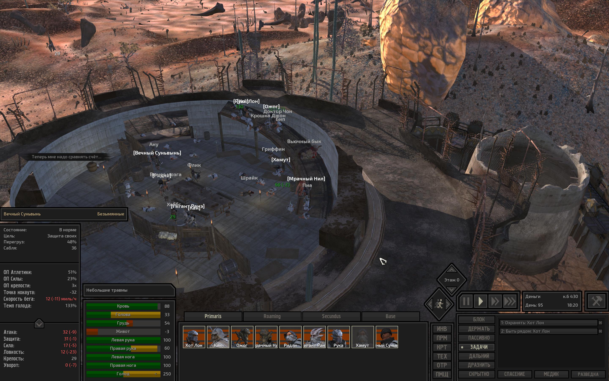

---

### 30. screenshot_112.jpg

- **Время записи (UTC)**: `2026-10-28T10:25:36Z`
- **Размер**: 499.7 КБ
- **SHA-256**: `d4ba2a06ae565f2196a04f0c3403578ca08ef3168f8f99ef3fa28cdeb63a1229`
- **Ссылки**: [Просмотр в GitHub](https://github.com/asaf1n/kenshi-campaign-tech/blob/main/published/screenshots/screenshot_112.jpg) | [Прямой Raw URL](https://raw.githubusercontent.com/asaf1n/kenshi-campaign-tech/main/published/screenshots/screenshot_112.jpg)

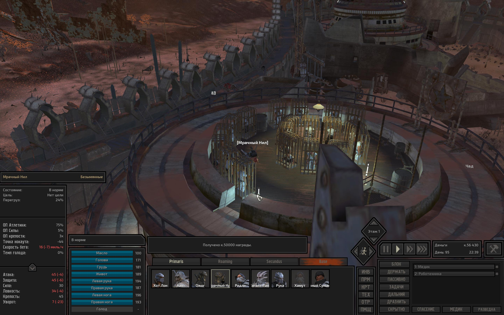

---

### 31. screenshot_113.jpg

- **Время записи (UTC)**: `2026-10-28T10:25:38Z`
- **Размер**: 509.2 КБ
- **SHA-256**: `b3e082b67fe2b19be46e1ffa39b92f7924c3bee40bd1fdc2bcc7e6824b68c7ba`
- **Ссылки**: [Просмотр в GitHub](https://github.com/asaf1n/kenshi-campaign-tech/blob/main/published/screenshots/screenshot_113.jpg) | [Прямой Raw URL](https://raw.githubusercontent.com/asaf1n/kenshi-campaign-tech/main/published/screenshots/screenshot_113.jpg)

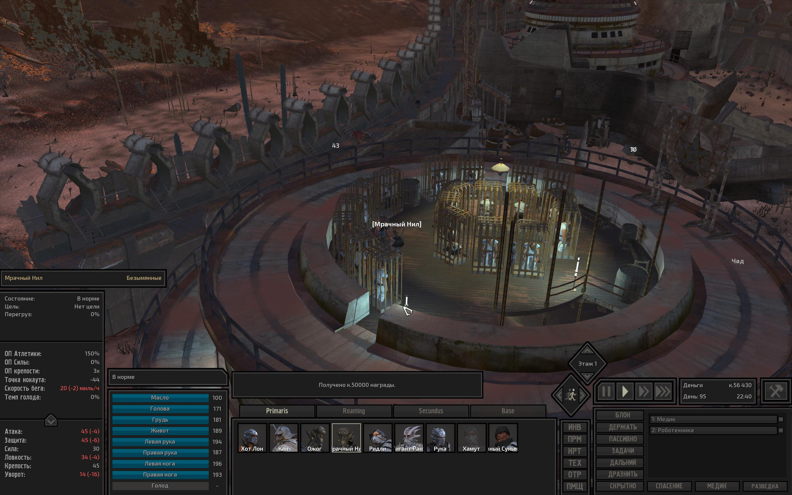

---

### 32. screenshot_114.jpg

- **Время записи (UTC)**: `2026-10-28T12:14:13Z`
- **Размер**: 481.7 КБ
- **SHA-256**: `d1db6d8864c6532649942dea1b7db592ca8c56bf28028ca0c6f02b1fcad7a3f6`
- **Ссылки**: [Просмотр в GitHub](https://github.com/asaf1n/kenshi-campaign-tech/blob/main/published/screenshots/screenshot_114.jpg) | [Прямой Raw URL](https://raw.githubusercontent.com/asaf1n/kenshi-campaign-tech/main/published/screenshots/screenshot_114.jpg)

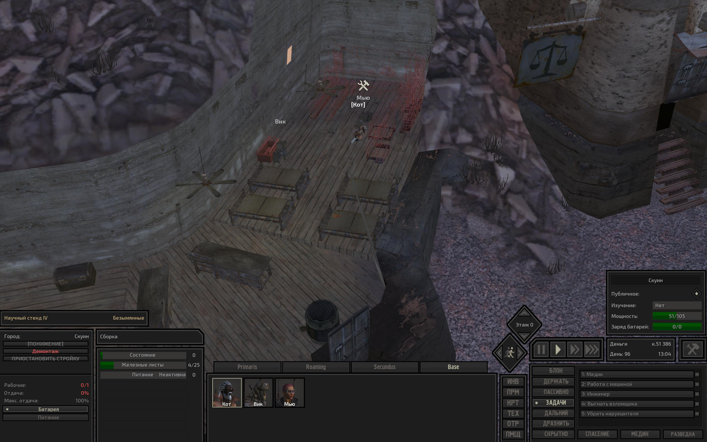

---

### 33. screenshot_115.jpg

- **Время записи (UTC)**: `2026-10-28T12:21:19Z`
- **Размер**: 559.0 КБ
- **SHA-256**: `3b9712100363c13ad3c93eb3c6d7efa8fdeedb7d8186862874d337e829adef89`
- **Ссылки**: [Просмотр в GitHub](https://github.com/asaf1n/kenshi-campaign-tech/blob/main/published/screenshots/screenshot_115.jpg) | [Прямой Raw URL](https://raw.githubusercontent.com/asaf1n/kenshi-campaign-tech/main/published/screenshots/screenshot_115.jpg)

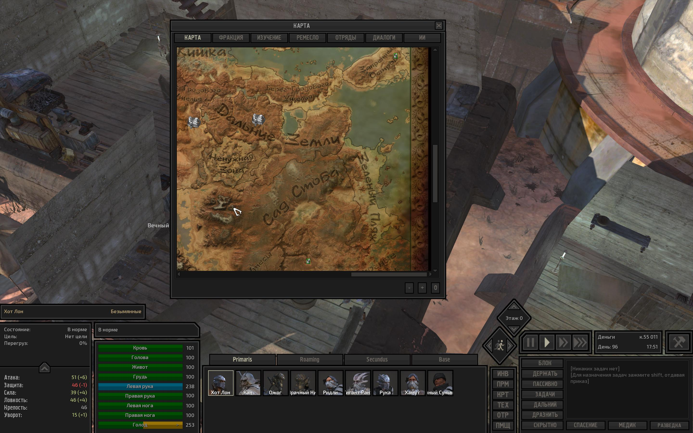

---

### 34. screenshot_116.jpg

- **Время записи (UTC)**: `2026-10-28T13:01:52Z`
- **Размер**: 639.3 КБ
- **SHA-256**: `cf53b9325729d56d70482bee301149951b0f5cdeef775a03fbd416eb18e91322`
- **Ссылки**: [Просмотр в GitHub](https://github.com/asaf1n/kenshi-campaign-tech/blob/main/published/screenshots/screenshot_116.jpg) | [Прямой Raw URL](https://raw.githubusercontent.com/asaf1n/kenshi-campaign-tech/main/published/screenshots/screenshot_116.jpg)

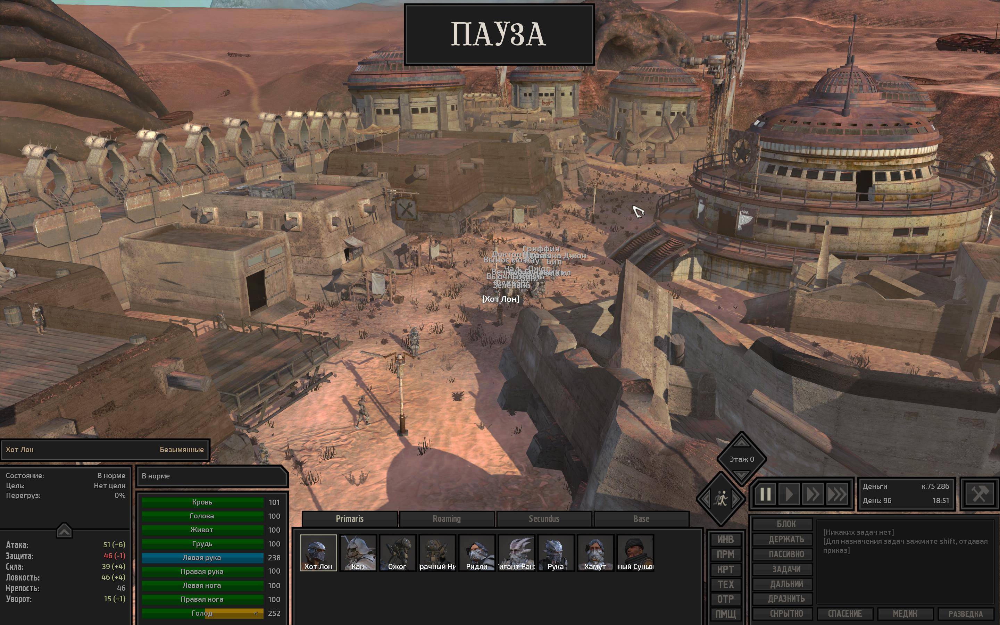

---

### 35. screenshot_117.jpg

- **Время записи (UTC)**: `2026-10-28T15:08:06Z`
- **Размер**: 470.6 КБ
- **SHA-256**: `0f3ffbab41c041ffd3c2c26181dba7cfe8c7f1b075c8ba57c29788c9474e5413`
- **Ссылки**: [Просмотр в GitHub](https://github.com/asaf1n/kenshi-campaign-tech/blob/main/published/screenshots/screenshot_117.jpg) | [Прямой Raw URL](https://raw.githubusercontent.com/asaf1n/kenshi-campaign-tech/main/published/screenshots/screenshot_117.jpg)

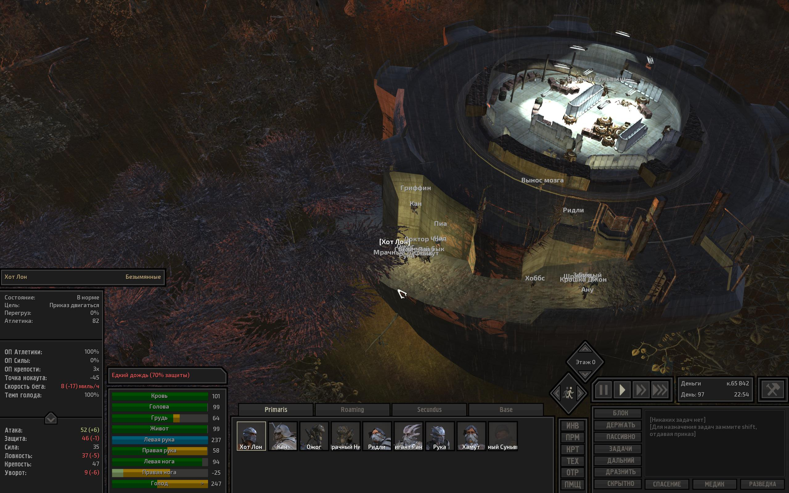

---

### 36. screenshot_118.jpg

- **Время записи (UTC)**: `2026-10-28T15:50:28Z`
- **Размер**: 823.1 КБ
- **SHA-256**: `68b3bff7d1e61c6035bccd4bd52ddc069ec748ebb716db9af85b6f6ce4aed3cb`
- **Ссылки**: [Просмотр в GitHub](https://github.com/asaf1n/kenshi-campaign-tech/blob/main/published/screenshots/screenshot_118.jpg) | [Прямой Raw URL](https://raw.githubusercontent.com/asaf1n/kenshi-campaign-tech/main/published/screenshots/screenshot_118.jpg)

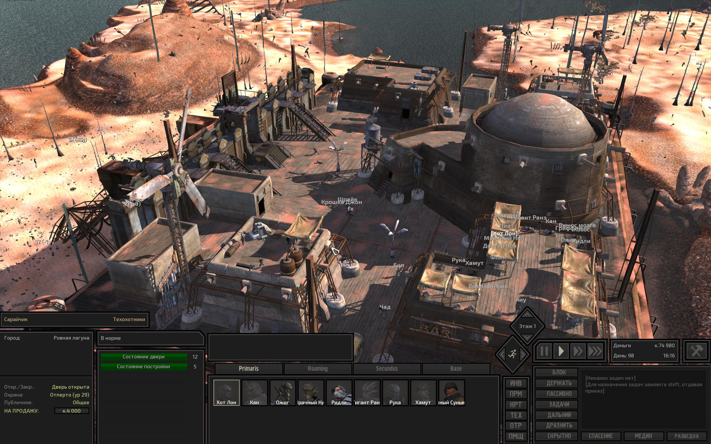

---

### 37. screenshot_119.jpg

- **Время записи (UTC)**: `2026-10-28T15:52:50Z`
- **Размер**: 726.8 КБ
- **SHA-256**: `4071a07ff5dd9c6ba062316403b26fd5032a36050a4bb9b3b1d8ec06e623bcbc`
- **Ссылки**: [Просмотр в GitHub](https://github.com/asaf1n/kenshi-campaign-tech/blob/main/published/screenshots/screenshot_119.jpg) | [Прямой Raw URL](https://raw.githubusercontent.com/asaf1n/kenshi-campaign-tech/main/published/screenshots/screenshot_119.jpg)

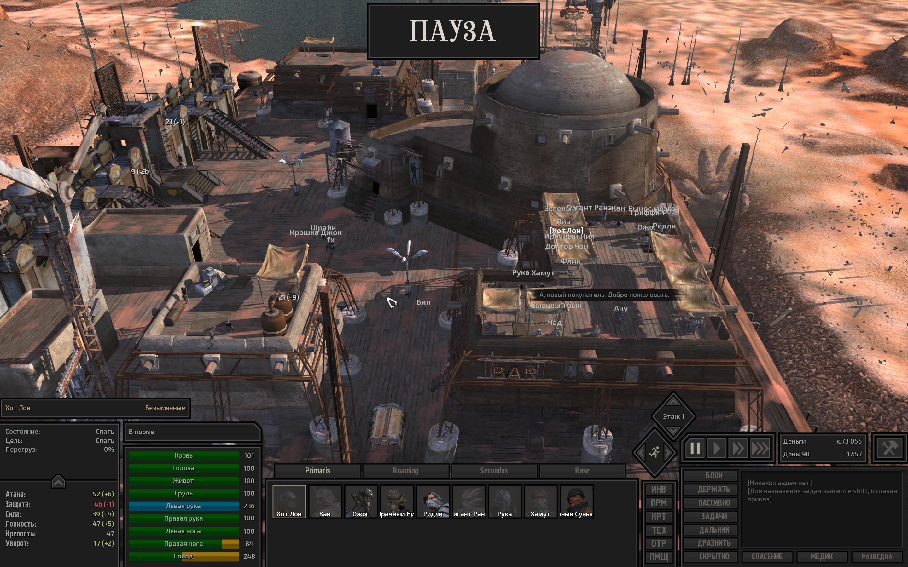

---

### 38. screenshot_120.jpg

- **Время записи (UTC)**: `2026-10-29T04:48:39Z`
- **Размер**: 433.6 КБ
- **SHA-256**: `1735176e59294579020f7f1e20751006b50a6cfd5a1685eb5ab94490eb0d35e4`
- **Ссылки**: [Просмотр в GitHub](https://github.com/asaf1n/kenshi-campaign-tech/blob/main/published/screenshots/screenshot_120.jpg) | [Прямой Raw URL](https://raw.githubusercontent.com/asaf1n/kenshi-campaign-tech/main/published/screenshots/screenshot_120.jpg)

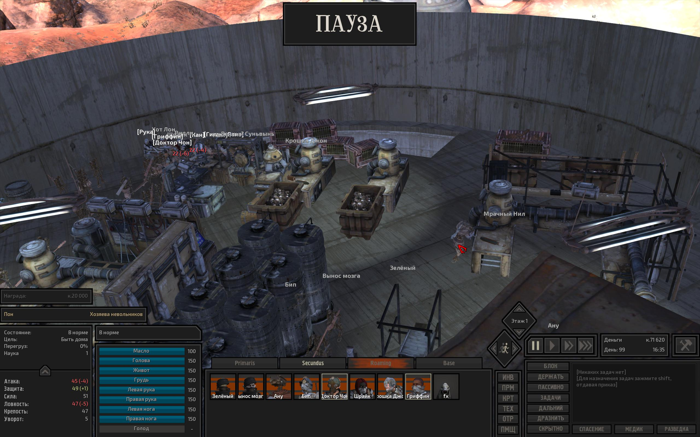

---

### 39. screenshot_121.jpg

- **Время записи (UTC)**: `2026-10-29T04:56:27Z`
- **Размер**: 648.4 КБ
- **SHA-256**: `5316a2c2c572c96d387284345ffdfb8c3ada87eade1b1884b507db875b3c4c09`
- **Ссылки**: [Просмотр в GitHub](https://github.com/asaf1n/kenshi-campaign-tech/blob/main/published/screenshots/screenshot_121.jpg) | [Прямой Raw URL](https://raw.githubusercontent.com/asaf1n/kenshi-campaign-tech/main/published/screenshots/screenshot_121.jpg)

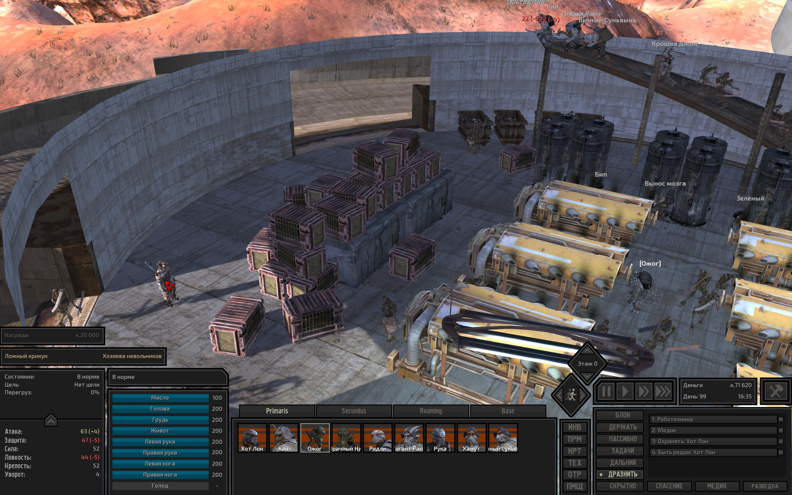

---

### 40. screenshot_122.jpg

- **Время записи (UTC)**: `2026-10-29T04:57:13Z`
- **Размер**: 543.0 КБ
- **SHA-256**: `288725c3b83766818587ed7c8f851c9117baff46e3f9495c2afb7c6a710650aa`
- **Ссылки**: [Просмотр в GitHub](https://github.com/asaf1n/kenshi-campaign-tech/blob/main/published/screenshots/screenshot_122.jpg) | [Прямой Raw URL](https://raw.githubusercontent.com/asaf1n/kenshi-campaign-tech/main/published/screenshots/screenshot_122.jpg)

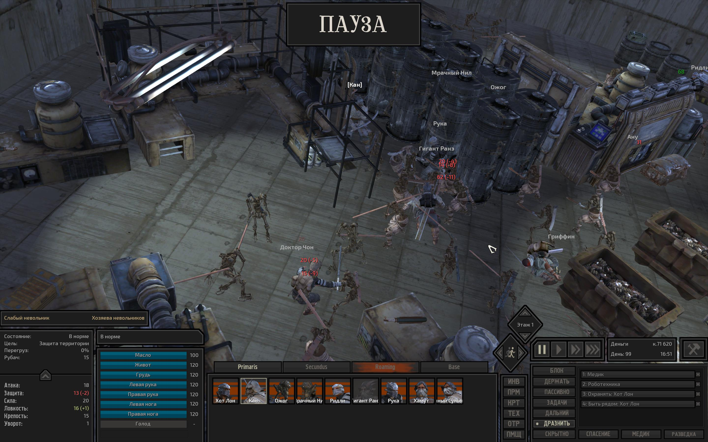

---

### 41. screenshot_123.jpg

- **Время записи (UTC)**: `2026-10-29T04:59:12Z`
- **Размер**: 585.7 КБ
- **SHA-256**: `5c65d11e37f46b086bd670503ddd3df56931a19a12ce982bcaa9b3e636d43f82`
- **Ссылки**: [Просмотр в GitHub](https://github.com/asaf1n/kenshi-campaign-tech/blob/main/published/screenshots/screenshot_123.jpg) | [Прямой Raw URL](https://raw.githubusercontent.com/asaf1n/kenshi-campaign-tech/main/published/screenshots/screenshot_123.jpg)

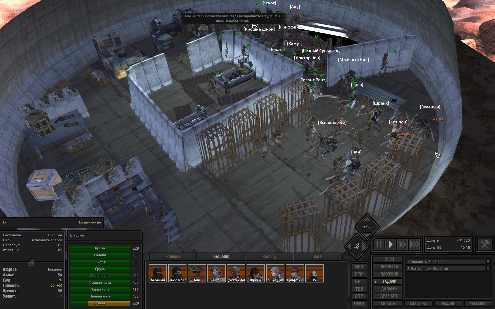

---

### 42. screenshot_124.jpg

- **Время записи (UTC)**: `2026-10-29T04:59:33Z`
- **Размер**: 578.6 КБ
- **SHA-256**: `e064a1418df51a5742ad8906a4099bd869f7acdb1f587878e9ac7e72e6e1cef1`
- **Ссылки**: [Просмотр в GitHub](https://github.com/asaf1n/kenshi-campaign-tech/blob/main/published/screenshots/screenshot_124.jpg) | [Прямой Raw URL](https://raw.githubusercontent.com/asaf1n/kenshi-campaign-tech/main/published/screenshots/screenshot_124.jpg)

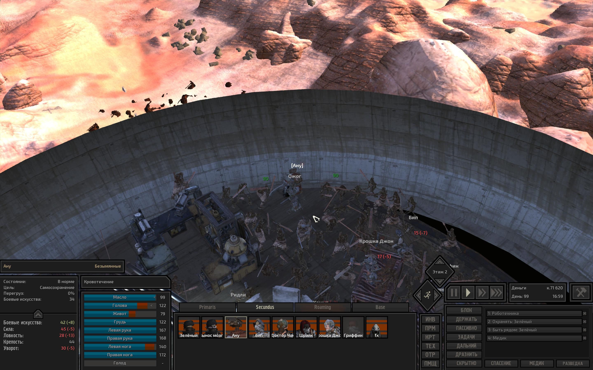

---

### 43. screenshot_125.jpg

- **Время записи (UTC)**: `2026-10-29T05:01:01Z`
- **Размер**: 561.3 КБ
- **SHA-256**: `8d68582c4c2285ee6b72f34b6ee5a4d883940e284ca4ca169a3d7a1e043a8285`
- **Ссылки**: [Просмотр в GitHub](https://github.com/asaf1n/kenshi-campaign-tech/blob/main/published/screenshots/screenshot_125.jpg) | [Прямой Raw URL](https://raw.githubusercontent.com/asaf1n/kenshi-campaign-tech/main/published/screenshots/screenshot_125.jpg)

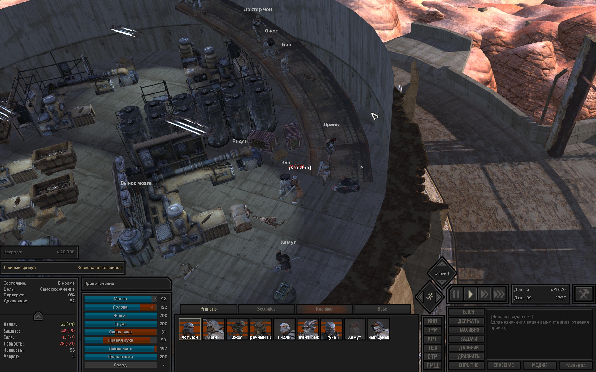

---

### 44. screenshot_126.jpg

- **Время записи (UTC)**: `2026-10-29T05:03:34Z`
- **Размер**: 551.2 КБ
- **SHA-256**: `e853a0fee41590d7d1d83aff0c0ede03dcd28bac2ac03f3727bf27d812bbc30a`
- **Ссылки**: [Просмотр в GitHub](https://github.com/asaf1n/kenshi-campaign-tech/blob/main/published/screenshots/screenshot_126.jpg) | [Прямой Raw URL](https://raw.githubusercontent.com/asaf1n/kenshi-campaign-tech/main/published/screenshots/screenshot_126.jpg)

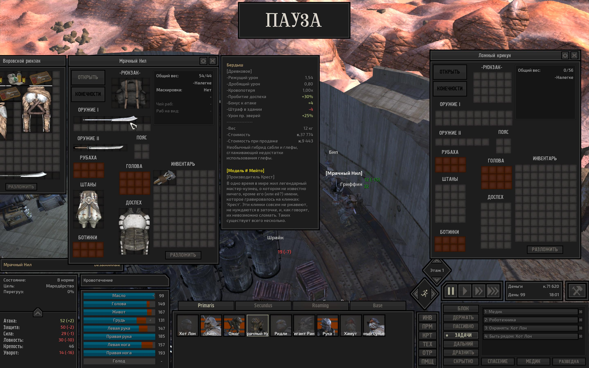

---

### 45. screenshot_127.jpg

- **Время записи (UTC)**: `2026-10-29T05:12:58Z`
- **Размер**: 544.9 КБ
- **SHA-256**: `93c5318d11d7f5d3cc854bc7b8f3ac43d792e45969ea94eae12f6446f2f8cab0`
- **Ссылки**: [Просмотр в GitHub](https://github.com/asaf1n/kenshi-campaign-tech/blob/main/published/screenshots/screenshot_127.jpg) | [Прямой Raw URL](https://raw.githubusercontent.com/asaf1n/kenshi-campaign-tech/main/published/screenshots/screenshot_127.jpg)

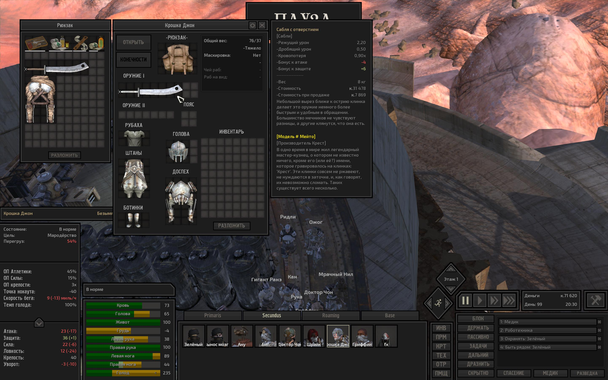

---

### 46. screenshot_128.jpg

- **Время записи (UTC)**: `2026-10-29T05:13:52Z`
- **Размер**: 361.7 КБ
- **SHA-256**: `b6d3eb308090e749382b496d2b57ee37fcbf74daa15156efffd15ef46ded0712`
- **Ссылки**: [Просмотр в GitHub](https://github.com/asaf1n/kenshi-campaign-tech/blob/main/published/screenshots/screenshot_128.jpg) | [Прямой Raw URL](https://raw.githubusercontent.com/asaf1n/kenshi-campaign-tech/main/published/screenshots/screenshot_128.jpg)

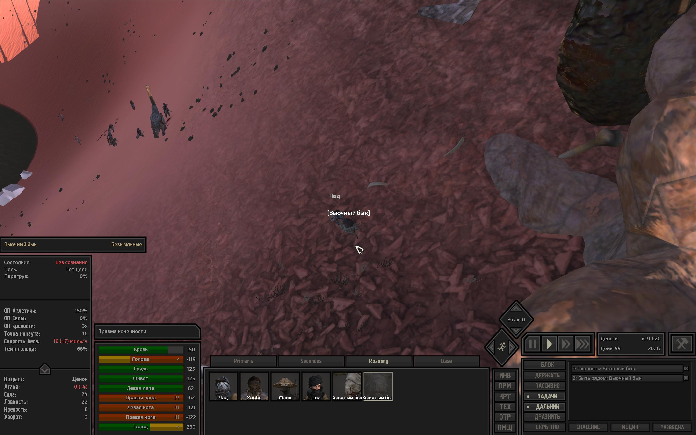

---

### 47. screenshot_129.jpg

- **Время записи (UTC)**: `2026-10-29T05:17:05Z`
- **Размер**: 558.2 КБ
- **SHA-256**: `8635b06c0db66b0a5f992eb38e9e34f8498f5f1841df799c25c0cdd37f06ac40`
- **Ссылки**: [Просмотр в GitHub](https://github.com/asaf1n/kenshi-campaign-tech/blob/main/published/screenshots/screenshot_129.jpg) | [Прямой Raw URL](https://raw.githubusercontent.com/asaf1n/kenshi-campaign-tech/main/published/screenshots/screenshot_129.jpg)

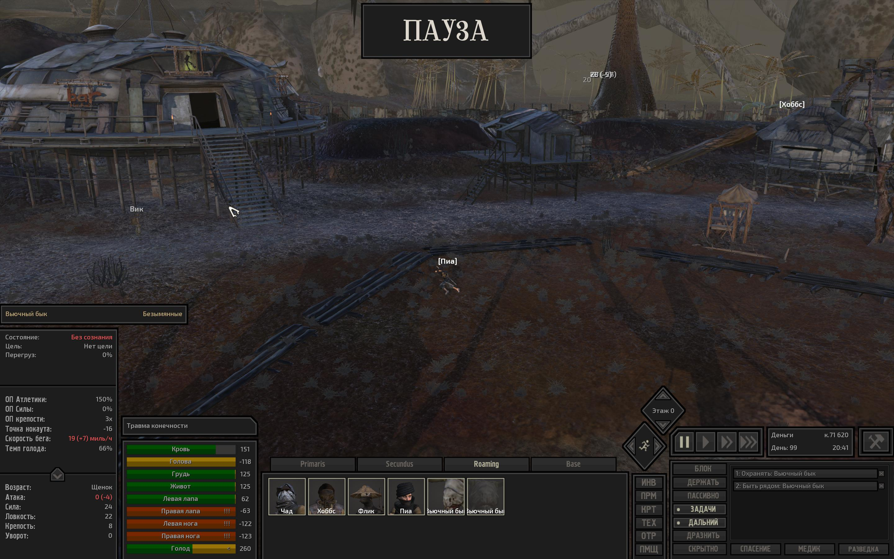

---

### 48. screenshot_130.jpg

- **Время записи (UTC)**: `2026-10-29T06:45:33Z`
- **Размер**: 610.1 КБ
- **SHA-256**: `85d9d0089a62adb3b7e36f5abfc2341f5597ae12bfba6c7a76ad5cf2bec878f3`
- **Ссылки**: [Просмотр в GitHub](https://github.com/asaf1n/kenshi-campaign-tech/blob/main/published/screenshots/screenshot_130.jpg) | [Прямой Raw URL](https://raw.githubusercontent.com/asaf1n/kenshi-campaign-tech/main/published/screenshots/screenshot_130.jpg)

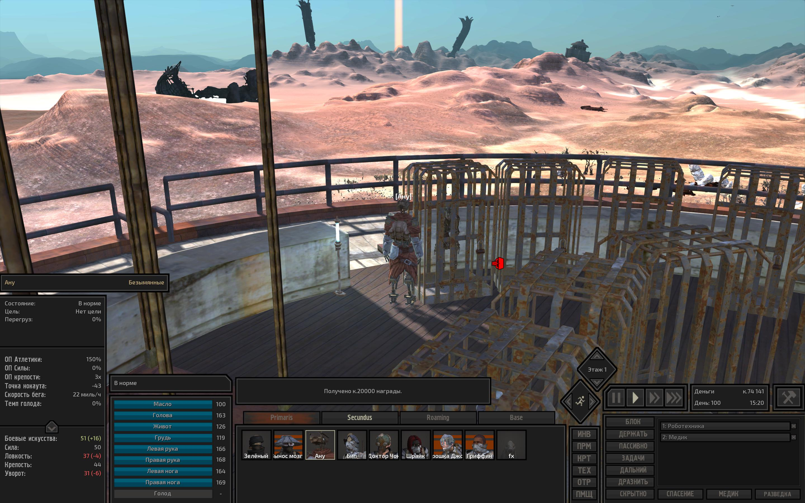

---

### 49. screenshot_131.jpg

- **Время записи (UTC)**: `2026-10-29T06:45:37Z`
- **Размер**: 611.5 КБ
- **SHA-256**: `d78486314e03855fdf105c83ece70f959e63f85315f0bbaafe1ed7d992bab68e`
- **Ссылки**: [Просмотр в GitHub](https://github.com/asaf1n/kenshi-campaign-tech/blob/main/published/screenshots/screenshot_131.jpg) | [Прямой Raw URL](https://raw.githubusercontent.com/asaf1n/kenshi-campaign-tech/main/published/screenshots/screenshot_131.jpg)

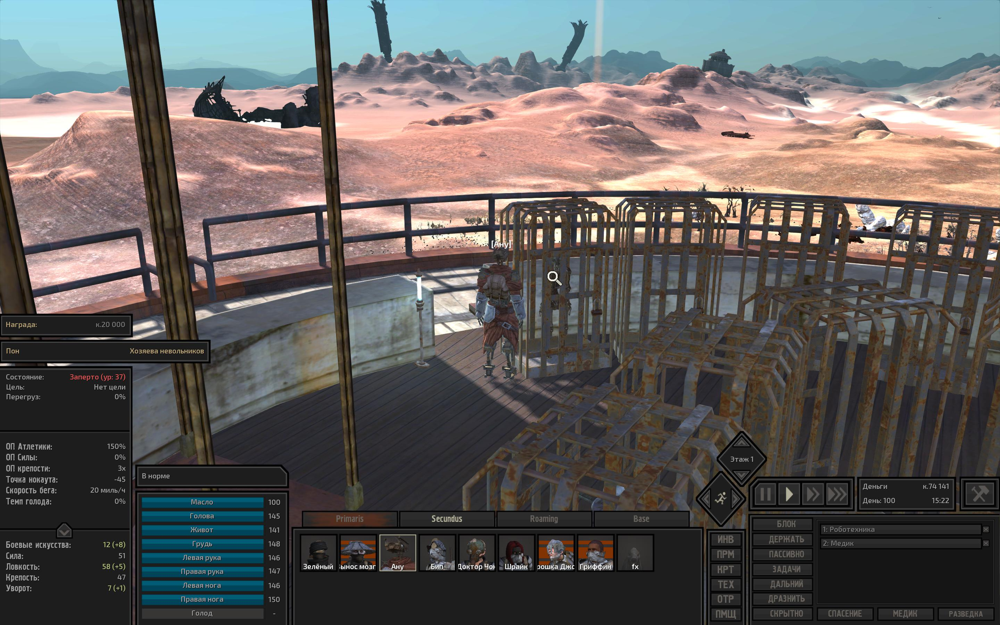

---

### 50. screenshot_132.jpg

- **Время записи (UTC)**: `2026-10-29T06:47:02Z`
- **Размер**: 685.5 КБ
- **SHA-256**: `47b6e6121b2d62e247f07104c9f541f002a749787d72c595e5a88a148703cd61`
- **Ссылки**: [Просмотр в GitHub](https://github.com/asaf1n/kenshi-campaign-tech/blob/main/published/screenshots/screenshot_132.jpg) | [Прямой Raw URL](https://raw.githubusercontent.com/asaf1n/kenshi-campaign-tech/main/published/screenshots/screenshot_132.jpg)

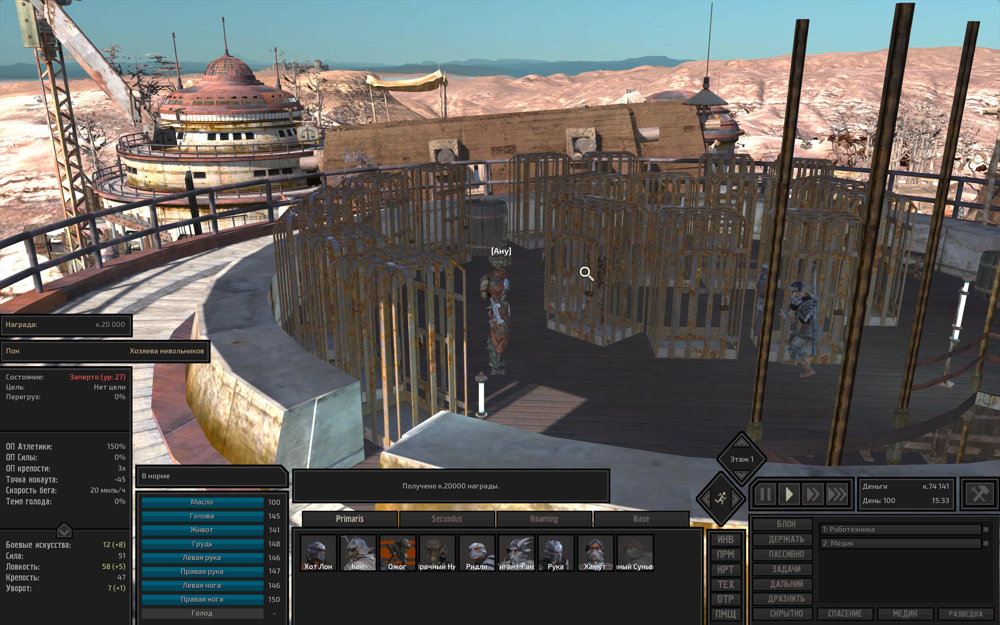

---

### 51. screenshot_133.jpg

- **Время записи (UTC)**: `2026-10-29T06:54:25Z`
- **Размер**: 572.8 КБ
- **SHA-256**: `f6ca5c219781b8d55d987bf79d07bf1fdcf9edb40334fd3204df1c1407f3d30e`
- **Ссылки**: [Просмотр в GitHub](https://github.com/asaf1n/kenshi-campaign-tech/blob/main/published/screenshots/screenshot_133.jpg) | [Прямой Raw URL](https://raw.githubusercontent.com/asaf1n/kenshi-campaign-tech/main/published/screenshots/screenshot_133.jpg)

---

### 52. screenshot_134.jpg

- **Время записи (UTC)**: `2026-10-29T06:55:42Z`
- **Размер**: 668.1 КБ
- **SHA-256**: `30527e44a3b7f7f490378a320eb33eca5f5dd44aad86c2abd58bec85f01a0ae2`
- **Ссылки**: [Просмотр в GitHub](https://github.com/asaf1n/kenshi-campaign-tech/blob/main/published/screenshots/screenshot_134.jpg) | [Прямой Raw URL](https://raw.githubusercontent.com/asaf1n/kenshi-campaign-tech/main/published/screenshots/screenshot_134.jpg)

---

### 53. screenshot_135.jpg

- **Время записи (UTC)**: `2026-10-29T06:56:26Z`
- **Размер**: 471.2 КБ
- **SHA-256**: `015b294d4183d853a389a1e3e5e8d3e65b7dee5480a0243022dfd5681584685a`
- **Ссылки**: [Просмотр в GitHub](https://github.com/asaf1n/kenshi-campaign-tech/blob/main/published/screenshots/screenshot_135.jpg) | [Прямой Raw URL](https://raw.githubusercontent.com/asaf1n/kenshi-campaign-tech/main/published/screenshots/screenshot_135.jpg)

---

### 54. screenshot_136.jpg

- **Время записи (UTC)**: `2026-10-29T06:56:56Z`
- **Размер**: 693.7 КБ
- **SHA-256**: `e3de4ff5eb32c3c24a89ff4aad46e35cb3261da2b17e650df3a1b9c56fc61439`
- **Ссылки**: [Просмотр в GitHub](https://github.com/asaf1n/kenshi-campaign-tech/blob/main/published/screenshots/screenshot_136.jpg) | [Прямой Raw URL](https://raw.githubusercontent.com/asaf1n/kenshi-campaign-tech/main/published/screenshots/screenshot_136.jpg)

---

### 55. screenshot_137.jpg

- **Время записи (UTC)**: `2026-10-29T06:57:11Z`
- **Размер**: 619.2 КБ
- **SHA-256**: `14ce611a908e7429d9cb5d2f6668ed726e582fafd861512a1c1a3b53b3f8feb8`
- **Ссылки**: [Просмотр в GitHub](https://github.com/asaf1n/kenshi-campaign-tech/blob/main/published/screenshots/screenshot_137.jpg) | [Прямой Raw URL](https://raw.githubusercontent.com/asaf1n/kenshi-campaign-tech/main/published/screenshots/screenshot_137.jpg)

---

### 56. screenshot_138.jpg

- **Время записи (UTC)**: `2026-10-29T08:47:22Z`
- **Размер**: 380.3 КБ
- **SHA-256**: `12d22cd8310afecf336d4edd66e490876385063c69de9922e4d43c85a4727af2`
- **Ссылки**: [Просмотр в GitHub](https://github.com/asaf1n/kenshi-campaign-tech/blob/main/published/screenshots/screenshot_138.jpg) | [Прямой Raw URL](https://raw.githubusercontent.com/asaf1n/kenshi-campaign-tech/main/published/screenshots/screenshot_138.jpg)

---

### 57. screenshot_139.jpg

- **Время записи (UTC)**: `2026-10-29T08:47:29Z`
- **Размер**: 377.2 КБ
- **SHA-256**: `25ba02ba99532ae3aea5baa1b705dfef904dac8829e306e9944b88aef8d50245`
- **Ссылки**: [Просмотр в GitHub](https://github.com/asaf1n/kenshi-campaign-tech/blob/main/published/screenshots/screenshot_139.jpg) | [Прямой Raw URL](https://raw.githubusercontent.com/asaf1n/kenshi-campaign-tech/main/published/screenshots/screenshot_139.jpg)

---

### 58. screenshot_140.jpg

- **Время записи (UTC)**: `2026-10-29T09:52:00Z`
- **Размер**: 504.3 КБ
- **SHA-256**: `1e9bbdfbad4ff4772cc9925b506a0e737e8959e7df8d81322fad529caa0edc9f`
- **Ссылки**: [Просмотр в GitHub](https://github.com/asaf1n/kenshi-campaign-tech/blob/main/published/screenshots/screenshot_140.jpg) | [Прямой Raw URL](https://raw.githubusercontent.com/asaf1n/kenshi-campaign-tech/main/published/screenshots/screenshot_140.jpg)

---

### 59. screenshot_141.jpg

- **Время записи (UTC)**: `2026-10-29T09:57:27Z`
- **Размер**: 588.9 КБ
- **SHA-256**: `29397bfa7667ec08ff331753aef0287d13de123bbdd79a15559b40515f91e8c6`
- **Ссылки**: [Просмотр в GitHub](https://github.com/asaf1n/kenshi-campaign-tech/blob/main/published/screenshots/screenshot_141.jpg) | [Прямой Raw URL](https://raw.githubusercontent.com/asaf1n/kenshi-campaign-tech/main/published/screenshots/screenshot_141.jpg)

---

### 60. screenshot_142.jpg

- **Время записи (UTC)**: `2026-10-29T10:21:36Z`
- **Размер**: 592.1 КБ
- **SHA-256**: `ca016a88b8151b9a4e5d16ca5087eb37031a26083369c0b4589b254eae1977c5`
- **Ссылки**: [Просмотр в GitHub](https://github.com/asaf1n/kenshi-campaign-tech/blob/main/published/screenshots/screenshot_142.jpg) | [Прямой Raw URL](https://raw.githubusercontent.com/asaf1n/kenshi-campaign-tech/main/published/screenshots/screenshot_142.jpg)

---

### 61. screenshot_143.jpg

- **Время записи (UTC)**: `2026-10-29T14:27:41Z`
- **Размер**: 474.1 КБ
- **SHA-256**: `471507462d1e94b78c6152ef8ecf30b8938336f47d5017f29fec0b2814005999`
- **Ссылки**: [Просмотр в GitHub](https://github.com/asaf1n/kenshi-campaign-tech/blob/main/published/screenshots/screenshot_143.jpg) | [Прямой Raw URL](https://raw.githubusercontent.com/asaf1n/kenshi-campaign-tech/main/published/screenshots/screenshot_143.jpg)

---

### 62. screenshot_144.jpg

- **Время записи (UTC)**: `2026-10-29T14:27:51Z`
- **Размер**: 441.8 КБ
- **SHA-256**: `985b52b190031276011ce1102f6c55c2e77252458a2c025b058a44620b8ccf4a`
- **Ссылки**: [Просмотр в GitHub](https://github.com/asaf1n/kenshi-campaign-tech/blob/main/published/screenshots/screenshot_144.jpg) | [Прямой Raw URL](https://raw.githubusercontent.com/asaf1n/kenshi-campaign-tech/main/published/screenshots/screenshot_144.jpg)

---

### 63. screenshot_145.jpg

- **Время записи (UTC)**: `2026-10-29T14:31:42Z`
- **Размер**: 327.1 КБ
- **SHA-256**: `0b73359b83bb0909cc8ef63946cc6c2e7ada526635254a33dccbdf3a81409183`
- **Ссылки**: [Просмотр в GitHub](https://github.com/asaf1n/kenshi-campaign-tech/blob/main/published/screenshots/screenshot_145.jpg) | [Прямой Raw URL](https://raw.githubusercontent.com/asaf1n/kenshi-campaign-tech/main/published/screenshots/screenshot_145.jpg)

---

### 64. screenshot_146.jpg

- **Время записи (UTC)**: `2026-10-29T15:47:20Z`
- **Размер**: 431.9 КБ
- **SHA-256**: `c7a162b9780904435c3f291d4e8e82a7d5a5ec4ff89eea44e4b6e884f3bdab47`
- **Ссылки**: [Просмотр в GitHub](https://github.com/asaf1n/kenshi-campaign-tech/blob/main/published/screenshots/screenshot_146.jpg) | [Прямой Raw URL](https://raw.githubusercontent.com/asaf1n/kenshi-campaign-tech/main/published/screenshots/screenshot_146.jpg)

---

### 65. screenshot_147.jpg

- **Время записи (UTC)**: `2026-10-29T15:48:13Z`
- **Размер**: 690.3 КБ
- **SHA-256**: `e0a01671c28bd6b2e0d76318f72f6f38ddf8eee2f0bc92223a9b86a316574113`
- **Ссылки**: [Просмотр в GitHub](https://github.com/asaf1n/kenshi-campaign-tech/blob/main/published/screenshots/screenshot_147.jpg) | [Прямой Raw URL](https://raw.githubusercontent.com/asaf1n/kenshi-campaign-tech/main/published/screenshots/screenshot_147.jpg)

---

### 66. screenshot_148.jpg

- **Время записи (UTC)**: `2026-10-29T15:48:57Z`
- **Размер**: 583.1 КБ
- **SHA-256**: `911aea634f0a3c957a6b00a0b4a5d5591805e8b04d3299c13101033d31821b21`
- **Ссылки**: [Просмотр в GitHub](https://github.com/asaf1n/kenshi-campaign-tech/blob/main/published/screenshots/screenshot_148.jpg) | [Прямой Raw URL](https://raw.githubusercontent.com/asaf1n/kenshi-campaign-tech/main/published/screenshots/screenshot_148.jpg)

---

### 67. screenshot_149.jpg

- **Время записи (UTC)**: `2026-10-29T16:11:48Z`
- **Размер**: 380.5 КБ
- **SHA-256**: `2f7a75616b50757e7c29187032e48908d941a33f481e56cad138acab28888639`
- **Ссылки**: [Просмотр в GitHub](https://github.com/asaf1n/kenshi-campaign-tech/blob/main/published/screenshots/screenshot_149.jpg) | [Прямой Raw URL](https://raw.githubusercontent.com/asaf1n/kenshi-campaign-tech/main/published/screenshots/screenshot_149.jpg)

---

### 68. screenshot_150.jpg

- **Время записи (UTC)**: `2026-10-29T16:54:01Z`
- **Размер**: 414.7 КБ
- **SHA-256**: `329d51048a89de57ae1ea0702421f21420f707d400b9b1de42970cbea9e959b9`
- **Ссылки**: [Просмотр в GitHub](https://github.com/asaf1n/kenshi-campaign-tech/blob/main/published/screenshots/screenshot_150.jpg) | [Прямой Raw URL](https://raw.githubusercontent.com/asaf1n/kenshi-campaign-tech/main/published/screenshots/screenshot_150.jpg)

---

### 69. screenshot_151.jpg

- **Время записи (UTC)**: `2026-10-29T16:55:31Z`
- **Размер**: 451.5 КБ
- **SHA-256**: `abca28632116ba5defdae5c6d3b0e2f3aadf2c61db16de29000e32a573ce537c`
- **Ссылки**: [Просмотр в GitHub](https://github.com/asaf1n/kenshi-campaign-tech/blob/main/published/screenshots/screenshot_151.jpg) | [Прямой Raw URL](https://raw.githubusercontent.com/asaf1n/kenshi-campaign-tech/main/published/screenshots/screenshot_151.jpg)

---

### 70. screenshot_152.jpg

- **Время записи (UTC)**: `2026-10-30T02:30:56Z`
- **Размер**: 453.2 КБ
- **SHA-256**: `e0a03c211185f0964987b61d186ec54ad9fe114d592b6fcb41909b04547ae42f`
- **Ссылки**: [Просмотр в GitHub](https://github.com/asaf1n/kenshi-campaign-tech/blob/main/published/screenshots/screenshot_152.jpg) | [Прямой Raw URL](https://raw.githubusercontent.com/asaf1n/kenshi-campaign-tech/main/published/screenshots/screenshot_152.jpg)

---

### 71. screenshot_153.jpg

- **Время записи (UTC)**: `2026-10-30T03:32:45Z`
- **Размер**: 394.4 КБ
- **SHA-256**: `a75fcc9326078ca4e15c3505e40c53089b63da5f8bb63de6c18648422de23eac`
- **Ссылки**: [Просмотр в GitHub](https://github.com/asaf1n/kenshi-campaign-tech/blob/main/published/screenshots/screenshot_153.jpg) | [Прямой Raw URL](https://raw.githubusercontent.com/asaf1n/kenshi-campaign-tech/main/published/screenshots/screenshot_153.jpg)

---

### 72. screenshot_154.jpg

- **Время записи (UTC)**: `2026-10-30T03:58:23Z`
- **Размер**: 459.8 КБ
- **SHA-256**: `4777efebbfbd37935a335586e8c0f01ffd85fd53d8d09159573aae89d1eed092`
- **Ссылки**: [Просмотр в GitHub](https://github.com/asaf1n/kenshi-campaign-tech/blob/main/published/screenshots/screenshot_154.jpg) | [Прямой Raw URL](https://raw.githubusercontent.com/asaf1n/kenshi-campaign-tech/main/published/screenshots/screenshot_154.jpg)

---

### 73. screenshot_155.jpg

- **Время записи (UTC)**: `2026-10-30T04:08:40Z`
- **Размер**: 471.1 КБ
- **SHA-256**: `bf828774ba501215623b7f6e496c1c19ef751e82b9ef2a6e2ae3793715c7872b`
- **Ссылки**: [Просмотр в GitHub](https://github.com/asaf1n/kenshi-campaign-tech/blob/main/published/screenshots/screenshot_155.jpg) | [Прямой Raw URL](https://raw.githubusercontent.com/asaf1n/kenshi-campaign-tech/main/published/screenshots/screenshot_155.jpg)

---

### 74. screenshot_156.jpg

- **Время записи (UTC)**: `2026-10-30T04:39:23Z`
- **Размер**: 380.9 КБ
- **SHA-256**: `e26a05f2fd8c032d60570d975d251cb47a67224b81593ab1612da0f40b77f3fa`
- **Ссылки**: [Просмотр в GitHub](https://github.com/asaf1n/kenshi-campaign-tech/blob/main/published/screenshots/screenshot_156.jpg) | [Прямой Raw URL](https://raw.githubusercontent.com/asaf1n/kenshi-campaign-tech/main/published/screenshots/screenshot_156.jpg)

---

### 75. screenshot_157.jpg

- **Время записи (UTC)**: `2026-10-30T04:43:35Z`
- **Размер**: 585.2 КБ
- **SHA-256**: `31a64d48f104557fd60e39a8b3cfe56e547a365f1b522337eb0202c6733dca9f`
- **Ссылки**: [Просмотр в GitHub](https://github.com/asaf1n/kenshi-campaign-tech/blob/main/published/screenshots/screenshot_157.jpg) | [Прямой Raw URL](https://raw.githubusercontent.com/asaf1n/kenshi-campaign-tech/main/published/screenshots/screenshot_157.jpg)

---

### 76. screenshot_158.jpg

- **Время записи (UTC)**: `2026-10-30T04:43:40Z`
- **Размер**: 588.1 КБ
- **SHA-256**: `b7a75fb64d7542644c3091cf3e2d88ef8121dde82395034fd15400eaa78bcee2`
- **Ссылки**: [Просмотр в GitHub](https://github.com/asaf1n/kenshi-campaign-tech/blob/main/published/screenshots/screenshot_158.jpg) | [Прямой Raw URL](https://raw.githubusercontent.com/asaf1n/kenshi-campaign-tech/main/published/screenshots/screenshot_158.jpg)

---

### 77. screenshot_159.jpg

- **Время записи (UTC)**: `2026-10-30T04:45:13Z`
- **Размер**: 466.2 КБ
- **SHA-256**: `93cf95b7bb72ee6af8372c80040d0f62494f7def4f02d4ce97661ea4a18c5ba4`
- **Ссылки**: [Просмотр в GitHub](https://github.com/asaf1n/kenshi-campaign-tech/blob/main/published/screenshots/screenshot_159.jpg) | [Прямой Raw URL](https://raw.githubusercontent.com/asaf1n/kenshi-campaign-tech/main/published/screenshots/screenshot_159.jpg)

---

### 78. screenshot_160.jpg

- **Время записи (UTC)**: `2026-10-30T04:46:00Z`
- **Размер**: 488.2 КБ
- **SHA-256**: `9c317651c2f15c9bce3d0969e726ba8cc32fc0d10a5ecd522a1135448fbd3e44`
- **Ссылки**: [Просмотр в GitHub](https://github.com/asaf1n/kenshi-campaign-tech/blob/main/published/screenshots/screenshot_160.jpg) | [Прямой Raw URL](https://raw.githubusercontent.com/asaf1n/kenshi-campaign-tech/main/published/screenshots/screenshot_160.jpg)

---

### 79. screenshot_161.jpg

- **Время записи (UTC)**: `2026-10-30T04:46:03Z`
- **Размер**: 492.0 КБ
- **SHA-256**: `b01d7955680efdfac92abb01f65de3cc8bfaca6050aa8ab0dbb621b219fdee66`
- **Ссылки**: [Просмотр в GitHub](https://github.com/asaf1n/kenshi-campaign-tech/blob/main/published/screenshots/screenshot_161.jpg) | [Прямой Raw URL](https://raw.githubusercontent.com/asaf1n/kenshi-campaign-tech/main/published/screenshots/screenshot_161.jpg)

---

### 80. screenshot_162.jpg

- **Время записи (UTC)**: `2026-10-30T04:48:50Z`
- **Размер**: 527.0 КБ
- **SHA-256**: `1c698cda57196503b395df36cfbe360f42bfbabe3c4680eb9927913e0b8b4a1b`
- **Ссылки**: [Просмотр в GitHub](https://github.com/asaf1n/kenshi-campaign-tech/blob/main/published/screenshots/screenshot_162.jpg) | [Прямой Raw URL](https://raw.githubusercontent.com/asaf1n/kenshi-campaign-tech/main/published/screenshots/screenshot_162.jpg)

---

### 81. screenshot_163.jpg

- **Время записи (UTC)**: `2026-10-30T04:53:46Z`
- **Размер**: 646.8 КБ
- **SHA-256**: `be3c65138a3364d1839152f22e72840144e4f2f1843d9fab8495fa49e105c870`
- **Ссылки**: [Просмотр в GitHub](https://github.com/asaf1n/kenshi-campaign-tech/blob/main/published/screenshots/screenshot_163.jpg) | [Прямой Raw URL](https://raw.githubusercontent.com/asaf1n/kenshi-campaign-tech/main/published/screenshots/screenshot_163.jpg)

---

### 82. screenshot_164.jpg

- **Время записи (UTC)**: `2026-10-30T05:33:21Z`
- **Размер**: 307.4 КБ
- **SHA-256**: `2befe1d7134720661768d2f590fefdfe827e3704f77b168eafb3df22e8f761ea`
- **Ссылки**: [Просмотр в GitHub](https://github.com/asaf1n/kenshi-campaign-tech/blob/main/published/screenshots/screenshot_164.jpg) | [Прямой Raw URL](https://raw.githubusercontent.com/asaf1n/kenshi-campaign-tech/main/published/screenshots/screenshot_164.jpg)

---

### 83. screenshot_165.jpg

- **Время записи (UTC)**: `2026-10-30T05:33:24Z`
- **Размер**: 346.4 КБ
- **SHA-256**: `0ae52a97c7a14b0c3435738b3ef377c662013f551e12314ae9f114917bf9edf2`
- **Ссылки**: [Просмотр в GitHub](https://github.com/asaf1n/kenshi-campaign-tech/blob/main/published/screenshots/screenshot_165.jpg) | [Прямой Raw URL](https://raw.githubusercontent.com/asaf1n/kenshi-campaign-tech/main/published/screenshots/screenshot_165.jpg)

---

### 84. screenshot_166.jpg

- **Время записи (UTC)**: `2026-10-30T05:33:28Z`
- **Размер**: 631.2 КБ
- **SHA-256**: `4b66449080d66c0bdaf405e1d9967d0ce23fc78e09849e68947a2535436a5890`
- **Ссылки**: [Просмотр в GitHub](https://github.com/asaf1n/kenshi-campaign-tech/blob/main/published/screenshots/screenshot_166.jpg) | [Прямой Raw URL](https://raw.githubusercontent.com/asaf1n/kenshi-campaign-tech/main/published/screenshots/screenshot_166.jpg)

---

### 85. screenshot_167.jpg

- **Время записи (UTC)**: `2026-10-30T05:37:32Z`
- **Размер**: 647.3 КБ
- **SHA-256**: `eba5ed41c3e513ab8eb359da0cb2732b6a7782ead18668035d5594c1543fd8b1`
- **Ссылки**: [Просмотр в GitHub](https://github.com/asaf1n/kenshi-campaign-tech/blob/main/published/screenshots/screenshot_167.jpg) | [Прямой Raw URL](https://raw.githubusercontent.com/asaf1n/kenshi-campaign-tech/main/published/screenshots/screenshot_167.jpg)

---

### 86. screenshot_168.jpg

- **Время записи (UTC)**: `2026-10-30T06:52:42Z`
- **Размер**: 596.4 КБ
- **SHA-256**: `00dde56bb629246be806d948d5bf46c24399afa39cc09aa2b0e4ac9d9305ea73`
- **Ссылки**: [Просмотр в GitHub](https://github.com/asaf1n/kenshi-campaign-tech/blob/main/published/screenshots/screenshot_168.jpg) | [Прямой Raw URL](https://raw.githubusercontent.com/asaf1n/kenshi-campaign-tech/main/published/screenshots/screenshot_168.jpg)

---

### 87. screenshot_169.jpg

- **Время записи (UTC)**: `2026-10-30T08:00:21Z`
- **Размер**: 624.1 КБ
- **SHA-256**: `2f9ce32ca7a70a9b09806c7a0999db3ad632fe6015f83c684fb0f5aa8b26fe90`
- **Ссылки**: [Просмотр в GitHub](https://github.com/asaf1n/kenshi-campaign-tech/blob/main/published/screenshots/screenshot_169.jpg) | [Прямой Raw URL](https://raw.githubusercontent.com/asaf1n/kenshi-campaign-tech/main/published/screenshots/screenshot_169.jpg)

---

### 88. screenshot_170.jpg

- **Время записи (UTC)**: `2026-10-30T08:32:30Z`
- **Размер**: 782.5 КБ
- **SHA-256**: `7f90b3ce2b2ab54dcbf1bea0d0f0c8b6ded819ee63f1be97e17844bbac67d12d`
- **Ссылки**: [Просмотр в GitHub](https://github.com/asaf1n/kenshi-campaign-tech/blob/main/published/screenshots/screenshot_170.jpg) | [Прямой Raw URL](https://raw.githubusercontent.com/asaf1n/kenshi-campaign-tech/main/published/screenshots/screenshot_170.jpg)

---

### 89. screenshot_171.jpg

- **Время записи (UTC)**: `2026-10-30T08:36:12Z`
- **Размер**: 531.4 КБ
- **SHA-256**: `feecb4710c5a5117164a58949d1f148ff60688acd52f8a1b61b7cc95ec4874b4`
- **Ссылки**: [Просмотр в GitHub](https://github.com/asaf1n/kenshi-campaign-tech/blob/main/published/screenshots/screenshot_171.jpg) | [Прямой Raw URL](https://raw.githubusercontent.com/asaf1n/kenshi-campaign-tech/main/published/screenshots/screenshot_171.jpg)

---

### 90. screenshot_172.jpg

- **Время записи (UTC)**: `2026-10-30T09:49:49Z`
- **Размер**: 605.9 КБ
- **SHA-256**: `99d3b03a8769ced93cc9c30997df0066035f2f8d3e315c1a64082ed72951e801`
- **Ссылки**: [Просмотр в GitHub](https://github.com/asaf1n/kenshi-campaign-tech/blob/main/published/screenshots/screenshot_172.jpg) | [Прямой Raw URL](https://raw.githubusercontent.com/asaf1n/kenshi-campaign-tech/main/published/screenshots/screenshot_172.jpg)

---

### 91. screenshot_173.jpg

- **Время записи (UTC)**: `2026-10-30T09:50:51Z`
- **Размер**: 484.9 КБ
- **SHA-256**: `b1655f132494e2b435e44929fc8f12bd39e6e7c41de82e082b55a575cd902ea4`
- **Ссылки**: [Просмотр в GitHub](https://github.com/asaf1n/kenshi-campaign-tech/blob/main/published/screenshots/screenshot_173.jpg) | [Прямой Raw URL](https://raw.githubusercontent.com/asaf1n/kenshi-campaign-tech/main/published/screenshots/screenshot_173.jpg)

---

### 92. screenshot_174.jpg

- **Время записи (UTC)**: `2026-10-30T09:57:44Z`
- **Размер**: 564.4 КБ
- **SHA-256**: `98c1b915a497d7132fe60172a1bf54790a9cac4e1ee4fc004cb927752b849c4e`
- **Ссылки**: [Просмотр в GitHub](https://github.com/asaf1n/kenshi-campaign-tech/blob/main/published/screenshots/screenshot_174.jpg) | [Прямой Raw URL](https://raw.githubusercontent.com/asaf1n/kenshi-campaign-tech/main/published/screenshots/screenshot_174.jpg)

---

### 93. screenshot_175.jpg

- **Время записи (UTC)**: `2026-10-30T10:24:27Z`
- **Размер**: 671.9 КБ
- **SHA-256**: `12f1b1931ba571b6939bdc6bcf11cf0b25f09150cca52fc5fda14c1d30a607d1`
- **Ссылки**: [Просмотр в GitHub](https://github.com/asaf1n/kenshi-campaign-tech/blob/main/published/screenshots/screenshot_175.jpg) | [Прямой Raw URL](https://raw.githubusercontent.com/asaf1n/kenshi-campaign-tech/main/published/screenshots/screenshot_175.jpg)

---

### 94. screenshot_176.jpg

- **Время записи (UTC)**: `2026-10-30T10:40:27Z`
- **Размер**: 314.6 КБ
- **SHA-256**: `d54562fe0892bd3ef83e381ea974fad054d052279b4f50d90929748ecfe0405a`
- **Ссылки**: [Просмотр в GitHub](https://github.com/asaf1n/kenshi-campaign-tech/blob/main/published/screenshots/screenshot_176.jpg) | [Прямой Raw URL](https://raw.githubusercontent.com/asaf1n/kenshi-campaign-tech/main/published/screenshots/screenshot_176.jpg)

---

### 95. screenshot_177.jpg

- **Время записи (UTC)**: `2026-10-30T10:41:40Z`
- **Размер**: 309.9 КБ
- **SHA-256**: `46dd16207eab74dc3f6c653d34c23e7279cf0f60457415828dfeca31ea84902a`
- **Ссылки**: [Просмотр в GitHub](https://github.com/asaf1n/kenshi-campaign-tech/blob/main/published/screenshots/screenshot_177.jpg) | [Прямой Raw URL](https://raw.githubusercontent.com/asaf1n/kenshi-campaign-tech/main/published/screenshots/screenshot_177.jpg)

---

### 96. screenshot_178.jpg

- **Время записи (UTC)**: `2026-10-30T10:46:55Z`
- **Размер**: 668.1 КБ
- **SHA-256**: `d8ad74edd5e654de3f474ead9c663d65e2447dd92b28684c0f56c428f569f419`
- **Ссылки**: [Просмотр в GitHub](https://github.com/asaf1n/kenshi-campaign-tech/blob/main/published/screenshots/screenshot_178.jpg) | [Прямой Raw URL](https://raw.githubusercontent.com/asaf1n/kenshi-campaign-tech/main/published/screenshots/screenshot_178.jpg)

---

### 97. screenshot_179.jpg

- **Время записи (UTC)**: `2026-10-30T10:58:18Z`
- **Размер**: 552.7 КБ
- **SHA-256**: `bf94ef453f2bd1b4e0db66e6a262682f69af70d84bb437a13e5ce5ad50663a4a`
- **Ссылки**: [Просмотр в GitHub](https://github.com/asaf1n/kenshi-campaign-tech/blob/main/published/screenshots/screenshot_179.jpg) | [Прямой Raw URL](https://raw.githubusercontent.com/asaf1n/kenshi-campaign-tech/main/published/screenshots/screenshot_179.jpg)

---

### 98. screenshot_180.jpg

- **Время записи (UTC)**: `2026-10-30T13:11:05Z`
- **Размер**: 482.6 КБ
- **SHA-256**: `e8178bc541b5eefe51a98262d561bbdec4b28531f4dbe852efb2a12d9d564614`
- **Ссылки**: [Просмотр в GitHub](https://github.com/asaf1n/kenshi-campaign-tech/blob/main/published/screenshots/screenshot_180.jpg) | [Прямой Raw URL](https://raw.githubusercontent.com/asaf1n/kenshi-campaign-tech/main/published/screenshots/screenshot_180.jpg)

---

### 99. screenshot_181.jpg

- **Время записи (UTC)**: `2026-10-30T14:10:19Z`
- **Размер**: 429.3 КБ
- **SHA-256**: `c24a72f6e5b2ba3ac0b711aa141c3f73d083d856a296cf30d6d43917e13862c7`
- **Ссылки**: [Просмотр в GitHub](https://github.com/asaf1n/kenshi-campaign-tech/blob/main/published/screenshots/screenshot_181.jpg) | [Прямой Raw URL](https://raw.githubusercontent.com/asaf1n/kenshi-campaign-tech/main/published/screenshots/screenshot_181.jpg)

---

### 100. screenshot_182.jpg

- **Время записи (UTC)**: `2026-10-30T14:10:54Z`
- **Размер**: 490.8 КБ
- **SHA-256**: `e3921a1fc5847799a01195c1504d9966000579b42d9b79fab0076cc764afbf09`
- **Ссылки**: [Просмотр в GitHub](https://github.com/asaf1n/kenshi-campaign-tech/blob/main/published/screenshots/screenshot_182.jpg) | [Прямой Raw URL](https://raw.githubusercontent.com/asaf1n/kenshi-campaign-tech/main/published/screenshots/screenshot_182.jpg)

---

### 101. screenshot_183.jpg

- **Время записи (UTC)**: `2026-10-30T14:22:12Z`
- **Размер**: 554.2 КБ
- **SHA-256**: `81da33d22780da80932ec2e2a8facada56aef9a65d4288b7889bafbb16c5adcb`
- **Ссылки**: [Просмотр в GitHub](https://github.com/asaf1n/kenshi-campaign-tech/blob/main/published/screenshots/screenshot_183.jpg) | [Прямой Raw URL](https://raw.githubusercontent.com/asaf1n/kenshi-campaign-tech/main/published/screenshots/screenshot_183.jpg)

---

### 102. screenshot_184.jpg

- **Время записи (UTC)**: `2026-10-30T14:22:56Z`
- **Размер**: 381.3 КБ
- **SHA-256**: `89caf868260fb1807f876464ee6d5283566ce990a5efa3b096bfe3071066c01f`
- **Ссылки**: [Просмотр в GitHub](https://github.com/asaf1n/kenshi-campaign-tech/blob/main/published/screenshots/screenshot_184.jpg) | [Прямой Raw URL](https://raw.githubusercontent.com/asaf1n/kenshi-campaign-tech/main/published/screenshots/screenshot_184.jpg)

---

### 103. screenshot_185.jpg

- **Время записи (UTC)**: `2026-10-30T14:22:59Z`
- **Размер**: 385.8 КБ
- **SHA-256**: `608df9cc869862ee6e7dbf0e0f1621871215ae6726ca1d33976a2a7156ee1100`
- **Ссылки**: [Просмотр в GitHub](https://github.com/asaf1n/kenshi-campaign-tech/blob/main/published/screenshots/screenshot_185.jpg) | [Прямой Raw URL](https://raw.githubusercontent.com/asaf1n/kenshi-campaign-tech/main/published/screenshots/screenshot_185.jpg)

---

### 104. screenshot_186.jpg

- **Время записи (UTC)**: `2026-10-30T14:26:04Z`
- **Размер**: 520.9 КБ
- **SHA-256**: `55b905272e10af57db18ef88161b7e8bd48413a06b5cd81ad60549c9a6a8a067`
- **Ссылки**: [Просмотр в GitHub](https://github.com/asaf1n/kenshi-campaign-tech/blob/main/published/screenshots/screenshot_186.jpg) | [Прямой Raw URL](https://raw.githubusercontent.com/asaf1n/kenshi-campaign-tech/main/published/screenshots/screenshot_186.jpg)

---

### 105. screenshot_187.jpg

- **Время записи (UTC)**: `2026-10-30T14:28:48Z`
- **Размер**: 707.6 КБ
- **SHA-256**: `c0564d615acfca579ee8a888b9bfa55a2f2d6ca77c34d0cf0ba0750e8a666182`
- **Ссылки**: [Просмотр в GitHub](https://github.com/asaf1n/kenshi-campaign-tech/blob/main/published/screenshots/screenshot_187.jpg) | [Прямой Raw URL](https://raw.githubusercontent.com/asaf1n/kenshi-campaign-tech/main/published/screenshots/screenshot_187.jpg)

---

### 106. screenshot_188.jpg

- **Время записи (UTC)**: `2026-10-30T14:35:22Z`
- **Размер**: 483.8 КБ
- **SHA-256**: `7dbe96f8570ffaf661c88252a84f2857a886b3696109514eb274c83e61a3da70`
- **Ссылки**: [Просмотр в GitHub](https://github.com/asaf1n/kenshi-campaign-tech/blob/main/published/screenshots/screenshot_188.jpg) | [Прямой Raw URL](https://raw.githubusercontent.com/asaf1n/kenshi-campaign-tech/main/published/screenshots/screenshot_188.jpg)

---

### 107. screenshot_189.jpg

- **Время записи (UTC)**: `2026-10-30T14:37:51Z`
- **Размер**: 572.6 КБ
- **SHA-256**: `c51cba00c7493d70828df709dd9a1fc5171263414d374e79a63381e12c96982f`
- **Ссылки**: [Просмотр в GitHub](https://github.com/asaf1n/kenshi-campaign-tech/blob/main/published/screenshots/screenshot_189.jpg) | [Прямой Raw URL](https://raw.githubusercontent.com/asaf1n/kenshi-campaign-tech/main/published/screenshots/screenshot_189.jpg)

---

### 108. screenshot_190.jpg

- **Время записи (UTC)**: `2026-10-30T16:43:26Z`
- **Размер**: 554.7 КБ
- **SHA-256**: `83152ab78547848dc6fba41fa8aa4b4208c61b7345c4f6a733d7a2e0b809b9eb`
- **Ссылки**: [Просмотр в GitHub](https://github.com/asaf1n/kenshi-campaign-tech/blob/main/published/screenshots/screenshot_190.jpg) | [Прямой Raw URL](https://raw.githubusercontent.com/asaf1n/kenshi-campaign-tech/main/published/screenshots/screenshot_190.jpg)

---

### 109. screenshot_191.jpg

- **Время записи (UTC)**: `2026-10-30T16:45:03Z`
- **Размер**: 454.3 КБ
- **SHA-256**: `f57f4429b9984cfbe04dc2a8745422e95ecc3e16d78decea54b56af3dc44a9bd`
- **Ссылки**: [Просмотр в GitHub](https://github.com/asaf1n/kenshi-campaign-tech/blob/main/published/screenshots/screenshot_191.jpg) | [Прямой Raw URL](https://raw.githubusercontent.com/asaf1n/kenshi-campaign-tech/main/published/screenshots/screenshot_191.jpg)

---

### 110. screenshot_192.jpg

- **Время записи (UTC)**: `2026-10-30T16:52:16Z`
- **Размер**: 768.4 КБ
- **SHA-256**: `1611a8d7de6ec94309997ae4a5b81c98c8217620e48cc03b7ad6b46c8253414e`
- **Ссылки**: [Просмотр в GitHub](https://github.com/asaf1n/kenshi-campaign-tech/blob/main/published/screenshots/screenshot_192.jpg) | [Прямой Raw URL](https://raw.githubusercontent.com/asaf1n/kenshi-campaign-tech/main/published/screenshots/screenshot_192.jpg)

---

### 111. screenshot_193.jpg

- **Время записи (UTC)**: `2026-10-30T18:08:33Z`
- **Размер**: 433.2 КБ
- **SHA-256**: `3895438a3401b2347aaf0df69dc0742ce58ebed9e68f9a45b14ed183738d5a26`
- **Ссылки**: [Просмотр в GitHub](https://github.com/asaf1n/kenshi-campaign-tech/blob/main/published/screenshots/screenshot_193.jpg) | [Прямой Raw URL](https://raw.githubusercontent.com/asaf1n/kenshi-campaign-tech/main/published/screenshots/screenshot_193.jpg)

---

### 112. screenshot_194.jpg

- **Время записи (UTC)**: `2026-10-30T18:09:18Z`
- **Размер**: 353.6 КБ
- **SHA-256**: `2e1724e625dc37ad8b56cf4ee8459afcbc0ea70ae206b9fa3b6b34ca9e905642`
- **Ссылки**: [Просмотр в GitHub](https://github.com/asaf1n/kenshi-campaign-tech/blob/main/published/screenshots/screenshot_194.jpg) | [Прямой Raw URL](https://raw.githubusercontent.com/asaf1n/kenshi-campaign-tech/main/published/screenshots/screenshot_194.jpg)

---

### 113. screenshot_195.jpg

- **Время записи (UTC)**: `2026-10-30T18:14:42Z`
- **Размер**: 498.0 КБ
- **SHA-256**: `c8bcb25010617b8f0edf621e5a460f42ce4ad1d699094e23cbc710d5dd8cd6e9`
- **Ссылки**: [Просмотр в GitHub](https://github.com/asaf1n/kenshi-campaign-tech/blob/main/published/screenshots/screenshot_195.jpg) | [Прямой Raw URL](https://raw.githubusercontent.com/asaf1n/kenshi-campaign-tech/main/published/screenshots/screenshot_195.jpg)

---

### 114. screenshot_196.jpg

- **Время записи (UTC)**: `2026-10-30T18:14:45Z`
- **Размер**: 486.5 КБ
- **SHA-256**: `2f9d0f1b4126d2c956484cd5b92c797407be00c3d005031dccb41d32e1c96593`
- **Ссылки**: [Просмотр в GitHub](https://github.com/asaf1n/kenshi-campaign-tech/blob/main/published/screenshots/screenshot_196.jpg) | [Прямой Raw URL](https://raw.githubusercontent.com/asaf1n/kenshi-campaign-tech/main/published/screenshots/screenshot_196.jpg)

---

### 115. screenshot_197.jpg

- **Время записи (UTC)**: `2026-10-30T19:19:41Z`
- **Размер**: 380.6 КБ
- **SHA-256**: `44210f1b69c0c2f7bdd9d7156726b8929fab451d3f132921c270ba3442352234`
- **Ссылки**: [Просмотр в GitHub](https://github.com/asaf1n/kenshi-campaign-tech/blob/main/published/screenshots/screenshot_197.jpg) | [Прямой Raw URL](https://raw.githubusercontent.com/asaf1n/kenshi-campaign-tech/main/published/screenshots/screenshot_197.jpg)

---

### 116. screenshot_198.jpg

- **Время записи (UTC)**: `2026-10-30T19:23:04Z`
- **Размер**: 410.5 КБ
- **SHA-256**: `bbe155d18f3de73585a332cd89b458d1173fc9cae5022c7554afe3dd584d4933`
- **Ссылки**: [Просмотр в GitHub](https://github.com/asaf1n/kenshi-campaign-tech/blob/main/published/screenshots/screenshot_198.jpg) | [Прямой Raw URL](https://raw.githubusercontent.com/asaf1n/kenshi-campaign-tech/main/published/screenshots/screenshot_198.jpg)

---

### 117. screenshot_199.jpg

- **Время записи (UTC)**: `2026-10-31T02:00:06Z`
- **Размер**: 568.5 КБ
- **SHA-256**: `360b4a1c45ec0864e649cf192798f0d8cd9cb3ce4df204e06eee1d72d69eedcd`
- **Ссылки**: [Просмотр в GitHub](https://github.com/asaf1n/kenshi-campaign-tech/blob/main/published/screenshots/screenshot_199.jpg) | [Прямой Raw URL](https://raw.githubusercontent.com/asaf1n/kenshi-campaign-tech/main/published/screenshots/screenshot_199.jpg)

---

### 118. screenshot_200.jpg

- **Время записи (UTC)**: `2026-10-31T02:07:11Z`
- **Размер**: 669.0 КБ
- **SHA-256**: `0b80eda4fd8564eb5f34ba09cb0ab78c6c679ef508ba0fb07b667fda8c2c7bed`
- **Ссылки**: [Просмотр в GitHub](https://github.com/asaf1n/kenshi-campaign-tech/blob/main/published/screenshots/screenshot_200.jpg) | [Прямой Raw URL](https://raw.githubusercontent.com/asaf1n/kenshi-campaign-tech/main/published/screenshots/screenshot_200.jpg)

---

### 119. screenshot_201.jpg

- **Время записи (UTC)**: `2026-10-31T02:09:06Z`
- **Размер**: 712.5 КБ
- **SHA-256**: `1372aa12574cfcf2326d369641b80a0d20115cf6157e8eb1671393e925d9a34e`
- **Ссылки**: [Просмотр в GitHub](https://github.com/asaf1n/kenshi-campaign-tech/blob/main/published/screenshots/screenshot_201.jpg) | [Прямой Raw URL](https://raw.githubusercontent.com/asaf1n/kenshi-campaign-tech/main/published/screenshots/screenshot_201.jpg)

---

### 120. screenshot_202.jpg

- **Время записи (UTC)**: `2026-10-31T02:09:42Z`
- **Размер**: 591.9 КБ
- **SHA-256**: `326033fa67262098831b486f375d8646b85c7ee46f9b8f52603bd819f3fc29dd`
- **Ссылки**: [Просмотр в GitHub](https://github.com/asaf1n/kenshi-campaign-tech/blob/main/published/screenshots/screenshot_202.jpg) | [Прямой Raw URL](https://raw.githubusercontent.com/asaf1n/kenshi-campaign-tech/main/published/screenshots/screenshot_202.jpg)

---

### 121. screenshot_203.jpg

- **Время записи (UTC)**: `2026-10-31T02:16:47Z`
- **Размер**: 546.5 КБ
- **SHA-256**: `1ae278d83b3b80c8275065a414498f8e7db2d0108899095da76d65b01e49e8f4`
- **Ссылки**: [Просмотр в GitHub](https://github.com/asaf1n/kenshi-campaign-tech/blob/main/published/screenshots/screenshot_203.jpg) | [Прямой Raw URL](https://raw.githubusercontent.com/asaf1n/kenshi-campaign-tech/main/published/screenshots/screenshot_203.jpg)

---

### 122. screenshot_204.jpg

- **Время записи (UTC)**: `2026-10-31T02:34:25Z`
- **Размер**: 548.1 КБ
- **SHA-256**: `63a4c232f3f9fb39f148312f3eec7e304e8193c85a02b6e51c4ffdc346fe2e1f`
- **Ссылки**: [Просмотр в GitHub](https://github.com/asaf1n/kenshi-campaign-tech/blob/main/published/screenshots/screenshot_204.jpg) | [Прямой Raw URL](https://raw.githubusercontent.com/asaf1n/kenshi-campaign-tech/main/published/screenshots/screenshot_204.jpg)

---

### 123. screenshot_205.jpg

- **Время записи (UTC)**: `2026-10-31T02:34:56Z`
- **Размер**: 630.2 КБ
- **SHA-256**: `cfd9ae6ee0e53a9f40a89b0942692bcbd8321d1c0d0814aa536837ce301e3c97`
- **Ссылки**: [Просмотр в GitHub](https://github.com/asaf1n/kenshi-campaign-tech/blob/main/published/screenshots/screenshot_205.jpg) | [Прямой Raw URL](https://raw.githubusercontent.com/asaf1n/kenshi-campaign-tech/main/published/screenshots/screenshot_205.jpg)

---

### 124. screenshot_206.jpg

- **Время записи (UTC)**: `2026-10-31T02:35:45Z`
- **Размер**: 641.6 КБ
- **SHA-256**: `ffde17b79ae8f1a61dc82c9157600aebe6360de49de78b6b6a6557bad324495d`
- **Ссылки**: [Просмотр в GitHub](https://github.com/asaf1n/kenshi-campaign-tech/blob/main/published/screenshots/screenshot_206.jpg) | [Прямой Raw URL](https://raw.githubusercontent.com/asaf1n/kenshi-campaign-tech/main/published/screenshots/screenshot_206.jpg)

---

### 125. screenshot_207.jpg

- **Время записи (UTC)**: `2026-10-31T02:38:51Z`
- **Размер**: 567.4 КБ
- **SHA-256**: `afbe91e8d35652e5e3b3ac4f4851ff1e855bd93cd21759447b11f77499d421fd`
- **Ссылки**: [Просмотр в GitHub](https://github.com/asaf1n/kenshi-campaign-tech/blob/main/published/screenshots/screenshot_207.jpg) | [Прямой Raw URL](https://raw.githubusercontent.com/asaf1n/kenshi-campaign-tech/main/published/screenshots/screenshot_207.jpg)

---

### 126. screenshot_208.jpg

- **Время записи (UTC)**: `2026-10-31T03:46:04Z`
- **Размер**: 516.5 КБ
- **SHA-256**: `1354aee7b34a5ec7ca0099e0aa94af4b0e7546dd3edf24d1fd7605cd332e1774`
- **Ссылки**: [Просмотр в GitHub](https://github.com/asaf1n/kenshi-campaign-tech/blob/main/published/screenshots/screenshot_208.jpg) | [Прямой Raw URL](https://raw.githubusercontent.com/asaf1n/kenshi-campaign-tech/main/published/screenshots/screenshot_208.jpg)

---

### 127. screenshot_209.jpg

- **Время записи (UTC)**: `2026-10-31T04:37:39Z`
- **Размер**: 498.9 КБ
- **SHA-256**: `6806fc9e1555b43684b43c224a5a01f77e26b799aaa7425be919c94f8776b9d8`
- **Ссылки**: [Просмотр в GitHub](https://github.com/asaf1n/kenshi-campaign-tech/blob/main/published/screenshots/screenshot_209.jpg) | [Прямой Raw URL](https://raw.githubusercontent.com/asaf1n/kenshi-campaign-tech/main/published/screenshots/screenshot_209.jpg)

---

### 128. screenshot_210.jpg

- **Время записи (UTC)**: `2026-10-31T04:50:53Z`
- **Размер**: 540.2 КБ
- **SHA-256**: `325560398cd0e0d9e4af7e6d023fe04cb2a2bb964903be7ad011583c8bd919fe`
- **Ссылки**: [Просмотр в GitHub](https://github.com/asaf1n/kenshi-campaign-tech/blob/main/published/screenshots/screenshot_210.jpg) | [Прямой Raw URL](https://raw.githubusercontent.com/asaf1n/kenshi-campaign-tech/main/published/screenshots/screenshot_210.jpg)

---

### 129. screenshot_211.jpg

- **Время записи (UTC)**: `2026-10-31T04:51:07Z`
- **Размер**: 569.7 КБ
- **SHA-256**: `64f223fd41c2d8d8abf00289538f67c5a96e0efcae21176d3645483669844b2c`
- **Ссылки**: [Просмотр в GitHub](https://github.com/asaf1n/kenshi-campaign-tech/blob/main/published/screenshots/screenshot_211.jpg) | [Прямой Raw URL](https://raw.githubusercontent.com/asaf1n/kenshi-campaign-tech/main/published/screenshots/screenshot_211.jpg)

---

### 130. screenshot_212.jpg

- **Время записи (UTC)**: `2026-10-31T04:57:26Z`
- **Размер**: 488.6 КБ
- **SHA-256**: `f7b98deb4f989c67ecc2ea53248d73470dbd9ecf7d7f999984869e5e29fe89dd`
- **Ссылки**: [Просмотр в GitHub](https://github.com/asaf1n/kenshi-campaign-tech/blob/main/published/screenshots/screenshot_212.jpg) | [Прямой Raw URL](https://raw.githubusercontent.com/asaf1n/kenshi-campaign-tech/main/published/screenshots/screenshot_212.jpg)

---

### 131. screenshot_213.jpg

- **Время записи (UTC)**: `2026-10-31T05:15:39Z`
- **Размер**: 605.2 КБ
- **SHA-256**: `86e8cd4b6d600c8063cf764909e0468b6d6df879eb0c7ef59212a3e7e2ebcf13`
- **Ссылки**: [Просмотр в GitHub](https://github.com/asaf1n/kenshi-campaign-tech/blob/main/published/screenshots/screenshot_213.jpg) | [Прямой Raw URL](https://raw.githubusercontent.com/asaf1n/kenshi-campaign-tech/main/published/screenshots/screenshot_213.jpg)

---

### 132. screenshot_214.jpg

- **Время записи (UTC)**: `2026-10-31T05:17:10Z`
- **Размер**: 921.1 КБ
- **SHA-256**: `b1fe2ee89a5b87926708fdb3b46f013c0f3928d87dbad30f5168a164a794d302`
- **Ссылки**: [Просмотр в GitHub](https://github.com/asaf1n/kenshi-campaign-tech/blob/main/published/screenshots/screenshot_214.jpg) | [Прямой Raw URL](https://raw.githubusercontent.com/asaf1n/kenshi-campaign-tech/main/published/screenshots/screenshot_214.jpg)

---

### 133. screenshot_215.jpg

- **Время записи (UTC)**: `2026-10-31T08:24:07Z`
- **Размер**: 603.7 КБ
- **SHA-256**: `7391ce63e108e9c4296c876826eb9ac016bb004ccdddf2bf92c651f87c527771`
- **Ссылки**: [Просмотр в GitHub](https://github.com/asaf1n/kenshi-campaign-tech/blob/main/published/screenshots/screenshot_215.jpg) | [Прямой Raw URL](https://raw.githubusercontent.com/asaf1n/kenshi-campaign-tech/main/published/screenshots/screenshot_215.jpg)

---

### 134. screenshot_216.jpg

- **Время записи (UTC)**: `2026-10-31T08:24:13Z`
- **Размер**: 807.3 КБ
- **SHA-256**: `77a5fe2e4d1990751a96e6912c266248a75366075ade010b06d3026097c29cc2`
- **Ссылки**: [Просмотр в GitHub](https://github.com/asaf1n/kenshi-campaign-tech/blob/main/published/screenshots/screenshot_216.jpg) | [Прямой Raw URL](https://raw.githubusercontent.com/asaf1n/kenshi-campaign-tech/main/published/screenshots/screenshot_216.jpg)

---

### 135. screenshot_217.jpg

- **Время записи (UTC)**: `2026-10-31T08:31:33Z`
- **Размер**: 563.0 КБ
- **SHA-256**: `9f3915c33f5e5cb73fa7ef8b527852d7d637a54d30a887e84087e143988a4145`
- **Ссылки**: [Просмотр в GitHub](https://github.com/asaf1n/kenshi-campaign-tech/blob/main/published/screenshots/screenshot_217.jpg) | [Прямой Raw URL](https://raw.githubusercontent.com/asaf1n/kenshi-campaign-tech/main/published/screenshots/screenshot_217.jpg)

---

### 136. screenshot_218.jpg

- **Время записи (UTC)**: `2026-10-31T08:32:59Z`
- **Размер**: 583.4 КБ
- **SHA-256**: `08fb047d6127c489a14723193c35da0369cd5f95deda0804b17b324ae317c6e7`
- **Ссылки**: [Просмотр в GitHub](https://github.com/asaf1n/kenshi-campaign-tech/blob/main/published/screenshots/screenshot_218.jpg) | [Прямой Raw URL](https://raw.githubusercontent.com/asaf1n/kenshi-campaign-tech/main/published/screenshots/screenshot_218.jpg)

---

### 137. screenshot_219.jpg

- **Время записи (UTC)**: `2026-10-31T08:35:58Z`
- **Размер**: 409.6 КБ
- **SHA-256**: `506343d4eef2647aae9a0eab424b960874b861e70f727f2c707f02857d5ee0b0`
- **Ссылки**: [Просмотр в GitHub](https://github.com/asaf1n/kenshi-campaign-tech/blob/main/published/screenshots/screenshot_219.jpg) | [Прямой Raw URL](https://raw.githubusercontent.com/asaf1n/kenshi-campaign-tech/main/published/screenshots/screenshot_219.jpg)

---

### 138. screenshot_220.jpg

- **Время записи (UTC)**: `2026-10-31T08:39:44Z`
- **Размер**: 453.5 КБ
- **SHA-256**: `bdee71c53653ab5ac2b03b9cf194a36f9bcf8b66a9e276445483de09ac894321`
- **Ссылки**: [Просмотр в GitHub](https://github.com/asaf1n/kenshi-campaign-tech/blob/main/published/screenshots/screenshot_220.jpg) | [Прямой Raw URL](https://raw.githubusercontent.com/asaf1n/kenshi-campaign-tech/main/published/screenshots/screenshot_220.jpg)

---

### 139. screenshot_221.jpg

- **Время записи (UTC)**: `2026-10-31T08:39:55Z`
- **Размер**: 478.6 КБ
- **SHA-256**: `2419bcec24a7050ccfee2e646f46da8db9be6f2f9c19d404a1a4ba2cb64c505c`
- **Ссылки**: [Просмотр в GitHub](https://github.com/asaf1n/kenshi-campaign-tech/blob/main/published/screenshots/screenshot_221.jpg) | [Прямой Raw URL](https://raw.githubusercontent.com/asaf1n/kenshi-campaign-tech/main/published/screenshots/screenshot_221.jpg)

---

### 140. screenshot_222.jpg

- **Время записи (UTC)**: `2026-10-31T08:40:31Z`
- **Размер**: 450.8 КБ
- **SHA-256**: `1a020a81a7718b7e322a365fb8da1bc2e97d5b574fe757df5f3d8e4ba78a6780`
- **Ссылки**: [Просмотр в GitHub](https://github.com/asaf1n/kenshi-campaign-tech/blob/main/published/screenshots/screenshot_222.jpg) | [Прямой Raw URL](https://raw.githubusercontent.com/asaf1n/kenshi-campaign-tech/main/published/screenshots/screenshot_222.jpg)

---

### 141. screenshot_223.jpg

- **Время записи (UTC)**: `2026-10-31T08:42:24Z`
- **Размер**: 404.7 КБ
- **SHA-256**: `4f55f3a6b499999426aea6f7ce9720c0ed3fd8ca2de8e202fb85b9eff4c100dc`
- **Ссылки**: [Просмотр в GitHub](https://github.com/asaf1n/kenshi-campaign-tech/blob/main/published/screenshots/screenshot_223.jpg) | [Прямой Raw URL](https://raw.githubusercontent.com/asaf1n/kenshi-campaign-tech/main/published/screenshots/screenshot_223.jpg)

---

### 142. screenshot_224.jpg

- **Время записи (UTC)**: `2026-10-31T08:42:42Z`
- **Размер**: 450.4 КБ
- **SHA-256**: `e2213a4f3d068f407d04ddedf43368e0fe4845a212036f9ebc30174e138cbda8`
- **Ссылки**: [Просмотр в GitHub](https://github.com/asaf1n/kenshi-campaign-tech/blob/main/published/screenshots/screenshot_224.jpg) | [Прямой Raw URL](https://raw.githubusercontent.com/asaf1n/kenshi-campaign-tech/main/published/screenshots/screenshot_224.jpg)

---

### 143. screenshot_225.jpg

- **Время записи (UTC)**: `2026-10-31T08:42:45Z`
- **Размер**: 508.3 КБ
- **SHA-256**: `fca2ca0a61d4c2d63a498602d5c5ff239d0b1c3d20bbd1dc095ee49b212c1805`
- **Ссылки**: [Просмотр в GitHub](https://github.com/asaf1n/kenshi-campaign-tech/blob/main/published/screenshots/screenshot_225.jpg) | [Прямой Raw URL](https://raw.githubusercontent.com/asaf1n/kenshi-campaign-tech/main/published/screenshots/screenshot_225.jpg)

---

### 144. screenshot_226.jpg

- **Время записи (UTC)**: `2026-10-31T08:43:29Z`
- **Размер**: 527.4 КБ
- **SHA-256**: `30c71aaa95b3185a358a3b3c042b740d5967c111744f18c8b2b8cb99d014fc19`
- **Ссылки**: [Просмотр в GitHub](https://github.com/asaf1n/kenshi-campaign-tech/blob/main/published/screenshots/screenshot_226.jpg) | [Прямой Raw URL](https://raw.githubusercontent.com/asaf1n/kenshi-campaign-tech/main/published/screenshots/screenshot_226.jpg)

---

### 145. screenshot_227.jpg

- **Время записи (UTC)**: `2026-10-31T08:44:47Z`
- **Размер**: 443.5 КБ
- **SHA-256**: `c97983722c073c956a34329cd0fc669df9896d17b4503b7c7dda31e4d717fbec`
- **Ссылки**: [Просмотр в GitHub](https://github.com/asaf1n/kenshi-campaign-tech/blob/main/published/screenshots/screenshot_227.jpg) | [Прямой Raw URL](https://raw.githubusercontent.com/asaf1n/kenshi-campaign-tech/main/published/screenshots/screenshot_227.jpg)

---

### 146. screenshot_228.jpg

- **Время записи (UTC)**: `2026-10-31T11:46:44Z`
- **Размер**: 431.2 КБ
- **SHA-256**: `bea096bd7da77ec5438537fc7a369f60a4deba58419be238523f500686a0e987`
- **Ссылки**: [Просмотр в GitHub](https://github.com/asaf1n/kenshi-campaign-tech/blob/main/published/screenshots/screenshot_228.jpg) | [Прямой Raw URL](https://raw.githubusercontent.com/asaf1n/kenshi-campaign-tech/main/published/screenshots/screenshot_228.jpg)

---

### 147. screenshot_229.jpg

- **Время записи (UTC)**: `2026-10-31T11:58:21Z`
- **Размер**: 534.3 КБ
- **SHA-256**: `db73d5f24bebdc23551bafdca5a2c04c2358348aa3d44a37085191b59c9107b0`
- **Ссылки**: [Просмотр в GitHub](https://github.com/asaf1n/kenshi-campaign-tech/blob/main/published/screenshots/screenshot_229.jpg) | [Прямой Raw URL](https://raw.githubusercontent.com/asaf1n/kenshi-campaign-tech/main/published/screenshots/screenshot_229.jpg)

---

### 148. screenshot_230.jpg

- **Время записи (UTC)**: `2026-10-31T11:59:09Z`
- **Размер**: 551.5 КБ
- **SHA-256**: `3708192b127a7535a46338d2dd7bcb88c92de857b4bd45a20a1188344df48d1f`
- **Ссылки**: [Просмотр в GitHub](https://github.com/asaf1n/kenshi-campaign-tech/blob/main/published/screenshots/screenshot_230.jpg) | [Прямой Raw URL](https://raw.githubusercontent.com/asaf1n/kenshi-campaign-tech/main/published/screenshots/screenshot_230.jpg)

---

### 149. screenshot_231.jpg

- **Время записи (UTC)**: `2026-10-31T12:10:59Z`
- **Размер**: 616.9 КБ
- **SHA-256**: `30cbf2a8cc3369b27ccf728c6f0b82dd0a2302f94f6412a733f940a185c95ce7`
- **Ссылки**: [Просмотр в GitHub](https://github.com/asaf1n/kenshi-campaign-tech/blob/main/published/screenshots/screenshot_231.jpg) | [Прямой Raw URL](https://raw.githubusercontent.com/asaf1n/kenshi-campaign-tech/main/published/screenshots/screenshot_231.jpg)

---

### 150. screenshot_232.jpg

- **Время записи (UTC)**: `2026-10-31T12:17:33Z`
- **Размер**: 474.6 КБ
- **SHA-256**: `1dc315a6fbc7145af5e9db65cf0ebc68278d5447e1267bde937f0d1db30871a3`
- **Ссылки**: [Просмотр в GitHub](https://github.com/asaf1n/kenshi-campaign-tech/blob/main/published/screenshots/screenshot_232.jpg) | [Прямой Raw URL](https://raw.githubusercontent.com/asaf1n/kenshi-campaign-tech/main/published/screenshots/screenshot_232.jpg)

---

### 151. screenshot_233.jpg

- **Время записи (UTC)**: `2026-10-31T12:18:35Z`
- **Размер**: 592.0 КБ
- **SHA-256**: `0b6b3b830a38636e8d4ba3ad08951fa7bbfd3bd29d4745a5d2e74af2cc7016e0`
- **Ссылки**: [Просмотр в GitHub](https://github.com/asaf1n/kenshi-campaign-tech/blob/main/published/screenshots/screenshot_233.jpg) | [Прямой Raw URL](https://raw.githubusercontent.com/asaf1n/kenshi-campaign-tech/main/published/screenshots/screenshot_233.jpg)

---

### 152. screenshot_234.jpg

- **Время записи (UTC)**: `2026-10-31T12:19:04Z`
- **Размер**: 689.3 КБ
- **SHA-256**: `64c7d0f7add97a8ab7b4f3785828a31934ea251036a167710bc0a1edc7b633f1`
- **Ссылки**: [Просмотр в GitHub](https://github.com/asaf1n/kenshi-campaign-tech/blob/main/published/screenshots/screenshot_234.jpg) | [Прямой Raw URL](https://raw.githubusercontent.com/asaf1n/kenshi-campaign-tech/main/published/screenshots/screenshot_234.jpg)

---

### 153. screenshot_235.jpg

- **Время записи (UTC)**: `2026-10-31T12:19:55Z`
- **Размер**: 583.6 КБ
- **SHA-256**: `87aba2bea3ead78a096e66d29af82593a2b3312aa44f9615af5039309dda14b4`
- **Ссылки**: [Просмотр в GitHub](https://github.com/asaf1n/kenshi-campaign-tech/blob/main/published/screenshots/screenshot_235.jpg) | [Прямой Raw URL](https://raw.githubusercontent.com/asaf1n/kenshi-campaign-tech/main/published/screenshots/screenshot_235.jpg)

---

### 154. screenshot_236.jpg

- **Время записи (UTC)**: `2026-10-31T12:21:44Z`
- **Размер**: 449.5 КБ
- **SHA-256**: `c0b6c8ebabf6663211866779a14dc7ac0ae947f4d7c5cade3537446fdd5360e2`
- **Ссылки**: [Просмотр в GitHub](https://github.com/asaf1n/kenshi-campaign-tech/blob/main/published/screenshots/screenshot_236.jpg) | [Прямой Raw URL](https://raw.githubusercontent.com/asaf1n/kenshi-campaign-tech/main/published/screenshots/screenshot_236.jpg)

---

### 155. screenshot_237.jpg

- **Время записи (UTC)**: `2026-10-31T12:32:20Z`
- **Размер**: 835.5 КБ
- **SHA-256**: `960f2c0a9242d0b9ed87f56a8935e5bec813a35ad4eb3c845a37fb1899e042e1`
- **Ссылки**: [Просмотр в GitHub](https://github.com/asaf1n/kenshi-campaign-tech/blob/main/published/screenshots/screenshot_237.jpg) | [Прямой Raw URL](https://raw.githubusercontent.com/asaf1n/kenshi-campaign-tech/main/published/screenshots/screenshot_237.jpg)

---

### 156. screenshot_238.jpg

- **Время записи (UTC)**: `2026-10-31T13:21:24Z`
- **Размер**: 595.6 КБ
- **SHA-256**: `4b8f50092a00aaefaa98aae2479007985e4727c1f41394d19a25b1ac2a5572ee`
- **Ссылки**: [Просмотр в GitHub](https://github.com/asaf1n/kenshi-campaign-tech/blob/main/published/screenshots/screenshot_238.jpg) | [Прямой Raw URL](https://raw.githubusercontent.com/asaf1n/kenshi-campaign-tech/main/published/screenshots/screenshot_238.jpg)

---

### 157. screenshot_239.jpg

- **Время записи (UTC)**: `2026-10-31T13:33:12Z`
- **Размер**: 617.3 КБ
- **SHA-256**: `05f67c40a9023926286c9296781e9d110702739f41584d362f1291a742085470`
- **Ссылки**: [Просмотр в GitHub](https://github.com/asaf1n/kenshi-campaign-tech/blob/main/published/screenshots/screenshot_239.jpg) | [Прямой Raw URL](https://raw.githubusercontent.com/asaf1n/kenshi-campaign-tech/main/published/screenshots/screenshot_239.jpg)

---

### 158. screenshot_240.jpg

- **Время записи (UTC)**: `2026-10-31T13:34:25Z`
- **Размер**: 629.3 КБ
- **SHA-256**: `ecfcb17ff8b29460517f40a82a414d202dda04a097ea70b020cb6b16b9eb1550`
- **Ссылки**: [Просмотр в GitHub](https://github.com/asaf1n/kenshi-campaign-tech/blob/main/published/screenshots/screenshot_240.jpg) | [Прямой Raw URL](https://raw.githubusercontent.com/asaf1n/kenshi-campaign-tech/main/published/screenshots/screenshot_240.jpg)

---

### 159. screenshot_241.jpg

- **Время записи (UTC)**: `2026-10-31T13:43:54Z`
- **Размер**: 503.1 КБ
- **SHA-256**: `8c82815fdeaa761380e748fea55ed40fbd432bba0084bfab25b804854e082c48`
- **Ссылки**: [Просмотр в GitHub](https://github.com/asaf1n/kenshi-campaign-tech/blob/main/published/screenshots/screenshot_241.jpg) | [Прямой Raw URL](https://raw.githubusercontent.com/asaf1n/kenshi-campaign-tech/main/published/screenshots/screenshot_241.jpg)

---

### 160. screenshot_242.jpg

- **Время записи (UTC)**: `2026-10-31T13:54:34Z`
- **Размер**: 496.1 КБ
- **SHA-256**: `a7e14115775f0c7536385978ff81908b430dc2473f05beb4bd8031e65710823c`
- **Ссылки**: [Просмотр в GitHub](https://github.com/asaf1n/kenshi-campaign-tech/blob/main/published/screenshots/screenshot_242.jpg) | [Прямой Raw URL](https://raw.githubusercontent.com/asaf1n/kenshi-campaign-tech/main/published/screenshots/screenshot_242.jpg)

---

### 161. screenshot_243.jpg

- **Время записи (UTC)**: `2026-10-31T14:53:57Z`
- **Размер**: 612.2 КБ
- **SHA-256**: `fc570778455d079243c36f609951107e33de34de232c0e0f4c80679df58ab8b1`
- **Ссылки**: [Просмотр в GitHub](https://github.com/asaf1n/kenshi-campaign-tech/blob/main/published/screenshots/screenshot_243.jpg) | [Прямой Raw URL](https://raw.githubusercontent.com/asaf1n/kenshi-campaign-tech/main/published/screenshots/screenshot_243.jpg)

---

### 162. screenshot_244.jpg

- **Время записи (UTC)**: `2026-10-31T14:53:58Z`
- **Размер**: 613.7 КБ
- **SHA-256**: `df9c3c3ca980ae10b285cfe79dc1bb37da1d5d3e64f2c3cfce4ecd9dbab1c2c3`
- **Ссылки**: [Просмотр в GitHub](https://github.com/asaf1n/kenshi-campaign-tech/blob/main/published/screenshots/screenshot_244.jpg) | [Прямой Raw URL](https://raw.githubusercontent.com/asaf1n/kenshi-campaign-tech/main/published/screenshots/screenshot_244.jpg)

---

### 163. screenshot_245.jpg

- **Время записи (UTC)**: `2026-10-31T15:02:53Z`
- **Размер**: 1007.0 КБ
- **SHA-256**: `a1ae4829ce2bc785c88de3f7a28aa3af4c6d6fe36b00060f41ada901721de1e4`
- **Ссылки**: [Просмотр в GitHub](https://github.com/asaf1n/kenshi-campaign-tech/blob/main/published/screenshots/screenshot_245.jpg) | [Прямой Raw URL](https://raw.githubusercontent.com/asaf1n/kenshi-campaign-tech/main/published/screenshots/screenshot_245.jpg)

---

### 164. screenshot_246.jpg

- **Время записи (UTC)**: `2026-10-31T15:06:20Z`
- **Размер**: 550.2 КБ
- **SHA-256**: `2762ed1f897ddb43b8d0c3acbb22f8c8bad48c69b9bce2f9453b08d8e0b20028`
- **Ссылки**: [Просмотр в GitHub](https://github.com/asaf1n/kenshi-campaign-tech/blob/main/published/screenshots/screenshot_246.jpg) | [Прямой Raw URL](https://raw.githubusercontent.com/asaf1n/kenshi-campaign-tech/main/published/screenshots/screenshot_246.jpg)

---

### 165. screenshot_247.jpg

- **Время записи (UTC)**: `2026-10-31T15:07:01Z`
- **Размер**: 810.2 КБ
- **SHA-256**: `1726e2bbf53a67217fadac9778bb08452fc8d4246587296c9ae1e3b7b45ce538`
- **Ссылки**: [Просмотр в GitHub](https://github.com/asaf1n/kenshi-campaign-tech/blob/main/published/screenshots/screenshot_247.jpg) | [Прямой Raw URL](https://raw.githubusercontent.com/asaf1n/kenshi-campaign-tech/main/published/screenshots/screenshot_247.jpg)

---

### 166. screenshot_248.jpg

- **Время записи (UTC)**: `2026-10-31T15:18:16Z`
- **Размер**: 486.1 КБ
- **SHA-256**: `af356f0a907607b8849547d4e35c80ecd94316c4cbdcff144d9921ecf2f1519d`
- **Ссылки**: [Просмотр в GitHub](https://github.com/asaf1n/kenshi-campaign-tech/blob/main/published/screenshots/screenshot_248.jpg) | [Прямой Raw URL](https://raw.githubusercontent.com/asaf1n/kenshi-campaign-tech/main/published/screenshots/screenshot_248.jpg)

---

### 167. screenshot_249.jpg

- **Время записи (UTC)**: `2026-10-31T15:18:29Z`
- **Размер**: 515.8 КБ
- **SHA-256**: `b11745b98633c315304fa6582eff4a826311e62ec621b34179fbc1ca05cead5d`
- **Ссылки**: [Просмотр в GitHub](https://github.com/asaf1n/kenshi-campaign-tech/blob/main/published/screenshots/screenshot_249.jpg) | [Прямой Raw URL](https://raw.githubusercontent.com/asaf1n/kenshi-campaign-tech/main/published/screenshots/screenshot_249.jpg)

---

### 168. screenshot_250.jpg

- **Время записи (UTC)**: `2026-10-31T15:22:52Z`
- **Размер**: 477.9 КБ
- **SHA-256**: `1f4ac20406d4e0b05c2140b9b9771ff087fca5fc47af6e1ff10088f8bfc8af60`
- **Ссылки**: [Просмотр в GitHub](https://github.com/asaf1n/kenshi-campaign-tech/blob/main/published/screenshots/screenshot_250.jpg) | [Прямой Raw URL](https://raw.githubusercontent.com/asaf1n/kenshi-campaign-tech/main/published/screenshots/screenshot_250.jpg)

---

### 169. screenshot_251.jpg

- **Время записи (UTC)**: `2026-10-31T18:38:56Z`
- **Размер**: 533.9 КБ
- **SHA-256**: `7853805bc00348d4f36fb884c2f911f5384b03082a47f55e639347dcef474c7b`
- **Ссылки**: [Просмотр в GitHub](https://github.com/asaf1n/kenshi-campaign-tech/blob/main/published/screenshots/screenshot_251.jpg) | [Прямой Raw URL](https://raw.githubusercontent.com/asaf1n/kenshi-campaign-tech/main/published/screenshots/screenshot_251.jpg)

---

### 170. screenshot_252.jpg

- **Время записи (UTC)**: `2026-10-31T18:47:05Z`
- **Размер**: 733.6 КБ
- **SHA-256**: `fbcc5141f993901f6b1402e896f2ec028b983750c71cfd0a1e36eccf5893d2ad`
- **Ссылки**: [Просмотр в GitHub](https://github.com/asaf1n/kenshi-campaign-tech/blob/main/published/screenshots/screenshot_252.jpg) | [Прямой Raw URL](https://raw.githubusercontent.com/asaf1n/kenshi-campaign-tech/main/published/screenshots/screenshot_252.jpg)

---

### 171. screenshot_253.jpg

- **Время записи (UTC)**: `2026-11-01T01:02:41Z`
- **Размер**: 748.9 КБ
- **SHA-256**: `c08bfb5b96f7c7e4c630a0e1028b6c2bbd6679ed80049f4a623bcae746321ec9`
- **Ссылки**: [Просмотр в GitHub](https://github.com/asaf1n/kenshi-campaign-tech/blob/main/published/screenshots/screenshot_253.jpg) | [Прямой Raw URL](https://raw.githubusercontent.com/asaf1n/kenshi-campaign-tech/main/published/screenshots/screenshot_253.jpg)

---

### 172. screenshot_254.jpg

- **Время записи (UTC)**: `2026-11-01T01:13:40Z`
- **Размер**: 682.5 КБ
- **SHA-256**: `cdd1c83106c5ca6ce55dccced7124825c2328a957b8d44a64ced8eb47a7688b8`
- **Ссылки**: [Просмотр в GitHub](https://github.com/asaf1n/kenshi-campaign-tech/blob/main/published/screenshots/screenshot_254.jpg) | [Прямой Raw URL](https://raw.githubusercontent.com/asaf1n/kenshi-campaign-tech/main/published/screenshots/screenshot_254.jpg)

---

### 173. screenshot_255.jpg

- **Время записи (UTC)**: `2026-11-01T01:23:18Z`
- **Размер**: 579.8 КБ
- **SHA-256**: `1bd0bcd38b1aae41be7289c8b2d872bed56a40fc1b3a936e100628c67fd26c0a`
- **Ссылки**: [Просмотр в GitHub](https://github.com/asaf1n/kenshi-campaign-tech/blob/main/published/screenshots/screenshot_255.jpg) | [Прямой Raw URL](https://raw.githubusercontent.com/asaf1n/kenshi-campaign-tech/main/published/screenshots/screenshot_255.jpg)

---

### 174. screenshot_256.jpg

- **Время записи (UTC)**: `2026-11-01T01:34:31Z`
- **Размер**: 766.2 КБ
- **SHA-256**: `9a22c60499d617a78dcf49cc525905fe83a4e19999beb64b302b72577df3c5a2`
- **Ссылки**: [Просмотр в GitHub](https://github.com/asaf1n/kenshi-campaign-tech/blob/main/published/screenshots/screenshot_256.jpg) | [Прямой Raw URL](https://raw.githubusercontent.com/asaf1n/kenshi-campaign-tech/main/published/screenshots/screenshot_256.jpg)

---

### 175. screenshot_257.jpg

- **Время записи (UTC)**: `2026-11-01T01:36:00Z`
- **Размер**: 714.3 КБ
- **SHA-256**: `687e8a5ad830df10fba46db3bb55245e380479476edbd024aa2f7a9a46da79cf`
- **Ссылки**: [Просмотр в GitHub](https://github.com/asaf1n/kenshi-campaign-tech/blob/main/published/screenshots/screenshot_257.jpg) | [Прямой Raw URL](https://raw.githubusercontent.com/asaf1n/kenshi-campaign-tech/main/published/screenshots/screenshot_257.jpg)

---

### 176. screenshot_258.jpg

- **Время записи (UTC)**: `2026-11-01T01:36:20Z`
- **Размер**: 619.0 КБ
- **SHA-256**: `3b763da379cc363bf01a980c0b4ffddcbe50964e6e547e9133b7c07cbf8b1283`
- **Ссылки**: [Просмотр в GitHub](https://github.com/asaf1n/kenshi-campaign-tech/blob/main/published/screenshots/screenshot_258.jpg) | [Прямой Raw URL](https://raw.githubusercontent.com/asaf1n/kenshi-campaign-tech/main/published/screenshots/screenshot_258.jpg)

---

### 177. screenshot_259.jpg

- **Время записи (UTC)**: `2026-11-01T01:39:22Z`
- **Размер**: 602.7 КБ
- **SHA-256**: `a8bc60896b328ab1d639e21aa24d70f8f4411f2bd7ea3047ed4158ecad1b24eb`
- **Ссылки**: [Просмотр в GitHub](https://github.com/asaf1n/kenshi-campaign-tech/blob/main/published/screenshots/screenshot_259.jpg) | [Прямой Raw URL](https://raw.githubusercontent.com/asaf1n/kenshi-campaign-tech/main/published/screenshots/screenshot_259.jpg)

---

### 178. screenshot_260.jpg

- **Время записи (UTC)**: `2026-11-01T01:55:58Z`
- **Размер**: 687.0 КБ
- **SHA-256**: `aedcf2d7842c41ee8350ba6ab72f53717dd7e4e1c6f17e4acbfbae0e0fc2dc1a`
- **Ссылки**: [Просмотр в GitHub](https://github.com/asaf1n/kenshi-campaign-tech/blob/main/published/screenshots/screenshot_260.jpg) | [Прямой Raw URL](https://raw.githubusercontent.com/asaf1n/kenshi-campaign-tech/main/published/screenshots/screenshot_260.jpg)

---

### 179. screenshot_261.jpg

- **Время записи (UTC)**: `2026-11-01T03:47:28Z`
- **Размер**: 450.5 КБ
- **SHA-256**: `4738a5947202491daa5a5b65c102cd4a4f766fbad6d6d967eca489fd037ed18d`
- **Ссылки**: [Просмотр в GitHub](https://github.com/asaf1n/kenshi-campaign-tech/blob/main/published/screenshots/screenshot_261.jpg) | [Прямой Raw URL](https://raw.githubusercontent.com/asaf1n/kenshi-campaign-tech/main/published/screenshots/screenshot_261.jpg)

---

### 180. screenshot_262.jpg

- **Время записи (UTC)**: `2026-11-01T04:27:01Z`
- **Размер**: 661.6 КБ
- **SHA-256**: `26d69f6443edbd5fc65271a96c96ed81c4d21cd7df3cee7be2913c6d7acd17ea`
- **Ссылки**: [Просмотр в GitHub](https://github.com/asaf1n/kenshi-campaign-tech/blob/main/published/screenshots/screenshot_262.jpg) | [Прямой Raw URL](https://raw.githubusercontent.com/asaf1n/kenshi-campaign-tech/main/published/screenshots/screenshot_262.jpg)

---

### 181. screenshot_263.jpg

- **Время записи (UTC)**: `2026-11-01T04:27:35Z`
- **Размер**: 669.3 КБ
- **SHA-256**: `c2b84e9a6ddf4dd5d4c49699a28666a3e0b8dda6c439e78cbc8d28b67d2cf308`
- **Ссылки**: [Просмотр в GitHub](https://github.com/asaf1n/kenshi-campaign-tech/blob/main/published/screenshots/screenshot_263.jpg) | [Прямой Raw URL](https://raw.githubusercontent.com/asaf1n/kenshi-campaign-tech/main/published/screenshots/screenshot_263.jpg)

---

### 182. screenshot_264.jpg

- **Время записи (UTC)**: `2026-11-01T04:29:19Z`
- **Размер**: 639.2 КБ
- **SHA-256**: `9a4a400ca0b41f692d578606b9d2b562a6e9c9e3f244fa591e6de7edf73b8bcc`
- **Ссылки**: [Просмотр в GitHub](https://github.com/asaf1n/kenshi-campaign-tech/blob/main/published/screenshots/screenshot_264.jpg) | [Прямой Raw URL](https://raw.githubusercontent.com/asaf1n/kenshi-campaign-tech/main/published/screenshots/screenshot_264.jpg)

---

### 183. screenshot_265.jpg

- **Время записи (UTC)**: `2026-11-01T04:29:42Z`
- **Размер**: 459.4 КБ
- **SHA-256**: `aae09eac8c1f269e54a4bbdeb9894c52816a477c069c638834e2772f845ea7e8`
- **Ссылки**: [Просмотр в GitHub](https://github.com/asaf1n/kenshi-campaign-tech/blob/main/published/screenshots/screenshot_265.jpg) | [Прямой Raw URL](https://raw.githubusercontent.com/asaf1n/kenshi-campaign-tech/main/published/screenshots/screenshot_265.jpg)

---

### 184. screenshot_266.jpg

- **Время записи (UTC)**: `2026-11-01T04:30:59Z`
- **Размер**: 522.4 КБ
- **SHA-256**: `421f81857422517a4bdcad90bccf178d0012694ea0f71e6a193ed128f701592c`
- **Ссылки**: [Просмотр в GitHub](https://github.com/asaf1n/kenshi-campaign-tech/blob/main/published/screenshots/screenshot_266.jpg) | [Прямой Raw URL](https://raw.githubusercontent.com/asaf1n/kenshi-campaign-tech/main/published/screenshots/screenshot_266.jpg)

---

### 185. screenshot_267.jpg

- **Время записи (UTC)**: `2026-11-01T04:31:01Z`
- **Размер**: 592.7 КБ
- **SHA-256**: `fe6953ba2019a4590829305fb5b35f42da08ff7e6a8fa8083294cdf5b122d9a2`
- **Ссылки**: [Просмотр в GitHub](https://github.com/asaf1n/kenshi-campaign-tech/blob/main/published/screenshots/screenshot_267.jpg) | [Прямой Raw URL](https://raw.githubusercontent.com/asaf1n/kenshi-campaign-tech/main/published/screenshots/screenshot_267.jpg)

---

### 186. screenshot_268.jpg

- **Время записи (UTC)**: `2026-11-01T04:50:19Z`
- **Размер**: 693.9 КБ
- **SHA-256**: `79d2c02ca761184f6b6cd8bbbc613f99fa4de290d546e0f0ebdfb7d5b0be20fa`
- **Ссылки**: [Просмотр в GitHub](https://github.com/asaf1n/kenshi-campaign-tech/blob/main/published/screenshots/screenshot_268.jpg) | [Прямой Raw URL](https://raw.githubusercontent.com/asaf1n/kenshi-campaign-tech/main/published/screenshots/screenshot_268.jpg)

---

### 187. screenshot_269.jpg

- **Время записи (UTC)**: `2026-11-01T04:55:45Z`
- **Размер**: 743.9 КБ
- **SHA-256**: `db580f623ab9fc0b7afc77cbe1b2c7879963a2f081aa2b67d5f22ebadbecb901`
- **Ссылки**: [Просмотр в GitHub](https://github.com/asaf1n/kenshi-campaign-tech/blob/main/published/screenshots/screenshot_269.jpg) | [Прямой Raw URL](https://raw.githubusercontent.com/asaf1n/kenshi-campaign-tech/main/published/screenshots/screenshot_269.jpg)

---

### 188. screenshot_270.jpg

- **Время записи (UTC)**: `2026-11-01T04:58:26Z`
- **Размер**: 508.4 КБ
- **SHA-256**: `b496e52355745158069cefcf030ac091924cea932c0b10b94a3f4867277342bb`
- **Ссылки**: [Просмотр в GitHub](https://github.com/asaf1n/kenshi-campaign-tech/blob/main/published/screenshots/screenshot_270.jpg) | [Прямой Raw URL](https://raw.githubusercontent.com/asaf1n/kenshi-campaign-tech/main/published/screenshots/screenshot_270.jpg)

---

### 189. screenshot_271.jpg

- **Время записи (UTC)**: `2026-11-01T05:00:17Z`
- **Размер**: 636.2 КБ
- **SHA-256**: `4ac11f9cee724de80fdc0191556c1f8f04b345ae18de781b08e3009efe78d049`
- **Ссылки**: [Просмотр в GitHub](https://github.com/asaf1n/kenshi-campaign-tech/blob/main/published/screenshots/screenshot_271.jpg) | [Прямой Raw URL](https://raw.githubusercontent.com/asaf1n/kenshi-campaign-tech/main/published/screenshots/screenshot_271.jpg)

---

### 190. screenshot_272.jpg

- **Время записи (UTC)**: `2026-11-01T05:00:31Z`
- **Размер**: 632.9 КБ
- **SHA-256**: `31d561469558677a15ba53db86a5d80f1353f0419a175ab3fdc5eef5198a0f48`
- **Ссылки**: [Просмотр в GitHub](https://github.com/asaf1n/kenshi-campaign-tech/blob/main/published/screenshots/screenshot_272.jpg) | [Прямой Raw URL](https://raw.githubusercontent.com/asaf1n/kenshi-campaign-tech/main/published/screenshots/screenshot_272.jpg)

---

### 191. screenshot_273.jpg

- **Время записи (UTC)**: `2026-11-01T05:11:45Z`
- **Размер**: 453.0 КБ
- **SHA-256**: `eab2bcc7adfe65f625b7ecc870cea98d3ac8e00e061baedcf31774a5ddecbd41`
- **Ссылки**: [Просмотр в GitHub](https://github.com/asaf1n/kenshi-campaign-tech/blob/main/published/screenshots/screenshot_273.jpg) | [Прямой Raw URL](https://raw.githubusercontent.com/asaf1n/kenshi-campaign-tech/main/published/screenshots/screenshot_273.jpg)

---

### 192. screenshot_274.jpg

- **Время записи (UTC)**: `2026-11-01T05:13:53Z`
- **Размер**: 596.0 КБ
- **SHA-256**: `f29873afad02f828d7f5f332b43e8f3732739386e4a45ac561af2abf0f94c2ff`
- **Ссылки**: [Просмотр в GitHub](https://github.com/asaf1n/kenshi-campaign-tech/blob/main/published/screenshots/screenshot_274.jpg) | [Прямой Raw URL](https://raw.githubusercontent.com/asaf1n/kenshi-campaign-tech/main/published/screenshots/screenshot_274.jpg)

---

### 193. screenshot_275.jpg

- **Время записи (UTC)**: `2026-11-01T05:21:23Z`
- **Размер**: 406.2 КБ
- **SHA-256**: `2f9774c93f560d101bcd55df83e6d5fc8c19886501ca118ce68db55521fc9521`
- **Ссылки**: [Просмотр в GitHub](https://github.com/asaf1n/kenshi-campaign-tech/blob/main/published/screenshots/screenshot_275.jpg) | [Прямой Raw URL](https://raw.githubusercontent.com/asaf1n/kenshi-campaign-tech/main/published/screenshots/screenshot_275.jpg)

---

### 194. screenshot_276.jpg

- **Время записи (UTC)**: `2026-11-01T05:21:26Z`
- **Размер**: 372.8 КБ
- **SHA-256**: `8016d51fd635c96c18636993b3b690ee3698d00e4554dcc3390522754d3cb28d`
- **Ссылки**: [Просмотр в GitHub](https://github.com/asaf1n/kenshi-campaign-tech/blob/main/published/screenshots/screenshot_276.jpg) | [Прямой Raw URL](https://raw.githubusercontent.com/asaf1n/kenshi-campaign-tech/main/published/screenshots/screenshot_276.jpg)

---

### 195. screenshot_277.jpg

- **Время записи (UTC)**: `2026-11-01T05:21:36Z`
- **Размер**: 375.0 КБ
- **SHA-256**: `eeba239c8260d2b4818679193fb85d5ff999c092e4942c82a24f88593a72a206`
- **Ссылки**: [Просмотр в GitHub](https://github.com/asaf1n/kenshi-campaign-tech/blob/main/published/screenshots/screenshot_277.jpg) | [Прямой Raw URL](https://raw.githubusercontent.com/asaf1n/kenshi-campaign-tech/main/published/screenshots/screenshot_277.jpg)

---

### 196. screenshot_278.jpg

- **Время записи (UTC)**: `2026-11-01T09:34:49Z`
- **Размер**: 579.6 КБ
- **SHA-256**: `33a651f30b3807ee62e141b3d299020e57fccb5acd0400882611e04894c6988c`
- **Ссылки**: [Просмотр в GitHub](https://github.com/asaf1n/kenshi-campaign-tech/blob/main/published/screenshots/screenshot_278.jpg) | [Прямой Raw URL](https://raw.githubusercontent.com/asaf1n/kenshi-campaign-tech/main/published/screenshots/screenshot_278.jpg)

---

### 197. screenshot_279.jpg

- **Время записи (UTC)**: `2026-11-01T09:38:34Z`
- **Размер**: 563.3 КБ
- **SHA-256**: `fc987a16d418589cd17fe4aaee3abfac43d91c0fc6993cf5b42c0eeb22f3c799`
- **Ссылки**: [Просмотр в GitHub](https://github.com/asaf1n/kenshi-campaign-tech/blob/main/published/screenshots/screenshot_279.jpg) | [Прямой Raw URL](https://raw.githubusercontent.com/asaf1n/kenshi-campaign-tech/main/published/screenshots/screenshot_279.jpg)

---

### 198. screenshot_280.jpg

- **Время записи (UTC)**: `2026-11-01T09:44:52Z`
- **Размер**: 521.0 КБ
- **SHA-256**: `75909b67d7bd0fe8d91823c0e80b00330889a2d3f498ab988a49ef161e6c2328`
- **Ссылки**: [Просмотр в GitHub](https://github.com/asaf1n/kenshi-campaign-tech/blob/main/published/screenshots/screenshot_280.jpg) | [Прямой Raw URL](https://raw.githubusercontent.com/asaf1n/kenshi-campaign-tech/main/published/screenshots/screenshot_280.jpg)

---

### 199. screenshot_281.jpg

- **Время записи (UTC)**: `2026-11-01T09:45:40Z`
- **Размер**: 762.4 КБ
- **SHA-256**: `98b7f0aa4da9206c2d5be4b3c8e7e82cab654c6b642671d0b2f454c611c21825`
- **Ссылки**: [Просмотр в GitHub](https://github.com/asaf1n/kenshi-campaign-tech/blob/main/published/screenshots/screenshot_281.jpg) | [Прямой Raw URL](https://raw.githubusercontent.com/asaf1n/kenshi-campaign-tech/main/published/screenshots/screenshot_281.jpg)

---

### 200. screenshot_282.jpg

- **Время записи (UTC)**: `2026-11-01T09:52:44Z`
- **Размер**: 648.9 КБ
- **SHA-256**: `29d5480405fb71069095e7fb46a3a60bcb1b15b9023ce14d8d1dbfedd61d66ea`
- **Ссылки**: [Просмотр в GitHub](https://github.com/asaf1n/kenshi-campaign-tech/blob/main/published/screenshots/screenshot_282.jpg) | [Прямой Raw URL](https://raw.githubusercontent.com/asaf1n/kenshi-campaign-tech/main/published/screenshots/screenshot_282.jpg)

---

### 201. screenshot_283.jpg

- **Время записи (UTC)**: `2026-11-01T09:57:16Z`
- **Размер**: 888.9 КБ
- **SHA-256**: `461c078252f84d73da296ed20a46e449e7217e9b118319e464254ad09ecf11ed`
- **Ссылки**: [Просмотр в GitHub](https://github.com/asaf1n/kenshi-campaign-tech/blob/main/published/screenshots/screenshot_283.jpg) | [Прямой Raw URL](https://raw.githubusercontent.com/asaf1n/kenshi-campaign-tech/main/published/screenshots/screenshot_283.jpg)

---

### 202. screenshot_284.jpg

- **Время записи (UTC)**: `2026-11-01T09:57:17Z`
- **Размер**: 888.9 КБ
- **SHA-256**: `2b4a7b78e28da4b78c8e4f221ed512ef9c7498f0208bbd0c6b84731eada7928c`
- **Ссылки**: [Просмотр в GitHub](https://github.com/asaf1n/kenshi-campaign-tech/blob/main/published/screenshots/screenshot_284.jpg) | [Прямой Raw URL](https://raw.githubusercontent.com/asaf1n/kenshi-campaign-tech/main/published/screenshots/screenshot_284.jpg)

---

### 203. screenshot_285.jpg

- **Время записи (UTC)**: `2026-11-01T09:57:40Z`
- **Размер**: 817.8 КБ
- **SHA-256**: `af668059f2581f4501bd8f7b7d489c35dd526202f52e69a58573a33f0da347b5`
- **Ссылки**: [Просмотр в GitHub](https://github.com/asaf1n/kenshi-campaign-tech/blob/main/published/screenshots/screenshot_285.jpg) | [Прямой Raw URL](https://raw.githubusercontent.com/asaf1n/kenshi-campaign-tech/main/published/screenshots/screenshot_285.jpg)

---

### 204. screenshot_286.jpg

- **Время записи (UTC)**: `2026-11-01T10:03:38Z`
- **Размер**: 599.3 КБ
- **SHA-256**: `2b1bf6d9f4616099ec17b394b5079f17789d762cbc1155295db7f72ef321b064`
- **Ссылки**: [Просмотр в GitHub](https://github.com/asaf1n/kenshi-campaign-tech/blob/main/published/screenshots/screenshot_286.jpg) | [Прямой Raw URL](https://raw.githubusercontent.com/asaf1n/kenshi-campaign-tech/main/published/screenshots/screenshot_286.jpg)

---

### 205. screenshot_287.jpg

- **Время записи (UTC)**: `2026-11-01T10:26:57Z`
- **Размер**: 776.8 КБ
- **SHA-256**: `d01dd7994fdb0be0f7ee35cc3e288ef28acbb90011c284e568620c2b25a7642e`
- **Ссылки**: [Просмотр в GitHub](https://github.com/asaf1n/kenshi-campaign-tech/blob/main/published/screenshots/screenshot_287.jpg) | [Прямой Raw URL](https://raw.githubusercontent.com/asaf1n/kenshi-campaign-tech/main/published/screenshots/screenshot_287.jpg)

---

### 206. screenshot_288.jpg

- **Время записи (UTC)**: `2026-11-01T10:27:41Z`
- **Размер**: 880.6 КБ
- **SHA-256**: `5535f30d31295cf759358e4d014235356fdc1833f3d9771b8bbd6a8432c4f9b8`
- **Ссылки**: [Просмотр в GitHub](https://github.com/asaf1n/kenshi-campaign-tech/blob/main/published/screenshots/screenshot_288.jpg) | [Прямой Raw URL](https://raw.githubusercontent.com/asaf1n/kenshi-campaign-tech/main/published/screenshots/screenshot_288.jpg)

---

### 207. screenshot_289.jpg

- **Время записи (UTC)**: `2026-11-01T10:28:21Z`
- **Размер**: 783.0 КБ
- **SHA-256**: `7187cd80f65f5a36ac3f49bf50aa68418adb1a6d0d3842655585d2695e7db26b`
- **Ссылки**: [Просмотр в GitHub](https://github.com/asaf1n/kenshi-campaign-tech/blob/main/published/screenshots/screenshot_289.jpg) | [Прямой Raw URL](https://raw.githubusercontent.com/asaf1n/kenshi-campaign-tech/main/published/screenshots/screenshot_289.jpg)

---

### 208. screenshot_290.jpg

- **Время записи (UTC)**: `2026-11-01T10:28:49Z`
- **Размер**: 621.1 КБ
- **SHA-256**: `3fea30c287ac2ebc02a6f642eaeb0acb2d7ac05292242cd7989d025bfe4e3414`
- **Ссылки**: [Просмотр в GitHub](https://github.com/asaf1n/kenshi-campaign-tech/blob/main/published/screenshots/screenshot_290.jpg) | [Прямой Raw URL](https://raw.githubusercontent.com/asaf1n/kenshi-campaign-tech/main/published/screenshots/screenshot_290.jpg)

---

### 209. screenshot_291.jpg

- **Время записи (UTC)**: `2026-11-01T10:29:21Z`
- **Размер**: 698.1 КБ
- **SHA-256**: `8ca5d942504cb44c7f71a0ac8e768c4b5b06f37c7357cb8a7d129554ece139de`
- **Ссылки**: [Просмотр в GitHub](https://github.com/asaf1n/kenshi-campaign-tech/blob/main/published/screenshots/screenshot_291.jpg) | [Прямой Raw URL](https://raw.githubusercontent.com/asaf1n/kenshi-campaign-tech/main/published/screenshots/screenshot_291.jpg)

---

### 210. screenshot_292.jpg

- **Время записи (UTC)**: `2026-11-01T10:29:55Z`
- **Размер**: 493.3 КБ
- **SHA-256**: `03f2e8d5457bddc922e9985c0cdd9b16de4cb895a1f9f9afd850d54bb88a37fb`
- **Ссылки**: [Просмотр в GitHub](https://github.com/asaf1n/kenshi-campaign-tech/blob/main/published/screenshots/screenshot_292.jpg) | [Прямой Raw URL](https://raw.githubusercontent.com/asaf1n/kenshi-campaign-tech/main/published/screenshots/screenshot_292.jpg)

---

### 211. screenshot_293.jpg

- **Время записи (UTC)**: `2026-11-01T10:30:50Z`
- **Размер**: 550.2 КБ
- **SHA-256**: `90bcf5e83085d9b898ab6b9ba7a9b03ffba79e5fc27e55d6094a73e26edbd45b`
- **Ссылки**: [Просмотр в GitHub](https://github.com/asaf1n/kenshi-campaign-tech/blob/main/published/screenshots/screenshot_293.jpg) | [Прямой Raw URL](https://raw.githubusercontent.com/asaf1n/kenshi-campaign-tech/main/published/screenshots/screenshot_293.jpg)

---

### 212. screenshot_294.jpg

- **Время записи (UTC)**: `2026-11-01T10:32:18Z`
- **Размер**: 731.4 КБ
- **SHA-256**: `927ca5ef51f63fed46f8b8c23a2733f785ab6636a33f8de333cb9726d05a9187`
- **Ссылки**: [Просмотр в GitHub](https://github.com/asaf1n/kenshi-campaign-tech/blob/main/published/screenshots/screenshot_294.jpg) | [Прямой Raw URL](https://raw.githubusercontent.com/asaf1n/kenshi-campaign-tech/main/published/screenshots/screenshot_294.jpg)

---

### 213. screenshot_295.jpg

- **Время записи (UTC)**: `2026-11-01T10:32:32Z`
- **Размер**: 717.2 КБ
- **SHA-256**: `9a99503407cd6b46a8bdaa6a0f58e0dd1df5b3e67ba515274464868d8139e170`
- **Ссылки**: [Просмотр в GitHub](https://github.com/asaf1n/kenshi-campaign-tech/blob/main/published/screenshots/screenshot_295.jpg) | [Прямой Raw URL](https://raw.githubusercontent.com/asaf1n/kenshi-campaign-tech/main/published/screenshots/screenshot_295.jpg)

---

### 214. screenshot_296.jpg

- **Время записи (UTC)**: `2026-11-01T10:34:03Z`
- **Размер**: 518.9 КБ
- **SHA-256**: `9d048af4b1c7cb50935d7456c154f7d184ecdd5035eb90235a341bdc840475b8`
- **Ссылки**: [Просмотр в GitHub](https://github.com/asaf1n/kenshi-campaign-tech/blob/main/published/screenshots/screenshot_296.jpg) | [Прямой Raw URL](https://raw.githubusercontent.com/asaf1n/kenshi-campaign-tech/main/published/screenshots/screenshot_296.jpg)

---

### 215. screenshot_297.jpg

- **Время записи (UTC)**: `2026-11-01T10:34:12Z`
- **Размер**: 803.2 КБ
- **SHA-256**: `6eefc17126c32a57b3038f29a326630177f37d20e80efb8420b8aa4375e74388`
- **Ссылки**: [Просмотр в GitHub](https://github.com/asaf1n/kenshi-campaign-tech/blob/main/published/screenshots/screenshot_297.jpg) | [Прямой Raw URL](https://raw.githubusercontent.com/asaf1n/kenshi-campaign-tech/main/published/screenshots/screenshot_297.jpg)

---

### 216. screenshot_298.jpg

- **Время записи (UTC)**: `2026-11-01T10:35:37Z`
- **Размер**: 663.0 КБ
- **SHA-256**: `deb3e75d28a524e54ddb671db385ab865d7d7a69ee5f9b18ffbe9bdd53bfdda9`
- **Ссылки**: [Просмотр в GitHub](https://github.com/asaf1n/kenshi-campaign-tech/blob/main/published/screenshots/screenshot_298.jpg) | [Прямой Raw URL](https://raw.githubusercontent.com/asaf1n/kenshi-campaign-tech/main/published/screenshots/screenshot_298.jpg)

---

### 217. screenshot_299.jpg

- **Время записи (UTC)**: `2026-11-01T10:58:01Z`
- **Размер**: 363.1 КБ
- **SHA-256**: `65c5e3ee3cf3270c130f7a2402267f4b054a9889dcc4e68974a10483e9af7153`
- **Ссылки**: [Просмотр в GitHub](https://github.com/asaf1n/kenshi-campaign-tech/blob/main/published/screenshots/screenshot_299.jpg) | [Прямой Raw URL](https://raw.githubusercontent.com/asaf1n/kenshi-campaign-tech/main/published/screenshots/screenshot_299.jpg)

---

### 218. screenshot_300.jpg

- **Время записи (UTC)**: `2026-11-01T10:58:14Z`
- **Размер**: 363.7 КБ
- **SHA-256**: `3dbd18afce0646a25135a2f5e924c8a13f1401b2df8a13db482050b863aec692`
- **Ссылки**: [Просмотр в GitHub](https://github.com/asaf1n/kenshi-campaign-tech/blob/main/published/screenshots/screenshot_300.jpg) | [Прямой Raw URL](https://raw.githubusercontent.com/asaf1n/kenshi-campaign-tech/main/published/screenshots/screenshot_300.jpg)

---

### 219. screenshot_301.jpg

- **Время записи (UTC)**: `2026-11-01T11:00:00Z`
- **Размер**: 475.1 КБ
- **SHA-256**: `eeefc469c4a34e811666e823cd47b21e9bbf297d731ce639a665bb79321e566a`
- **Ссылки**: [Просмотр в GitHub](https://github.com/asaf1n/kenshi-campaign-tech/blob/main/published/screenshots/screenshot_301.jpg) | [Прямой Raw URL](https://raw.githubusercontent.com/asaf1n/kenshi-campaign-tech/main/published/screenshots/screenshot_301.jpg)

---

### 220. screenshot_302.jpg

- **Время записи (UTC)**: `2026-11-01T11:00:16Z`
- **Размер**: 444.5 КБ
- **SHA-256**: `2711d47ce6cd61d68bdcd751e427a35ac8cb35b6d1e4d25b74e21113afe076ec`
- **Ссылки**: [Просмотр в GitHub](https://github.com/asaf1n/kenshi-campaign-tech/blob/main/published/screenshots/screenshot_302.jpg) | [Прямой Raw URL](https://raw.githubusercontent.com/asaf1n/kenshi-campaign-tech/main/published/screenshots/screenshot_302.jpg)

---

### 221. screenshot_303.jpg

- **Время записи (UTC)**: `2026-11-01T11:01:18Z`
- **Размер**: 566.5 КБ
- **SHA-256**: `aa153f4d761b3191dd8c4d097b46052c08a5d99ca868b183b80bdf26fe2b6eac`
- **Ссылки**: [Просмотр в GitHub](https://github.com/asaf1n/kenshi-campaign-tech/blob/main/published/screenshots/screenshot_303.jpg) | [Прямой Raw URL](https://raw.githubusercontent.com/asaf1n/kenshi-campaign-tech/main/published/screenshots/screenshot_303.jpg)

---

### 222. screenshot_304.jpg

- **Время записи (UTC)**: `2026-11-01T11:01:34Z`
- **Размер**: 545.5 КБ
- **SHA-256**: `55dfe608a84a43e61260209badb0e1dd2c5916b66b598d7200ae248b7df41523`
- **Ссылки**: [Просмотр в GitHub](https://github.com/asaf1n/kenshi-campaign-tech/blob/main/published/screenshots/screenshot_304.jpg) | [Прямой Raw URL](https://raw.githubusercontent.com/asaf1n/kenshi-campaign-tech/main/published/screenshots/screenshot_304.jpg)

---

### 223. screenshot_305.jpg

- **Время записи (UTC)**: `2026-11-01T11:02:03Z`
- **Размер**: 574.4 КБ
- **SHA-256**: `f857360b248416895995754ad66899340a67f6515d6174992d5cd8f0c27eb15a`
- **Ссылки**: [Просмотр в GitHub](https://github.com/asaf1n/kenshi-campaign-tech/blob/main/published/screenshots/screenshot_305.jpg) | [Прямой Raw URL](https://raw.githubusercontent.com/asaf1n/kenshi-campaign-tech/main/published/screenshots/screenshot_305.jpg)

---

### 224. screenshot_306.jpg

- **Время записи (UTC)**: `2026-11-01T11:09:18Z`
- **Размер**: 407.0 КБ
- **SHA-256**: `db5c918e5ffaaac7101af6d18f1480c55889a56ff1c4af7097ed439e7c51fb88`
- **Ссылки**: [Просмотр в GitHub](https://github.com/asaf1n/kenshi-campaign-tech/blob/main/published/screenshots/screenshot_306.jpg) | [Прямой Raw URL](https://raw.githubusercontent.com/asaf1n/kenshi-campaign-tech/main/published/screenshots/screenshot_306.jpg)

---

### 225. screenshot_307.jpg

- **Время записи (UTC)**: `2026-11-01T11:11:49Z`
- **Размер**: 553.0 КБ
- **SHA-256**: `5f88cd53215e7e666ad2fff027eb55afa4d6458895a2b19dc1ef12daa4f04003`
- **Ссылки**: [Просмотр в GitHub](https://github.com/asaf1n/kenshi-campaign-tech/blob/main/published/screenshots/screenshot_307.jpg) | [Прямой Raw URL](https://raw.githubusercontent.com/asaf1n/kenshi-campaign-tech/main/published/screenshots/screenshot_307.jpg)

---

### 226. screenshot_308.jpg

- **Время записи (UTC)**: `2026-11-01T11:48:31Z`
- **Размер**: 439.0 КБ
- **SHA-256**: `1f02e349c7813d4329558750d8d5c765a7e2e36d08c3ed4d2c4e9839323aaa04`
- **Ссылки**: [Просмотр в GitHub](https://github.com/asaf1n/kenshi-campaign-tech/blob/main/published/screenshots/screenshot_308.jpg) | [Прямой Raw URL](https://raw.githubusercontent.com/asaf1n/kenshi-campaign-tech/main/published/screenshots/screenshot_308.jpg)

---

### 227. screenshot_309.jpg

- **Время записи (UTC)**: `2026-11-01T11:56:05Z`
- **Размер**: 488.3 КБ
- **SHA-256**: `9d766e52744317b5f0ab72cbdaa4afd23b12fd3993b16d5eacfb5b6e6275dc7c`
- **Ссылки**: [Просмотр в GitHub](https://github.com/asaf1n/kenshi-campaign-tech/blob/main/published/screenshots/screenshot_309.jpg) | [Прямой Raw URL](https://raw.githubusercontent.com/asaf1n/kenshi-campaign-tech/main/published/screenshots/screenshot_309.jpg)

---

### 228. screenshot_310.jpg

- **Время записи (UTC)**: `2026-11-01T11:56:39Z`
- **Размер**: 539.4 КБ
- **SHA-256**: `b05b98e96bf829c2044b2126dba1cb78ab3f092b1bb7dca8e58579cd77883c5f`
- **Ссылки**: [Просмотр в GitHub](https://github.com/asaf1n/kenshi-campaign-tech/blob/main/published/screenshots/screenshot_310.jpg) | [Прямой Raw URL](https://raw.githubusercontent.com/asaf1n/kenshi-campaign-tech/main/published/screenshots/screenshot_310.jpg)

---

### 229. screenshot_311.jpg

- **Время записи (UTC)**: `2026-11-01T11:57:12Z`
- **Размер**: 532.9 КБ
- **SHA-256**: `20c8314002e1a71fc3b04d948aa392c11c74f5ce1d73911421c3edd5f4ef8af5`
- **Ссылки**: [Просмотр в GitHub](https://github.com/asaf1n/kenshi-campaign-tech/blob/main/published/screenshots/screenshot_311.jpg) | [Прямой Raw URL](https://raw.githubusercontent.com/asaf1n/kenshi-campaign-tech/main/published/screenshots/screenshot_311.jpg)

---

### 230. screenshot_312.jpg

- **Время записи (UTC)**: `2026-11-01T11:57:37Z`
- **Размер**: 543.4 КБ
- **SHA-256**: `d7b0926364fcf5ad0fe3a039d7c6cad000c3a429a1485efdb61c34d0cd1a364e`
- **Ссылки**: [Просмотр в GitHub](https://github.com/asaf1n/kenshi-campaign-tech/blob/main/published/screenshots/screenshot_312.jpg) | [Прямой Raw URL](https://raw.githubusercontent.com/asaf1n/kenshi-campaign-tech/main/published/screenshots/screenshot_312.jpg)

---

### 231. screenshot_313.jpg

- **Время записи (UTC)**: `2026-11-01T12:03:04Z`
- **Размер**: 419.4 КБ
- **SHA-256**: `f80f20757b084b11edf35ca4216db68056ee17a6970c08f17e6f45467a09f94d`
- **Ссылки**: [Просмотр в GitHub](https://github.com/asaf1n/kenshi-campaign-tech/blob/main/published/screenshots/screenshot_313.jpg) | [Прямой Raw URL](https://raw.githubusercontent.com/asaf1n/kenshi-campaign-tech/main/published/screenshots/screenshot_313.jpg)

---

### 232. screenshot_314.jpg

- **Время записи (UTC)**: `2026-11-01T12:03:53Z`
- **Размер**: 407.9 КБ
- **SHA-256**: `af0e2ab149ab6dd54b3bbe5bf9338437986c225f26ed55e17f870192ed8a8a85`
- **Ссылки**: [Просмотр в GitHub](https://github.com/asaf1n/kenshi-campaign-tech/blob/main/published/screenshots/screenshot_314.jpg) | [Прямой Raw URL](https://raw.githubusercontent.com/asaf1n/kenshi-campaign-tech/main/published/screenshots/screenshot_314.jpg)

---

### 233. screenshot_315.jpg

- **Время записи (UTC)**: `2026-11-01T12:08:24Z`
- **Размер**: 475.1 КБ
- **SHA-256**: `6332602ce544d5269fcff6db3a369a622100255f96a2c81d06f9986798fb71f4`
- **Ссылки**: [Просмотр в GitHub](https://github.com/asaf1n/kenshi-campaign-tech/blob/main/published/screenshots/screenshot_315.jpg) | [Прямой Raw URL](https://raw.githubusercontent.com/asaf1n/kenshi-campaign-tech/main/published/screenshots/screenshot_315.jpg)

---

### 234. screenshot_316.jpg

- **Время записи (UTC)**: `2026-11-01T12:11:13Z`
- **Размер**: 680.2 КБ
- **SHA-256**: `4ad517c7570b0d7883a729f9a3a4128f6b0719d8ff9c8b9196af8347748255fa`
- **Ссылки**: [Просмотр в GitHub](https://github.com/asaf1n/kenshi-campaign-tech/blob/main/published/screenshots/screenshot_316.jpg) | [Прямой Raw URL](https://raw.githubusercontent.com/asaf1n/kenshi-campaign-tech/main/published/screenshots/screenshot_316.jpg)

---

### 235. screenshot_317.jpg

- **Время записи (UTC)**: `2026-11-01T12:20:30Z`
- **Размер**: 572.0 КБ
- **SHA-256**: `14e1c482267fed9aa9a1b52dada333e00d44f7e503294ce5caefbe22a1f03187`
- **Ссылки**: [Просмотр в GitHub](https://github.com/asaf1n/kenshi-campaign-tech/blob/main/published/screenshots/screenshot_317.jpg) | [Прямой Raw URL](https://raw.githubusercontent.com/asaf1n/kenshi-campaign-tech/main/published/screenshots/screenshot_317.jpg)

---

### 236. screenshot_318.jpg

- **Время записи (UTC)**: `2026-11-01T12:38:11Z`
- **Размер**: 608.3 КБ
- **SHA-256**: `447e2bd435a1c9a232ab2ab7855e8c3ef4740063fdf02ec27891b9a4c9e77e56`
- **Ссылки**: [Просмотр в GitHub](https://github.com/asaf1n/kenshi-campaign-tech/blob/main/published/screenshots/screenshot_318.jpg) | [Прямой Raw URL](https://raw.githubusercontent.com/asaf1n/kenshi-campaign-tech/main/published/screenshots/screenshot_318.jpg)

---

### 237. screenshot_319.jpg

- **Время записи (UTC)**: `2026-11-01T12:39:07Z`
- **Размер**: 595.9 КБ
- **SHA-256**: `19eff87a8fbddcd8a0585bdf257a70e1f56c2efaaafc9fdf6c64631702788744`
- **Ссылки**: [Просмотр в GitHub](https://github.com/asaf1n/kenshi-campaign-tech/blob/main/published/screenshots/screenshot_319.jpg) | [Прямой Raw URL](https://raw.githubusercontent.com/asaf1n/kenshi-campaign-tech/main/published/screenshots/screenshot_319.jpg)

---

### 238. screenshot_320.jpg

- **Время записи (UTC)**: `2026-11-01T12:40:20Z`
- **Размер**: 562.7 КБ
- **SHA-256**: `6369b4e11d4a8fa7f5633eb1da1b01ed5f5c1d227f228a57515498700ce984fd`
- **Ссылки**: [Просмотр в GitHub](https://github.com/asaf1n/kenshi-campaign-tech/blob/main/published/screenshots/screenshot_320.jpg) | [Прямой Raw URL](https://raw.githubusercontent.com/asaf1n/kenshi-campaign-tech/main/published/screenshots/screenshot_320.jpg)

---

### 239. screenshot_321.jpg

- **Время записи (UTC)**: `2026-11-01T12:41:26Z`
- **Размер**: 604.3 КБ
- **SHA-256**: `538c3f89cf4358dc34483a02e36f2da4f77dd555d7e5425d0ddfbf3fb02bd64f`
- **Ссылки**: [Просмотр в GitHub](https://github.com/asaf1n/kenshi-campaign-tech/blob/main/published/screenshots/screenshot_321.jpg) | [Прямой Raw URL](https://raw.githubusercontent.com/asaf1n/kenshi-campaign-tech/main/published/screenshots/screenshot_321.jpg)

---

### 240. screenshot_322.jpg

- **Время записи (UTC)**: `2026-11-01T12:46:59Z`
- **Размер**: 490.3 КБ
- **SHA-256**: `a0732d2eb2a33e87d8445affa9c8d591eb8d10cf99b441573889557ac0466ca0`
- **Ссылки**: [Просмотр в GitHub](https://github.com/asaf1n/kenshi-campaign-tech/blob/main/published/screenshots/screenshot_322.jpg) | [Прямой Raw URL](https://raw.githubusercontent.com/asaf1n/kenshi-campaign-tech/main/published/screenshots/screenshot_322.jpg)

---

### 241. screenshot_323.jpg

- **Время записи (UTC)**: `2026-11-01T12:47:03Z`
- **Размер**: 482.0 КБ
- **SHA-256**: `8d32bf4be6dc91ac1ac14b9b107890c143c19ffb0c9c082a3d1062f4ab6bee67`
- **Ссылки**: [Просмотр в GitHub](https://github.com/asaf1n/kenshi-campaign-tech/blob/main/published/screenshots/screenshot_323.jpg) | [Прямой Raw URL](https://raw.githubusercontent.com/asaf1n/kenshi-campaign-tech/main/published/screenshots/screenshot_323.jpg)

---

### 242. screenshot_324.jpg

- **Время записи (UTC)**: `2026-11-01T12:49:04Z`
- **Размер**: 495.5 КБ
- **SHA-256**: `a306fb121ac17d3d38a34401119f3a41da21893af5c45bf5319063cf51959b68`
- **Ссылки**: [Просмотр в GitHub](https://github.com/asaf1n/kenshi-campaign-tech/blob/main/published/screenshots/screenshot_324.jpg) | [Прямой Raw URL](https://raw.githubusercontent.com/asaf1n/kenshi-campaign-tech/main/published/screenshots/screenshot_324.jpg)

---

### 243. screenshot_325.jpg

- **Время записи (UTC)**: `2026-11-01T12:49:11Z`
- **Размер**: 491.2 КБ
- **SHA-256**: `38130eadc5929d71850be099a48a8d7402a6bba388be4cd7880c0799e8dbaf7f`
- **Ссылки**: [Просмотр в GitHub](https://github.com/asaf1n/kenshi-campaign-tech/blob/main/published/screenshots/screenshot_325.jpg) | [Прямой Raw URL](https://raw.githubusercontent.com/asaf1n/kenshi-campaign-tech/main/published/screenshots/screenshot_325.jpg)

---

### 244. screenshot_326.jpg

- **Время записи (UTC)**: `2026-11-01T13:01:25Z`
- **Размер**: 576.1 КБ
- **SHA-256**: `906891931e29d3760f14b9a07dad9a7e2fe2af133bd2a53d599fb2ad277cce41`
- **Ссылки**: [Просмотр в GitHub](https://github.com/asaf1n/kenshi-campaign-tech/blob/main/published/screenshots/screenshot_326.jpg) | [Прямой Raw URL](https://raw.githubusercontent.com/asaf1n/kenshi-campaign-tech/main/published/screenshots/screenshot_326.jpg)

---

### 245. screenshot_327.jpg

- **Время записи (UTC)**: `2026-11-01T13:01:28Z`
- **Размер**: 583.2 КБ
- **SHA-256**: `7cea2e95bfb4e9c80c83c766e6d8d3b43226302ab4cabc30f708276e75d34730`
- **Ссылки**: [Просмотр в GitHub](https://github.com/asaf1n/kenshi-campaign-tech/blob/main/published/screenshots/screenshot_327.jpg) | [Прямой Raw URL](https://raw.githubusercontent.com/asaf1n/kenshi-campaign-tech/main/published/screenshots/screenshot_327.jpg)

---

### 246. screenshot_328.jpg

- **Время записи (UTC)**: `2026-11-01T13:07:04Z`
- **Размер**: 494.0 КБ
- **SHA-256**: `3ebcdefde8d327e2a34934cf8ac7ab9b9573e51e454727aa358a735ad12b644e`
- **Ссылки**: [Просмотр в GitHub](https://github.com/asaf1n/kenshi-campaign-tech/blob/main/published/screenshots/screenshot_328.jpg) | [Прямой Raw URL](https://raw.githubusercontent.com/asaf1n/kenshi-campaign-tech/main/published/screenshots/screenshot_328.jpg)

---

### 247. screenshot_329.jpg

- **Время записи (UTC)**: `2026-11-01T13:07:32Z`
- **Размер**: 445.2 КБ
- **SHA-256**: `a67e85cdf9afcc818ef115485c5800795d3980c3bb0249aaeaf755b36b6e64ab`
- **Ссылки**: [Просмотр в GitHub](https://github.com/asaf1n/kenshi-campaign-tech/blob/main/published/screenshots/screenshot_329.jpg) | [Прямой Raw URL](https://raw.githubusercontent.com/asaf1n/kenshi-campaign-tech/main/published/screenshots/screenshot_329.jpg)

---

### 248. screenshot_330.jpg

- **Время записи (UTC)**: `2026-11-01T13:09:04Z`
- **Размер**: 496.3 КБ
- **SHA-256**: `2f8faa62e6636f517ec6580e821c21af15bbb112d98bc2133c6fff3eb164d8a1`
- **Ссылки**: [Просмотр в GitHub](https://github.com/asaf1n/kenshi-campaign-tech/blob/main/published/screenshots/screenshot_330.jpg) | [Прямой Raw URL](https://raw.githubusercontent.com/asaf1n/kenshi-campaign-tech/main/published/screenshots/screenshot_330.jpg)

---

### 249. screenshot_331.jpg

- **Время записи (UTC)**: `2026-11-01T13:09:29Z`
- **Размер**: 548.3 КБ
- **SHA-256**: `e10270e5a68c36a9fc3652f78b56f0a9bddafc9f0f49b7ab679358e0292f638b`
- **Ссылки**: [Просмотр в GitHub](https://github.com/asaf1n/kenshi-campaign-tech/blob/main/published/screenshots/screenshot_331.jpg) | [Прямой Raw URL](https://raw.githubusercontent.com/asaf1n/kenshi-campaign-tech/main/published/screenshots/screenshot_331.jpg)

---

### 250. screenshot_332.jpg

- **Время записи (UTC)**: `2026-11-01T13:14:00Z`
- **Размер**: 561.9 КБ
- **SHA-256**: `fdeb0bad52af958cdd1a587091f9cd276d0bf61900b7e9a223cabcead4d0a7bb`
- **Ссылки**: [Просмотр в GitHub](https://github.com/asaf1n/kenshi-campaign-tech/blob/main/published/screenshots/screenshot_332.jpg) | [Прямой Raw URL](https://raw.githubusercontent.com/asaf1n/kenshi-campaign-tech/main/published/screenshots/screenshot_332.jpg)

---

### 251. screenshot_333.jpg

- **Время записи (UTC)**: `2026-11-01T13:15:51Z`
- **Размер**: 458.7 КБ
- **SHA-256**: `6e12760c64b6fd1712b24a0590f5398975cb027a9595aed3acfe28304733920f`
- **Ссылки**: [Просмотр в GitHub](https://github.com/asaf1n/kenshi-campaign-tech/blob/main/published/screenshots/screenshot_333.jpg) | [Прямой Raw URL](https://raw.githubusercontent.com/asaf1n/kenshi-campaign-tech/main/published/screenshots/screenshot_333.jpg)

---

### 252. screenshot_334.jpg

- **Время записи (UTC)**: `2026-11-01T13:24:08Z`
- **Размер**: 342.5 КБ
- **SHA-256**: `da3d91e85e7181186a6416afa170383a06ab28701704e8b1fa24fa25e1602dde`
- **Ссылки**: [Просмотр в GitHub](https://github.com/asaf1n/kenshi-campaign-tech/blob/main/published/screenshots/screenshot_334.jpg) | [Прямой Raw URL](https://raw.githubusercontent.com/asaf1n/kenshi-campaign-tech/main/published/screenshots/screenshot_334.jpg)

---

### 253. screenshot_335.jpg

- **Время записи (UTC)**: `2026-11-01T13:24:19Z`
- **Размер**: 422.2 КБ
- **SHA-256**: `601733e3434000d01cf1968e4cb61214aa8ce86723fd096ebbe9e9e07f9e2b16`
- **Ссылки**: [Просмотр в GitHub](https://github.com/asaf1n/kenshi-campaign-tech/blob/main/published/screenshots/screenshot_335.jpg) | [Прямой Raw URL](https://raw.githubusercontent.com/asaf1n/kenshi-campaign-tech/main/published/screenshots/screenshot_335.jpg)

---

### 254. screenshot_336.jpg

- **Время записи (UTC)**: `2026-11-01T15:20:53Z`
- **Размер**: 434.5 КБ
- **SHA-256**: `ac318c60b9cb493585c88e451cb95aa214c9849e65f880bebc114f5511f83543`
- **Ссылки**: [Просмотр в GitHub](https://github.com/asaf1n/kenshi-campaign-tech/blob/main/published/screenshots/screenshot_336.jpg) | [Прямой Raw URL](https://raw.githubusercontent.com/asaf1n/kenshi-campaign-tech/main/published/screenshots/screenshot_336.jpg)

---

### 255. screenshot_337.jpg

- **Время записи (UTC)**: `2026-11-01T15:26:32Z`
- **Размер**: 592.0 КБ
- **SHA-256**: `7015fbaf61ce2e6b73036476c5a61265bab78c5d918c39fc7e9694a3b597c3f4`
- **Ссылки**: [Просмотр в GitHub](https://github.com/asaf1n/kenshi-campaign-tech/blob/main/published/screenshots/screenshot_337.jpg) | [Прямой Raw URL](https://raw.githubusercontent.com/asaf1n/kenshi-campaign-tech/main/published/screenshots/screenshot_337.jpg)

---

### 256. screenshot_338.jpg

- **Время записи (UTC)**: `2026-11-01T15:31:17Z`
- **Размер**: 510.1 КБ
- **SHA-256**: `667a6a7a36413926ce75cc7319b100a28878a6be4ac0d2142374c539c01c15c0`
- **Ссылки**: [Просмотр в GitHub](https://github.com/asaf1n/kenshi-campaign-tech/blob/main/published/screenshots/screenshot_338.jpg) | [Прямой Raw URL](https://raw.githubusercontent.com/asaf1n/kenshi-campaign-tech/main/published/screenshots/screenshot_338.jpg)

---

### 257. screenshot_339.jpg

- **Время записи (UTC)**: `2026-11-01T15:48:09Z`
- **Размер**: 809.8 КБ
- **SHA-256**: `536b386d81e25d9ceaf84bfb0cb4ec59789f0a08487c2e40ad44c0d9c06ed675`
- **Ссылки**: [Просмотр в GitHub](https://github.com/asaf1n/kenshi-campaign-tech/blob/main/published/screenshots/screenshot_339.jpg) | [Прямой Raw URL](https://raw.githubusercontent.com/asaf1n/kenshi-campaign-tech/main/published/screenshots/screenshot_339.jpg)

---

### 258. screenshot_340.jpg

- **Время записи (UTC)**: `2026-11-01T15:49:47Z`
- **Размер**: 680.7 КБ
- **SHA-256**: `2041682bc165635740efe95b350129e3d80ad2041ef4f4beea56baca9f6ee3fb`
- **Ссылки**: [Просмотр в GitHub](https://github.com/asaf1n/kenshi-campaign-tech/blob/main/published/screenshots/screenshot_340.jpg) | [Прямой Raw URL](https://raw.githubusercontent.com/asaf1n/kenshi-campaign-tech/main/published/screenshots/screenshot_340.jpg)

---

### 259. screenshot_341.jpg

- **Время записи (UTC)**: `2026-11-01T15:51:31Z`
- **Размер**: 763.2 КБ
- **SHA-256**: `d4bcdd54d7cd00002e85557242b54010b51a576543cf313d6c8fc9b6ec4d1151`
- **Ссылки**: [Просмотр в GitHub](https://github.com/asaf1n/kenshi-campaign-tech/blob/main/published/screenshots/screenshot_341.jpg) | [Прямой Raw URL](https://raw.githubusercontent.com/asaf1n/kenshi-campaign-tech/main/published/screenshots/screenshot_341.jpg)

---

### 260. screenshot_342.jpg

- **Время записи (UTC)**: `2026-11-01T15:56:55Z`
- **Размер**: 729.0 КБ
- **SHA-256**: `42b0e53af270e5819b07e9ca54a9722b008eedf01140b310dcbf03628234fc1a`
- **Ссылки**: [Просмотр в GitHub](https://github.com/asaf1n/kenshi-campaign-tech/blob/main/published/screenshots/screenshot_342.jpg) | [Прямой Raw URL](https://raw.githubusercontent.com/asaf1n/kenshi-campaign-tech/main/published/screenshots/screenshot_342.jpg)

---

### 261. screenshot_343.jpg

- **Время записи (UTC)**: `2026-11-01T16:21:03Z`
- **Размер**: 540.4 КБ
- **SHA-256**: `bafed3e6a7eb859893868e41cb3d46808ef3836a1f3fcbffd2a3358a849b3573`
- **Ссылки**: [Просмотр в GitHub](https://github.com/asaf1n/kenshi-campaign-tech/blob/main/published/screenshots/screenshot_343.jpg) | [Прямой Raw URL](https://raw.githubusercontent.com/asaf1n/kenshi-campaign-tech/main/published/screenshots/screenshot_343.jpg)

---

### 262. screenshot_344.jpg

- **Время записи (UTC)**: `2026-11-01T16:26:00Z`
- **Размер**: 583.6 КБ
- **SHA-256**: `53d8c8b5b384230a7c0d8808b29dc206b5b30a858bc4368911d74e65b4c50634`
- **Ссылки**: [Просмотр в GitHub](https://github.com/asaf1n/kenshi-campaign-tech/blob/main/published/screenshots/screenshot_344.jpg) | [Прямой Raw URL](https://raw.githubusercontent.com/asaf1n/kenshi-campaign-tech/main/published/screenshots/screenshot_344.jpg)

---

### 263. screenshot_345.jpg

- **Время записи (UTC)**: `2026-11-01T16:29:13Z`
- **Размер**: 622.1 КБ
- **SHA-256**: `e2ea212a0d8b13a55c42b801d66c3d312c737c09c49026cf62e1dee6fe65cfdc`
- **Ссылки**: [Просмотр в GitHub](https://github.com/asaf1n/kenshi-campaign-tech/blob/main/published/screenshots/screenshot_345.jpg) | [Прямой Raw URL](https://raw.githubusercontent.com/asaf1n/kenshi-campaign-tech/main/published/screenshots/screenshot_345.jpg)

---

### 264. screenshot_346.jpg

- **Время записи (UTC)**: `2026-11-01T16:29:15Z`
- **Размер**: 617.9 КБ
- **SHA-256**: `da88f35fc21fdbe7705211d4139930b8b0a7aabe9b01b649dccebf5ff550e0cc`
- **Ссылки**: [Просмотр в GitHub](https://github.com/asaf1n/kenshi-campaign-tech/blob/main/published/screenshots/screenshot_346.jpg) | [Прямой Raw URL](https://raw.githubusercontent.com/asaf1n/kenshi-campaign-tech/main/published/screenshots/screenshot_346.jpg)

---

### 265. screenshot_347.jpg

- **Время записи (UTC)**: `2026-11-01T16:30:56Z`
- **Размер**: 438.4 КБ
- **SHA-256**: `ca805fe5521f1ba820c472cdd95902ccc8de602b8b541f8e2f4421cf9f5345d1`
- **Ссылки**: [Просмотр в GitHub](https://github.com/asaf1n/kenshi-campaign-tech/blob/main/published/screenshots/screenshot_347.jpg) | [Прямой Raw URL](https://raw.githubusercontent.com/asaf1n/kenshi-campaign-tech/main/published/screenshots/screenshot_347.jpg)

---

### 266. screenshot_348.jpg

- **Время записи (UTC)**: `2026-11-01T17:37:48Z`
- **Размер**: 717.3 КБ
- **SHA-256**: `14d60829d40fd929a4cc74e0dcf7f3a3106f76b2bd87163b63c4e4becfb454a5`
- **Ссылки**: [Просмотр в GitHub](https://github.com/asaf1n/kenshi-campaign-tech/blob/main/published/screenshots/screenshot_348.jpg) | [Прямой Raw URL](https://raw.githubusercontent.com/asaf1n/kenshi-campaign-tech/main/published/screenshots/screenshot_348.jpg)

---

### 267. screenshot_349.jpg

- **Время записи (UTC)**: `2026-11-01T17:42:30Z`
- **Размер**: 596.0 КБ
- **SHA-256**: `421b8daa46df43a91f821bb1d94f40acc86fd6c809585e922f4ad8c3bddfaaf6`
- **Ссылки**: [Просмотр в GitHub](https://github.com/asaf1n/kenshi-campaign-tech/blob/main/published/screenshots/screenshot_349.jpg) | [Прямой Raw URL](https://raw.githubusercontent.com/asaf1n/kenshi-campaign-tech/main/published/screenshots/screenshot_349.jpg)

---

### 268. screenshot_350.jpg

- **Время записи (UTC)**: `2026-11-01T17:42:49Z`
- **Размер**: 502.6 КБ
- **SHA-256**: `ad5455494077f8f555c024f6fccad0bc41a9340beac968496c0ae24f09d9d194`
- **Ссылки**: [Просмотр в GitHub](https://github.com/asaf1n/kenshi-campaign-tech/blob/main/published/screenshots/screenshot_350.jpg) | [Прямой Raw URL](https://raw.githubusercontent.com/asaf1n/kenshi-campaign-tech/main/published/screenshots/screenshot_350.jpg)

---

### 269. screenshot_351.jpg

- **Время записи (UTC)**: `2026-11-01T17:44:39Z`
- **Размер**: 494.2 КБ
- **SHA-256**: `88e599ec2145fa75c2c3814cce8ea11d2d3d930a4ce1201eaca90b34f70532f5`
- **Ссылки**: [Просмотр в GitHub](https://github.com/asaf1n/kenshi-campaign-tech/blob/main/published/screenshots/screenshot_351.jpg) | [Прямой Raw URL](https://raw.githubusercontent.com/asaf1n/kenshi-campaign-tech/main/published/screenshots/screenshot_351.jpg)

---

### 270. screenshot_352.jpg

- **Время записи (UTC)**: `2026-11-01T17:45:35Z`
- **Размер**: 559.6 КБ
- **SHA-256**: `cffe0990fa14956e690a9430c5ae5289e2e9f8a6f232bae3b62fee31e6544586`
- **Ссылки**: [Просмотр в GitHub](https://github.com/asaf1n/kenshi-campaign-tech/blob/main/published/screenshots/screenshot_352.jpg) | [Прямой Raw URL](https://raw.githubusercontent.com/asaf1n/kenshi-campaign-tech/main/published/screenshots/screenshot_352.jpg)

---

### 271. screenshot_353.jpg

- **Время записи (UTC)**: `2026-11-01T17:49:33Z`
- **Размер**: 431.5 КБ
- **SHA-256**: `a4a116388dc9ca19b7458aab11ab33e3404c78bc031ee0c1a0bcf20b26c7340e`
- **Ссылки**: [Просмотр в GitHub](https://github.com/asaf1n/kenshi-campaign-tech/blob/main/published/screenshots/screenshot_353.jpg) | [Прямой Raw URL](https://raw.githubusercontent.com/asaf1n/kenshi-campaign-tech/main/published/screenshots/screenshot_353.jpg)

---

### 272. screenshot_354.jpg

- **Время записи (UTC)**: `2026-11-01T17:53:37Z`
- **Размер**: 333.4 КБ
- **SHA-256**: `6bfd67208a19257b8a6ef706ce71c1cdd4280ef0e027e080c0183fdae4e81d7d`
- **Ссылки**: [Просмотр в GitHub](https://github.com/asaf1n/kenshi-campaign-tech/blob/main/published/screenshots/screenshot_354.jpg) | [Прямой Raw URL](https://raw.githubusercontent.com/asaf1n/kenshi-campaign-tech/main/published/screenshots/screenshot_354.jpg)

---

### 273. screenshot_355.jpg

- **Время записи (UTC)**: `2026-11-01T17:54:48Z`
- **Размер**: 475.0 КБ
- **SHA-256**: `488812db08df04c458eec420227f60225dcff54f138d1436cc07a48a4e53cffc`
- **Ссылки**: [Просмотр в GitHub](https://github.com/asaf1n/kenshi-campaign-tech/blob/main/published/screenshots/screenshot_355.jpg) | [Прямой Raw URL](https://raw.githubusercontent.com/asaf1n/kenshi-campaign-tech/main/published/screenshots/screenshot_355.jpg)

---

### 274. screenshot_356.jpg

- **Время записи (UTC)**: `2026-11-01T17:56:13Z`
- **Размер**: 713.9 КБ
- **SHA-256**: `313bb484a3d5a7b20cd11ed56e916cd11a94bad234302913068240dc543643f8`
- **Ссылки**: [Просмотр в GitHub](https://github.com/asaf1n/kenshi-campaign-tech/blob/main/published/screenshots/screenshot_356.jpg) | [Прямой Raw URL](https://raw.githubusercontent.com/asaf1n/kenshi-campaign-tech/main/published/screenshots/screenshot_356.jpg)

---

### 275. screenshot_357.jpg

- **Время записи (UTC)**: `2026-11-01T23:50:19Z`
- **Размер**: 441.7 КБ
- **SHA-256**: `96496943b578c8f08e52b3695cd18959e1b6329e86cadfb50b44cb3a020731db`
- **Ссылки**: [Просмотр в GitHub](https://github.com/asaf1n/kenshi-campaign-tech/blob/main/published/screenshots/screenshot_357.jpg) | [Прямой Raw URL](https://raw.githubusercontent.com/asaf1n/kenshi-campaign-tech/main/published/screenshots/screenshot_357.jpg)

---

### 276. screenshot_358.jpg

- **Время записи (UTC)**: `2026-11-01T23:51:12Z`
- **Размер**: 517.1 КБ
- **SHA-256**: `498b5aea01eb9964ee95364d36b1da0b695efb3f71cac1180b1a7c3578eff494`
- **Ссылки**: [Просмотр в GitHub](https://github.com/asaf1n/kenshi-campaign-tech/blob/main/published/screenshots/screenshot_358.jpg) | [Прямой Raw URL](https://raw.githubusercontent.com/asaf1n/kenshi-campaign-tech/main/published/screenshots/screenshot_358.jpg)

---

### 277. screenshot_359.jpg

- **Время записи (UTC)**: `2026-11-01T23:51:15Z`
- **Размер**: 502.3 КБ
- **SHA-256**: `534227ae6a89b5a00e2d45dc5b72880fcd092159297cc6904fb54ba33bbfd18b`
- **Ссылки**: [Просмотр в GitHub](https://github.com/asaf1n/kenshi-campaign-tech/blob/main/published/screenshots/screenshot_359.jpg) | [Прямой Raw URL](https://raw.githubusercontent.com/asaf1n/kenshi-campaign-tech/main/published/screenshots/screenshot_359.jpg)

---

### 278. screenshot_360.jpg

- **Время записи (UTC)**: `2026-11-02T00:00:07Z`
- **Размер**: 457.9 КБ
- **SHA-256**: `2c60a0ad02366955c66f08006fe9082f2cd109e508fe82fb6cfe6f5f86c21c60`
- **Ссылки**: [Просмотр в GitHub](https://github.com/asaf1n/kenshi-campaign-tech/blob/main/published/screenshots/screenshot_360.jpg) | [Прямой Raw URL](https://raw.githubusercontent.com/asaf1n/kenshi-campaign-tech/main/published/screenshots/screenshot_360.jpg)

---

### 279. screenshot_361.jpg

- **Время записи (UTC)**: `2026-11-02T00:08:26Z`
- **Размер**: 313.5 КБ
- **SHA-256**: `59105db91ee580dd617632ca4d156acc386150e1066eca59f99b08b862b04731`
- **Ссылки**: [Просмотр в GitHub](https://github.com/asaf1n/kenshi-campaign-tech/blob/main/published/screenshots/screenshot_361.jpg) | [Прямой Raw URL](https://raw.githubusercontent.com/asaf1n/kenshi-campaign-tech/main/published/screenshots/screenshot_361.jpg)

---

### 280. screenshot_362.jpg

- **Время записи (UTC)**: `2026-11-02T00:09:48Z`
- **Размер**: 420.3 КБ
- **SHA-256**: `fe0a131c36ec3c340bfc97b3e68c9d3c6f9df30ad81ba2862fc40174dd003e31`
- **Ссылки**: [Просмотр в GitHub](https://github.com/asaf1n/kenshi-campaign-tech/blob/main/published/screenshots/screenshot_362.jpg) | [Прямой Raw URL](https://raw.githubusercontent.com/asaf1n/kenshi-campaign-tech/main/published/screenshots/screenshot_362.jpg)

---

### 281. screenshot_363.jpg

- **Время записи (UTC)**: `2026-11-02T00:12:36Z`
- **Размер**: 508.6 КБ
- **SHA-256**: `b8730d53197fa2e1c9a377448aa917c6d8ad017710715b27a2bac705c2d6ef1f`
- **Ссылки**: [Просмотр в GitHub](https://github.com/asaf1n/kenshi-campaign-tech/blob/main/published/screenshots/screenshot_363.jpg) | [Прямой Raw URL](https://raw.githubusercontent.com/asaf1n/kenshi-campaign-tech/main/published/screenshots/screenshot_363.jpg)

---

### 282. screenshot_364.jpg

- **Время записи (UTC)**: `2026-11-02T00:14:39Z`
- **Размер**: 322.3 КБ
- **SHA-256**: `17ba8cdb607f1c92b60fc5355f70bc442b6829564f43a60befc4fa4a74bd318c`
- **Ссылки**: [Просмотр в GitHub](https://github.com/asaf1n/kenshi-campaign-tech/blob/main/published/screenshots/screenshot_364.jpg) | [Прямой Raw URL](https://raw.githubusercontent.com/asaf1n/kenshi-campaign-tech/main/published/screenshots/screenshot_364.jpg)

---

### 283. screenshot_365.jpg

- **Время записи (UTC)**: `2026-11-02T00:35:11Z`
- **Размер**: 271.1 КБ
- **SHA-256**: `7175b3528f2034f57c312c141a6cefdcc4b50742c5d0f6b1480e110c6f1ce3de`
- **Ссылки**: [Просмотр в GitHub](https://github.com/asaf1n/kenshi-campaign-tech/blob/main/published/screenshots/screenshot_365.jpg) | [Прямой Raw URL](https://raw.githubusercontent.com/asaf1n/kenshi-campaign-tech/main/published/screenshots/screenshot_365.jpg)

---

### 284. screenshot_366.jpg

- **Время записи (UTC)**: `2026-11-02T00:39:11Z`
- **Размер**: 282.2 КБ
- **SHA-256**: `82207940a940ffbe814cff73752fd048d16baf09f8c67793094d85f0ee34b5bf`
- **Ссылки**: [Просмотр в GitHub](https://github.com/asaf1n/kenshi-campaign-tech/blob/main/published/screenshots/screenshot_366.jpg) | [Прямой Raw URL](https://raw.githubusercontent.com/asaf1n/kenshi-campaign-tech/main/published/screenshots/screenshot_366.jpg)

---

### 285. screenshot_367.jpg

- **Время записи (UTC)**: `2026-11-02T00:40:34Z`
- **Размер**: 525.2 КБ
- **SHA-256**: `bc082ca740ee150ab8c19ba0af8d3e25007f7b7da7baa50d4fe6713c63b21e08`
- **Ссылки**: [Просмотр в GitHub](https://github.com/asaf1n/kenshi-campaign-tech/blob/main/published/screenshots/screenshot_367.jpg) | [Прямой Raw URL](https://raw.githubusercontent.com/asaf1n/kenshi-campaign-tech/main/published/screenshots/screenshot_367.jpg)

---

### 286. screenshot_368.jpg

- **Время записи (UTC)**: `2026-11-02T00:41:06Z`
- **Размер**: 522.6 КБ
- **SHA-256**: `bf2674ae59dd3b384279ca9b7324122196f1abcd860494d51975388bae71420f`
- **Ссылки**: [Просмотр в GitHub](https://github.com/asaf1n/kenshi-campaign-tech/blob/main/published/screenshots/screenshot_368.jpg) | [Прямой Raw URL](https://raw.githubusercontent.com/asaf1n/kenshi-campaign-tech/main/published/screenshots/screenshot_368.jpg)

---

### 287. screenshot_369.jpg

- **Время записи (UTC)**: `2026-11-02T00:42:17Z`
- **Размер**: 398.3 КБ
- **SHA-256**: `1430db24e4c27f1675a270c06240388a83e3517b91acda087d0b9ee865c4c2cf`
- **Ссылки**: [Просмотр в GitHub](https://github.com/asaf1n/kenshi-campaign-tech/blob/main/published/screenshots/screenshot_369.jpg) | [Прямой Raw URL](https://raw.githubusercontent.com/asaf1n/kenshi-campaign-tech/main/published/screenshots/screenshot_369.jpg)

---

### 288. screenshot_370.jpg

- **Время записи (UTC)**: `2026-11-02T00:48:17Z`
- **Размер**: 671.7 КБ
- **SHA-256**: `bec868c9d7d1f566b3a9916d42fe20417ae43c2a5ae7901def416ffeaf680db4`
- **Ссылки**: [Просмотр в GitHub](https://github.com/asaf1n/kenshi-campaign-tech/blob/main/published/screenshots/screenshot_370.jpg) | [Прямой Raw URL](https://raw.githubusercontent.com/asaf1n/kenshi-campaign-tech/main/published/screenshots/screenshot_370.jpg)

---

### 289. screenshot_371.jpg

- **Время записи (UTC)**: `2026-11-02T01:05:16Z`
- **Размер**: 510.5 КБ
- **SHA-256**: `22ba94ffacf141957708ade0605188cfd37f2be8c2e0280491b05a2019c480aa`
- **Ссылки**: [Просмотр в GitHub](https://github.com/asaf1n/kenshi-campaign-tech/blob/main/published/screenshots/screenshot_371.jpg) | [Прямой Raw URL](https://raw.githubusercontent.com/asaf1n/kenshi-campaign-tech/main/published/screenshots/screenshot_371.jpg)

---

### 290. screenshot_372.jpg

- **Время записи (UTC)**: `2026-11-02T06:33:56Z`
- **Размер**: 454.6 КБ
- **SHA-256**: `1642db99170da9ebe6a94b80c4349fc41fba39b2f9638c4bed020c6e64510786`
- **Ссылки**: [Просмотр в GitHub](https://github.com/asaf1n/kenshi-campaign-tech/blob/main/published/screenshots/screenshot_372.jpg) | [Прямой Raw URL](https://raw.githubusercontent.com/asaf1n/kenshi-campaign-tech/main/published/screenshots/screenshot_372.jpg)

---

### 291. screenshot_373.jpg

- **Время записи (UTC)**: `2026-11-02T15:59:52Z`
- **Размер**: 523.8 КБ
- **SHA-256**: `a39bf24f6a299e84482ecbb81900a57e62291055b83ad3d2c8b30f1172f1286e`
- **Ссылки**: [Просмотр в GitHub](https://github.com/asaf1n/kenshi-campaign-tech/blob/main/published/screenshots/screenshot_373.jpg) | [Прямой Raw URL](https://raw.githubusercontent.com/asaf1n/kenshi-campaign-tech/main/published/screenshots/screenshot_373.jpg)

---

### 292. screenshot_374.jpg

- **Время записи (UTC)**: `2026-11-03T01:03:27Z`
- **Размер**: 483.7 КБ
- **SHA-256**: `122c74fa67c8965c9482b55ae139e5d782dec7828782f2e4cf46e08aac5a039d`
- **Ссылки**: [Просмотр в GitHub](https://github.com/asaf1n/kenshi-campaign-tech/blob/main/published/screenshots/screenshot_374.jpg) | [Прямой Raw URL](https://raw.githubusercontent.com/asaf1n/kenshi-campaign-tech/main/published/screenshots/screenshot_374.jpg)

---

### 293. screenshot_375.jpg

- **Время записи (UTC)**: `2026-11-03T01:07:08Z`
- **Размер**: 522.6 КБ
- **SHA-256**: `b77d351225f79852974b54343e1da8fce3cdd4915db66c86eb5928083f4f19be`
- **Ссылки**: [Просмотр в GitHub](https://github.com/asaf1n/kenshi-campaign-tech/blob/main/published/screenshots/screenshot_375.jpg) | [Прямой Raw URL](https://raw.githubusercontent.com/asaf1n/kenshi-campaign-tech/main/published/screenshots/screenshot_375.jpg)

---

### 294. screenshot_376.jpg

- **Время записи (UTC)**: `2026-11-03T01:07:21Z`
- **Размер**: 508.9 КБ
- **SHA-256**: `ee4b5ad2572f33a447bfb089de7b67248894f98463d5f121a7b7fb8219751196`
- **Ссылки**: [Просмотр в GitHub](https://github.com/asaf1n/kenshi-campaign-tech/blob/main/published/screenshots/screenshot_376.jpg) | [Прямой Raw URL](https://raw.githubusercontent.com/asaf1n/kenshi-campaign-tech/main/published/screenshots/screenshot_376.jpg)

---

### 295. screenshot_377.jpg

- **Время записи (UTC)**: `2026-11-03T01:07:28Z`
- **Размер**: 457.7 КБ
- **SHA-256**: `254854f311fa18622cb3be8fba31c10ad99be570659b8d155e93bbce272c1297`
- **Ссылки**: [Просмотр в GitHub](https://github.com/asaf1n/kenshi-campaign-tech/blob/main/published/screenshots/screenshot_377.jpg) | [Прямой Raw URL](https://raw.githubusercontent.com/asaf1n/kenshi-campaign-tech/main/published/screenshots/screenshot_377.jpg)

---

### 296. screenshot_378.jpg

- **Время записи (UTC)**: `2026-11-03T01:09:28Z`
- **Размер**: 633.4 КБ
- **SHA-256**: `f53abcfa3e0a31837f58f3a2fbf7110ffa1b6e896b188450103a72b2de422ac0`
- **Ссылки**: [Просмотр в GitHub](https://github.com/asaf1n/kenshi-campaign-tech/blob/main/published/screenshots/screenshot_378.jpg) | [Прямой Raw URL](https://raw.githubusercontent.com/asaf1n/kenshi-campaign-tech/main/published/screenshots/screenshot_378.jpg)

---

### 297. screenshot_379.jpg

- **Время записи (UTC)**: `2026-11-03T01:11:58Z`
- **Размер**: 535.2 КБ
- **SHA-256**: `67aa30626556a90a0d6e9489f598bb26e05726ca676252947c74c98763e5e7e0`
- **Ссылки**: [Просмотр в GitHub](https://github.com/asaf1n/kenshi-campaign-tech/blob/main/published/screenshots/screenshot_379.jpg) | [Прямой Raw URL](https://raw.githubusercontent.com/asaf1n/kenshi-campaign-tech/main/published/screenshots/screenshot_379.jpg)

---

### 298. screenshot_380.jpg

- **Время записи (UTC)**: `2026-11-03T01:24:25Z`
- **Размер**: 591.1 КБ
- **SHA-256**: `654b2e7fc356d528677831aaa73f4a9b5f8842cff75d001a6f7921633bf00393`
- **Ссылки**: [Просмотр в GitHub](https://github.com/asaf1n/kenshi-campaign-tech/blob/main/published/screenshots/screenshot_380.jpg) | [Прямой Raw URL](https://raw.githubusercontent.com/asaf1n/kenshi-campaign-tech/main/published/screenshots/screenshot_380.jpg)

---

### 299. screenshot_381.jpg

- **Время записи (UTC)**: `2026-11-03T01:24:38Z`
- **Размер**: 627.2 КБ
- **SHA-256**: `4ce18b4e3f53e294c9d8c802f8227bee4eec72575d88a2e455bccf04079ae0ea`
- **Ссылки**: [Просмотр в GitHub](https://github.com/asaf1n/kenshi-campaign-tech/blob/main/published/screenshots/screenshot_381.jpg) | [Прямой Raw URL](https://raw.githubusercontent.com/asaf1n/kenshi-campaign-tech/main/published/screenshots/screenshot_381.jpg)

---

### 300. screenshot_382.jpg

- **Время записи (UTC)**: `2026-11-03T01:26:34Z`
- **Размер**: 684.9 КБ
- **SHA-256**: `b833ee706474f6a2392bdd13633401e52e487eb0d5849735442061d939a857af`
- **Ссылки**: [Просмотр в GitHub](https://github.com/asaf1n/kenshi-campaign-tech/blob/main/published/screenshots/screenshot_382.jpg) | [Прямой Raw URL](https://raw.githubusercontent.com/asaf1n/kenshi-campaign-tech/main/published/screenshots/screenshot_382.jpg)

---

### 301. screenshot_383.jpg

- **Время записи (UTC)**: `2026-11-03T01:28:41Z`
- **Размер**: 557.2 КБ
- **SHA-256**: `81a5a7168b8a667c1a4041c1d048660be80a8ada8b6519b9dadf292647cfe458`
- **Ссылки**: [Просмотр в GitHub](https://github.com/asaf1n/kenshi-campaign-tech/blob/main/published/screenshots/screenshot_383.jpg) | [Прямой Raw URL](https://raw.githubusercontent.com/asaf1n/kenshi-campaign-tech/main/published/screenshots/screenshot_383.jpg)

---

### 302. screenshot_384.jpg

- **Время записи (UTC)**: `2026-11-03T01:29:02Z`
- **Размер**: 525.0 КБ
- **SHA-256**: `5a23b089c9701ce16e75a685d6b84958080a8265c88f2b6bdfe0658ccf71db1f`
- **Ссылки**: [Просмотр в GitHub](https://github.com/asaf1n/kenshi-campaign-tech/blob/main/published/screenshots/screenshot_384.jpg) | [Прямой Raw URL](https://raw.githubusercontent.com/asaf1n/kenshi-campaign-tech/main/published/screenshots/screenshot_384.jpg)

---

### 303. screenshot_385.jpg

- **Время записи (UTC)**: `2026-11-03T01:29:35Z`
- **Размер**: 501.5 КБ
- **SHA-256**: `ae0ec601bc3115333728da3a75c1f206f6b6417f9cc7c655f43a459e458a5881`
- **Ссылки**: [Просмотр в GitHub](https://github.com/asaf1n/kenshi-campaign-tech/blob/main/published/screenshots/screenshot_385.jpg) | [Прямой Raw URL](https://raw.githubusercontent.com/asaf1n/kenshi-campaign-tech/main/published/screenshots/screenshot_385.jpg)

---

### 304. screenshot_386.jpg

- **Время записи (UTC)**: `2026-11-03T01:29:43Z`
- **Размер**: 493.1 КБ
- **SHA-256**: `2cb5224667ed03c8d4ce9674772c9aabb9a7a17350be8fc2d9d8c92b3641f1f0`
- **Ссылки**: [Просмотр в GitHub](https://github.com/asaf1n/kenshi-campaign-tech/blob/main/published/screenshots/screenshot_386.jpg) | [Прямой Raw URL](https://raw.githubusercontent.com/asaf1n/kenshi-campaign-tech/main/published/screenshots/screenshot_386.jpg)

---

### 305. screenshot_387.jpg

- **Время записи (UTC)**: `2026-11-03T01:31:33Z`
- **Размер**: 359.3 КБ
- **SHA-256**: `8b4545cff3f6e567f42e955f448a5da302b06eb123d893cb0a3af1510750ce7c`
- **Ссылки**: [Просмотр в GitHub](https://github.com/asaf1n/kenshi-campaign-tech/blob/main/published/screenshots/screenshot_387.jpg) | [Прямой Raw URL](https://raw.githubusercontent.com/asaf1n/kenshi-campaign-tech/main/published/screenshots/screenshot_387.jpg)

---

### 306. screenshot_388.jpg

- **Время записи (UTC)**: `2026-11-03T01:31:35Z`
- **Размер**: 354.1 КБ
- **SHA-256**: `02d9f2e67eedb29e6b34362809dcbf6644b065b447bf472a2b93c4369443d36d`
- **Ссылки**: [Просмотр в GitHub](https://github.com/asaf1n/kenshi-campaign-tech/blob/main/published/screenshots/screenshot_388.jpg) | [Прямой Raw URL](https://raw.githubusercontent.com/asaf1n/kenshi-campaign-tech/main/published/screenshots/screenshot_388.jpg)

---

### 307. screenshot_389.jpg

- **Время записи (UTC)**: `2026-11-03T01:32:07Z`
- **Размер**: 523.4 КБ
- **SHA-256**: `a4024da2094b817cd501a7ce82b3cebf113cbdc7c5408594dcab27128f162336`
- **Ссылки**: [Просмотр в GitHub](https://github.com/asaf1n/kenshi-campaign-tech/blob/main/published/screenshots/screenshot_389.jpg) | [Прямой Raw URL](https://raw.githubusercontent.com/asaf1n/kenshi-campaign-tech/main/published/screenshots/screenshot_389.jpg)

---

### 308. screenshot_390.jpg

- **Время записи (UTC)**: `2026-11-03T01:33:54Z`
- **Размер**: 366.7 КБ
- **SHA-256**: `737a86676aea044ab847a2fa4210b87aef47de5d8d28a8ec290dce129d74aa8e`
- **Ссылки**: [Просмотр в GitHub](https://github.com/asaf1n/kenshi-campaign-tech/blob/main/published/screenshots/screenshot_390.jpg) | [Прямой Raw URL](https://raw.githubusercontent.com/asaf1n/kenshi-campaign-tech/main/published/screenshots/screenshot_390.jpg)

---

### 309. screenshot_391.jpg

- **Время записи (UTC)**: `2026-11-03T01:34:13Z`
- **Размер**: 354.5 КБ
- **SHA-256**: `e8b02fc2e374dd9835cdb1fe1ba6d873e0a8297b64e16688984c9decadc0eb6a`
- **Ссылки**: [Просмотр в GitHub](https://github.com/asaf1n/kenshi-campaign-tech/blob/main/published/screenshots/screenshot_391.jpg) | [Прямой Raw URL](https://raw.githubusercontent.com/asaf1n/kenshi-campaign-tech/main/published/screenshots/screenshot_391.jpg)

---

### 310. screenshot_392.jpg

- **Время записи (UTC)**: `2026-11-03T01:35:29Z`
- **Размер**: 356.3 КБ
- **SHA-256**: `3e87711bf782e2336fe0fe47b239eb1a3f5fc88cdf403c9bd7c2ab120bb494f5`
- **Ссылки**: [Просмотр в GitHub](https://github.com/asaf1n/kenshi-campaign-tech/blob/main/published/screenshots/screenshot_392.jpg) | [Прямой Raw URL](https://raw.githubusercontent.com/asaf1n/kenshi-campaign-tech/main/published/screenshots/screenshot_392.jpg)

---

### 311. screenshot_393.jpg

- **Время записи (UTC)**: `2026-11-03T01:35:52Z`
- **Размер**: 389.8 КБ
- **SHA-256**: `0918e9f660b1f0114b7ab262116ab7bd5f30f86401f57bb484fb6d61cb7d1d20`
- **Ссылки**: [Просмотр в GitHub](https://github.com/asaf1n/kenshi-campaign-tech/blob/main/published/screenshots/screenshot_393.jpg) | [Прямой Raw URL](https://raw.githubusercontent.com/asaf1n/kenshi-campaign-tech/main/published/screenshots/screenshot_393.jpg)

---

### 312. screenshot_394.jpg

- **Время записи (UTC)**: `2026-11-03T01:36:12Z`
- **Размер**: 390.6 КБ
- **SHA-256**: `518449d69f2fe3ecdea2c6995dbec471d2fb9c1f56756d78cacf717933054984`
- **Ссылки**: [Просмотр в GitHub](https://github.com/asaf1n/kenshi-campaign-tech/blob/main/published/screenshots/screenshot_394.jpg) | [Прямой Raw URL](https://raw.githubusercontent.com/asaf1n/kenshi-campaign-tech/main/published/screenshots/screenshot_394.jpg)

---

### 313. screenshot_395.jpg

- **Время записи (UTC)**: `2026-11-03T02:06:49Z`
- **Размер**: 590.5 КБ
- **SHA-256**: `4a483f34ebd3d37b35ade917cd454c9000ff747ffe00f2cdf87bad32ddbaa925`
- **Ссылки**: [Просмотр в GitHub](https://github.com/asaf1n/kenshi-campaign-tech/blob/main/published/screenshots/screenshot_395.jpg) | [Прямой Raw URL](https://raw.githubusercontent.com/asaf1n/kenshi-campaign-tech/main/published/screenshots/screenshot_395.jpg)

---

### 314. screenshot_396.jpg

- **Время записи (UTC)**: `2026-11-03T02:07:17Z`
- **Размер**: 474.7 КБ
- **SHA-256**: `85e652b5fa3d17f0b49fb786273489d4527c303bd31e3534300f98726bfe778a`
- **Ссылки**: [Просмотр в GitHub](https://github.com/asaf1n/kenshi-campaign-tech/blob/main/published/screenshots/screenshot_396.jpg) | [Прямой Raw URL](https://raw.githubusercontent.com/asaf1n/kenshi-campaign-tech/main/published/screenshots/screenshot_396.jpg)

---

### 315. screenshot_397.jpg

- **Время записи (UTC)**: `2026-11-03T02:08:32Z`
- **Размер**: 497.6 КБ
- **SHA-256**: `842d5efe009694e5e2b313df377adc20df6bc20de8984c5821432a415d165e5d`
- **Ссылки**: [Просмотр в GitHub](https://github.com/asaf1n/kenshi-campaign-tech/blob/main/published/screenshots/screenshot_397.jpg) | [Прямой Raw URL](https://raw.githubusercontent.com/asaf1n/kenshi-campaign-tech/main/published/screenshots/screenshot_397.jpg)

---

### 316. screenshot_398.jpg

- **Время записи (UTC)**: `2026-11-03T02:10:40Z`
- **Размер**: 525.0 КБ
- **SHA-256**: `5218712f1e3e6245d5a19ba9ab2ab6331daaba66a423de361b86b2965a61de17`
- **Ссылки**: [Просмотр в GitHub](https://github.com/asaf1n/kenshi-campaign-tech/blob/main/published/screenshots/screenshot_398.jpg) | [Прямой Raw URL](https://raw.githubusercontent.com/asaf1n/kenshi-campaign-tech/main/published/screenshots/screenshot_398.jpg)

---

### 317. screenshot_399.jpg

- **Время записи (UTC)**: `2026-11-03T02:10:47Z`
- **Размер**: 524.7 КБ
- **SHA-256**: `e2338c27c6d772538c3bd1ea0fbb952a5df56ef10ac2ad0091d54a2461c23270`
- **Ссылки**: [Просмотр в GitHub](https://github.com/asaf1n/kenshi-campaign-tech/blob/main/published/screenshots/screenshot_399.jpg) | [Прямой Raw URL](https://raw.githubusercontent.com/asaf1n/kenshi-campaign-tech/main/published/screenshots/screenshot_399.jpg)

---

### 318. screenshot_400.jpg

- **Время записи (UTC)**: `2026-11-03T02:11:07Z`
- **Размер**: 538.8 КБ
- **SHA-256**: `331dc0e6f437fa872b2491f849057c02f92bbf425bf6991500feb8e61b27eeca`
- **Ссылки**: [Просмотр в GitHub](https://github.com/asaf1n/kenshi-campaign-tech/blob/main/published/screenshots/screenshot_400.jpg) | [Прямой Raw URL](https://raw.githubusercontent.com/asaf1n/kenshi-campaign-tech/main/published/screenshots/screenshot_400.jpg)

---

### 319. screenshot_401.jpg

- **Время записи (UTC)**: `2026-11-03T02:11:16Z`
- **Размер**: 539.2 КБ
- **SHA-256**: `d9aa23cb4661617499843e9a2ec33af1214da6dbc83f00bf7f0501cdcc74276c`
- **Ссылки**: [Просмотр в GitHub](https://github.com/asaf1n/kenshi-campaign-tech/blob/main/published/screenshots/screenshot_401.jpg) | [Прямой Raw URL](https://raw.githubusercontent.com/asaf1n/kenshi-campaign-tech/main/published/screenshots/screenshot_401.jpg)

---

### 320. screenshot_402.jpg

- **Время записи (UTC)**: `2026-11-03T02:12:10Z`
- **Размер**: 480.1 КБ
- **SHA-256**: `43871cf0543b806a38664062daa38cef47de025400a30c0dd661e2d5dfdcdb9e`
- **Ссылки**: [Просмотр в GitHub](https://github.com/asaf1n/kenshi-campaign-tech/blob/main/published/screenshots/screenshot_402.jpg) | [Прямой Raw URL](https://raw.githubusercontent.com/asaf1n/kenshi-campaign-tech/main/published/screenshots/screenshot_402.jpg)

---

### 321. screenshot_403.jpg

- **Время записи (UTC)**: `2026-11-03T02:24:41Z`
- **Размер**: 415.7 КБ
- **SHA-256**: `89c88504032fd8c13e3932fc7e86a7c423813529319e9560bc2305b334255533`
- **Ссылки**: [Просмотр в GitHub](https://github.com/asaf1n/kenshi-campaign-tech/blob/main/published/screenshots/screenshot_403.jpg) | [Прямой Raw URL](https://raw.githubusercontent.com/asaf1n/kenshi-campaign-tech/main/published/screenshots/screenshot_403.jpg)

---

### 322. screenshot_404.jpg

- **Время записи (UTC)**: `2026-11-03T02:25:05Z`
- **Размер**: 634.7 КБ
- **SHA-256**: `4cd86868832dc4cf0fb24e19c5663c5a68359aca7b30b53294b72c1e3fefb278`
- **Ссылки**: [Просмотр в GitHub](https://github.com/asaf1n/kenshi-campaign-tech/blob/main/published/screenshots/screenshot_404.jpg) | [Прямой Raw URL](https://raw.githubusercontent.com/asaf1n/kenshi-campaign-tech/main/published/screenshots/screenshot_404.jpg)

---

### 323. screenshot_405.jpg

- **Время записи (UTC)**: `2026-11-03T02:25:44Z`
- **Размер**: 530.7 КБ
- **SHA-256**: `73acf0d5774599525561daf2fd39512422e955e1e6387d0baff61a153c33df4f`
- **Ссылки**: [Просмотр в GitHub](https://github.com/asaf1n/kenshi-campaign-tech/blob/main/published/screenshots/screenshot_405.jpg) | [Прямой Raw URL](https://raw.githubusercontent.com/asaf1n/kenshi-campaign-tech/main/published/screenshots/screenshot_405.jpg)

---

### 324. screenshot_406.jpg

- **Время записи (UTC)**: `2026-11-03T02:33:22Z`
- **Размер**: 542.9 КБ
- **SHA-256**: `cf6f97b2e6e96743afab546226b23af453ad82d279c9ecc305d20a5a7bcbf1ed`
- **Ссылки**: [Просмотр в GitHub](https://github.com/asaf1n/kenshi-campaign-tech/blob/main/published/screenshots/screenshot_406.jpg) | [Прямой Raw URL](https://raw.githubusercontent.com/asaf1n/kenshi-campaign-tech/main/published/screenshots/screenshot_406.jpg)

---

### 325. screenshot_407.jpg

- **Время записи (UTC)**: `2026-11-03T02:34:20Z`
- **Размер**: 525.7 КБ
- **SHA-256**: `cfa38d08180161d317faedd80e53ce611457a6baf88051a566f9361ec81b13f8`
- **Ссылки**: [Просмотр в GitHub](https://github.com/asaf1n/kenshi-campaign-tech/blob/main/published/screenshots/screenshot_407.jpg) | [Прямой Raw URL](https://raw.githubusercontent.com/asaf1n/kenshi-campaign-tech/main/published/screenshots/screenshot_407.jpg)

---

### 326. screenshot_408.jpg

- **Время записи (UTC)**: `2026-11-03T02:41:09Z`
- **Размер**: 583.4 КБ
- **SHA-256**: `ac1a048a9864a228bab32c6fefe2f45d1b7fc754e1ac96afa5324291219bc1ef`
- **Ссылки**: [Просмотр в GitHub](https://github.com/asaf1n/kenshi-campaign-tech/blob/main/published/screenshots/screenshot_408.jpg) | [Прямой Raw URL](https://raw.githubusercontent.com/asaf1n/kenshi-campaign-tech/main/published/screenshots/screenshot_408.jpg)

---

### 327. screenshot_409.jpg

- **Время записи (UTC)**: `2026-11-03T02:41:36Z`
- **Размер**: 556.7 КБ
- **SHA-256**: `200dd5fa128b1f0470e91af95bfa4b66f99b225baef82540e936544b6dd69848`
- **Ссылки**: [Просмотр в GitHub](https://github.com/asaf1n/kenshi-campaign-tech/blob/main/published/screenshots/screenshot_409.jpg) | [Прямой Raw URL](https://raw.githubusercontent.com/asaf1n/kenshi-campaign-tech/main/published/screenshots/screenshot_409.jpg)

---

### 328. screenshot_410.jpg

- **Время записи (UTC)**: `2026-11-03T02:44:08Z`
- **Размер**: 471.7 КБ
- **SHA-256**: `b469c2b3e0c747950d9cb19386a8b6075f9b837802e18ba8b057f97aae05696a`
- **Ссылки**: [Просмотр в GitHub](https://github.com/asaf1n/kenshi-campaign-tech/blob/main/published/screenshots/screenshot_410.jpg) | [Прямой Raw URL](https://raw.githubusercontent.com/asaf1n/kenshi-campaign-tech/main/published/screenshots/screenshot_410.jpg)

---

### 329. screenshot_411.jpg

- **Время записи (UTC)**: `2026-11-03T02:44:53Z`
- **Размер**: 580.3 КБ
- **SHA-256**: `04780b1d37a8386fadba189b28e803053ee8c37d213239b95abaa9144d700a57`
- **Ссылки**: [Просмотр в GitHub](https://github.com/asaf1n/kenshi-campaign-tech/blob/main/published/screenshots/screenshot_411.jpg) | [Прямой Raw URL](https://raw.githubusercontent.com/asaf1n/kenshi-campaign-tech/main/published/screenshots/screenshot_411.jpg)

---

### 330. screenshot_412.jpg

- **Время записи (UTC)**: `2026-11-03T02:44:55Z`
- **Размер**: 524.3 КБ
- **SHA-256**: `793a138677ca766bd6dbd5cc6226e256ae67e6d02b679bcb22d021bda18532e1`
- **Ссылки**: [Просмотр в GitHub](https://github.com/asaf1n/kenshi-campaign-tech/blob/main/published/screenshots/screenshot_412.jpg) | [Прямой Raw URL](https://raw.githubusercontent.com/asaf1n/kenshi-campaign-tech/main/published/screenshots/screenshot_412.jpg)

---

### 331. screenshot_413.jpg

- **Время записи (UTC)**: `2026-11-03T02:45:39Z`
- **Размер**: 614.8 КБ
- **SHA-256**: `d041bb81da1f1689893261379fc68b8a1c611566338546d1ce79c1ce556b0e30`
- **Ссылки**: [Просмотр в GitHub](https://github.com/asaf1n/kenshi-campaign-tech/blob/main/published/screenshots/screenshot_413.jpg) | [Прямой Raw URL](https://raw.githubusercontent.com/asaf1n/kenshi-campaign-tech/main/published/screenshots/screenshot_413.jpg)

---

### 332. screenshot_414.jpg

- **Время записи (UTC)**: `2026-11-03T02:46:01Z`
- **Размер**: 621.3 КБ
- **SHA-256**: `8d0843ec5986284f05578a25d589f359e75cf127098bdcf1f6801c93656b2618`
- **Ссылки**: [Просмотр в GitHub](https://github.com/asaf1n/kenshi-campaign-tech/blob/main/published/screenshots/screenshot_414.jpg) | [Прямой Raw URL](https://raw.githubusercontent.com/asaf1n/kenshi-campaign-tech/main/published/screenshots/screenshot_414.jpg)

---

### 333. screenshot_415.jpg

- **Время записи (UTC)**: `2026-11-03T02:46:34Z`
- **Размер**: 641.7 КБ
- **SHA-256**: `cafa4aeaa9846ce4eeae333d90e24ac555199ca237ccf0ca9a6f6ffa643b5d49`
- **Ссылки**: [Просмотр в GitHub](https://github.com/asaf1n/kenshi-campaign-tech/blob/main/published/screenshots/screenshot_415.jpg) | [Прямой Raw URL](https://raw.githubusercontent.com/asaf1n/kenshi-campaign-tech/main/published/screenshots/screenshot_415.jpg)

---

### 334. screenshot_416.jpg

- **Время записи (UTC)**: `2026-11-03T02:48:19Z`
- **Размер**: 672.9 КБ
- **SHA-256**: `e389f7132adf9481aa32d523ec7f296e3856ecb3eb4fe51629741df91dd5caf6`
- **Ссылки**: [Просмотр в GitHub](https://github.com/asaf1n/kenshi-campaign-tech/blob/main/published/screenshots/screenshot_416.jpg) | [Прямой Raw URL](https://raw.githubusercontent.com/asaf1n/kenshi-campaign-tech/main/published/screenshots/screenshot_416.jpg)

---

### 335. screenshot_417.jpg

- **Время записи (UTC)**: `2026-11-03T02:48:48Z`
- **Размер**: 567.5 КБ
- **SHA-256**: `602aeaea253719e34c9e2aa6caf0e0637e93cbdd7abfcdddcfb654b043aa4200`
- **Ссылки**: [Просмотр в GitHub](https://github.com/asaf1n/kenshi-campaign-tech/blob/main/published/screenshots/screenshot_417.jpg) | [Прямой Raw URL](https://raw.githubusercontent.com/asaf1n/kenshi-campaign-tech/main/published/screenshots/screenshot_417.jpg)

---

### 336. screenshot_418.jpg

- **Время записи (UTC)**: `2026-11-03T02:56:07Z`
- **Размер**: 538.9 КБ
- **SHA-256**: `0fcab0edb9cb3514a4351657e8c125f2f9c204db3a92ea710e6e0ca3173437ec`
- **Ссылки**: [Просмотр в GitHub](https://github.com/asaf1n/kenshi-campaign-tech/blob/main/published/screenshots/screenshot_418.jpg) | [Прямой Raw URL](https://raw.githubusercontent.com/asaf1n/kenshi-campaign-tech/main/published/screenshots/screenshot_418.jpg)

---
